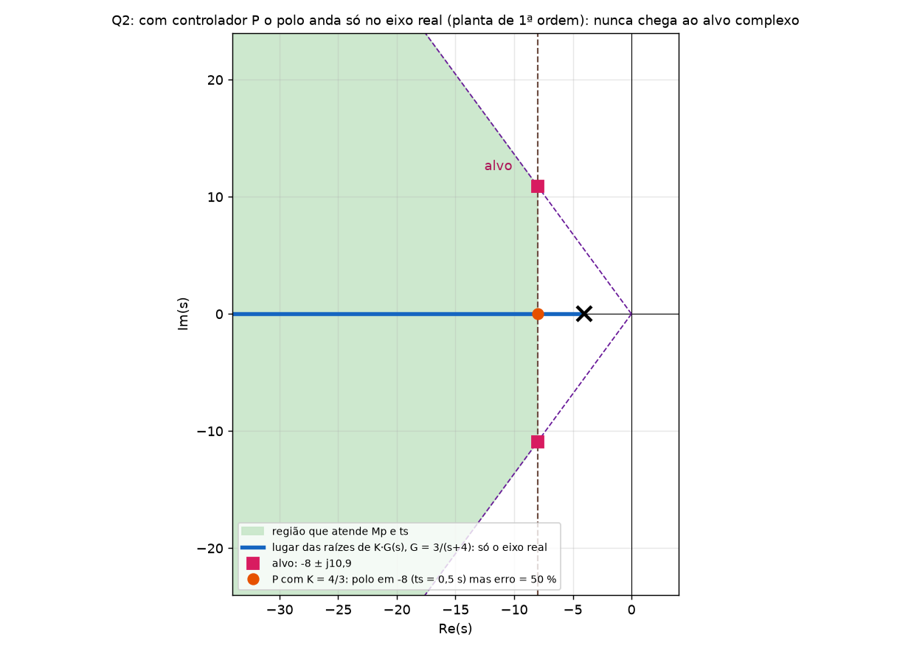
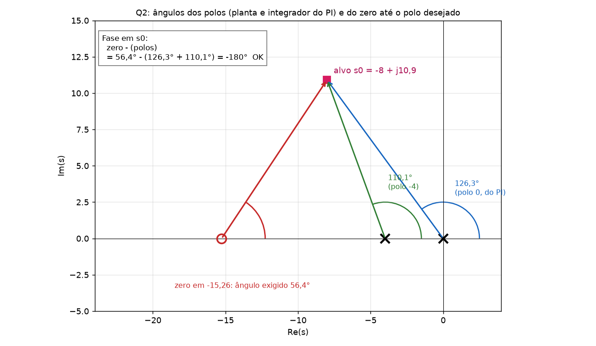
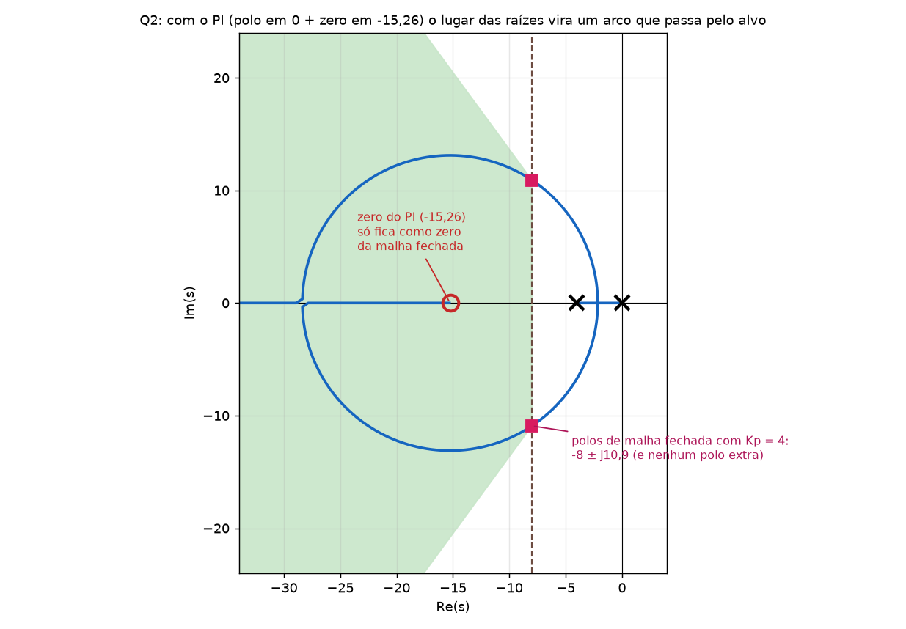
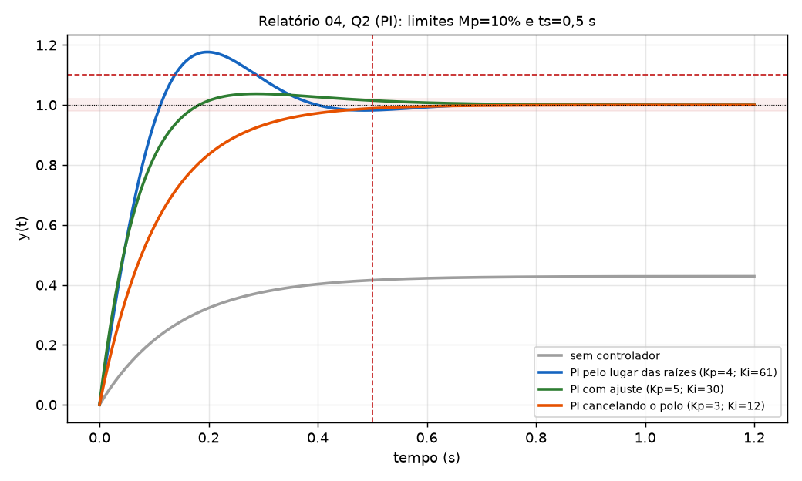

# Relatório 04, Q2 (PI): gabarito com o conteúdo explicado dentro da questão

Mesmo formato do [Gabarito_Q1_PD_Explicado.md](Gabarito_Q1_PD_Explicado.md): em cada passo há o **Conceito** (a teoria, no momento em que é usada) e **Na questão** (as contas com os números do enunciado). Não repito o que é da P1. Teoria completa: [Tutorial_Controle_P2_Completo.md](Tutorial_Controle_P2_Completo.md). Todos os números foram conferidos por simulação.

## Enunciado

> Projete um controlador **PI** para que o sistema tenha **overshoot máximo de 10 %** e **tempo de acomodação (2 %) máximo de 0,5 s** para entrada degrau unitário.
> Planta: **`G(s) = 3/(s+4)`**, realimentação unitária negativa.

## Passo 0: o que é o PI e o que a questão pede

**Conceito.** O PI soma uma parte proporcional a uma parte **integral**:

`C(s) = Kp + Ki/s = Kp·(s + z)/s`, com `z = Ki/Kp`

Em termos de polos e zeros, ele acrescenta **um polo na origem** (o integrador) e **um zero em `−z`**. O integrador **acumula o erro**: enquanto houver erro, a saída do controlador continua crescendo, e só para quando o erro chega a zero. Por isso o PI **zera o erro ao degrau** (o sistema passa de tipo 0 para tipo 1). O custo é que o polo na origem **atrasa a fase em 90°** e deixa o sistema **mais oscilatório e mais lento**. O zero existe para compensar parte desse atraso.

**Na questão.** Precisamos achar `z` e `Kp` (e daí `Ki = z·Kp`) para que a malha fechada atenda **Mp ≤ 10 %** e **ts ≤ 0,5 s**.

---

## Passo 1: o alvo `s₀`

**Conceito.** Igual ao da Q1: Mp e ts fixam um **ponto** no plano s onde o par de polos dominantes deve ficar (cone de `ζmin` e reta vertical `Re = −σ`). Formulário: `ζmin` do `ln(Mp)`, `σ = 4/ts`, `ωn = σ/ζ`, `ωd = ωn·√(1−ζ²)`.

**Na questão.**

| Passo | Conta | Valor |
|---|---|---|
| `ζmin` | `ln 0,10 = −2,303`; `ζ = 2,303/√(π² + 2,303²)` | **0,591** |
| `σ` | `4/0,5` | **8** |
| `ωn` | `8/0,591` | 13,53 |
| `ωd` | `13,53·√(1 − 0,591²)` | **10,915** |

**Alvo: `s₀ = −8 ± j10,915`.**

---

## Passo 2: dá para resolver só mudando o ganho (controlador P)?

**Conceito.** Com um controlador P, o polo de malha fechada percorre o **lugar das raízes de `K·G(s)`**. Aqui a planta é de **1ª ordem**, então o lugar é só uma semirreta do eixo real: **um polo real**, que **nunca** vai a um ponto complexo como `s₀`. Pela condição de fase: o ângulo do único polo até `s₀` é `110,1°`, e a condição pede `180°`: o alvo **não está no lugar**.

**Na questão.** **Conferência pela fase (é o teste do passo 2).** Ângulo do único polo da planta (em −4) até `s₀ = −8 + j10,915`: o vetor `s₀ − (−4) = (−4, 10,915)` aponta para a esquerda e para cima, então `180° − tan⁻¹(10,915/4) = 180° − 69,9° = 110,1°`. A fase de `K·G(s₀)` é **−110,1°**, e o lugar das raízes exige **−180°**. Faltam **69,9°**, então `s₀` **não pertence** ao lugar de `K·G`: com `K > 0` a fase em `s₀` é sempre −110,1°, e nenhum ganho leva o polo até lá.

Com P, `T(s) = 3K/(s + 4 + 3K)`: um polo em `−(4 + 3K)`, sem overshoot. Dá para atender os dois requisitos numéricos do enunciado:

- ts = 0,5 s exige o polo em −8: `4 + 3K = 8` → `K = 4/3`; Mp = 0.

**Mas há um problema: o erro.** O valor final de `y` é `3K/(4 + 3K) = 4/8 = 0,5`: o erro ao degrau seria **50 %**. Para ter erro de 5 % com P, `K ≥ 25` (polo em −80), com ganho altíssimo. O **PI zera o erro**, e é por isso que a questão pede um PI.



(Observação: o enunciado desta Q2 não escreve "erro zero" como o da Aula 14, mas a razão de ser do PI é essa. Projetamos o PI para os polos dominantes complexos em `−8 ± j10,9`, mantendo o erro zero.)

---

## Passo 3: o zero do PI pela condição de fase

**Conceito.** A condição de fase em `s₀` é `θz − Σ θpolos = −180°`, e o zero entra com sinal + e os polos com sinal −. A diferença em relação ao PD: **o PI traz um polo extra na origem, que entra na soma**.

`θz = Σ θpolos − 180°`, com `Σ θpolos` incluindo o polo da **planta** e o polo **em 0** do PI.

Ângulos (vetor `s₀ − p`, anti-horário a partir do eixo real positivo). Como os dois polos estão **à direita** de `s₀` (parte real −8), os dois ângulos passam de 90° e usam a fórmula `180° − tan⁻¹(...)`.

**Na questão.**

| Polo | Vetor `s₀ − p` | Conta | Ângulo |
|---|---|---|---|
| 0 (do PI) | `(−8, 10,915)` | `180° − tan⁻¹(10,915/8)` | **126,3°** |
| −4 (da planta) | `(−4, 10,915)` | `180° − tan⁻¹(10,915/4)` | **110,1°** |
| **Soma** | | | **236,4°** |

`θz = 236,4° − 180° = 56,4°`

Pelo triângulo: `tan θz = ωd/(z − σ)` → `z = σ + ωd/tan θz = 8 + 10,915/1,505 = 8 + 7,25 =` **15,26**

**O zero do PI fica em −15,26.**



Conferência: `56,4° − (126,3° + 110,1°) = 56,4° − 236,4° = −180°` ✔.

---

## Passo 4: o ganho `Kp` pela condição de módulo

**Conceito.** Como na Q1: o ganho faz o polo cair **exatamente** em `s₀`: `|C(s₀)G(s₀)| = 1`, ou seja,

`Kp = |s₀|·|s₀+4| / ( 3·|s₀+z| )`

(produto das distâncias aos polos, dividido por `K_G` e pelo produto das distâncias aos zeros). **O polo em 0 do PI entra com `|s₀|`.**

**Na questão.**

| Distância | Conta | Valor |
|---|---|---|
| ao polo 0 | `√(8² + 10,915²)` | 13,53 |
| ao polo −4 | `√(4² + 10,915²)` | 11,62 |
| ao zero −15,26 | `√(7,26² + 10,915²)` | 13,10 |

`Kp = 13,53 × 11,62 / (3 × 13,10) = 157,2/39,3 =` **4,0**

`Ki = z·Kp = 15,26 × 4,0 =` **61,0**

**Controlador projetado:** `C(s) = 4 + 61/s = 4(s + 15,26)/s`.

---

## Passo 5: o que o projeto garante

**Conceito.** Os polos de malha fechada são as raízes de `1 + C·G = 0`. Aqui a planta é de 1ª ordem e o PI acrescenta um polo (integrador): a malha fechada tem **2 polos** (`n = 2`). Como o alvo reserva **os dois**, não sobra "terceiro polo": o par dominante é a resposta completa. Mas há **um zero** (o do PI, em −15,26) que as fórmulas de 2ª ordem não consideram: ele **aumenta o overshoot**.

**Na questão.** O polinômio característico é

`s(s + 4) + 3·(Kp s + Ki) = s² + (4 + 3Kp)s + 3Ki = s² + 16 s + 183`

com raízes `−8 ± j10,9`, exatamente o alvo ✔ (conferência: a soma dos dois polos vale `−(4 + 3Kp) = −16 = 2 × (−8)`).



O lugar das raízes com o PI é um **círculo** centrado no zero (−15,26) que passa pelo alvo. Isso mostra visualmente o efeito do PI: sem ele, o lugar era só uma semirreta real.

---

## Passo 6: simulação

**Conceito.** As fórmulas de 2ª ordem desconsideram o zero. Para saber o Mp e o ts reais, **simule** (`step`, `stepinfo`).

```matlab
clear all
clc
G=tf(3,[1 4])
C1=tf([4 61],[1 0])           % C(s) = (Kp s + Ki)/s
T1=feedback(C1*G,1);
step(T1,1.5); grid
stepinfo(T1)
```

**Na questão.**

| | Mp | ts (2 %) | Atende? |
|---|---|---|---|
| Projeto (`Kp = 4`, `Ki = 61`) | **17,7 %** ✘ | 0,37 s ✔ | **não** (overshoot) |

O tempo de acomodação é ótimo (0,37 s), mas o overshoot é maior que o previsto (10 %). Causa: o **zero em −15,26**.



---

## Passo 7: ajuste fino

**Conceito.** A causa do excesso de overshoot é o **zero**. A tabela de efeitos (Aula 12) diz que `Ki` grande aumenta o overshoot, e o zero está em `z = Ki/Kp`. Duas ideias:

1. O "truque dos slides" (Aula 14): **reduzir o ganho**, mantendo `z`. Aqui isso **piora**: com `Kp = 3,2` e `z = 15,26` (`Ki = 48,8`) o Mp vai a **18,4 %** e o ts a 0,58 s. Por quê? Os polos de malha fechada passam a `−6,8 ± j10,0` (a parte real cai de 8 para 6,8, e o zero continua longe).
2. **Aproximar o zero da origem** (`z` menor) e **subir o ganho**: o zero deixa de "empurrar" o overshoot, e os polos ficam mais afastados do eixo jω.

**Na questão.** `Kp = 5` e `Ki = 30` (zero em `z = 30/5 = 6`):

`C(s) = 5 + 30/s = 5(s + 6)/s`

| | Mp | ts (2 %) | Polos de malha fechada | Atende? |
|---|---|---|---|---|
| **Final** | **3,75 %** ✔ | **0,454 s** ✔ | `s² + 19s + 90` → **−9 e −10** | **sim** |

Os dois polos ficaram **reais** (sem oscilar), então o pouco de overshoot que sobra vem **só do zero em −6**.

### Alternativa: cancelar o polo da planta

O zero do PI pode **cancelar** o polo da planta: com `z = 4`, `C·G = 3Kp(s + 4)/(s(s + 4)) = 3Kp/s`, e a malha fechada vira de **1ª ordem**: `T = 3Kp/(s + 3Kp)`. Com `Kp = 3` (`Ki = 12`): `T = 9/(s + 9)`: **Mp = 0** e `ts = 4/9 = 0,44 s`. Atende, mas só vale se o modelo `3/(s+4)` for exato (cancelamento é frágil).

---

## Passo 8: erro estacionário

**Conceito.** O integrador do PI aumenta o tipo em 1. Uma planta tipo 0 vira **tipo 1**: erro ao degrau **zero**; erro à rampa `1/Kv`.

**Na questão.** `C·G = 3(Kp s + Ki)/(s(s + 4))` → tipo 1.

| | Constante | Erro |
|---|---|---|
| Degrau | `Kp = ∞` | **0** ✔ (a simulação termina em 1,000) |
| Rampa, projeto | `Kv = 3Ki/4 = 45,8` | `0,022` |
| Rampa, final (`Ki = 30`) | `Kv = 22,5` | `0,044` |

---

## Resposta final

> **Projeto:** `C(s) = 4 + 61/s = 4(s + 15,26)/s` (polos −8 ± j10,9; Mp = 17,7 %, ts = 0,37 s).
> **Após ajuste fino:** `C(s) = 5 + 30/s = 5(s + 6)/s`: **Mp = 3,75 %, ts = 0,45 s, erro ao degrau zero.**
> Alternativa por cancelamento: `C(s) = 3 + 12/s`: T = 9/(s + 9), sem overshoot, ts = 0,44 s.

## Conceitos usados e onde estudar

| Passo | Conceito | Onde |
|---|---|---|
| 0 | O que o PI adiciona (polo em 0, zero em −z) | [Tutorial completo §3](Tutorial_Controle_P2_Completo.md#s3) |
| 1 | Alvo `s₀` | [Tutorial completo §1](Tutorial_Controle_P2_Completo.md#s1) |
| 2 | P basta? | [Tutorial completo §6](Tutorial_Controle_P2_Completo.md#s6) |
| 3 | Zero pela fase (com o polo em 0) | [Tutorial completo §4 e §6](Tutorial_Controle_P2_Completo.md#s4) |
| 4 | Ganho pelo módulo | [Tutorial completo §6](Tutorial_Controle_P2_Completo.md#s6) |
| 5 e 6 | Zero do controlador e simulação | [Tutorial completo §7](Tutorial_Controle_P2_Completo.md#s7) |
| 7 | Ajuste fino; cancelamento | [Tutorial completo §6 e §7](Tutorial_Controle_P2_Completo.md#s7) |
| 8 | Erro estacionário | P1 (tipo e constantes) |

## Autoteste

1. Se a especificação fosse **Mp = 15 %** e **ts = 1 s** na mesma planta, qual seria o alvo? (Resposta: `ζ = 0,517`, `σ = 4`, `ωd = 6,62`: `s₀ = −4 ± j6,62`.)
2. Para esse novo alvo, quais os ângulos do polo 0 e do polo −4 até `s₀`? (Resposta: o polo 0 dá `180° − tan⁻¹(6,62/4) = 121,1°`; o polo −4 está exatamente abaixo de `s₀` (mesma parte real −4), então o vetor é vertical e o ângulo é **90°**.)
3. Por que o polo em 0 do PI entra na soma dos ângulos e na condição de módulo? (Resposta: ele faz parte de `C(s)G(s)`: está no denominador, entra como `−θ` na fase e como `|s₀|` no módulo.)
4. Por que reduzir `Kp` (truque dos slides) piorou o overshoot aqui? (Resposta: o zero continua longe da origem e o ganho menor afasta os polos do alvo; o remédio foi aproximar o zero, `z = 6`.)
