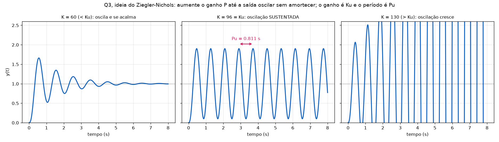
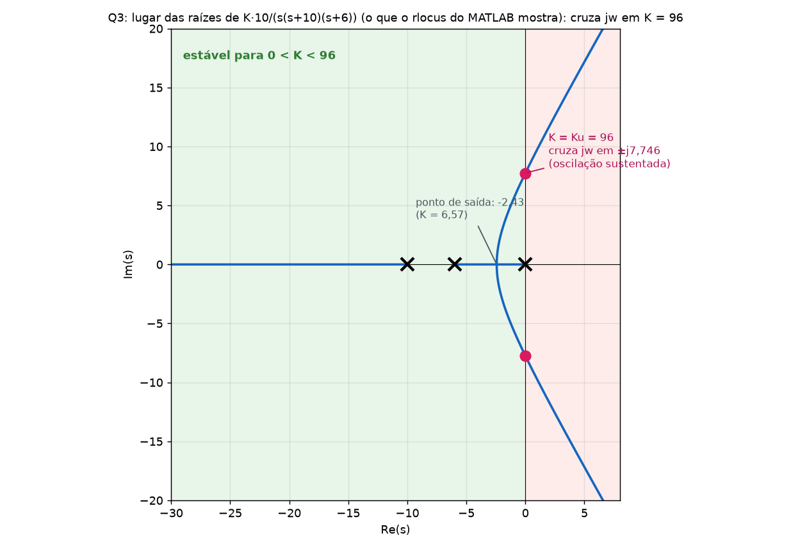
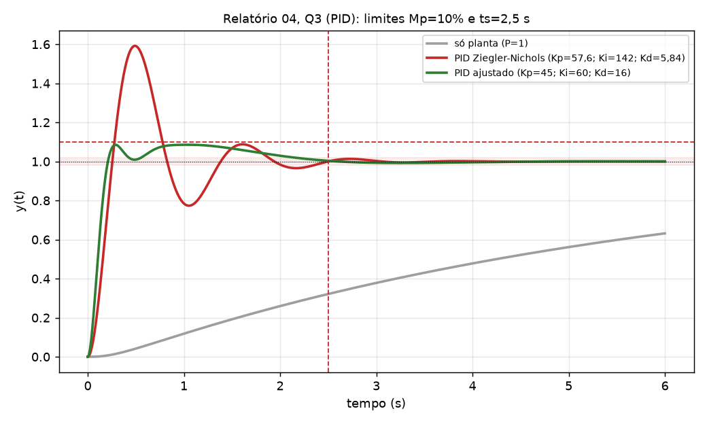

# Relatório 04, Q3 (PID por Ziegler-Nichols): gabarito com o conteúdo explicado dentro da questão

Mesmo formato dos gabaritos [Q1 (PD)](Gabarito_Q1_PD_Explicado.md) e [Q2 (PI)](Gabarito_Q2_PI_Explicado.md): em cada passo há o **Conceito** e **Na questão**. Não repito o que é da P1 (Routh, lugar das raízes, tipo e erro). Todos os números foram conferidos por simulação.

> O método de Ziegler-Nichols de **malha fechada (ganho limite)** está na **Aula 15** dos slides (slides 18 a 24). Lá o ganho crítico se chama `Kcr` e o período `Tcr`; aqui uso `Ku` e `Pu`, que são os mesmos números. O slide 2 avisa que o ZN geralmente dá uma resposta como a de um 2º grau com ζ = 0,21 (Mp ≈ 50,9 %), o que explica o overshoot grande antes do ajuste fino.

## Enunciado

> Projete um controlador **PID** usando o método **ZN de malha fechada** para o sistema abaixo. Calcule os parâmetros **analiticamente** e compare com o **root locus gerado pelo MATLAB**. Faça um **ajuste** para obter **overshoot menor que 10 %** com **tempo de acomodação (2 %) menor que 2,5 s** para entrada degrau unitário.
> Planta: **`G(s) = 10/(s(s+10)(s+6))`**, realimentação unitária negativa.

---

## Passo 0: o que é o PID e por que o Ziegler-Nichols é diferente do PD e do PI

**Conceito.** O PID junta as três ações:

`C(s) = Kp + Ki/s + Kd·s = Kd(s² + (Kp/Kd)s + Ki/Kd)/s`

Ou seja, **um polo em 0** (integrador, zera o erro) e **dois zeros** (a parte D e I juntas), geralmente reais e iguais.

Nas Q1 e Q2 você **calculava** o controlador a partir de um alvo no plano s. Aqui não: o **Ziegler-Nichols (ZN)** é uma **regra empírica** que **mede** o comportamento da planta e **converte** em ganhos por uma tabela. Você não escolhe Mp nem ts; o ZN dá um ponto de partida (agressivo) e depois **se ajusta**.

**Na questão.** Vamos (1) medir `Ku` e `Pu`, (2) usar a tabela do ZN, (3) simular, e (4) ajustar até Mp < 10 % e ts < 2,5 s.

---

## Passo 1: só P e o polinômio característico

**Conceito.** O ZN começa **desligando o I e o D** (`Ki = Kd = 0`), ficando só com o ganho `K`. Aumenta-se `K` até o sistema ficar **no limite da estabilidade**: a saída oscila **sem crescer nem diminuir**. Nesse ponto os polos de malha fechada estão **no eixo jω** (±jω).

**Na questão.** Com `C = K`, a malha fechada é `1 + K·G(s) = 0`:

`s(s + 10)(s + 6) + 10K = 0`  →  **`s³ + 16s² + 60s + 10K = 0`**

---

## Passo 2: o ganho crítico `Ku` (Routh)

**Conceito.** "No limite da estabilidade" = polos em ±jω. Pelo Routh (P1), isso acontece no K que **zera a linha s¹**.

**Na questão.**

| | | |
|---|---|---|
| s³ | 1 | 60 |
| s² | 16 | 10K |
| s¹ | `(16·60 − 10K)/16` | 0 |
| s⁰ | 10K | |

A linha s¹ zera quando `960 − 10K = 0`:

**`Ku = 96`**

Para `K < 96` o sistema é estável; para `K > 96`, instável.

---

## Passo 3: o período crítico `Pu` (equação auxiliar)

**Conceito.** Com `K = Ku`, os polos imaginários puros `±jωu` são as raízes da **equação auxiliar** (a linha s², porque a linha s¹ zerou). A frequência da oscilação sustentada é `ωu` e o **período** é `Pu = 2π/ωu`.

**Na questão.** A linha s² é `[16, 10K]`; com `K = 96`:

`16s² + 10·96 = 0` → `s² = −60` → **`s = ±j7,746`**, `ωu = √60 = 7,746 rad/s`

**`Pu = 2π/7,746 = 0,811 s`**

(O polinômio completo `s³ + 16s² + 60s + 960 = (s + 16)(s² + 60)`, com polos **−16** e **±j7,746** ✔.)

---

## Passo 4: o que `Ku` e `Pu` significam, e a comparação com o root locus

**Conceito.** `Ku` e `Pu` são **medidas**, como se você tivesse feito o experimento real: aumentar o ganho até a planta oscilar e medir o período no osciloscópio. Na simulação:



- `K = 60 < Ku`: a oscilação se **amortece**.
- **`K = 96 = Ku`: oscilação sustentada**, com período `Pu = 0,811 s` (medido entre dois picos) ✔.
- `K = 130 > Ku`: a oscilação **cresce** (instável).

**Comparação com o `rlocus` do MATLAB** (o que o enunciado pede):

```matlab
clear all
clc
G=tf(10,[1 16 60 0])      % 10/(s(s+10)(s+6)): s(s+10)(s+6) = s^3+16 s^2+60 s
rlocus(G)
[K,polos]=rlocfind(G)     % clique no cruzamento com o eixo jw
```



O lugar das raízes cruza o eixo jω em **±j7,746** com **K = 96**: são exatamente o `ωu` e o `Ku` do cálculo analítico. Também aparecem as assíntotas (`σa = −16/3 = −5,33`; ângulos 60°, 180°, 300°) e o ponto de saída em −2,43 (`K = 6,57`), da P1. Se a questão pedir a comparação, é isto: **o cálculo do Routh coincide com o ponto onde o `rlocus` atravessa jω.**

---

## Passo 5: a tabela do ZN e a conversão para `Kp`, `Ki`, `Kd`

**Conceito.** Com `Ku` e `Pu`, a tabela do ZN (malha fechada) dá, para PID, o ganho `Kp` e **dois tempos**:

| `Kp` | `Ti` (tempo integral) | `Td` (tempo derivativo) |
|---|---|---|
| `0,6·Ku` | `Pu/2` | `Pu/8` |

O PID nessa forma é `C(s) = Kp·(1 + 1/(Ti·s) + Td·s)`. Para a forma paralela dos slides, `C(s) = Kp + Ki/s + Kd·s`, comparando termos:

**`Ki = Kp/Ti`** e **`Kd = Kp·Td`**

**Na questão.**

| Parâmetro | Conta | Valor |
|---|---|---|
| `Kp` | `0,6 × 96` | **57,6** |
| `Ti` | `0,811/2` | 0,406 s |
| `Td` | `0,811/8` | 0,1014 s |
| `Ki` | `57,6/0,406` | **142,0** |
| `Kd` | `57,6 × 0,1014` | **5,84** |

`C(s) = 57,6 + 142/s + 5,84 s`.

**Curiosidade (confere com a Aula 12):** como `Ti = 4·Td`, os dois zeros do PID ficam **reais e iguais**, em `−1/(2Td) = −4,93` (raízes de `5,84s² + 57,6s + 142`: `−4,93` e `−4,93`), exatamente o "polo na origem e **2 zeros, geralmente reais e iguais**" do slide.

---

## Passo 6: simular o ZN

**Conceito.** O ZN **não** é projetado para atender um Mp ou ts: ele é calibrado para uma resposta "rápida e bem amortecida em média" (decaimento de 1/4 por oscilação), o que costuma dar **overshoot de 40 a 60 %**. É um ponto de partida.

```matlab
C=tf([5.84 57.6 142.0],[1 0]);     % (Kd s^2 + Kp s + Ki)/s
T=feedback(C*G,1);
step(T,6); grid; stepinfo(T)
```

**Na questão.**

| | Mp | ts (2 %) | Polos de malha fechada | Atende (Mp < 10 %, ts < 2,5 s)? |
|---|---|---|---|---|
| **ZN** | **59 %** ✘ | 2,34 s ✔ | −1,70 ± j5,64 e −6,30 ± j1,11 (estável) | **não** (overshoot) |

---

## Passo 7: ajuste fino (usando a tabela de efeitos)

**Conceito.** A tabela da Aula 12 diz o que cada ganho faz:

| Aumentar | Overshoot | ts | Erro |
|---|---|---|---|
| `Kp` | aumenta | pouco | diminui |
| `Ki` | aumenta | aumenta | anula |
| `Kd` | **diminui** | **diminui** | sem impacto |

Como o problema é overshoot, o remédio é **aumentar `Kd`** e **diminuir `Ki`**. Mexa **um ganho de cada vez** para ver o efeito (e não perder o controle):

| Alteração em relação ao ZN | Mp | ts | Observação |
|---|---|---|---|
| ZN (57,6; 142; 5,84) | 59,2 % | 2,34 s | ponto de partida |
| só `Kd`: 5,84 → **16** | **19,3 %** | 2,14 s | **grande efeito** no overshoot |
| só `Ki`: 142 → **60** | **39,8 %** | 1,72 s | reduz overshoot e ts |
| só `Kp`: 57,6 → 45 | 57,8 % | 3,44 s | quase nada no overshoot (piora o ts) |
| `Kd` e `Ki` juntos (57,6; 60; 16) | 14,1 % | 2,02 s | quase lá |
| **os três** (45; 60; 16) | **8,6 %** | **2,15 s** | **atende** |

**Na questão.** Conjunto escolhido:

`Kp = 45`, `Ki = 60`, `Kd = 16`  →  **`C(s) = 45 + 60/s + 16 s`**

| | Mp | ts (2 %) | Polos de malha fechada | Atende? |
|---|---|---|---|---|
| **Ajustado** | **8,6 %** ✔ | **2,15 s** ✔ | −6,91 ± j11,79 e −1,09 ± j1,43 | **sim** |



**Observações.**

- Este é **um** conjunto possível; outros próximos também atendem (por exemplo, `45; 50; 14` dá 8,6 % e 2,23 s).
- O par dominante (−1,09 ± j1,43, o mais perto do eixo jω) prevê `ts ≈ 3,7 s` pelas fórmulas de 2ª ordem, mas o simulado é 2,15 s. É que os **zeros do PID** (`16s² + 45s + 60`: `−1,41 ± j1,33`, perto do par dominante) cancelam parte do efeito. É de novo o ponto de que as fórmulas de 2ª ordem são **aproximações** (polos dominantes, Aula 10).
- `Kd = 16` é bem maior que o do ZN: na prática o derivador **amplifica ruído** e pede um polo de filtro (Aula 13, p.4).

---

## Passo 8: erro estacionário

**Conceito.** O PID tem um integrador. A planta já tem um polo em 0 (tipo 1). O sistema com PID é **tipo 2**: erro zero ao **degrau** e à **rampa**; erro finito à parábola `1/Ka`, com `Ka = lim s²·C·G = Ki·10/(10·6) = Ki/6`.

**Na questão.**

| | Degrau | Rampa | Parábola |
|---|---|---|---|
| Final (`Ki = 60`) | **0** | **0** | `1/Ka = 1/10 = 0,1` |
| ZN (`Ki = 142`) | 0 | 0 | `1/23,7 = 0,042` |

A simulação termina em `y = 1,000` ✔.

---

## Resposta final

> **ZN:** `Ku = 96`, `Pu = 0,811 s` → `Kp = 57,6`, `Ti = 0,406 s`, `Td = 0,1014 s` → `Ki = 142`, `Kd = 5,84`; `C(s) = 57,6 + 142/s + 5,84 s` (Mp = 59 %, ts = 2,34 s). O `rlocus` cruza o eixo jω em **±j7,75** com **K = 96**, igual ao cálculo analítico.
> **Ajustado:** `C(s) = 45 + 60/s + 16 s` (`Kp = 45`, `Ki = 60`, `Kd = 16`): **Mp = 8,6 %, ts = 2,15 s**, erro ao degrau e à rampa zero.

## Conceitos usados e onde estudar

| Passo | Conceito | Onde |
|---|---|---|
| 0 | PID: polo em 0 e dois zeros | [Tutorial completo §3](Tutorial_Controle_P2_Completo.md#s3) |
| 1 a 3 | `Ku` e `Pu` por Routh e equação auxiliar | [Tutorial completo §8](Tutorial_Controle_P2_Completo.md#s8) (e Routh na P1) |
| 4 | Comparação com o `rlocus` | [Tutorial completo §8.4](Tutorial_Controle_P2_Completo.md#s8) |
| 5 | Tabela ZN e conversão `Ti`, `Td` → `Ki`, `Kd` | [Tutorial completo §8.3](Tutorial_Controle_P2_Completo.md#s8) |
| 6 e 7 | Simulação e ajuste fino | [Tutorial completo §7 e §8.5](Tutorial_Controle_P2_Completo.md#s7) |
| 8 | Erro estacionário (tipo 2) | P1 |

## Autoteste

1. Se a planta fosse `G = 20/(s(s+10)(s+6))`, qual seria o `Ku`? (Resposta: o polinômio vira `s³ + 16s² + 60s + 20K`: a linha s¹ zera com `960 = 20K` → `Ku = 48`; `ωu` continua `√60 = 7,746`, `Pu = 0,811 s`.)
2. Qual é a diferença entre `Ti`, `Td` e `Ki`, `Kd`? (Resposta: `Ti` e `Td` são **tempos** na forma `Kp(1 + 1/(Ti s) + Td s)`; `Ki = Kp/Ti` e `Kd = Kp·Td` são os ganhos da forma paralela `Kp + Ki/s + Kd s`.)
3. Por que o overshoot de 59 % do ZN não é um erro de conta? (Resposta: o ZN é uma regra empírica agressiva; o enunciado pede o ajuste justamente por isso.)
4. Na tabela de efeitos, qual ganho mais reduziu o overshoot sozinho? (Resposta: `Kd`, de 59 % para 19 %.)
