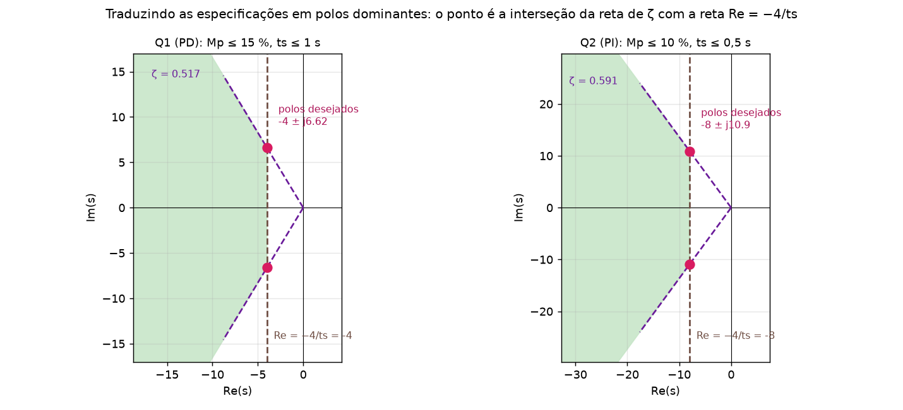
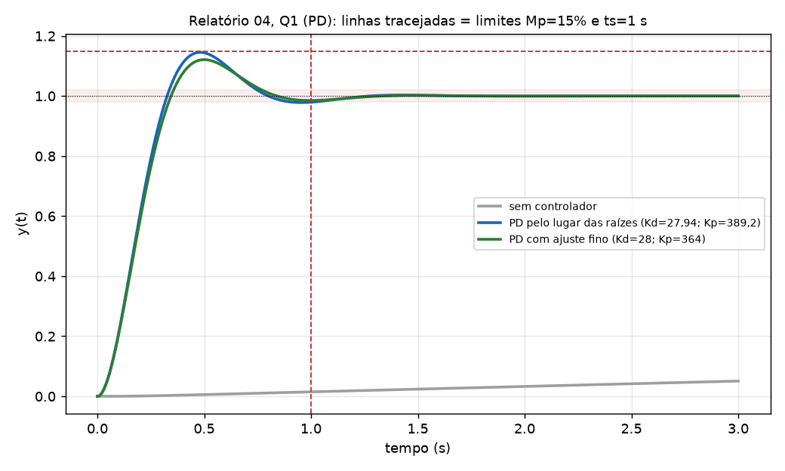
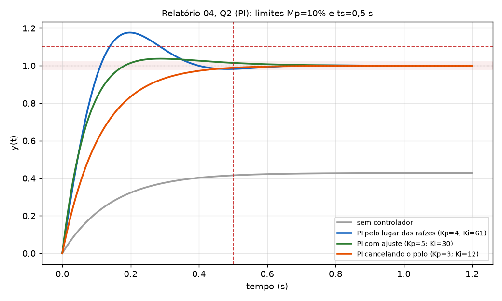
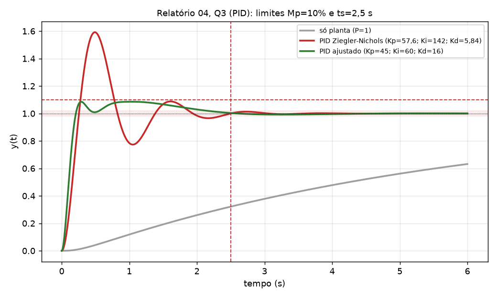

# Gabarito comentado: Relatório 04 (PD, PI e PID/Ziegler-Nichols)

Segue os passos da Aula 13 (PD) e da Aula 14 (PI). Receitas em [Tutorial_Controle_P2.md](Tutorial_Controle_P2.md); teoria em [Resumo_Controle_P2.md](Resumo_Controle_P2.md). **Todos os números abaixo foram conferidos por simulação** (resposta ao degrau por Python/SciPy); **não rodei o MATLAB**, mas o código no fim está no formato dos slides.

Convenção: realimentação unitária negativa; `C(s)` é o controlador e `G(s)` a planta; `E = X − Y`. Lembre das duas formas: `C = Kp + Ki/s + Kd·s`, e `C = Kd(s + z)` (PD) ou `Kp(s + z)/s` (PI).



---

## Q1: PD para `G(s) = 2/(s(s+12)(s+9))`, Mp ≤ 15 %, ts (2 %) ≤ 1 s

> **Versão com o conteúdo explicado dentro da questão (conceito + aplicação em cada passo):** [Gabarito_Q1_PD_Explicado.md](Gabarito_Q1_PD_Explicado.md).

### Passo 1: polos dominantes desejados

- `Mp = 0,15` → `ln 0,15 = −1,897` → **`ζmin = 1,897/√(π² + 1,897²) = 0,517`**.
- `ts = 4/(ζωn) = 1` → **`ζωn = 4`** → `ωn = 4/0,517 = 7,738 rad/s`.
- `ωd = 7,738·√(1 − 0,517²) = 7,738 × 0,856 = 6,624`.
- **Polos desejados: `s₀ = −4 ± j6,624`.**

### Passo 2: só P resolve?

Ângulos dos polos de `G` (em 0, −9 e −12) até `s₀ = −4 + j6,624`:

| Polo | Vetor `s₀ − p` | Ângulo |
|---|---|---|
| 0 | `(−4, 6,624)` | `180° − 58,9° = 121,1°` |
| −9 | `(5, 6,624)` | `52,9°` |
| −12 | `(8, 6,624)` | `39,6°` |
| **Soma** | | **213,6° (≈ 213,7°)** |

A condição de fase pede `−180°`, mas a soma dos ângulos dá **213,7° ≠ 180°**: `s₀` **não está no lugar das raízes** de `K·G`. Só P (variar K) não leva a esses polos → **PD necessário.**

### Passo 3: o zero do PD (condição de fase)

`C(s)G(s) = 2Kd(s + z)/(s(s+9)(s+12))` e a fase em `s₀` precisa ser −180°:

`θz − 213,7° = −180°` → **`θz = 33,7°`**

Pelo triângulo do zero em −z até `s₀`: `tan θz = ωd/(z − σ)` →

`z = σ + ωd/tan θz = 4 + 6,624/0,6665 = 13,94`

### Passo 4: o ganho (condição de módulo)

`|C(s₀)G(s₀)| = 1`:

`Kd = |s₀|·|s₀+9|·|s₀+12| / (2·|s₀+z|)`

- `|s₀| = √(16 + 43,9) = 7,74`
- `|s₀ + 9| = √(25 + 43,9) = 8,30`
- `|s₀ + 12| = √(64 + 43,9) = 10,39`
- `|s₀ + 13,94| = √(98,8 + 43,9) = 11,94`

`Kd = 7,74 × 8,30 × 10,39 / (2 × 11,94) = 667,3/23,88 = 27,94`

**`Kd = 27,94`, `Kp = z·Kd = 13,94 × 27,94 = 389,2`.**

**Controlador projetado:** `C(s) = 27,94 s + 389,2 = 27,94(s + 13,94)`.

### Passo 5: constante de erro

`C(s)G(s)` tem o polo em 0 da planta: tipo 1. `Kv = lim s·C·G = Kp·2/(12·9) = 389,2·2/108 = 7,2`.

- Erro ao **degrau: 0** (tipo 1).
- Erro à **rampa: 1/Kv = 0,14**.

### Passo 6: simulação

Malha fechada: `s(s+12)(s+9) + 2Kd(s + z)`. Polos de malha fechada: **−13**, **−4 ± j6,62**. O zero do controlador (−13,94) fica **quase em cima** do polo −13, então se cancelam e o sistema se comporta como o de 2ª ordem projetado.

| | Mp | ts (2 %) | Atende? |
|---|---|---|---|
| Projeto (Kd = 27,94; Kp = 389,2) | **14,5 %** | **1,013 s** | Mp sim; **ts passa 1 s por pouco** |

### Passo 7: ajuste fino

O ts passou de 1 s por 0,013 s. Mantém o conceito: ajusta ganhos mantendo o zero próximo. Opção que atende:

**`Kd = 28`, `Kp = 364`** (zero em `z = 364/28 = 13`), `C(s) = 28s + 364 = 28(s + 13)`.

| | Mp | ts (2 %) | Polos de malha fechada |
|---|---|---|---|
| **Final** | **12,1 %** ✔ | **0,77 s** ✔ | −12,56 e −4,22 ± j6,34 |

(Mover o zero um pouco para perto da origem aumenta a ação derivativa e acelera a resposta; o ganho `Kd` sobe de leve.)



### Observação prática

Um derivador puro amplifica ruído: na implementação, `C(s) = (Kp + Kd s)/(1 + s/a)` com `a` grande (ex.: 10 vezes o zero).

### Resposta

> `C(s) = 27,9 s + 389` (PD de projeto, polos dominantes −4 ± j6,62), e **após ajuste fino `C(s) = 28 s + 364`**, que dá Mp = 12,1 % e ts = 0,77 s.

---

## Q2: PI para `G(s) = 3/(s+4)`, Mp ≤ 10 %, ts (2 %) ≤ 0,5 s

> **Versão com o conteúdo explicado dentro da questão (conceito + aplicação em cada passo):** [Gabarito_Q2_PI_Explicado.md](Gabarito_Q2_PI_Explicado.md).

### Passo 1: polos dominantes

- `Mp = 0,10` → `ln 0,10 = −2,303` → **`ζmin = 2,303/√(π² + 2,303²) = 0,591`**.
- `ts = 4/(ζωn) = 0,5` → **`ζωn = 8`** → `ωn = 8/0,591 = 13,53`.
- `ωd = 13,53·√(1 − 0,591²) = 13,53 × 0,807 = 10,91`.
- **Polos desejados: `s₀ = −8 ± j10,91`.**

### Passo 2: só P resolve?

Conferência pela fase: o polo em −4 até `s₀ = −8 + j10,915` dá `180° − 69,9° = 110,1°`; a fase de `K·G(s₀)` é `−110,1° ≠ −180°` (faltam 69,9°), então `s₀` **não pertence** ao lugar de `K·G`. Em outras palavras, com P, a planta de **1ª ordem** tem **um único polo, real** (`s = −4 − 3Kp`), que **nunca** vai ao alvo complexo `−8 ± j10,9`. Dá para atender os números do enunciado só com P (`Kp = 4/3` põe o polo em −8: ts = 0,5 s, Mp = 0), **mas** o valor final seria `3Kp/(4 + 3Kp) = 0,5`, ou seja, **erro de 50 %** ao degrau. O **PI** é o que zera o erro, e é por isso que a questão pede um PI.

### Passo 3: o zero do PI (condição de fase)

`C(s)G(s) = 3Kp(s + z)/(s(s+4))`. Ângulos até `s₀ = −8 + j10,91`:

| Polo | Vetor | Ângulo |
|---|---|---|
| 0 (do PI) | `(−8, 10,91)` | `180° − 53,7° = 126,3°` |
| −4 (da planta) | `(−4, 10,91)` | `180° − 69,9° = 110,1°` |
| **Soma** | | **236,4°** |

`θz − 236,4° = −180°` → **`θz = 56,4°`** →

`z = σ + ωd/tan θz = 8 + 10,91/1,505 = 15,26`

### Passo 4: o ganho

`Kp = |s₀|·|s₀+4| / (3·|s₀+z|)`:

- `|s₀| = 13,53`; `|s₀+4| = √(16 + 119) = 11,62`; `|s₀+15,26| = √(52,7 + 119) = 13,10`.

`Kp = 13,53 × 11,62 / (3 × 13,10) = 4,0`; **`Ki = z·Kp = 15,26 × 4,0 = 61,0`.**

**Controlador projetado:** `C(s) = 4 + 61/s = 4(s + 15,26)/s`.

### Passo 5: simulação do projeto

Polos de malha fechada: `s² + (4 + 3Kp)s + 3Ki = s² + 16s + 183` → **−8 ± j10,9** ✔ (exatamente os desejados). Mas:

| | Mp | ts (2 %) | Atende? |
|---|---|---|---|
| Projeto (Kp = 4; Ki = 61) | **17,7 %** | 0,37 s | **não** (Mp > 10 %) |

O overshoot passou do previsto porque o **zero do PI em −15,26** adiciona overshoot ao 2º grau.

### Passo 6: ajuste fino

Aqui o ajuste do slide (reduzir Kp) **piora** (Kp = 3,2 e z = 15,26 dá Mp = 18,4 %, ts = 0,58 s). O que resolve é **aproximar o zero da origem** (z menor, o integrador menos dominante) e **subir Kp**:

**`Kp = 5`, `Ki = 30`** (z = 6): `C(s) = 5 + 30/s = 5(s + 6)/s`.

| | Mp | ts (2 %) | Polos de malha fechada |
|---|---|---|---|
| **Final** | **3,75 %** ✔ | **0,454 s** ✔ | **−9 e −10** (`s² + 19s + 90`) |

Os dois polos ficaram reais, então o pouco de overshoot vem **só do zero em −6**.

### Alternativa (cancelamento do polo)

Escolher `z = 4` **cancela o polo da planta**: `Kp = 3`, `Ki = 12` → `C·G = 9/s` → `T = 9/(s + 9)`: **1ª ordem**, `ts = 4/9 = 0,44 s`, **Mp = 0**. Atende, mas só vale se o modelo `3/(s+4)` for exato (cancelamento é frágil).



### Erro

Tipo 1: erro ao degrau **zero** ✔ (para qualquer um dos projetos acima).

### Resposta

> `C(s) = 4 + 61/s` (projeto, polos −8 ± j10,9); após ajuste fino, **`C(s) = 5 + 30/s`** (Mp = 3,75 %, ts = 0,45 s, erro zero).

---

## Q3: PID por Ziegler-Nichols de malha fechada, `G(s) = 10/(s(s+10)(s+6))`

> **Versão com o conteúdo explicado dentro da questão (conceito + aplicação em cada passo):** [Gabarito_Q3_PID_Explicado.md](Gabarito_Q3_PID_Explicado.md).

(O método ZN de malha fechada está na **Aula 15** dos slides, slides 18 a 24; `Ku` e `Pu` aqui são o `Kcr` e o `Tcr` de lá.)

### Passo 1: só P, polinômio característico

Com `C = K` (só P): `1 + K·G = 0` → `s(s+10)(s+6) + 10K = 0` →

**`s³ + 16s² + 60s + 10K = 0`**

### Passo 2: ganho crítico (Routh)

| | | |
|---|---|---|
| s³ | 1 | 60 |
| s² | 16 | 10K |
| s¹ | `(16·60 − 10K)/16` | 0 |
| s⁰ | 10K | |

A linha s¹ zera quando `960 − 10K = 0` → **`Ku = 96`**.

### Passo 3: período crítico (equação auxiliar, linha s²)

Com `K = 96`: `16s² + 10·96 = 0` → `s² = −60` → **`s = ±j7,746`**, `ωu = √60 = 7,746 rad/s` →

**`Pu = 2π/ωu = 0,811 s`**

### Passo 4: sintonia ZN para PID

| Parâmetro | Fórmula | Valor |
|---|---|---|
| `Kp` | `0,6·Ku` | **57,6** |
| `Ti` | `Pu/2` | **0,406 s** |
| `Td` | `Pu/8` | **0,1014 s** |
| `Ki` | `Kp/Ti` | **142,0** |
| `Kd` | `Kp·Td` | **5,84** |

`C(s) = 57,6 + 142/s + 5,84 s`.

### Passo 5: comparar com o lugar das raízes do MATLAB

`rlocus(G)` com `G = 10/(s(s+10)(s+6))`. O lugar tem 3 ramos (polos 0, −6, −10), `n − m = 3`: assíntotas em 60°, 180°, 300°, com `σa = (0−6−10)/3 = −5,33`. O ponto de saída é `s = −2,43` (K = 6,57), e o lugar **cruza o eixo jω em ±j7,746 com K = 96**: é **exatamente o `Ku` e o `ωu` do passo 2/3**. No MATLAB: clicar no cruzamento (`[K,polos] = rlocfind(G)`) retorna Gain ≈ 96 e frequência ≈ 7,75 rad/s.

### Passo 6: simulação do ZN

Polos de malha fechada com o PID ZN: −1,70 ± j5,64 e −6,30 ± j1,11 (estável).

| | Mp | ts (2 %) | Atende (Mp < 10 %, ts < 2,5 s)? |
|---|---|---|---|
| ZN (57,6; 142; 5,84) | **59 %** | 2,34 s | **não** (Mp) |

O ZN é agressivo: o overshoot alto é típico do método.

### Passo 7: ajuste fino (tabela de efeitos da Aula 12)

- **Aumentar Kd** (diminui overshoot e ts).
- **Reduzir Kp** (diminui o overshoot).
- **Reduzir Ki** (Ki grande aumenta overshoot e ts).

Conjunto que atende: **`Kp = 45`, `Ki = 60`, `Kd = 16`**, `C(s) = 45 + 60/s + 16 s`.

| | Mp | ts (2 %) | Polos de malha fechada |
|---|---|---|---|
| **Ajustado** | **8,6 %** ✔ | **2,15 s** ✔ | −6,9 ± j11,8 e −1,09 ± j1,43 |

(É um entre vários conjuntos possíveis; outros valores próximos também atendem, por exemplo `Kp = 45, Ki = 50, Kd = 14` dá 8,6 % e 2,23 s.) O erro ao degrau é **zero** (o PID tem um integrador).



### Resposta

> **ZN:** `Ku = 96`, `Pu = 0,811 s`; `Kp = 57,6`, `Ki = 142`, `Kd = 5,84` (Mp = 59 %). **Ajustado:** `Kp = 45`, `Ki = 60`, `Kd = 16` (Mp = 8,6 %, ts = 2,15 s).

---

## Código MATLAB (no formato dos slides)

```matlab
%% Q1: PD
clear all
clc
G=tf(2,[1 21 108 0])          % 2/(s(s+12)(s+9)): s(s+12)(s+9) = s^3+21 s^2+108 s
C1=tf([27.94 389.2],1)        % projeto pelo lugar das raizes
C2=tf([28 364],1)             % ajuste fino
T1=feedback(C1*G,1);
T2=feedback(C2*G,1);
step(T1,3); hold on; step(T2,3); grid
stepinfo(T1), stepinfo(T2)    % Overshoot e SettlingTime (2%)

%% Q2: PI
clear all
clc
G=tf(3,[1 4])
C1=tf([4 61],[1 0])           % projeto
C2=tf([5 30],[1 0])           % ajuste fino
T1=feedback(C1*G,1);
T2=feedback(C2*G,1);
step(T1,1.5); hold on; step(T2,1.5); grid
stepinfo(T1), stepinfo(T2)

%% Q3: PID Ziegler-Nichols
clear all
clc
G=tf(10,[1 16 60 0])          % 10/(s(s+10)(s+6))
rlocus(G)                     % cruza jw em K = 96, w = 7,75
[K,polos]=rlocfind(G)         % clique no cruzamento
Ku=96; Pu=2*pi/sqrt(60);
Kp=0.6*Ku; Ti=Pu/2; Td=Pu/8;
Ki=Kp/Ti; Kd=Kp*Td            % 57,6; 142,0; 5,84
C=tf([Kd Kp Ki],[1 0]);       % C = Kd s^2 + Kp s + Ki sobre s
Cf=tf([16 45 60],[1 0]);      % ajustado
T=feedback(C*G,1);
Tf=feedback(Cf*G,1);
step(T,6); hold on; step(Tf,6); grid
stepinfo(T), stepinfo(Tf)
```

---

## Resumo das respostas

| Questão | Controlador de projeto | Controlador final (após ajuste fino) | Desempenho final |
|---|---|---|---|
| Q1 PD | `27,94 s + 389,2` (polos −4 ± j6,62; Mp 14,5 %, ts 1,01 s) | `28 s + 364` | Mp 12,1 %, ts 0,77 s |
| Q2 PI | `4 + 61/s` (polos −8 ± j10,9; Mp 17,7 %) | `5 + 30/s` (ou `3 + 12/s`, cancelando o polo) | Mp 3,75 %, ts 0,45 s |
| Q3 PID (ZN) | `57,6 + 142/s + 5,84 s` (Ku = 96, Pu = 0,811 s; Mp 59 %) | `45 + 60/s + 16 s` | Mp 8,6 %, ts 2,15 s |
