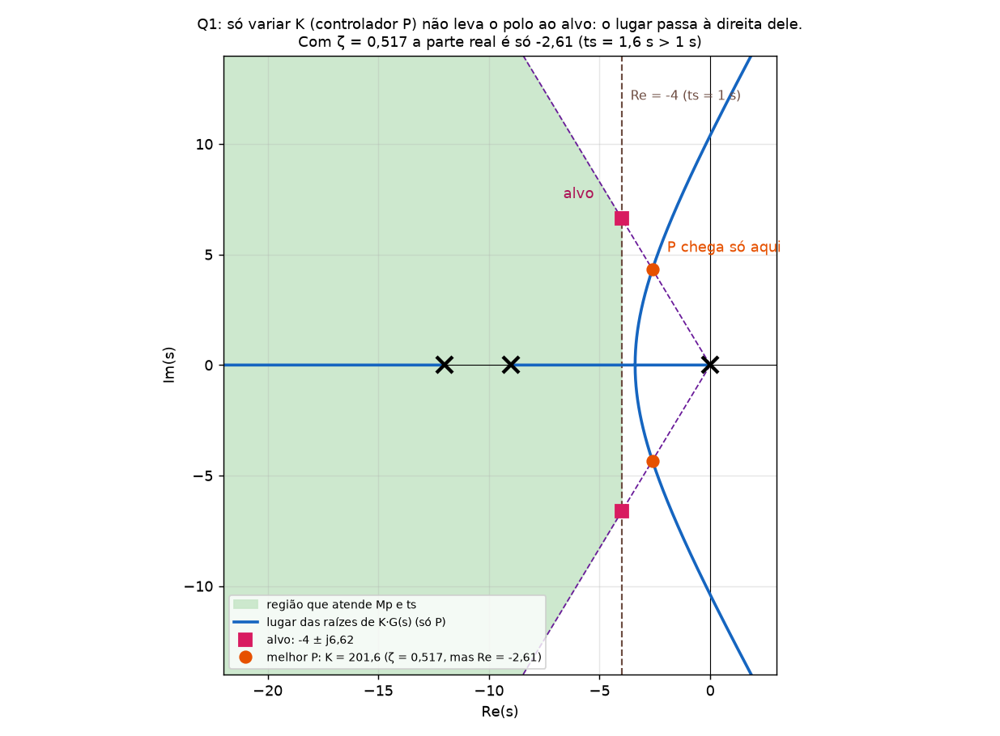
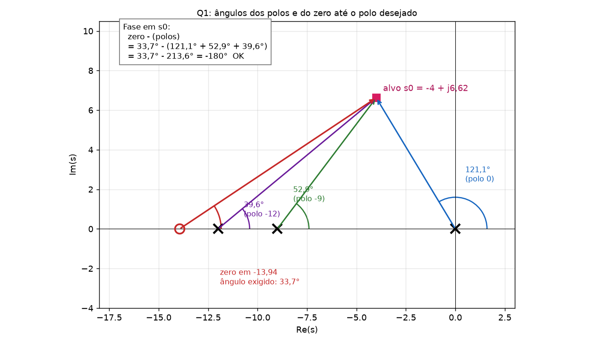
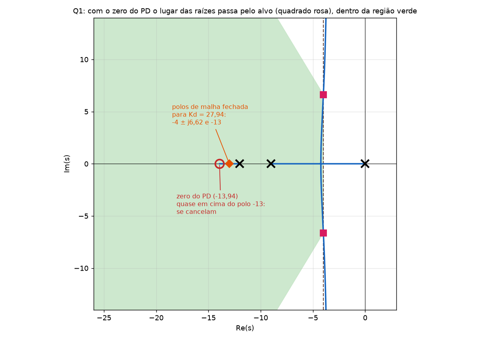
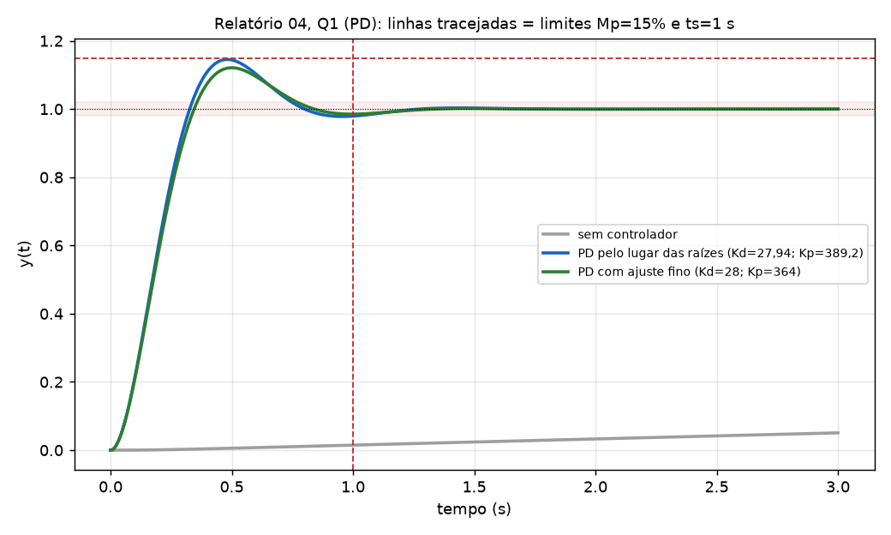

# Relatório 04, Q1 (PD): gabarito com o conteúdo explicado dentro da questão

Aqui a teoria **aparece no momento em que é usada**. Cada passo tem duas partes:

- **Conceito:** o que é, de onde vem e por que se faz assim.
- **Na questão:** a conta com os números do enunciado.

Não repito o que foi coberto na P1 (fórmulas de ζ e ts, condições de fase e módulo do lugar das raízes, tipo e erro). O resumo geral está em [Gabarito_Relatorio04.md](Rel04_Resumo_das_3_questoes_com_MATLAB.md), a explicação completa da matéria em [Tutorial_Controle_P2_Completo.md](../Tutorial_Controle_P2_Completo.md) e os exercícios em [Exercicios_P2.pdf](../Exercicios_P2.pdf). Todos os números foram conferidos por simulação.

## Enunciado

> Projete um controlador `C(s)` do tipo **PD** para que o sistema tenha **overshoot máximo de 15 %** e **tempo de acomodação (2 %) máximo de 1 s** para entrada degrau unitário.
> Planta: **`G(s) = 2/(s(s+12)(s+9))`**, realimentação unitária negativa.

```
X(s) → (+) → E(s) → [ C(s) ] → M(s) → [ G(s) = 2/(s(s+12)(s+9)) ] → Y(s)
        ↑ (−)                                                      │
        └───────────────────────────────────────────────────────────┘
```

## Passo 0: o que a questão realmente pede

**Conceito.** Projetar um controlador é escolher `C(s)` para que os **polos de malha fechada** fiquem num lugar que **cumpra a especificação**. O PD tem a forma

`C(s) = Kp + Kd·s = Kd·(s + z)`, com `z = Kp/Kd`

ou seja, é um **ganho `Kd` multiplicando um zero em `−z`**. O que se escolhe no projeto são **dois números**: onde fica o zero (`z`) e o ganho (`Kd`). A derivada (D) reage à **velocidade** do erro, então **freia** o sistema antes de ele ultrapassar o alvo: ela reduz overshoot e tempo de acomodação, mas não muda o erro estacionário.

**Na questão.** Precisamos achar `z` e `Kd` (e daí `Kp = z·Kd`) para que **Mp ≤ 15 %** e **ts ≤ 1 s**.

---

## Passo 1: traduzir as especificações em onde os polos devem ficar

**Conceito.** As especificações Mp e ts são fórmulas de **2ª ordem**. Um sistema de ordem maior se comporta como de 2ª ordem se um **par de polos complexos domina** (Aula 10): são os mais próximos do eixo jω. Então se **escolhe** onde esse par deve ficar e se projeta o controlador para colocá-lo lá.

- Overshoot só depende do **ângulo** do polo: `ζ = cos θ`, onde θ é o ângulo com o eixo real negativo. Mp **máximo** → ζ **mínimo**: o polo deve estar **dentro de um cone**.
- Tempo de acomodação só depende da **parte real**: `ts = 4/σ`. ts **máximo** → σ **mínimo**: o polo deve estar **à esquerda de uma reta vertical**.
- A região permitida é a interseção. O projeto escolhe o ponto **da borda** (o "mais econômico").

**Na questão.**

| Especificação | Fórmula | Valor |
|---|---|---|
| Mp = 15 % | `ζmin = −ln(0,15)/√(π² + ln²(0,15))`, com `ln 0,15 = −1,897` | **`ζmin = 0,517`** |
| ts = 1 s (2 %) | `σ = ζωn = 4/ts` | **`σ = 4`** |
| frequência natural | `ωn = σ/ζmin = 4/0,517` | `ωn = 7,738 rad/s` |
| frequência amortecida | `ωd = ωn·√(1 − ζ²) = 7,738 × 0,856` | `ωd = 6,624 rad/s` |

**Polos dominantes desejados:** `s₀ = −4 ± j6,624`. Este ponto é o **alvo** de todo o projeto.

---

## Passo 2: dá para resolver só mudando o ganho (controlador P)?

**Conceito.** Aumentar `K` move os polos de malha fechada **ao longo do lugar das raízes** de `K·G(s)`. Um controlador P só consegue qualquer ponto **desse** lugar. O alvo `s₀` pertence ao lugar se e só se a **condição de fase** for satisfeita: a soma dos ângulos dos polos de `G` até `s₀` deve ser ±180°. Se não for, o ponto **não está no lugar**, e é preciso um controlador que acrescente polos e zeros (cap. 2 do tutorial: o zero "puxa" o lugar).

**Na questão.** Ângulos dos polos da planta (em 0, −9 e −12) até `s₀ = −4 + j6,624` (o vetor é `s₀ − p`, ângulo anti-horário a partir do eixo real positivo):

| Polo | Vetor `s₀ − p` | Cálculo | Ângulo |
|---|---|---|---|
| 0 | `(−4, 6,624)` | `180° − tan⁻¹(6,624/4)` | **121,1°** |
| −9 | `(5, 6,624)` | `tan⁻¹(6,624/5)` | **52,9°** |
| −12 | `(8, 6,624)` | `tan⁻¹(6,624/8)` | **39,6°** |
| **Soma** | | | **213,6°** |

A condição pede 180°; deu **213,6°**. **O alvo não está no lugar das raízes de `K·G`.**



**Prova numérica de que P não resolve:** o ponto do lugar com `ζ = 0,517` é obtido com `K = 201,6`, e os polos ficam em `−2,61 ± j4,33` (a laranja). Aí o overshoot é **14,1 %** (ok), mas a parte real é só **−2,61**, e o tempo de acomodação sai **1,59 s** (> 1 s). Para ter `σ = 4` com `K` maior, o ζ cai muito e o overshoot estoura. Conclusão: **P não atende os dois requisitos ao mesmo tempo.** Precisamos de um **zero** (PD).

(O lugar tem 3 ramos e `n − m = 3`: ele curva para a direita e eventualmente cruza o eixo jω em `K = 1134`, ganho crítico pelo Routh.)

---

## Passo 3: escolher o zero do PD pela condição de fase

**Conceito.** O PD acrescenta um zero em `−z`. A condição de fase em `s₀` com o zero passa a ser

`θz − Σ θpolos = −180°`  →  **`θz = Σ θpolos − 180°`**

O zero entra com sinal **+** (os polos com sinal **−**) porque está no numerador. A ideia geométrica: o zero fornece o ângulo que **faltava** para fechar −180°. Como o zero em `−z` enxerga `s₀` sob o ângulo `θz`, o triângulo retângulo formado dá

`tan θz = ωd/(z − σ)`  →  **`z = σ + ωd/tan θz`**

**Na questão.**

`θz = 213,7° − 180° = 33,7°`

`z = 4 + 6,624/tan 33,7° = 4 + 6,624/0,6665 = 4 + 9,94 = 13,94`

**O zero do PD fica em −13,94.**



Conferência na figura: `33,7° − (121,1° + 52,9° + 39,6°) = 33,7° − 213,6° = −180°` ✔.

---

## Passo 4: o ganho `Kd` pela condição de módulo

**Conceito.** A condição de fase garante que `s₀` **está** no lugar das raízes. Mas ele só será um polo de malha fechada para **um** valor específico do ganho. Esse valor vem da **condição de módulo**:

`|C(s₀)·G(s₀)| = 1`  →  `Kd · |s₀ + z| · 2 / (|s₀|·|s₀+9|·|s₀+12|) = 1`

Em palavras: o ganho é o produto das distâncias de `s₀` aos polos, dividido pelo produto das distâncias aos zeros e pelo ganho da planta.

**Na questão.** As distâncias de `s₀ = −4 + j6,624`:

| Distância | Conta | Valor |
|---|---|---|
| ao polo 0 | `√(16 + 43,9)` | 7,74 |
| ao polo −9 | `√(25 + 43,9)` | 8,30 |
| ao polo −12 | `√(64 + 43,9)` | 10,39 |
| ao zero −13,94 | `√(98,8 + 43,9)` | 11,94 |

`Kd = 7,74 × 8,30 × 10,39 / (2 × 11,94) = 667,3/23,88 =` **27,94**

`Kp = z·Kd = 13,94 × 27,94 =` **389,2**

**Controlador projetado:** `C(s) = 27,94 s + 389,2 = 27,94 (s + 13,94)`.

---

## Passo 5: o que o projeto garante e o que não garante

**Conceito.** O projeto garante que **dois** dos polos de malha fechada estão em `s₀`. Mas a malha fechada tem **3 polos** (planta de 3ª ordem; o PD não acrescenta polos) e **um zero** (o do PD). O terceiro polo e o zero **não** estão nas fórmulas de 2ª ordem. Eles só **não atrapalham** se o terceiro polo estiver **longe** (polos dominantes, Aula 10) ou **cancelado** pelo zero.

**Na questão.** O polinômio de malha fechada é `s(s+12)(s+9) + 2Kd(s+z) = s³ + 21s² + 163,9s + 778,4`. Suas raízes:

- **−4 ± j6,62** (o par dominante, exatamente o alvo ✔)
- **−13** (o terceiro polo)

E o zero fica em **−13,94**, **quase em cima** do polo −13. Os dois quase se cancelam. Quantificando: o resíduo do polo −13 é `≈ 0,42`, e seu peso na resposta ao degrau é `0,42/13 ≈ 0,03` (**3 %**). Resultado: a resposta se comporta como o 2ª ordem projetado.



**Por que a soma dos polos é −21?** Como `n − m = 2` (3 polos, 1 zero), a soma dos polos de malha fechada **não depende do ganho**: `−4 − 4 − 13 = −21` ✔ (é a soma dos polos da planta: `0 − 9 − 12`). É uma conferência que pega erro de conta.

---

## Passo 6: simular (a prova do projeto)

**Conceito.** As fórmulas de 2ª ordem são aproximações. **A única forma de ter certeza** é simular o sistema real de malha fechada e medir Mp e ts. O MATLAB devolve ambos em `stepinfo`.

```matlab
clear all
clc
G=tf(2,[1 21 108 0])          % 2/(s(s+12)(s+9)); s(s+12)(s+9) = s^3+21 s^2+108 s
C1=tf([27.94 389.2],1)        % C(s) = Kd*s + Kp
T1=feedback(C1*G,1);
step(T1,3); grid
stepinfo(T1)                  % Overshoot e SettlingTime (2%)
```

**Na questão.**

| | Mp | ts (2 %) | Atende? |
|---|---|---|---|
| Projeto (`Kd = 27,94`, `Kp = 389,2`) | **14,5 %** ✔ | **1,013 s** ✘ | Mp sim; ts passa de 1 s por **0,013 s** |

O overshoot saiu um pouco **menor** que 15 % porque o zero do controlador (−13,94) praticamente cancelou o polo −13, quase sem acrescentar overshoot. O ts deu 1,013 s pela tolerância (`4/σ = 1,000 s`: a fórmula é aproximada). Precisa de **ajuste fino**.



---

## Passo 7: ajuste fino

**Conceito.** Pela tabela de efeitos da Aula 12, **aumentar `Kd` reduz o overshoot e o ts**. Como o ts passou por pouco, basta uma pequena correção dos ganhos, mantendo o zero próximo do projetado (para não destruir o cancelamento com o polo −13). **Sempre simular** depois.

**Na questão.** Escolho `Kd = 28` e `z = 13` (zero um pouco mais perto da origem), que dá `Kp = 28 × 13 = 364`:

`C(s) = 28 s + 364 = 28 (s + 13)`

| | Mp | ts (2 %) | Polos de malha fechada | Atende? |
|---|---|---|---|---|
| **Final** | **12,1 %** ✔ | **0,77 s** ✔ | −12,56 e −4,22 ± j6,34 | **sim** |

A parte real do par dominante subiu de −4 para **−4,22** (por isso o ts caiu para 0,77 s, melhor que 1 s), com ζ = 0,55.

---

## Passo 8: erro estacionário (a "constante de erro", passo 5 do professor)

**Conceito.** O erro depende do **tipo** do sistema (P1). O PD **não** acrescenta polo na origem, então **não muda o tipo**: quem determina é a planta. O D só age quando o erro **varia**; com erro constante ele é zero. Por isso o PD **não altera o erro estacionário**.

**Na questão.** `G(s)` tem **um polo em 0** → tipo 1.

| Entrada | Constante | Erro |
|---|---|---|
| Degrau | `Kp = ∞` | **0** |
| Rampa | `Kv = lim s·C·G = Kp·2/(12·9) = 389,2 × 0,0185 = 7,2` (final: 6,7) | `1/Kv = 0,14` (final: 0,15) |

A simulação confirma: `y(t)` termina em **1,000** (erro zero ao degrau).

---

## Passo 9: a prática (derivador e ruído)

**Conceito.** Um derivador puro `Kd·s` tem **ganho que cresce sem limite** com a frequência. Na prática isso (a) é impossível fisicamente e (b) **amplifica ruído** de alta frequência. A solução do slide (Aula 13, p.4) é acrescentar **um polo** que limita o ganho:

`C(s) = (Kp + Kd·s)/(1 + s/a)`

Ele precisa ficar **longe** (muito à esquerda) para não alterar o projeto.

**Na questão.** Teste com o controlador final (`Kd = 28`, `Kp = 364`, zero em −13):

| Polo do filtro `a` | Mp | ts (2 %) | Atende? |
|---|---|---|---|
| sem filtro | 12,1 % | 0,77 s | sim |
| **140** (≈ 10 × z) | **14,0 %** | **0,99 s** | **sim** (no limite) |
| 70 | 16,1 % | 1,09 s | **não** |
| 50 | 17,9 % | 1,12 s | **não** |

Moral: o polo do filtro deve ficar **muito mais longe que o zero** (≥ 10×); quanto mais perto, mais ele estraga o projeto.

---

## Resposta final

> **`C(s) = 27,94 s + 389,2 = 27,94 (s + 13,94)`** (projeto), com polos de malha fechada `−4 ± j6,62` e `−13` (Mp = 14,5 %, ts = 1,013 s).
> **Após ajuste fino, `C(s) = 28 s + 364 = 28 (s + 13)`** (`Kd = 28`, `Kp = 364`): **Mp = 12,1 %, ts = 0,77 s**, erro ao degrau **zero**, erro à rampa `1/Kv = 0,15`.

## Resumo dos conceitos usados (e onde estudar)

| Passo | Conceito | Onde |
|---|---|---|
| 0 | O que é e o que faz o PD | [Tutorial completo §3](../Tutorial_Controle_P2_Completo.md#s3) |
| 1 | Especificação → polos dominantes | [Tutorial completo §1](../Tutorial_Controle_P2_Completo.md#s1), [Resumo §8](../Resumo_Controle_P2.md#s8) |
| 2 | Teste de "só P resolve?" pela condição de fase | [Tutorial completo §5, passo 2](../Tutorial_Controle_P2_Completo.md#s5) |
| 3 | Zero pela fase, ângulos | [Tutorial completo §4 e §5](../Tutorial_Controle_P2_Completo.md#s4) |
| 4 | Ganho pelo módulo | [Tutorial completo §5, passo 4](../Tutorial_Controle_P2_Completo.md#s5) |
| 5 | Polos extras e cancelamento | [Tutorial completo §1 e §2](../Tutorial_Controle_P2_Completo.md#s1) |
| 6 e 7 | Simulação e ajuste fino | [Tutorial completo §7](../Tutorial_Controle_P2_Completo.md#s7) |
| 8 | Erro estacionário | P1 (tipo e constantes) |
| 9 | Derivador na prática | [Tutorial completo §3.7](../Tutorial_Controle_P2_Completo.md#s3) |

## Autoteste com esta questão

1. Mesma planta, mas com **Mp = 10 %** e **ts = 0,5 s**: qual é o novo alvo `s₀`? (Resposta: `ζmin = 0,591`, `σ = 4/0,5 = 8`, `ωn = 13,53`, `ωd = 10,9` → `s₀ = −8 ± j10,9`.)
2. Com esse novo alvo, os ângulos dos polos (0, −9, −12) somam `126,3° + 84,8° + 69,8° = 280,9°`. Qual é o ângulo que o zero deve dar e onde ele fica? (Resposta: `θz = 280,9° − 180° = 100,9°`; como passa de 90°, `z = 8 + 10,9/tan 100,9° = 5,9`: o zero fica **à direita** do alvo, em −5,9.)
3. Se a soma dos ângulos dos polos fosse **150°** (< 180°), o PD resolveria? (Resposta: não. O zero teria de dar `150° − 180° = −30°`, e um zero só dá ângulos positivos. Faltaria **fase negativa**, que vem de um polo adicional, não de um PD.)
4. O que muda no passo 4 se a planta fosse `5/(s(s+12)(s+9))`? (Resposta: o zero `z = 13,94` **não muda** (depende só dos ângulos); `Kd = 667,3/(5 × 11,94) = 11,2`.)
