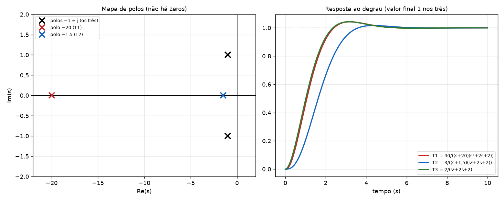

# Aula 10: Exercício: mapa de polos e zeros e resposta ao degrau de T₁, T₂, T₃

**Origem:** `Exercicios_P2.pdf` págs. 4 a 6 (Aula 10, slides 3, 4 e 5). É o único item que o slide chama de "Exercício".

## Enunciado

Faça o mapa de polos e zeros e a resposta ao degrau dos 3 sistemas:

- `T₁(s) = 40 / ((s+20)(s+1+j)(s+1−j))`
- `T₂(s) = 3 / ((s+1,5)(s+1+j)(s+1−j))`
- `T₃(s) = 2 / ((s+1+j)(s+1−j))`

## Resolução (passo a passo, no estilo do professor)

**Passo 1: polos e zeros.** Nenhum dos três tem zeros (numerador constante). Os polos saem direto dos fatores do denominador (`s + a` dá polo em `−a`):

| | Polos |
|---|---|
| `T₃` | −1 ± j |
| `T₁` | −1 ± j **e −20** |
| `T₂` | −1 ± j **e −1,5** |



**Passo 2: valor final da resposta ao degrau** (teorema do valor final, `T(0)`):

- `T₁(0) = 40/(20·2) = 1`
- `T₂(0) = 3/(1,5·2) = 1`
- `T₃(0) = 2/2 = 1`

Os três terminam em **1**. (O fator `(s+1+j)(s+1−j) = s² + 2s + 2` vale 2 em s = 0.)

**Passo 3: frações parciais** (os resíduos são os do slide, que usou `[r,p,k] = residue(num,den)`; a conta à mão vem logo abaixo):

| | Resíduo do polo real | Resíduos do par complexo |
|---|---|---|
| `T₁` | **0,1105** (polo −20) | −0,0552 ∓ j1,0497 (módulo 1,051) |
| `T₂` | **2,4** (polo −1,5) | −1,2 ∓ j0,6 (módulo 1,342) |
| `T₃` | não tem | ∓ j1 (módulo 1) |

### Passo 3 à mão (sem MATLAB: o que fazer na prova)

O slide só mostra o resultado do `residue`. À mão, usa-se o **método da cobertura**: para cada polo, cubra o fator dele e calcule o resto em `s = −polo`.

**Aritmética complexa que você vai precisar:**

- `(a+bj)(c+dj) = (ac − bd) + (ad + bc)j`, com `j² = −1`.
- `(a+bj)(a−bj) = a² + b²` (real).
- Divisão: `1/(a+bj) = (a−bj)/(a²+b²)` (multiplique em cima e embaixo pelo conjugado).
- Os resíduos dos polos conjugados são **conjugados** entre si: calcule um só.

**T₃ = 2/((s+1+j)(s+1−j))** (só o par complexo)

Polo `−1−j` (fator `s+1+j`): cubra e calcule em `s = −1−j`:

`r = 2/(s+1−j) = 2/(−2j) = −1/j = j`

Polo `−1+j`: `r = −j`. Resíduos `±j1`, módulo 1 ✔.

**T₂ = 3/((s+1,5)(s+1+j)(s+1−j))**

- Polo `−1,5`: `r = 3/((−0,5+j)(−0,5−j)) = 3/(0,25+1) = 3/1,25 =` **2,4**.
- Polo `−1−j`: `r = 3/((s+1,5)(s+1−j))` em `s = −1−j`: `(0,5−j)(−2j) = −j + 2j² = −2 − j`, e `r = 3/(−2−j) = 3(−2+j)/5 =` **−1,2 + j0,6**.
- Polo `−1+j`: o conjugado, **−1,2 − j0,6**. Módulo `√(1,44+0,36) = 1,3416` ✔.

**T₁ = 40/((s+20)(s+1+j)(s+1−j))**

- Polo `−20`: `r = 40/((−19+j)(−19−j)) = 40/(361+1) = 40/362 =` **0,1105**.
- Polo `−1−j`: `r = 40/((s+20)(s+1−j))` em `s = −1−j`: `(19−j)(−2j) = −38j + 2j² = −2 − 38j`, e `r = 40/(−2−38j) = 40(−2+38j)/(4+1444) = (−80 + 1520j)/1448 =` **−0,0552 + j1,0497**.
- Módulo: `√(0,0552² + 1,0497²) = 1,0512` ✔.

**Conferência rápida (vale para os três):** em `s = 0` a soma das frações deve dar `T(0) = 1`. Exemplo com `T₂`: `2,4/1,5 + 2·Re[(−1,2+j0,6)/(1+j)] = 1,6 + 2(−0,3) = 1` ✔.

### Passo 3b: resposta ao degrau à mão (explicado com calma)

**Objetivo:** achar `y(t)`, a resposta de `T(s)` quando a entrada é um degrau unitário. Faremos em 4 etapas, primeiro com `T₃` (o mais curto) e depois com `T₂` e `T₁`.

#### Etapa 1: montar `Y(s)`

A transformada do degrau unitário é `1/s`. Então a saída é

`Y(s) = T(s) · (1/s) = T(s)/s`

Isso só **acrescenta um polo em 0** à função. Em `T₃`:

`Y(s) = 2 / ( s (s+1+j)(s+1−j) )`

Agora são **três polos**: `0`, `−1+j` e `−1−j`.

#### Etapa 2: frações parciais de `Y(s)`

`Y(s) = A/s + B/(s+1−j) + C/(s+1+j)`

Cada resíduo sai pela cobertura, como já visto: apague o fator do polo e calcule o resto em `s = polo`.

- **A (polo 0, fator `s`):** apague `s`, sobra `2/((s+1+j)(s+1−j))`. Com `s = 0`: `2/((1+j)(1−j)) = 2/(1+1) = 1`. **A = 1**.
- **B (polo −1+j, fator `s+1−j`):** apague esse fator, sobra `2/(s(s+1+j))`. Com `s = −1+j`:
  - `s = −1+j`
  - `s+1+j = (−1+j)+1+j = 2j`
  - `s(s+1+j) = (−1+j)(2j) = −2j + 2j² = −2 − 2j`
  - `B = 2/(−2−2j) = 1/(−1−j) = −1/(1+j) = −(1−j)/2 = −0,5 + 0,5j`
- **C (polo −1−j):** é o conjugado de `B`: **C = −0,5 − 0,5j**.

Então: `Y(s) = 1/s + (−0,5+0,5j)/(s+1−j) + (−0,5−0,5j)/(s+1+j)`.

#### Etapa 3: voltar para o tempo

Use a regra que você já conhece, `L⁻¹[1/(s+a)] = e^(−at)`, termo a termo:

- `1/s` volta como `1` (o degrau).
- `B/(s+1−j)`: aqui `a = 1−j`, então volta como `B·e^(−(1−j)t) = B·e^((−1+j)t)`.
- `C/(s+1+j)`: `a = 1+j`, volta como `C·e^((−1−j)t)`.

`y(t) = 1 + B·e^((−1+j)t) + C·e^((−1−j)t)`

Como `C` é o conjugado de `B` e `e^((−1−j)t)` é o conjugado de `e^((−1+j)t)`, os dois termos somados dão **duas vezes a parte real** de um deles (a soma de um número complexo com seu conjugado é `2·Re`):

`y(t) = 1 + 2·Re[ B·e^((−1+j)t) ]`

#### Etapa 4: transformar a exponencial complexa em seno e cosseno

Separe `e^((−1+j)t) = e^(−t)·e^(jt)` e use a fórmula de Euler, `e^(jt) = cos t + j·sen t`. Com `B = a + bj`:

`B·e^(jt) = (a + bj)(cos t + j sen t) = (a cos t − b sen t) + j(a sen t + b cos t)`

A parte real é `a cos t − b sen t`. Logo:

**`y(t) = 1 + 2e^(−t)·( a cos t − b sen t )`**, com `a = Re B` e `b = Im B`.

Para `T₃`: `a = −0,5` e `b = 0,5`:

`y(t) = 1 + 2e^(−t)(−0,5 cos t − 0,5 sen t) =` **`1 − e^(−t)(cos t + sen t)`**

#### Teste

- **`t = 0`:** `1 − 1·(1 + 0) = 0`. A saída parte de zero ✔.
- **`t → ∞`:** `e^(−t) → 0`, então `y → 1`. É o valor final `T(0) = 1` ✔.

---

#### `T₂ = 3/((s+1,5)(s+1+j)(s+1−j))` (mesmas etapas)

`Y(s) = 3 / ( s (s+1,5)(s+1+j)(s+1−j) )`: quatro polos: `0`, `−1,5`, `−1+j`, `−1−j`.

| Polo | Apague o fator, calcule em `s = polo` | Resíduo |
|---|---|---|
| 0 | `3/((1,5)(1+j)(1−j)) = 3/(1,5·2)` | **1** |
| −1,5 | `3/(s(s²+2s+2))` com `s = −1,5`: `s²+2s+2 = 2,25−3+2 = 1,25`; `(−1,5)(1,25) = −1,875`; `3/(−1,875)` | **−1,6** |
| −1+j | `3/(s(s+1,5)(s+1+j))` com `s = −1+j`: `(−1+j)(0,5+j) = −1,5−0,5j`; vezes `(2j)` dá `1 − 3j`; `3/(1−3j) = 3(1+3j)/10` | **0,3 + 0,9j** |

Etapa 3 e 4: o termo real volta como `−1,6e^(−1,5t)`; o par complexo vira `2e^(−t)(a cos t − b sen t)` com `a = 0,3` e `b = 0,9`:

**`y(t) = 1 − 1,6e^(−1,5t) + e^(−t)(0,6 cos t − 1,8 sen t)`**

Teste: `y(0) = 1 − 1,6 + 0,6 = 0` ✔.

#### `T₁ = 40/((s+20)(s+1+j)(s+1−j))`

`Y(s) = 40 / ( s (s+20)(s+1+j)(s+1−j) )`.

| Polo | Conta | Resíduo |
|---|---|---|
| 0 | `40/(20·2)` | **1** |
| −20 | `40/(s(s²+2s+2))` com `s = −20`: `s²+2s+2 = 400−40+2 = 362`; `(−20)(362) = −7240`; `40/(−7240)` | **−0,0055** |
| −1+j | `40/(s(s+20)(s+1+j))` com `s = −1+j`: `(−1+j)(19+j) = −20+18j`; vezes `(2j)` dá `−36 − 40j`; `40/(−36−40j) = 40(−36+40j)/2896` | **−0,4972 + 0,5525j** |

Etapa 4 com `a = −0,4972` e `b = 0,5525`:

**`y(t) = 1 − 0,0055e^(−20t) − e^(−t)(0,9945 cos t + 1,105 sen t)`**

Teste: `y(0) = 1 − 0,0055 − 0,9945 = 0` ✔.

#### Resumo do método

1. `Y(s) = T(s)/s` (acrescenta o polo 0).
2. Cobertura para cada polo: o do 0 dá o valor final (sempre `T(0)`), o real dá um termo `r·e^(−at)`, o complexo dá `B = a + bj`.
3. Cada par complexo vira `2e^(σt)(a cos ωt − b sen ωt)`, onde `σ` e `ω` são a parte real e a parte imaginária do polo `σ + jω` (aqui `σ = −1` e `ω = 1`).
4. Teste: `y(0) = 0` e `y(∞) = T(0)`.

(As três fórmulas foram conferidas contra a simulação numérica em vários instantes.)

**Overshoot de `T₃` à mão:** o pico ocorre onde `y'(t) = 0`. Derivando, `y' = 2e^(−t) sen t`, que zera em `t = π`. Então `y(π) = 1 − e^(−π)(−1 + 0) = 1 + e^(−π) = 1,043`, ou seja, **Mp = 4,3 %**. É a mesma fórmula `e^(−πζ/√(1−ζ²))` com `ζ = 0,707`.

**Por que `T₁ ≈ T₃`:** compare as duas respostas. `T₁` difere de `T₃` só por `−0,0055e^(−20t)` (que some em ≈ 0,2 s e vale no máximo 0,0055) e por pequenas mudanças nos coeficientes de `cos t` e `sen t` (−0,9945 e −1,105 contra −1 e −1). É isso que "o polo −20 é desprezível" quer dizer.

**Passo 4: aplicar a regra de dominância** (slides 4 e 5). Um polo é desprezível quando:

1. Está **pelo menos 5 vezes mais longe do eixo jω** que os dominantes, e
2. Tem **resíduo pequeno** em relação aos dos dominantes.

| | Relação das partes reais | Resíduo do polo real × complexos | Conclusão |
|---|---|---|---|
| `T₁` | 20/1 = **20 > 5** | **0,11 ≪ 1,05** | o polo −20 **não domina**: `T₁ ≈ T₃` |
| `T₂` | 1,5/1 = **1,5 < 5** | **2,4 > 1,34** | o polo −1,5 **domina/compete**: `T₂` **não** se comporta como 2ª ordem |

**Passo 5: resposta ao degrau** (confirmada por simulação):

| Sistema | Overshoot | ts (2 %) | Leitura |
|---|---|---|---|
| `T₃` (ωn = √2, ζ = 0,707) | 4,3 % | ≈ 4,2 s | 2ª ordem padrão |
| `T₁` | 4,3 % | ≈ 4,3 s | **quase idêntica a T₃** (polo −20 desprezível) |
| `T₂` | 1,7 % | ≈ 3,3 s | polo −1,5 dominante: mais lenta no início e sem overshoot relevante |

## Resposta

`T₁` se comporta como `T₃` (3ª ordem aproximada por 2ª pelos polos dominantes −1 ± j). `T₂` tem polo real próximo e resíduo grande, então **não** pode ser aproximada por 2ª ordem.

**Frase do slide (p.4):** "A F.T. de terceira ordem `T₁(s)` se comporta como a de segunda `T₃(s)` devido aos polos dominantes."

## MATLAB

```matlab
clear all
clc
T1 = tf(40, conv([1 20], [1 2 2]));
T2 = tf(3, conv([1 1.5], [1 2 2]));
T3 = tf(2, [1 2 2]);
figure(1); pzmap(T1, T2, T3); grid;
figure(2); step(T1, T2, T3); grid;
[r, p, k] = residue(40, conv([1 20], [1 2 2]))   % resíduos de T1
```

*(MATLAB não foi rodado aqui; os números foram conferidos com Python/scipy.)*
