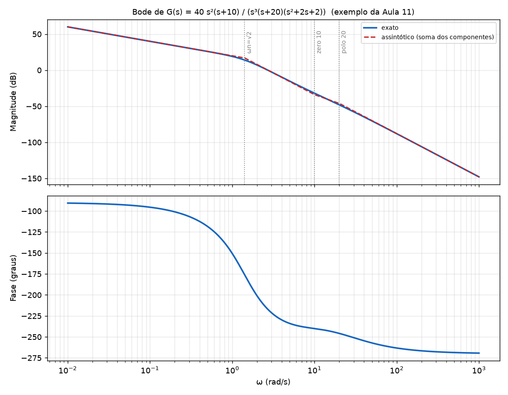

# Aula 11: Exemplos de Bode

**Origem:** `Exercicios_P2.pdf` págs. 17 a 30 (Aula 11, slides 7 a 20).

Dois exemplos: o **principal**, desenvolvido por componente nos slides 7 a 18, e o do MATLAB (slides 19 e 20).

---

## Exemplo 1 (slides 7 a 19): `G(s) = 40 s²(s+10) / (s³ (s+20)(s+1+j)(s+1−j))`

### Enunciado
Trace o diagrama de Bode (magnitude e fase) de `G(s)`.

### Resolução

**Passo 1: colocar na forma de Bode** (cada fator no formato `1 + s/ω₀`, e o resto vira o ganho constante). Note que `(s+1+j)(s+1−j) = s² + 2s + 2`.

`G(jω) = 40·(jω)²·10(jω/10 + 1) / [ (jω)³ · 20(jω/20 + 1) · 2((jω)²/2 + jω + 1) ]`

- `Kb = 40·10/(20·2) = 10`
- Par complexo: `ωn² = 2` → `ωn = 1,414` e `2ζ/ωn = 1` → `ζ = 0,707`.

**Passo 2: um componente por vez** (a ordem dos slides 8 a 18):

| Slide | Componente | Magnitude | Fase |
|---|---|---|---|
| 8 | Constante `Kb = 10` | `20·log 10 =` **20 dB** | 0° |
| 9 e 10 | Origem: 3 polos e 2 zeros → `(jω)²/(jω)³ = 1/(jω)` | **−20 dB/déc**, passando por 0 dB em ω = 1 | **−90°** |
| 13 e 14 | Zero real em −10 | +20 dB/déc a partir de ω = 10 | 0° → **+45° em 10** → +90° |
| 11 e 12 | Polo real em −20 | −20 dB/déc a partir de ω = 20 | 0° → **−45° em 20** → −90° |
| 16 a 18 | Par complexo (ωn = 1,414; ζ = 0,707) | −40 dB/déc a partir de 1,414 | 0° → **−90° em ωn** → −180° |

(O slide 15 mostra o zero no semiplano direito; esse não aparece neste exemplo, está na tabela abaixo.)

**Passo 3: magnitude assintótica.** Parte-se de `20 dB` em ω = 1 com inclinação `20·(2 − 3) = −20 dB/déc`, e a cada frequência de canto soma-se a inclinação do componente:

| Faixa de ω | Inclinação | Valor no fim da faixa |
|---|---|---|
| até 1,414 | −20 dB/déc | `20 − 20·log 1,414 = 17,0 dB` |
| 1,414 a 10 | −20 − 40 = **−60** | `17,0 − 60·log(10/1,414) = −34,0 dB` |
| 10 a 20 | −60 + 20 = **−40** | `−34,0 − 40·log 2 = −46,0 dB` |
| acima de 20 | −40 − 20 = **−60** | |

**Passo 4: fase total.** Começa em **−90°** (ω → 0, só o termo da origem). No fim: 6 polos − 3 zeros = 3 → **−270°** (ω → ∞).



A figura mostra o Bode exato (azul) e a soma das assíntotas (vermelho tracejado). Como **ζ = 0,707, não há pico de ressonância** (o pico só aparece para ζ < 0,707).

### Resposta
Magnitude: 20 dB em ω = 1; inclinações −20 → −60 → −40 → −60 dB/déc (cantos em 1,414, 10 e 20); fase de −90° a −270°.

### Conferência
Cálculo exato com numpy em ω = 1: 19,1 dB (assíntota 20 dB; a diferença vem do canto em 1,414 e do par complexo). Para ω = 10: −31,9 dB (assíntota −34 dB, pela proximidade do canto em 10).

### MATLAB (slide 19)
```matlab
[num,den]=zp2tf([0 0 -10]',[0 0 0 -20 -1-1i -1+1i],40);
G=tf(num,den);
bode(G);
grid;
```

---

## Exemplo 2 (slide 20): `G(s) = 4 / (s(s+1)(s+2)(s+3))`

### Resolução

1. **Forma de Bode:** `Kb = 4/(1·2·3) = 2/3`, ou **−3,5 dB**; 1 polo na origem; polos reais em 1, 2 e 3.
2. **Inclinações** (cada polo real soma −20 dB/déc a partir do seu canto):

| Faixa de ω | Inclinação | Valor da assíntota no fim da faixa |
|---|---|---|
| até 1 | −20 dB/déc (polo na origem) | −3,5 dB em ω = 1 |
| 1 a 2 | −40 | −15,6 dB em ω = 2 |
| 2 a 3 | −60 | −26,1 dB em ω = 3 |
| acima de 3 | −80 | |

3. **Fase:** começa em −90° (polo na origem) e termina em **−360°** (4 polos).

### MATLAB (slide 20)
```matlab
[num,den]=zp2tf([],[0 -1 -2 -3],4);
G=tf(num,den);
bode(G);
grid;
```

---

## Elementos isolados (slides 11 a 18)

| Slide | Elemento | Resultado |
|---|---|---|
| 11 e 12 | Polo real `1/(1 + jω/20)` | corte em 20; −20 dB/déc depois; fase 0° até ≈ 4, **−45° em 20**, −90° a partir de ≈ 100 |
| 13 e 14 | Zero real `1 + jω/10` | corte em 10; +20 dB/déc; fase 0° até ≈ 2, **+45° em 10**, +90° a partir de ≈ 50 |
| 15 | Zero no **semiplano direito** `1 − jω/100` | **mesma magnitude** do zero em −100; fase **0° → −45° em 100 → −90°** (vai para o lado contrário) |
| 16 a 18 | Complexos `2/(s²+2s+2)`, ωn = √2, ζ = 0,707 | `MAG = −10·log[(1 − ω²/2)² + ω²] = −10·log(1 + ω⁴/4)`; `φ = −tan⁻¹(2ω/(2 − ω²))` |
| 9 e 10 | Origem `1/(jω)³` | `MAG = −60·log ω`, fase −270°; zeros `(jω)²`: `+40·log ω`, +180° |
| 8 | Constante `Kb` | `20·log Kb`, fase 0° |

**Regra geral para colocar em prova:** monte a tabela de inclinações (soma a cada canto), tire o valor inicial pela constante e pelo número de polos/zeros na origem, e some as fases dos componentes (−90° por polo, +90° por zero, no limite).
