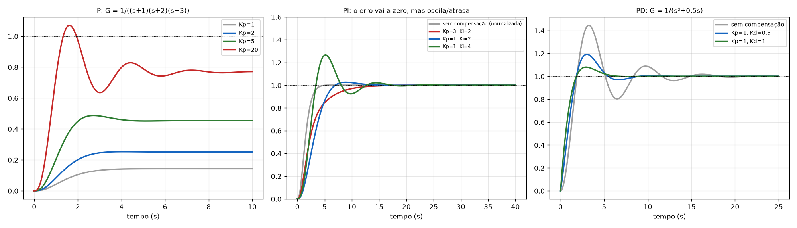

# Aula 12: Exemplos de P, PI e PD (efeito no sistema)

**Origem:** `Exercicios_P2.pdf` págs. 17 a 21 (Aula 12, slides 3, 5, 8, 9 e 11). Os slides só mostram **gráficos**; os números abaixo foram obtidos por simulação (scipy) para dar uma correção numérica.

---

## Exemplo 1 (slides 3 e 5): controlador **P**, `G = 1/((s+1)(s+2)(s+3))`, `C = Kp`

### Enunciado
Compare a resposta ao degrau para `Kp = 1` (sem compensação), `2`, `5` e `20`.

### Resolução
Com `C = Kp`, malha fechada `T = Kp/(s³ + 6s² + 11s + 6 + Kp)`. Valor final `Kp/(6 + Kp)`; erro `6/(6 + Kp)`.

| Kp | Valor final | Erro estacionário | Overshoot | Polos dominantes |
|---|---|---|---|---|
| 1 | 0,143 | 0,857 | ≈ 0 % | −1,34 ± j0,56 |
| 2 | 0,25 | 0,75 | 1 % | −1,24 ± j0,86 |
| 5 | 0,455 | 0,545 | 7 % | −1,05 ± j1,31 |
| 20 | 0,769 | 0,231 | **39 %** | −0,58 ± j2,24 |

### Resposta (o que o slide quer mostrar)
Aumentar Kp: **reduz o tempo de subida**, **aumenta o overshoot**, **reduz o erro mas não o zera**, e **não muda a ordem** do sistema.

---

## Exemplo 2 (slides 8 e 9): controlador **PI**, mesma planta, `C = Kp + Ki/s`

### Enunciado
Compare `(Kp, Ki) = (3, 2)`, `(1, 2)` e `(1, 4)`.

### Resolução
`C·G = (Kp s + Ki)/(s(s+1)(s+2)(s+3))`: um polo em 0 (tipo 1) e zero em `−Ki/Kp`. Malha fechada de **4ª ordem**.

| Kp | Ki | Overshoot | ts (2 %) | Erro |
|---|---|---|---|---|
| 3 | 2 | 0 % (lento) | ≈ 11 s | **0** |
| 1 | 2 | 2,6 % | ≈ 10 s | **0** |
| 1 | 4 | **26,6 %** | ≈ 15 s | **0** |

### Resposta
O PI **zera o erro** (o polo em 0 sobe o tipo), mas **aumentar Ki aumenta overshoot e ts** (Kp = 1: Ki 2 → 4 vai de 2,6 % a 26,6 %). O sistema passa a ser de 4ª ordem.

---

## Exemplo 3 (slide 11): controlador **PD**, `G = 1/(s² + 0,5s)`, `C = Kp + Kd·s`

### Enunciado
Compare `Kp = 1` com `Kd = 0` (sem compensação), `0,5` e `1`.

### Resolução
`C·G = (Kd s + Kp)/(s(s + 0,5))`; o PD adiciona **um zero em `−Kp/Kd`** e não muda a ordem de malha fechada (continua 2ª ordem): `T = (Kd s + Kp)/(s² + (0,5 + Kd)s + Kp)`. O amortecimento sobe com Kd: `2ζωn = 0,5 + Kd`.

| Kp | Kd | Overshoot | ts (2 %) |
|---|---|---|---|
| 1 | 0 | **44 %** | ≈ 14 s |
| 1 | 0,5 | 19 % | ≈ 7,7 s |
| 1 | 1 | **7,9 %** | ≈ 5,1 s |

### Resposta
Aumentar **Kd** diminui overshoot e ts (o zero + o termo `Kd` no coeficiente de `s` aumentam o amortecimento).

---

## Tabela-resumo dos três exemplos

| Controlador | Adiciona | Efeito no erro | Efeito na resposta |
|---|---|---|---|
| P | só ganho | reduz, não zera | sobe overshoot, desce tr |
| PI | polo em 0 + zero | **zera** | sobe overshoot/ts se Ki grande |
| PD | zero | não muda | desce overshoot e ts |

Para a tabela completa de todos os controladores: [../Tabela_Comparativa_Controladores.md](../Tabela_Comparativa_Controladores.md).
