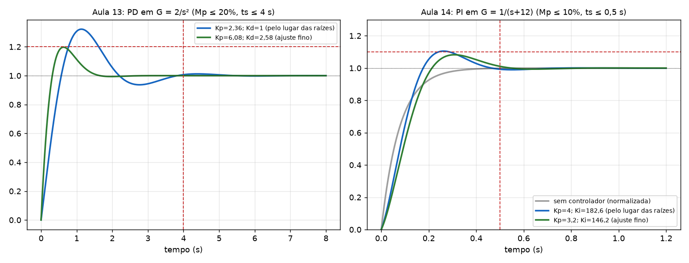

# Aula 13: Exemplo completo de projeto de PD (G = 2/s²) e implementação com AmpOps

**Origem:** `Exercicios_P2.pdf` págs. 22 a 35 (Aula 13, slides 6 a 19). É o modelo exato para a Q1 do Relatório 04 (mesmos passos, outra planta).

## Enunciado

Deseja-se que o sistema `G(s) = 2/s²`, com realimentação unitária, tenha **Mp ≤ 20 %** e **ts (2 %) ≤ 4 s** para um degrau unitário. Projete um controlador **PD** `C(s) = Kp + Kd·s` e depois implemente-o com amplificadores operacionais.

## Resolução (os 5 passos da Aula 13)

**Passo 1: polos dominantes desejados** (slide 7).

- Overshoot: `0,2 = e^(−πζ/√(1−ζ²))` → **`ζmin = 0,46`**.
- Acomodação: `ts = 4/(ζωn) = 4` → **`(ζωn)min = 1`**, então `ωn = 1/0,46 = 2,174`.
- `ωd = ωn·√(1 − ζ²) = 2,174·√(1 − 0,46²) = 1,93`.
- Polos desejados: **`s₀ = −1 ± j1,93`**.

**Passo 2: só P resolve?** Conferência pela **fase** em `s₀ = −1 + j1,93`. Cada polo em 0 (são dois) dá `180° − tan⁻¹(1,93/1) = 117,4°`, e os dois somam **234,8°**. A fase de `K·G(s₀)` é **−234,8°**, e o lugar das raízes exige **−180°**. Como `−234,8° ≠ −180°` (sobram **54,8°**), `s₀` **não pertence** ao lugar de `K·2/s²` (que é o eixo imaginário): nenhum ganho leva o polo até lá. **Não resolve → PD necessário.** O zero do PD fornece justamente esses 54,8° no passo seguinte.

**Passo 3: condição de fase** (slide 8). `C·G = 2Kd(s+z)/s²`.

- Ângulo de cada polo em 0 até `s₀ = −1 + j1,93`: `180° − tan⁻¹(1,93/1) = 117,4°`. Os dois polos juntos: **234,8°**.
- Condição `θz − 234,8° = −180°` → **`θz = 54,8°`**.
- `tan(54,8°) = 1,93/(z − 1) = 1,418` → `z − 1 = 1,36` → **`z = 2,36`**.

**Passo 4: condição de módulo** (slide 9). `|C·G| = 1` em `s₀`:

- `|s₀ + 2,36| = √(1,36² + 1,93²) = 2,36`
- `|s₀|² = 1² + 1,93² = 4,72`
- `Kd = |s₀|²/(2·|s₀+z|) = 4,72/(2·2,36) = 1`

Logo **`Kd = 1`**, **`Kp = z·Kd = 2,36`**, `C(s) = 2,36 + s`.

**Passo 5: testar** (slide 11). Simulação: **Mp = 32 %** e ts = 3,5 s. **Não atende o overshoot** (o zero do PD aumenta o overshoot além do previsto pelo par dominante).

**Ajuste fino** (slide 12): mantém `z = 2,36` e **sobe o ganho** (move o polo ao longo do lugar):

- **`Kd = 2,58`**, **`Kp = z·Kd = 6,08`**, `C(s) = 2,58(s + 2,36) = 2,58s + 6,08`.
- Simulação: **Mp = 19,7 % (< 20 %)** e **ts = 1,4 s (< 4 s)** ✔.

**Erro estacionário** (slide 13). `e(∞) = lim s·(1/s)/(1 + CG) = lim s²/(s² + 5,16s + 12,18) = 0`. A planta tem **dois integradores** (tipo 2), então o erro ao degrau já era zero.

**Malha fechada** (slide 14):

`T(s) = 5,16(s + 2,36)/(s² + 5,16s + 12,18) = 5,15(s+2,36)/((s+2,58−j2,35)(s+2,58+j2,35))`



## Implementação com AmpOps (slides 15 a 19)

**Passo A: forma `Kp(1 + Td·s)`** (slide 15).

`C(s) = 2,58(s + 2,36) = 2,58·2,36·(s/2,36 + 1) = 6,089(0,424s + 1)`

ou seja, `Kp = 6,089` e `Td = 0,424 s`.

**Passo B: blocos** (slides 16 a 18):

- **Integrador inversor:** `Vo/Vin = −1/(RCs)`.
- **Planta `G = 2/s²`:** dois integradores inversores em cascata (o sinal negativo se cancela). Slide 19: capacitores de 1 F e resistores `R₁ = 1 Ω` e `R₂ = 0,5 Ω`: `(1/(1·s))·(1/(0,5·s)) = 2/s²`.
- **Subtrator** (slide 18): com resistores iguais `Vo = Vin1 − Vin2`, para formar o erro `E = X − Y` na entrada do controlador.
- **Controlador PD:** soma do ganho `Kp` com o derivador `Kd·s`.

## Resposta

`C(s) = 2,36 + s` (projeto) e **`C(s) = 6,08 + 2,58·s`** (depois do ajuste fino). Mp = 19,7 %, ts = 1,4 s, erro ao degrau 0.

## Conferência (simulação)

| Caso | Mp | ts (2 %) |
|---|---|---|
| Projeto: Kd = 1, Kp = 2,36 | 32,2 % | 3,50 s |
| Ajuste: Kd = 2,58, Kp = 6,08 | 19,75 % | 1,42 s |

Polos de malha fechada do projeto original: raízes de `s² + 2s + 4,72` = **−1 ± j1,93** ✔.

## MATLAB

```matlab
clear all
clc
G = tf(2, [1 0 0]);
C = tf([2.58 6.08], 1);            % 2,58 s + 6,08
T = feedback(C*G, 1);
step(T); grid;
rlocus(tf([1 2.36],1)*G); grid;    % passa por -1 +- j1.93
```
