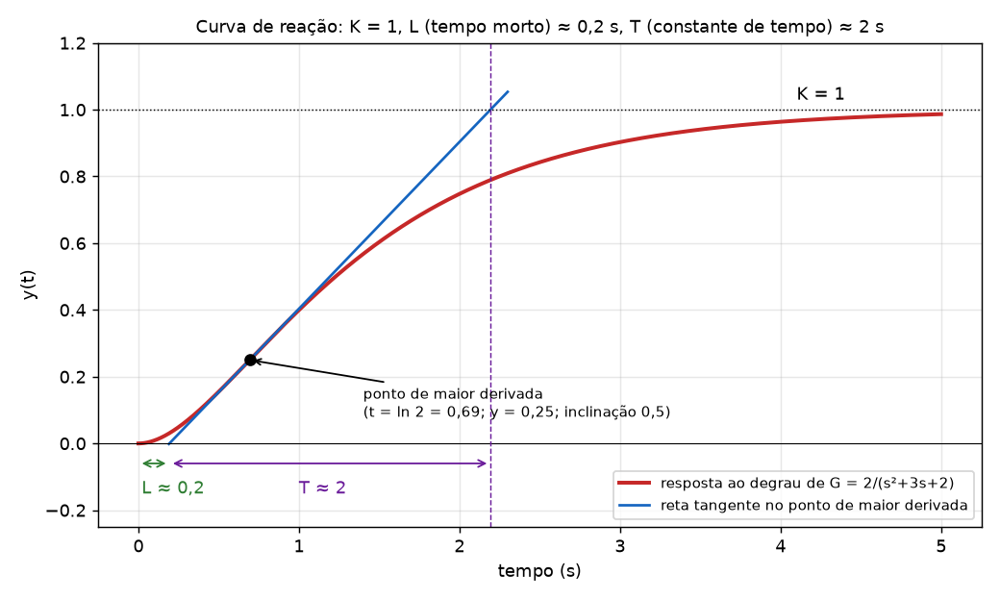
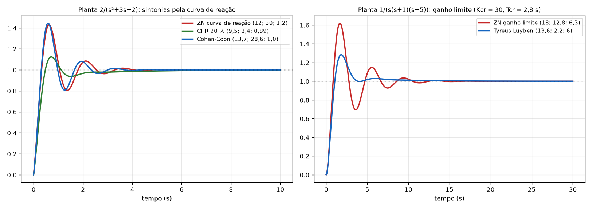

# Aula 15: Controladores PID: métodos de sintonia (Ziegler-Nichols, Cohen-Coon, CHR, Tyreus-Luyben)

**Origem:** `Slides/Aula 15 - Controladores PID.pdf` (26 slides). Os exemplos resolvidos estão nos slides 7 a 12, 16 a 17 e 19 a 26, e entram no `Exercicios_P2.pdf` (págs. 44 a 59). Esta aula **traz as tabelas do Ziegler-Nichols** que a Q3 do Relatório 04 usa.

Nos slides o ganho limite se chama `Kcr` e o período `Tcr`. Nos gabaritos do Relatório 04 chamei de `Ku` e `Pu`: **`Kcr = Ku` e `Tcr = Pu`**.

Todos os números foram conferidos por simulação (Python). **O MATLAB não foi rodado.**

---

## 1. O que é "sintonia" (slides 2 e 5)

Nas Aulas 13 e 14 o controlador saía de **polos desejados** (fase e módulo no lugar das raízes). Nos métodos de sintonia, ele sai de **tabelas**, a partir de dois ou três números medidos da planta. Os slides dizem:

- Há **dois** métodos de Ziegler-Nichols: **curva de reação** (malha **aberta**) e **ganho limite** (malha **fechada**). Servem para P, PI e PID.
- **Não servem para todos os casos.**
- A resposta típica é equivalente a um sistema de 2ª ordem com **ζ = 0,21 (Mp = 50,9 %)**: é por isso que o ZN dá overshoot grande e exige ajuste fino.

| Método | Mede | Onde se faz |
|---|---|---|
| ZN, Cohen-Coon, CHR | `K`, `L`, `T` da **curva de reação** | malha aberta |
| ZN ganho limite, Tyreus-Luyben | `Kcr` e `Tcr` | malha fechada |

---

## 2. Método da curva de reação (slides 3 a 17)

### 2.1 Como se mede (slides 3 e 4)

Abre-se a malha, aplica-se um **degrau na entrada da planta** e mede-se a saída. A curva precisa ter **forma de "S"** (não vale para planta instável em malha aberta). Traça-se a **tangente no ponto de maior derivada**:

- **`K`**: valor final da resposta (para degrau unitário, o ganho DC).
- **`L`**: **tempo morto**, onde a tangente cruza o eixo do tempo.
- **`T`**: **constante de tempo**, o intervalo entre esse cruzamento e o ponto onde a tangente atinge `K`.

A curva é aproximada por `Y(s)/X(s) = K·e^(−Ls)/(Ts + 1)`. O **fator de incontrolabilidade** é `L/T` (quanto maior, mais difícil controlar).



### 2.2 Exemplo dos slides: `G(s) = 2/(s² + 3s + 2)`, `K = 1`, `L = 0,2`, `T = 2`

Os slides leem `L` e `T` **do gráfico**. Dá para conferir a conta à mão, porque `y(t) = 1 − 2e^(−t) + e^(−2t)`:

- Inclinação `y' = 2e^(−t) − 2e^(−2t)`; o máximo está em `t = ln 2 = 0,693`, com `y = 0,25` e `y' = 0,5`.
- A tangente `y = 0,25 + 0,5(t − 0,693)` cruza `y = 0` em `t = 0,193`: **L ≈ 0,2**.
- Ela cruza `y = 1` em `t = 2,193`: **T = 2,193 − 0,193 = 2,0**.
- `L/T = 0,1`, dentro da faixa do ZN (0,1 ≤ L/T ≤ 0,3).

### 2.3 Tabela do ZN, curva de reação (slide 6)

| Controlador | `Kp` | `Ti = Kp/Ki` | `Td = Kd/Kp` |
|---|---|---|---|
| P | `T/(K·L)` | ∞ | 0 |
| PI | `0,9·T/(K·L)` | `L/0,3` | 0 |
| **PID** | **`1,2·T/(K·L)`** | **`2L`** | **`0,5L`** |

Forma do slide: `C(s) = Kp + Ki/s + Kd·s = Kp(1 + 1/(Ti·s) + Td·s) = 0,6(T/K)(s + 1/L)²/s`. O PID tem **um polo na origem e zeros duplos em `s = −1/L`**. Depois: **`Ki = Kp/Ti`** e **`Kd = Kp·Td`**.

**Condições (slide 5):** o ZN é adequado para `0,1 ≤ L/T ≤ 0,3`; é instável para `L/T > 0,4`.

### 2.4 Exemplo 1: PID por ZN (slides 7 e 8)

1. `Kp = 1,2·T/(K·L) = 1,2·2/(1·0,2) =` **12**
2. `Ti = 2L = 2·0,2 = 0,4` → `Ki = Kp/Ti = 12/0,4 =` **30**
3. `Td = 0,5L = 0,5·0,2 = 0,1` → `Kd = Kp·Td = 12·0,1 =` **1,2**

`C(s) = 12 + 30/s + 1,2s = (1,2s² + 12s + 30)/s = 1,2(s+5)²/s`. (Confere com a forma do slide: `1,2(s+5)²/s` e zeros duplos em `−1/L = −5`.)

Simulação em malha fechada: **Mp ≈ 43 %**, ts ≈ 3,1 s, erro zero (tem integrador).

### 2.5 Exemplo 2: PI por ZN (slides 9 e 10)

- `Kp = 0,9·T/(K·L) = 0,9·2/0,2 =` **9**
- `Ti = L/0,3 = 0,2/0,3 = 0,67` → `Ki = 9/0,67 =` **13,5**
- `Td = 0` → `Kd = 0`

`C(s) = 9 + 13,5/s`. Simulação: **Mp ≈ 58 %**, ts ≈ 5,3 s.

### 2.6 Exemplo 3: P por ZN (slides 11 e 12)

- `Kp = T/(K·L) = 2/0,2 =` **10**; `Ki = 0`, `Kd = 0`.

Simulação: **Mp ≈ 35 %**, e o valor final é **0,909** (erro de `1/(1 + 10·1) = 9,1 %`, porque o P não zera o erro).

### 2.7 Cohen-Coon (slides 13 e 14)

Para `L/T` **mais alto** (`L/T > 0,3`). Adequado para `0,6 ≤ L/T ≤ 4,5`, com robustez ruim para `L/T < 2` (valores dos slides).

Defina `τ = L/(L + T)`.

| Controlador | `Kp` | `Ti` | `Td` |
|---|---|---|---|
| P | `(T/(KL))(1 + 0,35τ/(1−τ))` | ∞ | 0 |
| PI | `0,9(T/(KL))(1 + 0,92τ/(1−τ))` | `L(3,3 − 3τ)/(1 + 1,2τ)` | 0 |
| **PID** | **`1,35(T/(KL))(1 + 0,18τ/(1−τ))`** | **`L(2,5 − 2τ)/(1 − 0,39τ)`** | **`0,37L(1−τ)/(1 − 0,81τ)`** |

Os slides **não resolvem** um exemplo de Cohen-Coon. Aplicando ao mesmo caso (`K = 1`, `L = 0,2`, `T = 2`, `τ = 0,2/2,2 = 0,091`), conta minha:

- `Kp = 1,35·10·(1 + 0,18·0,091/0,909) = 13,5·1,018 =` **13,74**
- `Ti = 0,2(2,5 − 0,182)/(1 − 0,0355) = 0,2·2,318/0,9645 =` **0,481** → `Ki = 13,74/0,481 =` **28,6**
- `Td = 0,37·0,2·0,909/(1 − 0,0736) = 0,0673/0,9264 =` **0,0726** → `Kd = 13,74·0,0726 =` **1,00**

Simulação: Mp ≈ 44 %, ts ≈ 2,8 s.

### 2.8 Chien-Hrones-Reswick, CHR (slides 15 a 17)

Dois critérios: **resposta mais rápida com Mp = 0 %** ou **com Mp = 20 %**.

| Controlador | `Kp` (0 %) | `Ti` (0 %) | `Td` (0 %) | `Kp` (20 %) | `Ti` (20 %) | `Td` (20 %) |
|---|---|---|---|---|---|---|
| P | `0,3T/(KL)` | ∞ | 0 | `0,7T/(KL)` | ∞ | 0 |
| PI | `0,35T/(KL)` | `1,2T` | 0 | `0,6T/(KL)` | `T` | 0 |
| **PID** | **`0,6T/(KL)`** | **`T`** | **`0,5L`** | **`0,95T/(KL)`** | **`1,4T`** | **`0,47L`** |

**Exemplo dos slides (PID, Mp = 20 %):** `K = 1`, `L = 0,2`, `T = 2`.

- `Kp = 0,95·2/(1·0,2) =` **9,5**
- `Ti = 1,4T = 2,8` → `Ki = 9,5/2,8 =` **3,4**
- `Td = 0,47L = 0,094` → `Kd = 9,5·0,094 =` **0,89**

`C(s) = 9,5 + 3,4/s + 0,89s`. Simulação: **Mp ≈ 12 %**, ts ≈ 3,2 s. (Bem melhor que os 43 % do ZN.)



---

## 3. Método do ganho limite (ZN malha fechada, slides 18 a 24)

### 3.1 Como se faz (slide 18)

Anulam-se `Ki` e `Kd`. Aumenta-se `Kp` até a oscilação **sem decaimento**. Esse ganho é `Kcr`, e o período da oscilação é `Tcr`.

| Controlador | `Kp` | `Ti = Kp/Ki` | `Td = Kd/Kp` |
|---|---|---|---|
| P | `0,5·Kcr` | ∞ | 0 |
| PI | `0,45·Kcr` | `Tcr/1,2` | 0 |
| **PID** | **`0,6·Kcr`** | **`0,5·Tcr`** | **`Tcr/8`** |

### 3.2 Exemplo dos slides: `G(s) = 1/(s(s+1)(s+5))`

**Obter `Kcr` e `Tcr` pelo lugar das raízes** (slides 19 e 20): `rlocus` mostra o cruzamento com jω em `Kcr = 30` e `ωcr = 2,24 rad/s`, logo `Tcr = 2π/ωcr = 2,8 s`. O slide 20 confere simulando `K = 30` em malha fechada e medindo o período entre dois picos: `4,38 − 1,58 = 2,8 s`.

**Obter analiticamente** (slides 21 e 22), **é o que cai na prova sem MATLAB:**

1. Polinômio característico com só P: `s(s+1)(s+5) + Kp = s³ + 6s² + 5s + Kp = 0`.
2. Routh:

| Linha | 1ª coluna | 2ª coluna |
|---|---|---|
| s³ | 1 | 5 |
| s² | 6 | Kp |
| s¹ | `(30 − Kp)/6` | 0 |
| s⁰ | Kp | |

3. **`Kcr`:** zera a linha s¹: `(30 − Kcr)/6 = 0` → **`Kcr = 30`**. (A linha s⁰ só dá `Kp = 0`, que não é solução com K > 0.)
4. **`ωcr`:** equação auxiliar da linha s² com `Kp = 30`: `6s² + 30 = 0` → `s² = −5` → `s = ±j√5 =` **±j2,24**.
5. **`Tcr = 2π/2,24 =` 2,8 s.**

**Aplicar a tabela** (slide 23):

- `Kp = 0,6·Kcr = 0,6·30 =` **18**
- `Ti = 0,5·Tcr = 0,5·2,8 = 1,4` → `Ki = Kp/Ti = 18/1,4 =` **12,8**
- `Td = Tcr/8 = 2,8/8 = 0,35` → `Kd = Kp·Td = 18·0,35 =` **6,3**

`C(s) = 18 + 12,8/s + 6,3s`. Simulação: **Mp ≈ 62 %**, ts ≈ 10 s (agressivo: típico do ZN).

*(Extra meu, não está nos slides: P: `Kp = 15`; PI: `Kp = 13,5`, `Ti = 2,33`, `Ki = 5,8`.)*

### 3.3 Tyreus-Luyben (slides 25 e 26)

Baseado no ZN, mas **mais estável** (menos overshoot).

| Controlador | `Kp` | `Ti` | `Td` |
|---|---|---|---|
| PI | `Kcr/3,2` | `2,2·Tcr` | 0 |
| **PID** | **`Kcr/2,2`** | **`2,2·Tcr`** | **`Tcr/6,3`** |

**No exemplo** (`Kcr = 30`, `Tcr = 2,8`):

- `Kp = 30/2,2 =` **13,6**
- `Ti = 2,2·2,8 = 6,16` → `Ki = 13,6/6,16 =` **2,2**
- `Td = 2,8/6,3 = 0,44` → `Kd = 13,6·0,44 =` **6**

`C(s) = 13,6 + 2,2/s + 6s`. Simulação: **Mp ≈ 28 %**, ts ≈ 7,2 s (contra 62 % do ZN).

---

## 4. Resumo: qual método usar

| Situação | Método |
|---|---|
| Tenho a **função de transferência** e quero números exatos | ganho limite: Routh dá `Kcr` e `Tcr` à mão (é o da Q3 do Relatório 04) |
| Só tenho a **resposta ao degrau medida** (forma de S) | curva de reação: leio `K`, `L`, `T` |
| `0,1 ≤ L/T ≤ 0,3` | ZN curva de reação |
| `L/T` alto (> 0,3) | Cohen-Coon |
| Quero overshoot menor | CHR (0 % ou 20 %) ou Tyreus-Luyben |

Em todos, o ZN costuma exigir **ajuste fino** (como a Q3 do Relatório 04 pede). O ajuste está em [03_Rel04_Q3_PID.md](03_Rel04_Q3_PID.md).

---

## 5. MATLAB (como nos slides)

**Curva de reação (ZN, PID):**
```matlab
clear all
clc
G=tf(2,[1 3 2]);
step(G)
grid
% Kp = 12; Ki = 30; Kd = 1.2
P=tf(12,1);
I=tf(30,[1 0]);
D=tf([1.2 0],1);
C=P+I+D
T=feedback(C*G,1)
step(T)
grid
```

**Ganho limite (ZN, PID):**
```matlab
clear all
clc
[num,den]=zp2tf([],[0 -1 -5],1);
G=tf(num,den)
k=linspace(0,100,1000);
rlocus(G,k)                      % cruzamento com jw: Kcr = 30, wcr = 2,24
P=tf(18,1);
I=tf(12.8,[1 0]);
D=tf([6.3 0],1);
C=P+I+D
T=feedback(C*G,1)
step(T)
grid
```
