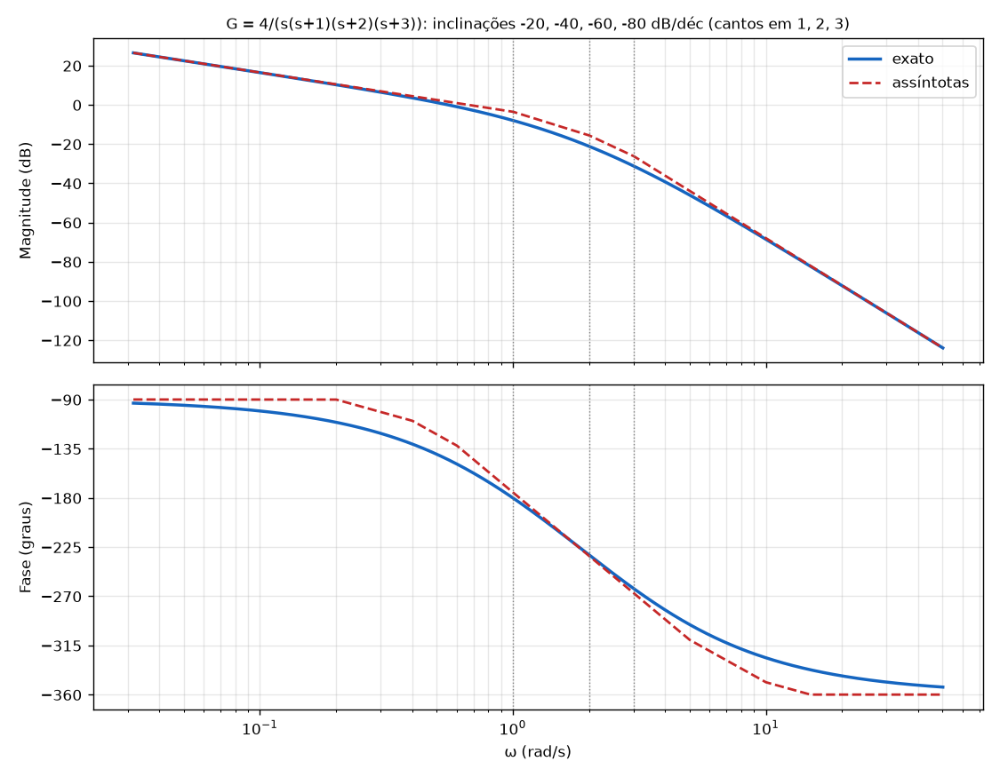

# Diagrama de Bode: passo a passo para resolver (método da Aula 11)

Receita para os exemplos da Aula 11 (`Exercicios_P2.pdf` págs. 17 a 30). Os slides trazem só exemplos resolvidos, sem exercício numerado, então esta é a forma de resolver qualquer função de transferência desse tipo. Os dois exemplos dos slides estão em [08_Aula11_Bode.md](08_Aula11_Bode.md).

**Para que serve:** o Bode mostra como `G(jω)` (a função `G(s)` com `s = jω`) amplifica e atrasa cada frequência: um gráfico de **magnitude em dB** e um de **fase em graus**, ambos contra ω em escala logarítmica. É a soma dos gráficos de cada fator.

---

## A receita (8 passos)

### Passo 1: separe os fatores
Escreva `G(s)` como produto de: uma constante, polos/zeros na origem, polos/zeros reais e pares complexos.

### Passo 2: coloque na forma de Bode
Cada fator vira `(1 + s/ω₀)` (vale 1 em ω → 0). O que sobra vai para o **ganho de Bode**:

`Kb = K · (produto dos zeros ≠ 0) / (produto dos polos ≠ 0)`

Sem polos nem zeros na origem, `Kb = G(0)` (ganho DC). Fator complexo `s² + 2ζωn s + ωn²` vira `(s²/ωn² + 2ζ s/ωn + 1)` com a constante `ωn²` para o `Kb`.

### Passo 3: converta `Kb` para dB
`Kb(dB) = 20·log₁₀|Kb|`. Referências: `Kb = 10` → 20 dB; `Kb = 2` → 6 dB; `Kb = 0,5` → −6 dB; `Kb = 1` → 0 dB.

### Passo 4: inclinação inicial (polos/zeros na origem)
Seja `R = (nº de zeros na origem) − (nº de polos na origem)`. A reta inicial tem inclinação **`20·R dB/déc`** e passa por **`Kb(dB)` em ω = 1**. A fase inicial é **`90°·R`**.

### Passo 5: frequências de canto
Para `1 + s/a`, o canto é `ω = a`. Para o par complexo, o canto é `ωn`. Ordene da menor para a maior.

### Passo 6: tabela de inclinações (magnitude)
Em cada canto, soma-se a contribuição:

| Fator | Muda a inclinação em |
|---|---|
| polo real | **−20 dB/déc** |
| zero real | **+20 dB/déc** |
| par complexo de polos | **−40 dB/déc** |
| par complexo de zeros | **+40 dB/déc** |

O valor no fim de cada faixa é `valor anterior + inclinação · log₁₀(ω_fim/ω_início)`.

### Passo 7: fase
Cada fator contribui:

| Fator | Fase |
|---|---|
| origem (por polo / por zero) | **−90° / +90°**, constante |
| polo real em `a` | 0° até `a/5`, **−45° em `a`**, −90° de `5a` em diante |
| zero real em `a` | 0° até `a/5`, **+45° em `a`**, +90° de `5a` em diante |
| zero no semiplano **direito** | mesma magnitude do zero esquerdo, mas a fase vai **0° → −45° → −90°** |
| par complexo de polos | 0° até `ωn/5`, **−90° em ωn**, −180° de `5ωn` em diante |

Some as fases de todos os fatores. A fase final (ω → ∞) é `−90°·(nº de polos − nº de zeros)`.

### Passo 8: desenhe e confira
Magnitude: segmentos de reta com as inclinações do passo 6. Fase: curva suave somando o passo 7. Confira o valor inicial e a fase final.

> Observação: o professor, nos slides (Aula 11, p.11 a 15), usa **a/5 e 5a** como faixa da transição de fase (por exemplo, polo em 20: 0° até ≈ 4, −45° em 20, −90° de ≈ 100 em diante).

---

## Exemplo completo: `G(s) = 4 / (s(s+1)(s+2)(s+3))` (Aula 11, slide 20)

**Passo 1.** Constante 4; um polo na origem; polos reais em 1, 2 e 3.

**Passo 2: forma de Bode.**

`G(jω) = 4 / [ jω · 1(jω+1) · 2(jω/2+1) · 3(jω/3+1) ]`, então `Kb = 4/(1·2·3) = 2/3`.

**Passo 3.** `Kb(dB) = 20·log(2/3) = −3,5 dB`.

**Passo 4.** `R = 0 − 1 = −1`: inclinação inicial **−20 dB/déc**, passando por **−3,5 dB em ω = 1**. Fase inicial **−90°**.

**Passo 5.** Cantos: **1, 2, 3**.

**Passo 6: tabela de inclinações.**

| Faixa de ω | Inclinação | Valor no fim da faixa |
|---|---|---|
| até 1 | −20 dB/déc | −3,5 dB (em ω = 1) |
| 1 a 2 | −20 − 20 = **−40** | `−3,5 − 40·log 2 =` **−15,6 dB** (ω = 2) |
| 2 a 3 | −40 − 20 = **−60** | `−15,6 − 60·log 1,5 =` **−26,1 dB** (ω = 3) |
| acima de 3 | −60 − 20 = **−80** | |

**Passo 7: fase.** Origem: −90°. Cada polo real soma −45° no seu canto e −90° de `5a` em diante:

| ω | Fase aproximada (soma dos fatores) | Fase exata |
|---|---|---|
| 0,1 | −90° | −100,5° |
| 1 | ≈ −175° | −180° |
| 2 | ≈ −233° | −232° |
| 3 | ≈ −267° | −263° |
| 10 | ≈ −349° | −326° |
| ω → ∞ | **−360°** (4 polos) | −360° |

**Passo 8: gráfico** (azul = exato; vermelho tracejado = assíntotas):



A diferença entre a assíntota e o valor exato é **máxima nos cantos** (3 dB num canto isolado). Em ω = 1 o exato vale −8 dB contra −3,5 dB na assíntota, porque os cantos em 2 e 3 também contribuem.

**MATLAB (slide 20):**
```matlab
[num,den]=zp2tf([],[0 -1 -2 -3],4);
G=tf(num,den);
bode(G);
grid;
```

---

## Aplicando a receita ao exemplo 1 (resumo)

`G = 40s²(s+10)/(s³(s+20)(s²+2s+2))`

| Passo | Resultado |
|---|---|
| 2 | `Kb = 40·10/(20·2) = 10`; par complexo com `ωn = √2 = 1,414` e `ζ = 0,707` |
| 3 | `Kb(dB) = 20 dB` |
| 4 | `R = 2 − 3 = −1`: −20 dB/déc, passando por 20 dB em ω = 1; fase inicial −90° |
| 5 | cantos: 1,414 (complexo), 10 (zero), 20 (polo) |
| 6 | inclinações: −20 → **−60** (em 1,414) → **−40** (em 10) → **−60** (em 20) |
| 7 | fase: −90° no início; −270° no fim (6 polos − 3 zeros = 3) |

Detalhes e a figura em [08_Aula11_Bode.md](08_Aula11_Bode.md).

---

## Erros comuns

- Esquecer que o `Kb` vem de **dividir** o produto dos zeros pelo dos polos **sem contar os da origem**.
- Somar o `+20` do zero na inclinação **do jeito errado**: zero **sobe** a inclinação, polo **desce**.
- Zero no semiplano direito: a magnitude é igual à do zero esquerdo, mas a **fase vai para o lado contrário**.
- Par complexo com `ζ < 0,707`: aparece um **pico** de ressonância perto de `ωn` (para `ζ = 0,707` não há pico). 🧩 *O valor do pico `−20·log(2ζ)` dB não está nos slides; é fórmula padrão.*
- Confundir ω em rad/s com frequência em Hz.

*(Números conferidos com Python. O MATLAB não foi rodado.)*
