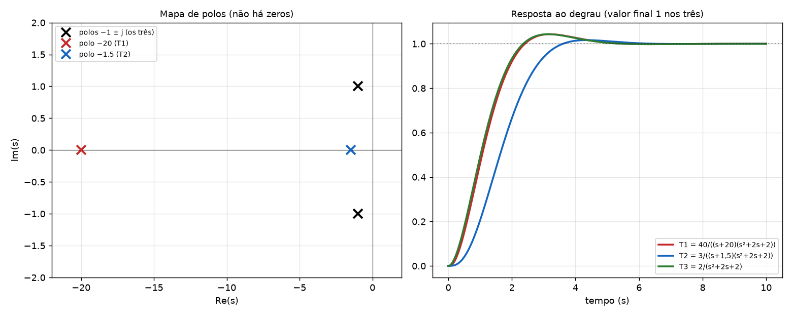
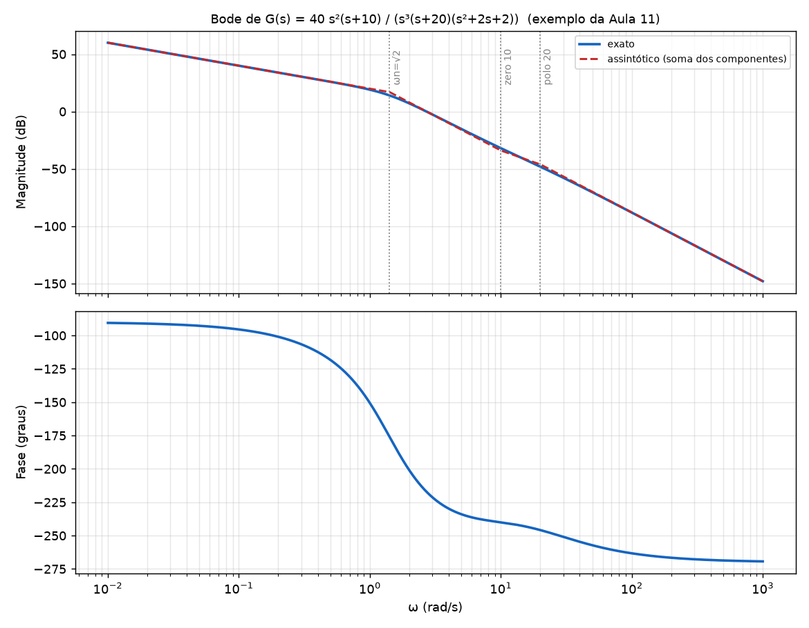
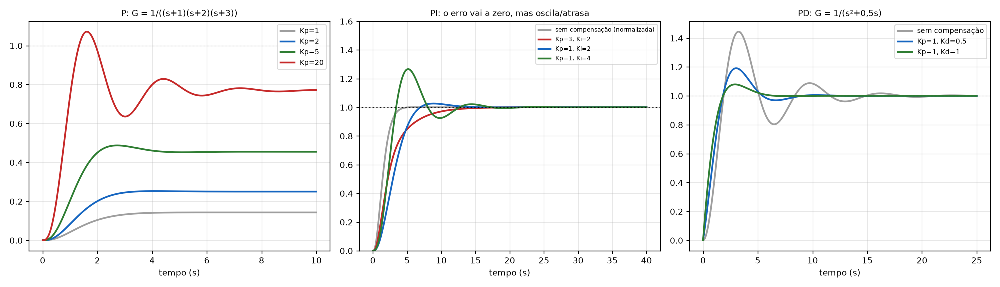
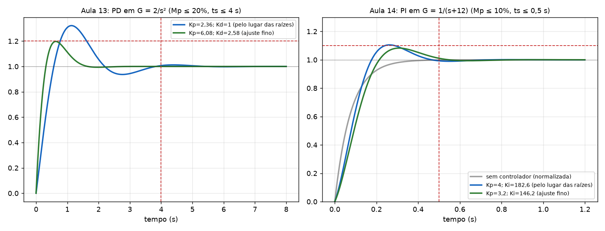

# Exercícios e exemplos dos slides da P2, resolvidos

A última prova teve questões **iguais às da lista e dos slides**, então aqui estão **todos os exercícios e exemplos numéricos dos slides da P2** (Aulas 10 a 14), com enunciado, onde está, resolução e conferência. Os da lista (Relatório 04) estão em [Gabarito_Relatorio04.md](Rel04_Resumo_das_3_questoes_com_MATLAB.md). Teoria: [Resumo_Controle_P2.md](../Resumo_Controle_P2.md). Passos: [Tutorial_Controle_P2.md](../Tutorial_Controle_P2.md).

## Resultado da busca nos slides

| Slide | Tem exercício? | O que é | Onde está aqui |
|---|---|---|---|
| **Aula 10, p.3** | **Sim, explícito** ("Exercício") | mapa de polos e zeros + resposta ao degrau de T₁, T₂, T₃ | [§1](#e1) |
| Aula 10, p.4 a 7 | exemplo resolvido | polos dominantes, resíduos, resposta ao degrau `40/((s+20)(s+2)(s+1))` | [§1](#e1), [§2](#e2) |
| Aula 10, p.13 e 14 | exemplo (motivação) | `G = K/((s+1)(s+2)(s+3))` com K = 18 | [§3](#e3) |
| Aula 10, p.19 a 22 | exemplo resolvido | compensador **LAG** em `K(s+8)/((s+3)(s+2)(s+1))` | [§4](#e4) |
| Aula 10, p.24 a 27 | exemplo resolvido | compensador **LEAD** em `K/((s+3)(s+2))` | [§5](#e5) |
| Aula 11 | exemplos resolvidos | Bode de `40s²(s+10)/(s³(s+20)(s²+2s+2))` e de `4/(s(s+1)(s+2)(s+3))`, vários elementos | [§6](#bode) |
| Aula 12, p.3 a 11 | exemplos (só gráficos) | efeito de P, PI, PD | [§7](#e7) |
| **Aula 13** | exemplo resolvido completo | projeto de **PD** em `2/s²` | [§8](#e8) |
| **Aula 14** | exemplo resolvido completo | projeto de **PI** em `1/(s+12)` | [§9](#e9) |

Só um é chamado de "Exercício" no slide (Aula 10, p.3); os outros são "Exemplo", e é onde costuma estar o que cai na prova (principalmente os projetos PD e PI das Aulas 13 e 14, o LAG/LEAD da Aula 10 e o Bode da Aula 11).

---

<a id="e1"></a>
## 1. Aula 10 (p.3): "Exercício": mapa de polos e zeros e resposta ao degrau de T₁, T₂, T₃

**Enunciado:** faça o mapa de polos e zeros e a resposta ao degrau dos 3 sistemas:

- `T₁(s) = 40/((s+20)(s+1+j)(s+1−j))`
- `T₂(s) = 3/((s+1,5)(s+1+j)(s+1−j))`
- `T₃(s) = 2/((s+1+j)(s+1−j))`

**Resolução:**

1. **Mapa de polos e zeros.** Nenhum tem zeros. Polos:
   - `T₃`: −1 ± j.
   - `T₁`: −1 ± j e **−20**.
   - `T₂`: −1 ± j e **−1,5**.



2. **Ganho DC** (`T(0)`): `T₁ = 40/(20·2) = 1`, `T₂ = 3/(1,5·2) = 1`, `T₃ = 2/2 = 1`. Todos terminam em **1** (a mesma altura final).

3. **Frações parciais e resíduos** (valores do slide, conferidos com `residue`):

| | Resíduo do polo real | Resíduo dos complexos (módulo) |
|---|---|---|
| `T₁` | **0,1105** (polo −20) | 1,0512 |
| `T₂` | **2,4** (polo −1,5) | 1,3416 |

   - `T₁ = 0,1105/(s+20) − (0,0552 − j1,0497)/(s+1+j) − (0,0552 + j1,0497)/(s+1−j)`
   - `T₂ = 2,4/(s+1,5) − (1,2 + j0,6)/(s+1+j) − (1,2 − j0,6)/(s+1−j)`

4. **Dominância:**
   - `T₁`: relação das partes reais `20/1 = 20 > 5` e resíduo do polo real **0,11 ≪ 1,05**. O polo −20 **não domina**: `T₁` se comporta como **`T₃`** (2ª ordem com ωn = √2, ζ = 0,707).
   - `T₂`: relação `1,5/1 = 1,5` (< 5) e resíduo do polo real **2,4 > 1,34**. O polo real **domina ou compete**, então **`T₂` não é 2ª ordem**: a resposta fica mais lenta e **sem overshoot** relevante (a figura mostra).

5. **Resposta ao degrau** (conferida numericamente):

| Sistema | Overshoot | Tempo de acomodação (2 %) | Observação |
|---|---|---|---|
| `T₃` | 4,3 % (ζ = 0,707) | ≈ 4,2 s | 2ª ordem padrão |
| `T₁` | 4,3 % | ≈ 4,3 s | **quase idêntico a T₃** |
| `T₂` | 1,7 % | ≈ 3,3 s | polo −1,5 domina; não é 2ª ordem |

**Frase da conclusão (slide p.4):** "A F.T. de terceira ordem `T₁(s)` se comporta como a de segunda `T₃(s)` devido aos polos dominantes."

---

<a id="e2"></a>
## 2. Aula 10 (p.6 e 7): resposta ao degrau de `G = 40/((s+20)(s+2)(s+1))`

**Dado:** `G(s) = 40/(s³ + 23s² + 62s + 40)`.

**Resolução (frações parciais, `residue`):**

`G(s) = 0,117/(s+20) − 2,222/(s+2) + 2,105/(s+1)`

Transformada inversa: `L⁻¹{1/(s+a)} = e^(−at)`, e, para o degrau, `L⁻¹{1/(s(s+a))} = (1 − e^(−at))/a`. Então:

`g(t) = 0,117e^(−20t) − 2,222e^(−2t) + 2,105e^(−t)`

`y(t) = 0,117/20·(1 − e^(−20t)) − 2,222/2·(1 − e^(−2t)) + 2,105/1·(1 − e^(−t))`

**`y(t) = 0,006(1 − e^(−20t)) − 1,111(1 − e^(−2t)) + 2,105(1 − e^(−t))`**

Conferência: valor final `0,006 − 1,111 + 2,105 = 1,000` ✓ (= `G(0) = 40/40`).

**Leitura:** o termo do polo −20 vale só **0,006** (desprezível); a resposta é comandada pelos polos −1 e −2.

---

<a id="e3"></a>
## 3. Aula 10 (p.13 e 14): `G = K/((s+1)(s+2)(s+3))` com K = 18

**Dado:** malha fechada para K = 18: `T = 18/((s+4,75)(s+0,63−j2,16)(s+0,63+j2,16))`.

**Verificação:** polinômio característico `(s+1)(s+2)(s+3) + 18 = s³ + 6s² + 11s + 24`, com raízes **−4,75** e **−0,63 ± j2,16** ✓.

**Leituras do slide:**

- Valor final `18/(6 + 18) = 0,75` (**erro 25 %** ao degrau).
- Pólos complexos com `ζ = 0,28` e overshoot ≈ 40 % (informação do cursor do MATLAB na p.14).
- Objetivos que não saem só com K: **reduzir o tempo de subida mantendo o overshoot** (polos mais afastados na mesma reta de ζ) e **diminuir o erro**.
- **"Pode não ser possível obter os resultados desejados apenas variando o ganho"**: é a motivação dos compensadores (LAG e LEAD).

---

<a id="e4"></a>
## 4. Aula 10 (p.17 a 22): compensador LAG

**Dado:** `G(s) = K(s+8)/((s+3)(s+2)(s+1))`. Compensador `Gc = Kc (s+1/T)/(s+1/(αT))` com `T = α = 10`:

`Gc(s) = Kc (s + 1/10)/(s + 1/100)`

**Resolução:**

1. **`G(0)`:** `G(0) = 8K/6 = 4K/3`.
2. **Ganho DC do compensador:** `Gc(0) = Kc·(0,1/0,01) = 10·Kc` (= `Kc·α`).
3. **Erro ao degrau (teorema do valor final):** `e(∞) = 1/(1 + Gc(0)G(0))`.
4. **Ganho limite** (sem compensador): polinômio `s³ + 6s² + (11+K)s + (6+8K)`; Routh: `6(11+K) = 6 + 8K` → **K = 30**.

**Resultados (conferidos):**

| Caso | Cálculo | e(∞) | Observação |
|---|---|---|---|
| Sem LAG, K = 1 | `1/(1 + 4/3) = 3/7` | **0,428** | |
| Sem LAG, K = 28 | `1/(1 + 4·28/3) = 3/115` | **0,026** | K quase no limite (30): resposta muito oscilatória (polo em −0,02 ± j6,26 no gráfico) |
| Com LAG, Kc = 1, K = 1 | `1/(1 + 10·4/3) = 3/43` | **0,07** | |
| Com LAG, **Kc = 5**, K = 1 | `1/(1 + 50·4/3) = 3/203` | **0,015** | erro menor que o de K = 28, **sem** chegar perto do limite |

**Conclusão (slide p.22):** o lugar das raízes com o LAG é **praticamente o mesmo** do original (polo e zero perto da origem se cancelam), mas o **ganho DC aumenta 10 vezes** e o erro cai, **ao custo de uma resposta mais lenta**.

---

<a id="e5"></a>
## 5. Aula 10 (p.23 a 27): compensador LEAD

**Dado:** `G(s) = K/((s+3)(s+2))`. **Objetivo:** criar polos dominantes em `s = −4 ± j4`. **Problema:** o lugar das raízes de `K/((s+2)(s+3))` é uma reta vertical em −2,5, então **só aumentar K não leva a −4 ± j4**.

**Resolução (o professor arbitra o zero, calcula o polo):**

1. Ângulos até `s₀ = −4 + j4` (anti-horário):
   - polo −2: `180° − tan⁻¹(4/2) = 116,57°`
   - polo −3: `180° − tan⁻¹(4/1) = 104,04°`
2. **1ª tentativa, zero em −4:** ângulo do zero `90°`. `θp = 90° − 104,04° − 116,57° + 180° = 49,39°` → `p = 4 + 4/tan(49,39°) = 4 + 4/1,17 = 7,42`. O polo em −7,42 está **perto dos polos da planta** (pode dominar). Tenta outro zero.
3. **2ª tentativa, zero em −5:** ângulo do zero `tan⁻¹(4/1) = 75,96°`. `θp = 75,96° − 104,04° − 116,57° + 180° = 35,35°`; `tan(35,35°) = 0,71` → **`p = 4 + 4/0,71 = 9,63`**.
4. **Parâmetros do compensador:** `Gc = Kc (s+5)/(s+9,63)`:
   - `1/T = 5` → `T = 0,2`;
   - `1/(αT) = 9,63` → `α = 1/(0,2·9,63) = 0,52` (**0 < α < 1**: LEAD ✔).
5. **Ganho (módulo em `s₀`):**
   `Kc·K = |s₀+2|·|s₀+3|·|s₀+9,63| / |s₀+5| = 4,472 · 4,123 · 6,906 / 4,123 = 30,9`.
6. **Malha aberta:** `Gc·G = Kc·K (s+5)/((s+9,63)(s+3)(s+2))`. O lugar das raízes passa por `−4 ± j4` quando **`Kc·K = 30,9`**.

**Por que o zero em −5 e não em −4?** O polo do compensador precisa ficar **bem à esquerda** dos polos da planta (−2, −3) para **não ser dominante**: −7,42 era perto demais; −9,63 é melhor.

---

<a id="bode"></a>
## 6. Aula 11: Bode (todos os exemplos dos slides)

### 6.1 Exemplo principal: `G(s) = 40 s²(s+10) / (s³(s+20)(s+1+j)(s+1−j))`

Note `(s+1+j)(s+1−j) = s² + 2s + 2`.

**Passo 1: forma de Bode.**

`G(jω) = 40·(jω)²·10·(jω/10 + 1) / [ (jω)³ · 20(jω/20 + 1) · 2((jω)²/2 + jω + 1) ]`

`Kb = 40·10/(20·2) = 10`, e o par complexo tem `ωn = √2 = 1,414` e `ζ = 1/√2 = 0,707` (de `s²/ωn² + 2ζs/ωn + 1` com `ωn² = 2` e `2ζ/ωn = 1`).

**Passo 2: componentes.**

| Componente | Magnitude | Fase |
|---|---|---|
| Constante `Kb = 10` | `20·log 10 = 20 dB` | 0° |
| `(jω)²/(jω)³ = 1/(jω)` (3 polos e 2 zeros na origem) | **−20 dB/déc** | **−90°** |
| Zero em −10 | +20 dB/déc a partir de ω = 10 | 0° → +45° em 10 → +90° |
| Polo em −20 | −20 dB/déc a partir de ω = 20 | 0° → −45° em 20 → −90° |
| Par complexo (ωn = 1,414; ζ = 0,707) | −40 dB/déc a partir de 1,414 | 0° → −90° em ωn → −180° |

**Passo 3: magnitude assintótica** (inclinação inicial `20·(2 − 3) = −20 dB/déc`, passando por `20 dB` em ω = 1):

| Faixa | Inclinação | Valor no fim da faixa |
|---|---|---|
| ω < 1,414 | −20 dB/déc | `20 − 20·log 1,414 = 17,0 dB` |
| 1,414 a 10 | −20 − 40 = **−60** | `17,0 − 60·log(10/1,414) = −34,0 dB` |
| 10 a 20 | −60 + 20 = **−40** | `−34,0 − 40·log 2 = −46,0 dB` |
| ω > 20 | −40 − 20 = **−60** | |

**Passo 4: fase total:** começa em **−90°** (ω → 0) e termina em **−270°** (ω → ∞: 6 polos − 3 zeros = 3 → −270°).



(A figura mostra o Bode exato em azul e a soma das assíntotas em vermelho tracejado. Como ζ = 0,707, **não há pico de ressonância**: o pico só aparece para ζ < 0,707.)

**MATLAB (slide):**
```matlab
[num,den]=zp2tf([0 0 -10]',[0 0 0 -20 -1-1i -1+1i],40);
G=tf(num,den);
bode(G);
grid;
```

### 6.2 Exemplo: `G(s) = 4/(s(s+1)(s+2)(s+3))`

- `Kb = 4/(1·2·3) = 2/3` → **−3,5 dB**; 1 polo na origem; polos em 1, 2, 3.
- Inclinações: −20 (até 1), −40 (1 a 2), −60 (2 a 3), −80 (acima de 3).
- Valores assintóticos: ω = 1 → −3,5 dB; ω = 2 → −15,6 dB; ω = 3 → −26,1 dB.
- Fase: de −90° até −360° (4 polos).
- MATLAB: `[num,den]=zp2tf([],[0 -1 -2 -3],4); G=tf(num,den); bode(G); grid;`

### 6.3 Elementos isolados (os exemplos numéricos dos slides)

| Exemplo do slide | O que é | Resultado |
|---|---|---|
| `1/(1 + jω/20)` | polo real em −20 | corte em 20; −20 dB/déc depois; fase 0° até 4, **−45° em 20**, −90° a partir de 100 |
| `1 + jω/10` | zero real em −10 | corte em 10; +20 dB/déc; fase 0° até 2, **+45° em 10**, +90° a partir de 50 |
| `1 − jω/100` | zero no **semiplano direito** (+100) | **mesma magnitude** do zero em −100; fase **0°, −45° em 100, −90°** a partir de 500 |
| `2/(s²+2s+2)` | polos complexos, ωn = √2, ζ = 1/√2 | `MAG = −10·log[(1 − ω²/2)² + ω²] = −10·log(1 + ω⁴/4)`; `φ = −tan⁻¹(2ω/(2 − ω²))` |
| `(jω)^R` polos / zeros na origem | `G = 1/(jω)³` e `(jω)²` | `MAG = −60·log ω`, fase −270° (polos); `+40·log ω`, +180° (zeros) |
| Constante | `Kb = 40·10/(20·2)` | **20 dB**, fase 0° |

**Laplace → Fourier (slide p.2 a 5, só exemplo):** `H(s) = (10s²+28s+24)/(s²+4s+8) = 10 (s+1,4±j0,66)/(s+2±j2)`. Ganho em baixa frequência `H(0) = 24/8 = 3` (9,5 dB); em alta frequência `→ 10` (20 dB). A transformada de Fourier é a de Laplace calculada em `s = jω`.

---

<a id="e7"></a>
## 7. Aula 12 (p.3 a 11): efeito de P, PI, PD (exemplos dos slides, recalculados)

Os slides mostram só os **gráficos**; abaixo estão os números (conferidos por simulação) e os gráficos refeitos.



### 7.1 P: `G = 1/((s+1)(s+2)(s+3))`, `C = Kp`

| Kp | Valor final `Kp/(6+Kp)` | Erro estacionário | Overshoot | Polos dominantes |
|---|---|---|---|---|
| 1 (sem compensação) | 0,143 | 0,857 | ≈ 0 % | −1,34 ± j0,56 |
| 2 | 0,25 | 0,75 | 1 % | −1,24 ± j0,86 |
| 5 | 0,455 | 0,545 | 7 % | −1,05 ± j1,31 |
| 20 | 0,769 | 0,231 | **39 %** | −0,58 ± j2,24 |

**Efeitos confirmados:** o tempo de subida cai; o overshoot cresce; o erro diminui (mas **não zera**); a ordem não muda.

### 7.2 PI: mesma planta, `C = Kp + Ki/s`

| Kp | Ki | Overshoot | ts (2 %) | Erro |
|---|---|---|---|---|
| 3 | 2 | 0 % (lento) | ≈ 11 s | **0** |
| 1 | 2 | 2,6 % | ≈ 10 s | **0** |
| 1 | 4 | **26,6 %** | ≈ 15 s | **0** |

**Efeitos confirmados:** o erro vai a **zero** (polo em 0), mas aumentar **Ki** aumenta o overshoot e o ts (Kp = 1: Ki 2 → 4); sistema de 4ª ordem.

### 7.3 PD: `G = 1/(s² + 0,5s)`, `C = Kp + Kd s`

| Kp | Kd | Overshoot | ts (2 %) |
|---|---|---|---|
| 1 | 0 (sem compensação) | **44 %** | ≈ 14 s |
| 1 | 0,5 | 19 % | ≈ 7,7 s |
| 1 | 1 | **7,9 %** | ≈ 5,1 s |

**Efeito confirmado:** aumentar **Kd diminui overshoot e ts**.

---

<a id="e8"></a>
## 8. Aula 13: projeto do PD (exemplo completo)

**Enunciado:** `G = 2/s²`, Mp máx. 20 %, ts (2 %) máx. 4 s, controlador PD.

**Resolução (passos da Aula 13):**

1. **Polos dominantes.** `ζmin`: `0,2 = e^(−πζ/√(1−ζ²))` → `ζmin = 0,46`. `ts = 4/(ζωn) = 4` → `(ζωn)min = 1` → `ωn = 1/0,46 = 2,174`; `ωd = 2,174·√(1 − 0,46²) = 1,93`. **Polos: −1 ± j1,93.**
2. **P basta?** O lugar de `K·2/s²` é o eixo imaginário (polos em 0 duplo): não passa por −1 ± j1,93. **Não**: PD necessário.
3. **Condição de fase:** `C·G = 2Kd(s+z)/s²`. Ângulo de cada polo em 0 até `−1 + j1,93`: `180° − tan⁻¹(1,93/1) = 117,4°`. A soma é `2 × 117,4° = 234,8°`.
   `θz − 234,8° = −180°` → `θz = 54,8°`.
   `tan(54,8°) = 1,93/(z − 1) = 1,418` → `z − 1 = 1,36` → **`z = 2,36`**.
4. **Condição de módulo:** `2Kd·|s₀+2,36| / |s₀|² = 1`:
   `|s₀+2,36| = √(1,36² + 1,93²) = 2,36`; `|s₀|² = 1 + 3,72 = 4,72` → `Kd = 4,72/(2·2,36) = 1`. Logo **`Kd = 1`**, **`Kp = z·Kd = 2,36`**, `C = 2,36 + s`.
5. **Simulação:** **Mp = 32 %**, ts = 3,5 s (✔ conferido: 32,2 % e 3,50 s): **não atende o overshoot**.
6. **Ajuste fino:** mantém `z = 2,36` e sobe o ganho: **`Kd = 2,58`**, **`Kp = 6,08`**, `C = 2,58(s + 2,36) = 2,58s + 6,08`. Resultado: **Mp < 20 %**, **ts < 4 s** ✔ (conferido: 19,7 % e 1,4 s).
7. **Erro estacionário (degrau):** `e(∞) = lim s·(1/s)·1/(1 + CG) = lim s²/(s² + 5,16s + 12,18) = 0`. A planta já tem dois integradores (tipo 2).
8. **Malha fechada:** `T = 5,16(s+2,36)/(s² + 5,16s + 12,18) = 5,15(s+2,36)/((s+2,58−j2,35)(s+2,58+j2,35))`.



**Implementação com amplificadores operacionais:**

- `C(s) = 2,58(s + 2,36) = 6,089(0,424s + 1)` (forma `Kp(1 + Td s)` com `Kp = 6,089` e `Td = 0,424 s`).
- Integrador inversor: `Vo/Vin = −1/(RCs)`. Dois integradores inversores em cascata dão `G = 2/s²` (com `R₁C₁ = 1` e `R₂C₂ = 0,5`).
- Somador/subtrator com resistores iguais: `Vo = Vin1 − Vin2` (forma o erro `X − Y`).

---

<a id="e9"></a>
## 9. Aula 14: projeto do PI (exemplo completo)

**Enunciado:** `G = 1/(s+12)`, Mp máx. 10 %, **erro zero** ao degrau, ts (2 %) máx. 0,5 s, controlador PI.

**Resolução (passos da Aula 14):**

1. **Polos dominantes.** `ζmin`: `0,1 = e^(−πζ/√(1−ζ²))` → `ζmin = 0,59`. `ts = 4/(ζωn) = 0,5` → `(ζωn)min = 8` → `ωn = 8/0,59 = 13,56`; `ωd = 13,56·√(1−0,59²) = 10,9`. **Polos: −8 ± j10,9.**
2. **P basta?** Não: planta de 1ª ordem com P só tem polo real (nunca complexo), e com P o erro seria `1/(1 + Kp/12) ≠ 0`.
3. **Condição de fase.** `C·G = Kp(s+z)/(s(s+12))`. Ângulos até `−8 + j10,9`:
   - polo em 0: `180° − tan⁻¹(10,9/8) = 126,3°`
   - polo em −12: `tan⁻¹(10,9/4) = 69,8°`
   `θz − 126,3° − 69,8° = −180°` → `θz = 16,1°`
   `tan(16,1°) = 10,9/(z − 8) = 0,289` → **`z = 8 + 10,9/0,289 = 45,7`**.
4. **Condição de módulo:** `Kp·|s₀+45,7| / (|s₀|·|s₀+12|) = 1`:
   `|s₀| = 13,5`; `|s₀+12| = |4 + j10,9| = 11,6`; `|s₀+45,7| = |37,7 + j10,9| = 39,2`.
   **`Kp = 13,5·11,6/39,2 = 4`**, **`Ki = z·Kp = 182,6`**. `C = 4 + 182,6/s`.
5. **Simulação:** **Mp ≈ 10,5 % (> 10 %)**, ts < 0,5 s: precisa de **ajuste fino**.
6. **Ajuste fino:** reduz o ganho: `Kp = 0,8·4 = 3,2` e **`Ki = z·Kp = 45,7 × 3,2 = 146,2`**. `C = 3,2 + 146,2/s`. Resultado: **Mp < 10 %**, **ts < 0,5 s** ✔ (conferido: 8,2 % e 0,47 s).
7. **Malha fechada (projeto original):** `T = 4(s + 45,7)/((s+8−j10,9)(s+8+j10,9))`; **(final)** `T = 3,2(s+45,7)/((s+7,6−j9,4)(s+7,6+j9,4))`.

**Erro:** o PI tem um polo em 0, então a malha é tipo 1: erro ao degrau **zero** ✔.

---

## Como estudar esta lista

1. Refaça cada resolução **sem olhar**, usando os passos do [tutorial](../Tutorial_Controle_P2.md).
2. Confira os números principais: **z = 2,36; Kd = 1; Kd = 2,58 (PD)** e **z = 45,7; Kp = 4; Kp = 3,2; Ki = 146,2 (PI)**.
3. No LAG, saiba calcular `e(∞)` pelos 4 casos; no LEAD, saiba **por que o zero em −5** e **p = 9,63, α = 0,52, Kc·K = 30,9**.
4. No Bode, saiba montar a **tabela de inclinações** e a fase total do exemplo `40s²(s+10)/(...)`.
