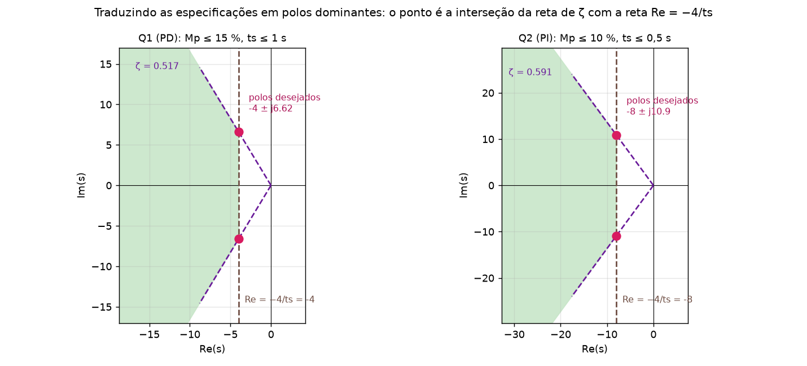

# Tutorial: como resolver os exercícios da P2 (do jeito do professor Guisso)

> **Versão completa e explicada do zero (para quem está vendo a matéria pela primeira vez):** [Tutorial_Controle_P2_Completo.md](Tutorial_Controle_P2_Completo.md). Este arquivo é o resumo em receitas.

Cobre o `Relatório 04` (PD, PI, PID com Ziegler-Nichols) e os exemplos dos slides das Aulas 10 a 14. Teoria em [Resumo_Controle_P2.md](Resumo_Controle_P2.md). Resolvidos: [Gabarito_Relatorio04.md](Gabarito_Relatorio04.md) e [Exercicios_dos_Slides_P2.md](Exercicios_dos_Slides_P2.md). A P1 é a base: [Tutorial_Controle_P1.md](../P1/Tutorial_Controle_P1.md).

## Índice

0. [Qual receita usar?](#s0)
1. [Receita A: traduzir especificações em polos dominantes](#a)
2. [Receita B: projetar um PD](#b)
3. [Receita C: projetar um PI](#c)
4. [Receita D: PID por Ziegler-Nichols de malha fechada 🧩](#d)
5. [Receita E: ajuste fino (como o professor faz)](#e)
6. [Receita F: compensadores LAG e LEAD](#f)
7. [Receita G: polos dominantes e resíduos](#g)
8. [Receita H: diagrama de Bode](#h)
9. [Receita I: efeito dos controladores (perguntas teóricas)](#i)
10. [Conferência no MATLAB (no formato do professor)](#j)
11. [Erros que mais custam pontos](#k)
12. [Checklist final](#chk)

<a id="s0"></a>
## 0. Qual receita usar?

| O enunciado pede... | Receita |
|---|---|
| "Projete um controlador **PD** para Mp ≤ ..% e ts ≤ .. s" | A + B (+ E) |
| "Projete um controlador **PI** para Mp ≤ ..%, erro zero, ts ≤ .. s" | A + C (+ E) |
| "Projete um **PID** pelo método **Ziegler-Nichols**" | D (+ E) |
| "Faça o **ajuste fino**" / "para obter overshoot menor que.." | E |
| "Projete um compensador por **avanço/atraso de fase**" | F |
| "Faça o **mapa de polos e zeros** e a **resposta ao degrau**" / "polo dominante" | G |
| "Trace o **diagrama de Bode**" | H |
| "Qual o efeito de aumentar Kp/Ki/Kd?" / "quando usar PI, PD..?" | I |

<a id="a"></a>
## 1. Receita A: traduzir especificações em polos dominantes

(É sempre o **passo 1** de PD, PI e dos compensadores. Vem de Aula 13, p.2 e 11 a 12.)

1. **Overshoot → ζmin:** `ζmin = −ln(Mp) / √(π² + ln²(Mp))`, com `Mp` em fração.
   Ex.: 15 % → `ln 0,15 = −1,897` → `ζmin = 0,517`. Outros: 10 % → 0,591; 20 % → 0,456.
2. **Tempo de acomodação → σ:** para o critério de 2 %, `ts = 4/σ` → **`σ = 4/ts`** (é a parte real do polo, `ζωn`).
3. **ωn:** `ωn = σ/ζmin`.
4. **ωd:** `ωd = ωn·√(1 − ζmin²)`.
5. **Polos dominantes desejados:** **`s₀ = −σ ± jωd`**.

Visualização: é a **interseção** da reta de `ζ = ζmin` (a `cos⁻¹(ζmin)` do eixo real negativo) com a reta vertical `Re = −σ`. Qualquer ponto à esquerda e dentro do cone também atende; o projeto escolhe o ponto da **borda** (o mais "econômico").



**Exemplo numérico do Relatório 04:**

| Questão | Especificação | ζmin | σ = 4/ts | ωn | ωd | Polos desejados |
|---|---|---|---|---|---|---|
| Q1 (PD) | Mp 15 %, ts 1 s | 0,517 | 4 | 7,738 | 6,624 | **−4 ± j6,624** |
| Q2 (PI) | Mp 10 %, ts 0,5 s | 0,591 | 8 | 13,53 | 10,915 | **−8 ± j10,915** |

<a id="b"></a>
## 2. Receita B: projetar um PD (`C = Kd(s + z)`, `z = Kp/Kd`)

Dados: planta `G(s)`, especificações. (Aula 13, p.9.)

**Passo 1.** Calcule os polos dominantes `s₀` (receita A).

**Passo 2: P basta?** Teste se `s₀` **pertence ao lugar das raízes** de `K·G(s)`: some os ângulos dos polos de `G` até `s₀`. Se **não** for ±180°, o ponto **não** está no lugar, e só aumentar K não resolve → precisa do PD.
- Ângulos: do polo `−p` até `s₀`, `θ = ∠(s₀ + p)` (anti-horário a partir do eixo real positivo). Polos de `G` entram com sinal **−**.

**Passo 3: onde fica o zero?** Condição de fase: `θz − Σ θpolos = −180°` (zero com sinal +).

`θz = Σ θpolos − 180°`

O zero em `−z` vê `s₀` sob o ângulo `θz`: `tan θz = ωd/(z − σ)`, logo

**`z = σ + ωd / tan(θz)`**

**Passo 4: ganho** (condição de módulo `|C(s₀)G(s₀)| = 1`):

`Kd = ∏|s₀ − pk| / ( K_G · |s₀ + z| )`

onde `pk` são os polos de `G` e `K_G` é o ganho de `G` (o número no numerador, se for mônico no resto). Depois `Kp = z·Kd`.

**Passo 5: erro estacionário.** Calcule a constante (Kp, Kv, Ka) com `C(s)G(s)`. O PD **não** adiciona integrador: o tipo é o da planta.

**Passo 6: simule** e confira Mp e ts (MATLAB). O zero do controlador costuma **aumentar** o overshoot: faça o **ajuste fino** (receita E).

**Passo 7 (prático).** Um derivador puro amplifica ruído em alta frequência; coloque um polo longe: `C(s) = (Kp + Kd s)/(1 + s/a)`.

**Exemplo do slide (Aula 13):** planta `2/s²`, Mp ≤ 20 %, ts ≤ 4 s → `s₀ = −1 ± j1,93`; ângulos dos dois polos em 0: `2×117,4° = 234,8°`; `θz = 54,8°`; `z = 2,36`; `Kd = 1`, `Kp = 2,36`; simulação: Mp 32 %, ts 3,5 s → ajuste fino `Kd = 2,58`, `Kp = 6,08`. Resolvido em [Exercicios_dos_Slides_P2.md](Exercicios_dos_Slides_P2.md).

<a id="c"></a>
## 3. Receita C: projetar um PI (`C = Kp(s + z)/s`, `z = Ki/Kp`)

Dados: planta `G(s)`, especificações. (Aula 14, p.2.)

**Passo 1.** Polos dominantes `s₀` (receita A).

**Passo 2: P basta?** Se **só P** não pode dar polos complexos (planta de 1ª ordem) ou se o enunciado exige **erro zero** ao degrau, vá para PI. (Planta tipo 0 com P: erro `1/(1 + Kp·G(0))` ≠ 0.)

**Passo 3: zero.** O PI tem um **polo na origem**: some também o ângulo desse polo (`∠s₀`, que vale `180° − tan⁻¹(ωd/σ)`).

`θz = Σ θpolos (planta + o polo em 0) − 180°`, e `z = σ + ωd / tan(θz)`

**Passo 4: ganho:**

`Kp = |s₀|·∏|s₀ − pk| / ( K_G · |s₀ + z| )`

(`|s₀|` é o módulo do polo na origem do PI.) Depois **`Ki = z·Kp`**.

**Passo 5: simule** e faça ajuste fino se preciso.

**Exemplo do slide (Aula 14):** planta `1/(s+12)`, Mp ≤ 10 %, ts ≤ 0,5 s → `s₀ = −8 ± j10,9`; ângulos: polo 0 `126,3°`, polo −12 `69,8°` → `θz = 16,1°` → `z = 45,7`; `Kp = 4`, `Ki = 182,6`; simulação Mp ≈ 10,5 % → ajuste fino `Kp = 3,2`, `Ki = 146,2`.

**Atalho útil 🧩 (cancelamento):** se a planta é `K/(s + a)`, escolher `z = a` **cancela** o polo da planta e dá `C·G = K·Kp/s`: malha fechada de **1ª ordem** `T = KKp/(s + KKp)`, **sem overshoot**, com `ts = 4/(K·Kp)`. Mas a malha só fica assim se o modelo da planta for exato (cancelamentos são frágeis).

<a id="d"></a>
## 4. Receita D: PID por Ziegler-Nichols de malha fechada 🧩

(Pedido na Q3 do Relatório 04. O método **não está** nos slides da pasta; confira com o caderno.)

**Passos:**

1. **Fixe `Ki = Kd = 0`** (só P, com ganho `K`). Escreva o **polinômio característico** de malha fechada: `1 + K·G(s) = 0` → `A(s) + K·B(s) = 0`.
2. **Routh com K literal.** O **ganho crítico `Ku`** é o K que **zera a linha s¹** (oscilação sustentada).
3. **Equação auxiliar** (linha s²) com `K = Ku`: dá `s = ±jωu`. Período crítico **`Pu = 2π/ωu`**.
   - Isso é o mesmo cruzamento com jω do lugar das raízes: confira com `rlocus` e `[K,polos] = rlocfind(G)`.
4. **Tabela ZN (PID):** `Kp = 0,6·Ku`, `Ti = Pu/2`, `Td = Pu/8`.
5. **Converta para a forma dos slides:** `Ki = Kp/Ti` e `Kd = Kp·Td`, com `C(s) = Kp + Ki/s + Kd·s`.
6. **Simule.** ZN costuma dar overshoot de 40 a 60 %: faça o **ajuste fino** (receita E) até atender Mp e ts.

<a id="e"></a>
## 5. Receita E: ajuste fino (como o professor faz)

Quando a simulação não atende (acontece nos dois exemplos dos slides), ajuste **os ganhos**, sem refazer o projeto.

**Regras do professor (Aula 12, tabela de efeitos):**

| Para... | Faça |
|---|---|
| Diminuir **overshoot** | **aumentar Kd**; diminuir Kp e/ou Ki |
| Diminuir **ts** | **aumentar Kd**; (Ki pequeno ajuda) |
| Anular erro | manter Ki > 0 (**mas** Ki grande aumenta overshoot e ts) |
| Resposta mais rápida | aumentar Kp (aumenta overshoot) |

**Truque dos slides:** mantenha o **zero** `z` e **mude só o ganho**:
- PD (Aula 13): `Kd` de 1 para **2,58**, com `Kp = z·Kd` (sobe o ganho).
- PI (Aula 14): `Kp` de 4 para **3,2** (= 0,8·4), com `Ki = z·Kp` (desce o ganho).

**Atenção, o truque não é universal.** Ele funcionou nos exemplos dos slides, mas **na Q2 do Relatório 04 (PI em `3/(s+4)`) reduzir Kp piora** o overshoot (Kp = 3,2 dá 18,4 %). Lá o problema é o **zero do PI em −15,3**, que acrescenta overshoot; o que resolveu foi **aproximar o zero da origem** (z = 6) e **subir o Kp** (5). Regra: o overshoot extra vem do **zero do controlador**; se ele está longe da origem (z grande), traga-o para perto; se está perto, reduza o ganho. Sempre **simule** para decidir.

**Se isso não bastar,** mova o zero: aproximar o zero da origem (`z` menor) aumenta a ação derivativa relativa (PD) ou antecipa o integrador (PI).

**Sempre confirme** por simulação (`step`, `stepinfo`) e confira também que **todos os polos** de malha fechada estão no semiplano esquerdo.

<a id="f"></a>
## 6. Receita F: compensadores LAG e LEAD (Aula 10)

### F.1 LAG: reduzir erro estacionário sem mexer no lugar das raízes

`Gc = Kc (s + 1/T)/(s + 1/(αT))`, `α > 1` (polo mais perto da origem que o zero).

1. Calcule o erro atual: `e = 1/(1 + K·G(0))`.
2. Escolha `α` (ganho DC extra: `Gc(0) = Kc·α`) para atingir o erro desejado: `e = 1/(1 + Kc·α·G(0))`.
3. Coloque o zero e o polo **perto da origem e perto um do outro** (ex.: `T = 10`, zero em −0,1, polo em −0,01 para `α = 10`) para **não alterar** o lugar das raízes.
4. Ganho `K` dentro da faixa estável (ganho limite pelo Routh).

### F.2 LEAD: criar polos dominantes que o lugar original não tem

`Gc = Kc (s + 1/T)/(s + 1/(αT))`, `0 < α < 1` (zero mais perto da origem que o polo).

1. Polo dominante desejado `s₀` (receita A, ou dado).
2. **Arbitre o zero** (ex.: −5). Calcule a **fase** que falta: `θp = θz − Σθpolos_planta + 180°` (usando os ângulos medidos a partir do eixo real, anti-horário).
3. **Posição do polo:** `p = σ + ωd/tan(θp)` (com `σ = −Re(s₀)`).
4. Se o polo ficou **muito perto** dos da planta (e poderia dominar), **mova o zero** (de −4 para −5, no exemplo).
5. **Parâmetros:** `T = 1/z`, `α = z/p`.
6. **Ganho (módulo):** `Kc·K = ∏|s₀ − pk|·|s₀ + p| / |s₀ + z|`.

Exemplo completo: [Exercicios_dos_Slides_P2.md](Exercicios_dos_Slides_P2.md).

<a id="g"></a>
## 7. Receita G: polos dominantes e resíduos (Aula 10, "Exercício")

Para "faça o mapa de polos e zeros e a resposta ao degrau" de `T₁`, `T₂`, `T₃`:

1. **Mapa:** marque os polos (`x`) e zeros (`o`) de cada `T`. Aqui só há polos.
2. **Relação das partes reais:** compare `|Re|` do polo real com o dos complexos (ex.: 20/1 = 20 para `T₁`; 1,5/1 = 1,5 para `T₂`).
3. **Resíduos:** expanda em frações parciais (`residue` no MATLAB). Compare `|rᵢ|`: um resíduo muito menor torna o polo irrelevante.
4. **Conclusão:** `T₁ ≈ T₃` (o polo −20 é desprezível); `T₂` **não** se reduz a 2ª ordem (o polo −1,5 tem resíduo 2,4 e está perto).
5. **Resposta ao degrau:** `step(T)`. Use a forma `y(t) = Σ rᵢ/pᵢ (1 − e^(pᵢ t))` para o cálculo analítico (exemplo da p.6).
6. **Cancelamento:** par polo-zero muito próximos se anulam.

<a id="h"></a>
## 8. Receita H: diagrama de Bode (Aula 11)

1. **Coloque `G(s)` na forma de Bode:** fatore cada termo como `(1 + jω/z)` e `(1 + jω/p)` (cada um vale 1 em ω → 0), separe os fatores em `jω` (origem), e junte as constantes.
   - `Kb = K · Π zᵢ / Π pq`.
2. **Liste os componentes e as frequências de corte** (ω = |z|, |p|, e ωn dos pares complexos).
3. **Magnitude (dB), reta por reta:**
   - Constante: `20·log|Kb|`.
   - Origem: **inclinação** `−20R` (polos) ou `+20T` (zeros) dB/década, passando por `20·log|Kb|` em ω = 1 (para a assíntota inicial).
   - Cada polo real: **−20 dB/déc** a partir de ω = p. Cada zero real: **+20 dB/déc** a partir de ω = z. Par complexo: **−40 dB/déc** a partir de ωn.
4. **Monte a magnitude** somando as inclinações **a cada corte** (a inclinação inicial é `20·(T − R)` dB/déc).
5. **Fase:** constante (0° ou −180°) + origem (−90R, +90T) + cada polo real (0° até 0,2p, −45° em p, −90° depois de 5p) + zeros reais (sinais opostos) + par complexo (0° → −90° em ωn → −180°). **Zero no semiplano direito:** mesma magnitude, **fase oposta**.
6. **Soma dos gráficos** = Bode final.
7. **Confira** no MATLAB: `[num,den] = zp2tf(zeros', polos', ganho); G = tf(num,den); bode(G); grid`.

Exemplo do slide resolvido em [Exercicios_dos_Slides_P2.md](Exercicios_dos_Slides_P2.md#bode).

<a id="i"></a>
## 9. Receita I: efeito dos controladores (perguntas teóricas)

Responda sempre com **efeito no sistema + efeito na resposta**:

| | P | PI | PD | PID |
|---|---|---|---|---|
| Polos/zeros que adiciona | nenhum | polo em 0, zero em −Ki/Kp | zero em −Kp/Kd | polo em 0, dois zeros |
| Ordem | mantém | **aumenta** | mantém | **aumenta** |
| Overshoot | aumenta com Kp | aumenta com Ki | **diminui** com Kd | combinação |
| ts | pouco | aumenta | **diminui** | combinação |
| Erro estacionário | diminui com Kp | **anula** (degrau) | sem impacto | anula |
| Ruído | – | – | **amplifica** | amplifica |
| Quando usar | melhora o regime, piora o transitório | erro zero | transitório ruim, regime bom (raro) | transitório **e** regime |

Frase para a prova: "**PI e PID são os mais usados na indústria**" (slide Aula 12).

<a id="j"></a>
## 10. Conferência no MATLAB (no formato do professor)

```matlab
% PD (exemplo da Aula 13)
clear all
clc
C=tf([2.58 6.08],1);       % C(s) = Kd*s + Kp
G=tf(2,[1 0 0])            % planta
T=feedback(G,1)            % sem controlador
U=feedback(C*G,1)          % com PD
step(T,20)
hold on
step(U,20)

% PI (exemplo da Aula 14)
clear all
clc
C=tf([3.2 146.2],[1 0]);   % C(s) = Kp + Ki/s
G=tf(1,[1 12])
U=feedback(C*G,1);
step(U); grid; stepinfo(U)

% PID: lugar das raízes para o ganho crítico (ZN)
G=tf(10,[1 16 60 0])       % 10/(s(s+10)(s+6))
rlocus(G); [K,polos]=rlocfind(G)    % clique no cruzamento com jw: K = Ku
```

`stepinfo(U)` devolve **Overshoot**, **SettlingTime** (2 %) e **RiseTime**: é como se confere a especificação.

<a id="k"></a>
## 11. Erros que mais custam pontos

1. **Esquecer que o PI tem um polo na origem** (e que ele entra na soma dos ângulos).
2. **Ângulos com o sinal errado:** zeros +, polos −; sempre anti-horário a partir do eixo real positivo.
3. **Não conferir por simulação:** nos dois exemplos dos slides, o projeto **só** atende depois do **ajuste fino**.
4. **Usar `ts = 4/ωn`** em vez de `4/(ζωn)`.
5. **Calcular Kd e z, mas não o `Kp = z·Kd`** (e `Ki = z·Kp` no PI).
6. **ZN: confundir `Ti`/`Td` com `Ki`/`Kd`:** `Ki = Kp/Ti`, `Kd = Kp·Td`.
7. **Cancelar polo com zero** sem avisar que depende do modelo exato.
8. **Misturar critérios:** ts de 2 % usa 4/σ; de 5 %, 3/σ; de 1 %, 4,6/σ.

<a id="chk"></a>
## 12. Checklist final

- [ ] Polos dominantes `s₀ = −σ ± jωd` calculados e **marcados**?
- [ ] Verifiquei se só P resolve (o ponto está no lugar?).
- [ ] Soma dos ângulos com sinais certos (e o polo em 0 no PI)?
- [ ] Zero `z`, ganho (módulo) e `Kp`, `Ki`, `Kd` calculados?
- [ ] **Simulei** e conferi Mp e ts? Fiz o ajuste fino se preciso?
- [ ] Todos os polos de malha fechada no semiplano esquerdo?
- [ ] Respondi perguntas sobre efeito do controlador, erro estacionário e ruído?
