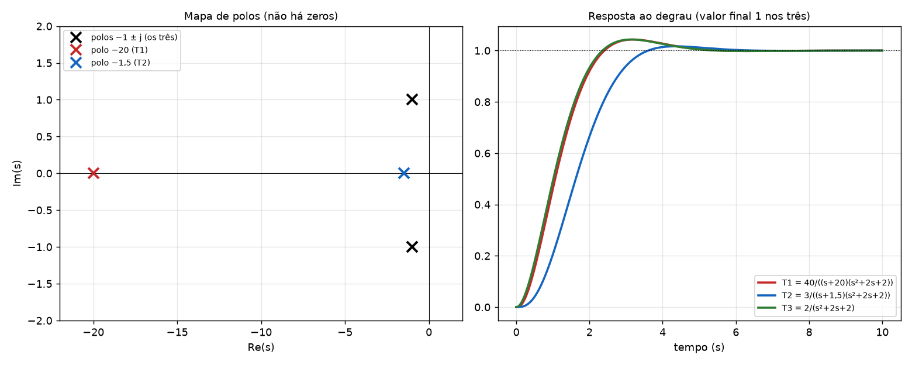
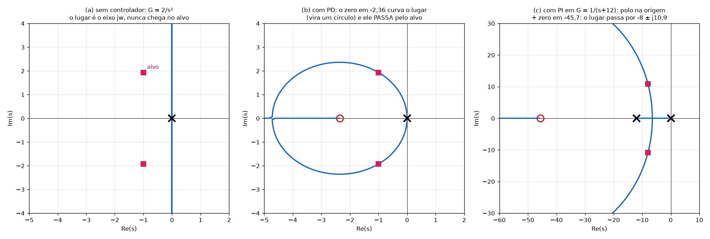
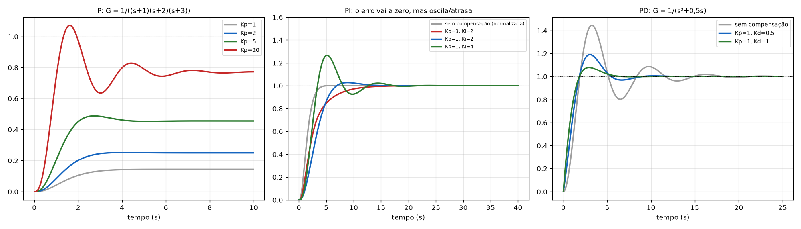
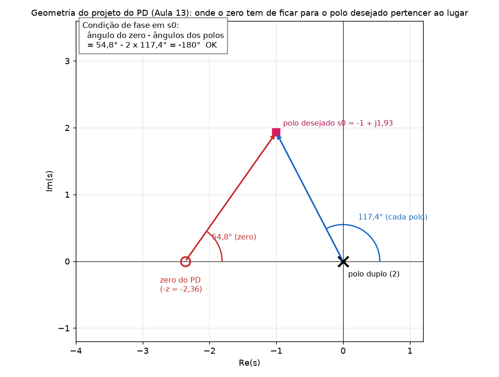
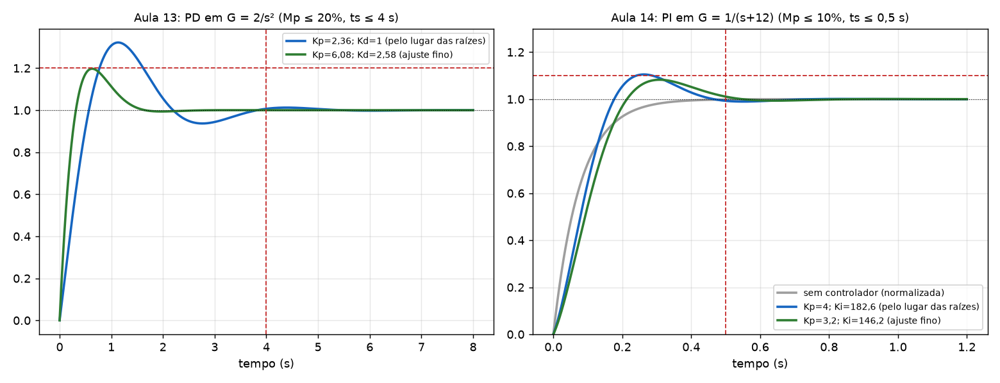
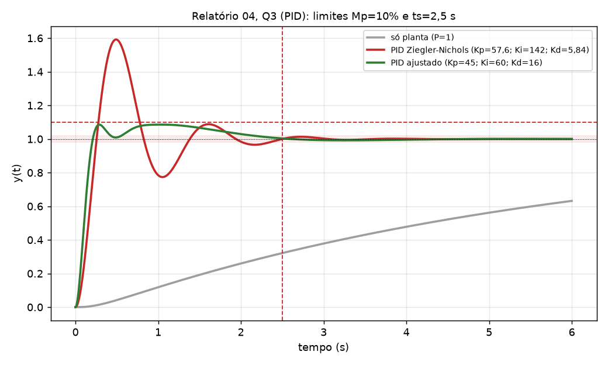
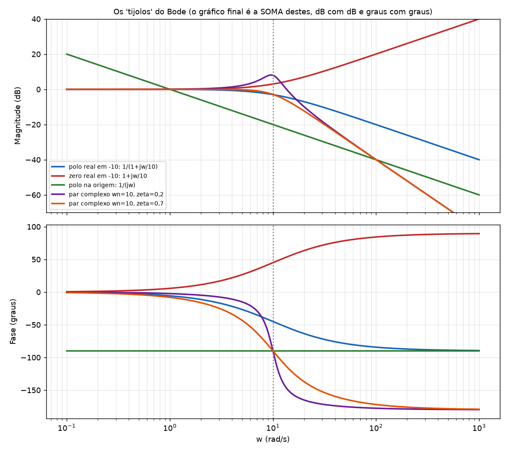
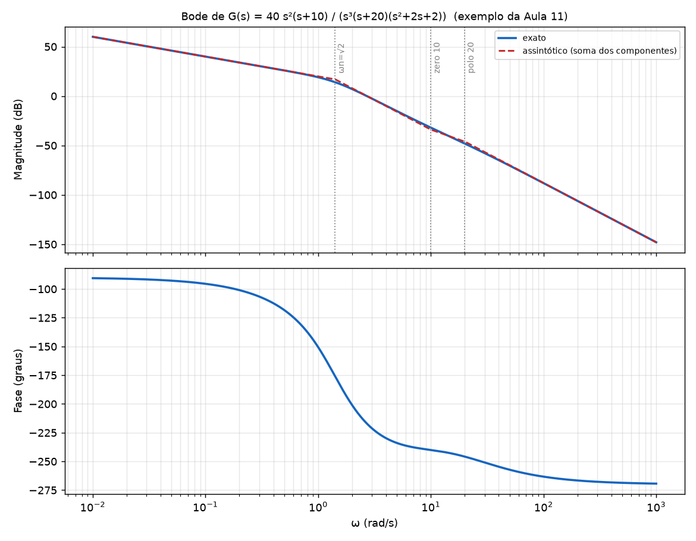

# Tutorial completo da P2: projeto de controladores e Bode (para quem está vendo pela primeira vez)

Este tutorial **explica a matéria nova da P2** do começo, com a intuição por trás de cada passo, e depois mostra como resolver os exercícios do jeito do professor Guisso. **Não repito o que foi coberto na P1** (função de transferência, 1ª e 2ª ordem, erro estacionário, Routh, lugar das raízes e suas condições de fase e de módulo). Quando precisar de algo da P1, eu só cito o nome e a fórmula.

Arquivos relacionados: [Resumo_Controle_P2.md](Resumo_Controle_P2.md) (resumo dos slides), [Exercicios_dos_Slides_P2.md](Exercicios_dos_Slides_P2.md) (exemplos dos slides resolvidos), [Gabarito_Relatorio04.md](Gabarito_Relatorio04.md) (a lista resolvida) e [Exercicios_P2.pdf](Exercicios_P2.pdf) (os exercícios em PDF).

> 🧩 marca o que a prova pode cobrar mas **não está** nos slides da pasta (conferir com o caderno).
> Todos os números deste arquivo foram conferidos por simulação.

## Índice

0. [Onde estamos: de "analisar" para "projetar"](#s0)
1. [Polos dominantes (Aula 10)](#s1)
2. [O que acontece quando se acrescenta um polo ou um zero (Aula 10)](#s2)
3. [Os controladores P, I, D e suas combinações (Aula 12)](#s3)
4. [Como se calcula um ângulo no plano s (ferramenta do projeto)](#s4)
5. [Projeto do PD, passo a passo (Aula 13)](#s5)
6. [Projeto do PI, passo a passo (Aula 14)](#s6)
7. [Ajuste fino: por que e como](#s7)
8. [PID e o método de Ziegler-Nichols 🧩](#s8)
9. [Compensadores por atraso (LAG) e avanço (LEAD) de fase (Aula 10)](#s9)
10. [Diagrama de Bode, do zero (Aula 11)](#s10)
11. [Os exercícios do Relatório 04 em resumo](#s11)
12. [Glossário, autoteste e checklist](#s12)

---

<a id="s0"></a>
## 0. Onde estamos: de "analisar" para "projetar"

**Na P1** você recebia um sistema e **descobria** como ele se comporta: estável? qual o erro? qual o overshoot? por onde andam os polos quando varia o ganho K?

**Na P2** o problema é o inverso: o professor diz **como o sistema deve se comportar** (por exemplo, "overshoot máximo de 15 % e tempo de acomodação de 1 s") e você precisa **inventar um controlador** `C(s)` que faça isso. Esse controlador é um novo bloco colocado **antes da planta**:

```
X(s) → (+) → E(s) → [ C(s) controlador ] → M(s) → [ G(s) planta ] → Y(s)
        ↑ (−)                                                  │
        └───────────────────────────────────────────────────────┘
```

O erro `E = X − Y` entra no controlador, e o controlador decide o sinal `M(s)` que vai para a planta.

**A estratégia de projeto (a mesma em todas as questões):**

1. Traduzir as especificações em **onde os polos de malha fechada devem ficar** (os "polos desejados").
2. Perguntar: o lugar das raízes da planta passa por esses polos? Se **não**, só mudar o ganho `K` não adianta.
3. Escolher um **controlador que adiciona polos e zeros** de modo que o lugar das raízes **passe** pelos polos desejados.
4. Calcular o **ganho** (para o polo cair exatamente no ponto).
5. **Simular** e **ajustar**.

**O que você já sabe da P1 e vai usar (só para lembrar, sem explicação):**

- Overshoot → `ζmin = −ln(Mp)/√(π² + ln²Mp)`; ts (2 %) → `σ = ζωn = 4/ts`; `ωn = σ/ζ`; `ωd = ωn√(1−ζ²)`; polos `−σ ± jωd`.
- Condição de **fase** `∠G·H = ±180°` e de **módulo** `|K·G·H| = 1` (Aula 7).
- Tipo do sistema e erro (`Kp, Kv, Ka`); Routh para achar ganho crítico e frequência de cruzamento.

**O que é novo na P2:** polos dominantes (Aula 10), compensadores LAG/LEAD (Aula 10), Bode (Aula 11), controladores P/PI/PD/PID (Aulas 12 a 14) e Ziegler-Nichols 🧩.

---

<a id="s1"></a>
## 1. Polos dominantes (Aula 10)

### 1.1 O problema que isso resolve

As fórmulas de overshoot e tempo de acomodação da P1 valem para um sistema de **2ª ordem puro** (dois polos, sem zeros). Mas quase todo sistema real (e **todo sistema com controlador**) tem ordem maior que 2, com polos e zeros extras. Então perguntamos: **quando posso tratar um sistema de ordem alta como se fosse de 2ª ordem?** A resposta são os **polos dominantes**.

### 1.2 A intuição

Cada polo `p` contribui para a resposta no tempo com um termo do tipo `r·e^(pt)`, onde `r` é o **resíduo** do polo (o "peso" do termo).

- Um polo **mais à esquerda** (`p` mais negativo) gera um termo que **morre depressa**.
- Um polo **perto do eixo jω** gera um termo que **dura bastante**.

Se um par de polos está bem mais perto do eixo jω do que os outros, os termos dos outros polos **sumem antes** de a resposta se acomodar. Quem fica "mandando" na resposta é o par mais perto do eixo, e ele se comporta como um sistema de 2ª ordem. Esses são os **polos dominantes**.

### 1.3 Resíduo: o que é e como calcular

Expandindo `T(s)` em frações parciais (polos simples):

`T(s) = r₁/(s − p₁) + r₂/(s − p₂) + …`

O resíduo de um polo `pᵢ` se calcula **tapando o fator** `(s − pᵢ)` e calculando o resto em `s = pᵢ`.

**Exemplo (Aula 10, p.6): `G(s) = 40/((s+20)(s+2)(s+1))`**

| Polo | Tapa o fator e calcula em `s = p` | Resíduo |
|---|---|---|
| −1 | `40/((−1+20)(−1+2)) = 40/19` | **2,105** |
| −2 | `40/((−2+20)(−2+1)) = 40/(18·(−1))` | **−2,222** |
| −20 | `40/((−20+2)(−20+1)) = 40/(−18·−19)` | **0,117** |

Logo `G(s) = 0,117/(s+20) − 2,222/(s+2) + 2,105/(s+1)`.

**Resposta ao degrau:** como `L⁻¹{1/(s(s+a))} = (1 − e^(−at))/a`, cada termo `r/(s+a)` contribui na resposta ao degrau com `(r/a)(1 − e^(−at))`:

`y(t) = 0,006(1 − e^(−20t)) − 1,111(1 − e^(−2t)) + 2,105(1 − e^(−t))`

**Observação importante:** o peso real de um termo na resposta ao degrau é `r/|p|`, e não só `r`. O polo −20 tem `r = 0,117`, mas pesa só `0,117/20 = 0,006` (0,6 % do valor final): **irrelevante**. Os polos −1 e −2 comandam.

### 1.4 As regras do professor (Aula 10, p.2)

1. A dominância depende da **relação entre as partes reais** dos polos **e** do **valor dos resíduos**.
2. Se a relação das partes reais for **maior que 5** e **não houver zeros próximos**, os polos **mais perto do eixo jω** são dominantes.
3. Os polos dominantes podem ser um **par complexo**.
4. Um **par polo-zero muito próximo se cancela** (o zero "apaga" o polo, porque o resíduo daquele polo fica quase zero).
5. Um polo **longe da origem** tem resíduo pequeno e contribui pouco.

### 1.5 O exercício dos slides (Aula 10, p.3 a 5) explicado

Três sistemas, todos com o mesmo par de polos `−1 ± j`, mas com um terceiro polo diferente:

- `T₃ = 2/(s²+2s+2)`: **2ª ordem pura** (ωn = √2, ζ = 0,707).
- `T₁ = 40/((s+20)(s²+2s+2))`: terceiro polo em −20.
- `T₂ = 3/((s+1,5)(s²+2s+2))`: terceiro polo em −1,5.

Os três têm ganho DC igual a 1 (`40/40`, `3/3`, `2/2`).

| | Relação das partes reais | Resíduo do polo extra | Conclusão |
|---|---|---|---|
| `T₁` | `20/1 = 20 > 5` | **0,11** (pequeno) | o polo −20 é **desprezível**: `T₁ ≈ T₃` |
| `T₂` | `1,5/1 = 1,5` | **2,4** (grande) | o polo −1,5 **não é desprezível**; `T₂` **não** vira 2ª ordem |



(No gráfico, `T₁` e `T₃` ficam praticamente iguais, e `T₂` fica mais lento e sem overshoot.)

### 1.6 Por que isso importa no projeto

No projeto de PD e PI você calcula o controlador **como se o sistema fosse de 2ª ordem** (polos dominantes). Depois, o sistema real tem polos e zeros extras (o zero do controlador, um terceiro polo). **O projeto só funciona se esses extras não atrapalharem.** Por isso você sempre **simula** no fim, e por isso às vezes precisa do **ajuste fino**.

**Dúvida frequente:** *"Posso ignorar sempre os polos distantes?"* Só quando a relação for grande **e** não houver zero perto. Um zero próximo de um polo cancela o polo; um zero longe do polo mantém o polo ativo e **acrescenta overshoot**.

---

<a id="s2"></a>
## 2. O que acontece quando se acrescenta um polo ou um zero (Aula 10)

### 2.1 A regra

| Acrescentar | O lugar das raízes se desloca para | Estabilidade relativa | Tempo de acomodação |
|---|---|---|---|
| **Polo** | a **direita** | **diminui** | **aumenta** (mais lento) |
| **Zero** | a **esquerda** | **aumenta** | **diminui** (mais rápido) |

### 2.2 Por que é assim (intuição pela condição de fase)

Para um ponto `s` estar no lugar das raízes, a soma dos ângulos precisa dar `−180°`: `Σ ângulos dos zeros − Σ ângulos dos polos = −180°`.

- Um **zero a mais** soma um ângulo positivo. O lugar precisa mudar para que a conta continue fechando em −180°, e ele se **curva para perto do zero**, "atraído" por ele.
- Um **polo a mais** subtrai um ângulo, e o lugar **se afasta** do polo, "repelido" por ele.

Como os controladores que vamos projetar adicionam **zeros à esquerda** (para atrair o lugar para a região estável) e às vezes um **polo na origem** (PI), é essencial saber esse efeito.

### 2.3 Visualizando com o exemplo da Aula 13



- **(a)** A planta `2/s²` tem dois polos em 0. O lugar das raízes é **o próprio eixo imaginário**: com qualquer K o sistema só oscila sem amortecer, e **nunca** chega ao ponto desejado `−1 ± j1,93`.
- **(b)** Com o zero do PD em −2,36, o lugar vira um **círculo** à esquerda, que **passa exatamente** pelo ponto desejado. O zero "puxou" o lugar para a esquerda.
- **(c)** Para o PI em `1/(s+12)`, o PI coloca um polo em 0 e um zero em −45,7. O lugar (antes só um segmento do eixo real) passa a **descrever um arco** que atravessa `−8 ± j10,9`.

**É exatamente isso que o projeto faz:** coloca polos e zeros onde o lugar passe pelo ponto que a especificação pede.

---

<a id="s3"></a>
## 3. Os controladores P, I, D e suas combinações (Aula 12)

### 3.1 A ideia física de cada ação

O controlador olha o erro `e(t) = x(t) − y(t)` e gera um sinal `m(t)` para a planta.

| Ação | Fórmula no tempo | Em palavras | Transferência |
|---|---|---|---|
| **Proporcional (P)** | `m = Kp·e` | reage ao erro **de agora** | `Kp` |
| **Integral (I)** | `m = Ki·∫e dt` | reage ao erro **acumulado** (passado) | `Ki/s` |
| **Derivativa (D)** | `m = Kd·de/dt` | reage à **taxa de variação** do erro (tendência) | `Kd·s` |

**Analogia (dirigir):** P é "quanto estou fora do alvo?"; I é "há quanto tempo estou fora do alvo?"; D é "com que rapidez me aproximo ou me afasto?" (se está se aproximando rápido, freie antes de passar).

### 3.2 Por que cada uma faz o que faz

**P:** só gera saída se existe erro. Com erro zero, `m = 0`. Por isso, numa planta tipo 0, o erro ao degrau nunca zera: o erro precisa sobrar para manter `m` não nulo. Aumentar `Kp` **diminui** o erro, mas aumenta o overshoot.

**I:** enquanto houver erro, a integral **continua crescendo**, e o controlador **empurra cada vez mais forte** até o erro zerar. É por isso que o PI **anula** o erro ao degrau. Em termos de função de transferência, `Ki/s` é um **polo na origem**: o tipo do sistema sobe em 1 (volte à tabela de erro da P1: tipo 1 → erro ao degrau zero).
O custo: o polo na origem **atrasa a fase** em 90°, **atrai o lugar das raízes para perto do eixo jω** e deixa o sistema **mais oscilatório e mais lento**.

**D:** responde à **velocidade** do erro. Se o erro está diminuindo rápido, `de/dt` é negativo e o controlador **reduz o esforço antes** de o erro chegar a zero, **freando o overshoot**. Se o erro é constante, `de/dt = 0` e **nada acontece**: por isso o D **não** altera o erro estacionário. Em transferência, `Kd·s` é um **zero**.
O custo: um derivador **amplifica ruído** (ruído varia rápido, então `de/dt` fica grande).

### 3.3 Forma de polos e zeros (o que o projeto manipula)

| Controlador | `C(s)` | Polos e zeros que adiciona |
|---|---|---|
| P | `Kp` | nenhum |
| **PI** | `Kp + Ki/s = Kp(s + Ki/Kp)/s` | **polo em 0** e **zero em −Ki/Kp** |
| **PD** | `Kp + Kd s = Kd(s + Kp/Kd)` | **zero em −Kp/Kd** |
| **PID** | `Kp + Ki/s + Kd s = Kd(s² + (Kp/Kd)s + Ki/Kd)/s` | **polo em 0** e **dois zeros** |

Guarde `z = Kp/Kd` (PD) e `z = Ki/Kp` (PI): é a posição do zero com sinal trocado.

### 3.4 Tabela de efeitos (Aula 12, p.13)

| Aumentando | Overshoot | Tempo de acomodação | Erro estacionário |
|---|---|---|---|
| **Kp** | aumenta | pouco impacto | diminui |
| **Ki** | aumenta | aumenta | **anula** (degrau) |
| **Kd** | **diminui** | **diminui** | sem impacto |

### 3.4.1 Efeitos adicionais por controlador (Aula 12)

- **P:** não altera o lugar das raízes (só os ganhos limites); tempo de subida menor; overshoot maior; **não aumenta a ordem**; `E/X = 1/(1 + Kp·G)`.
- **PI:** aumenta a ordem (polo extra); resposta mais oscilatória; às vezes mais lenta; **erro nulo para degrau**.
- **PD:** zero em `−Kp/Kd`; ação corretiva mais cedo; **amplifica ruído**.
- **PID:** polo na origem e dois zeros (geralmente reais e iguais).

### 3.5 Qual controlador escolher (Aula 12, p.14)

| Problema | Controlador |
|---|---|
| Transitório ruim (overshoot, ts), regime estacionário bom | **PD** (raro, por causa do ruído) |
| Quer **erro zero** em regime | **PI** |
| Quer melhorar transitório **e** regime | **PID** |
| Quer só diminuir o erro e aceitar piorar o transitório | P (limitado) |
| Sistema instável, quer estabilizar mudando o ganho | P |

**PI e PID são os mais usados na indústria.**

### 3.6 Os exemplos da Aula 12, lidos com atenção



**P, `G = 1/((s+1)(s+2)(s+3))`:**

| Kp | Valor final | Erro | Overshoot |
|---|---|---|---|
| 1 | 0,14 | 0,86 | ~0 |
| 2 | 0,25 | 0,75 | 1 % |
| 5 | 0,45 | 0,55 | 7 % |
| 20 | 0,77 | 0,23 | 39 % |

Leitura: Kp maior → mais rápido e erro menor, **mas** o erro nunca chega a zero e o overshoot sobe. Isso é a limitação do P.

**PI, mesma planta (erro vai a zero em todos):**

| Kp | Ki | Overshoot | ts |
|---|---|---|---|
| 3 | 2 | 0 % | ≈ 11 s (lento) |
| 1 | 2 | 2,6 % | ≈ 10 s |
| 1 | 4 | **26,6 %** | ≈ 15 s |

Leitura: o erro zera (polo em 0), mas **aumentar Ki de 2 para 4 aumentou o overshoot e o ts**.

**PD, `G = 1/(s²+0,5s)`:**

| Kp | Kd | Overshoot | ts |
|---|---|---|---|
| 1 | 0 | 44 % | ≈ 14 s |
| 1 | 0,5 | 19 % | ≈ 7,7 s |
| 1 | 1 | **7,9 %** | ≈ 5,1 s |

Leitura: **mais Kd, menos overshoot e menos tempo de acomodação.**

### 3.7 O derivador na prática (Aula 13, p.4)

Um derivador puro `Kd·s` tem **ganho que cresce sem limite** com a frequência: fisicamente impossível, e péssimo para ruído. Na prática coloca-se **um polo** que limita o ganho em alta frequência:

`C(s) = (Kp + Kd s)/(1 + s/a)`, por exemplo `C(s) = (s+2)/(1 + s/10)`

O polo em `−a` fica **longe** (para não alterar o projeto).

---

<a id="s4"></a>
## 4. Como se calcula um ângulo no plano s (ferramenta do projeto)

Todo projeto de PD e PI usa a **condição de fase** no ponto desejado `s₀ = −σ + jωd`. É preciso saber medir os ângulos sem errar.

**Regra:** para cada polo ou zero em `p` (real, no eixo), o ângulo é o do **vetor que vai de `p` até `s₀`**, medido a partir do **eixo real positivo**, no sentido **anti-horário**.

O vetor é `s₀ − p = (−σ − p) + jωd`. Chame `dx = −σ − p` (distância horizontal, com sinal) e `dy = ωd`.

| Onde o polo/zero está em relação a `s₀` | Ângulo |
|---|---|
| **À esquerda** de `s₀` (`dx > 0`) | `atan(dy/dx)` (primeiro quadrante) |
| **À direita** de `s₀` (`dx < 0`) | `180° − atan(dy/|dx|)` (segundo quadrante) |
| Exatamente abaixo/acima de `s₀` (`dx = 0`) | 90° |

**Exemplo:** `s₀ = −4 + j6,624`.

| Polo em | `dx = −4 − p` | `dy` | Ângulo |
|---|---|---|---|
| 0 | −4 (direita de s₀) | 6,624 | `180° − atan(6,624/4) = 180° − 58,9° = 121,1°` |
| −9 | 5 (esquerda) | 6,624 | `atan(6,624/5) = 52,9°` |
| −12 | 8 (esquerda) | 6,624 | `atan(6,624/8) = 39,6°` |

**Sinais ao somar:** zeros contam **+**, polos contam **−**. A condição de fase é `Σ zeros − Σ polos = −180°` (ou `+180°`, é o mesmo).

**Dica de conferência:** desenhe o triângulo. O ângulo nunca passa de 180° e quanto mais à direita o polo, maior o ângulo.

---

<a id="s5"></a>
## 5. Projeto do PD, passo a passo (Aula 13)

**Quando usar:** quando o transitório (overshoot e ts) é o problema e o erro estacionário está bom. `C(s) = Kd(s + z)`, com `z = Kp/Kd`.

### Passo 1: especificações → polos desejados

(Fórmulas da P1.) O resultado é `s₀ = −σ ± jωd`. É o **alvo**.

### Passo 2: só variar o ganho resolve?

Pergunta: o alvo `s₀` **pertence ao lugar das raízes** de `K·G(s)`? Teste somando os ângulos dos polos de `G` até `s₀`. Se **não** der 180°, o alvo **não** está no lugar, e é preciso acrescentar um controlador.

*Exemplo (Aula 13):* `G = 2/s²`, dois polos em 0. Cada um vale 117,4° até `−1 + j1,93`; soma 234,8° ≠ 180°. O ponto **não** está no lugar (que é o eixo imaginário): PD necessário.

### Passo 3: onde colocar o zero (condição de fase)

Precisamos que, **depois** de acrescentar o zero em `−z`, o ponto `s₀` passe a estar no lugar:

`θz − Σ θpolos = −180°`  →  **`θz = Σ θpolos − 180°`**

O zero em `−z` enxerga o ponto `s₀` sob o ângulo `θz`. Pelo triângulo (veja a figura), `tan θz = ωd/(z − σ)`, logo

**`z = σ + ωd/tan θz`**



Na figura: dois polos em 0 dão `2 × 117,4° = 234,8°`; o zero precisa fornecer `234,8° − 180° = 54,8°`; isso fixa `z = 1 + 1,93/tan 54,8° = 2,36`.

### Passo 4: o ganho (condição de módulo)

O ganho faz o polo cair **exatamente** em `s₀` (e não em outro ponto do lugar). A condição é `|C(s₀)G(s₀)| = 1`.

`Kd = ∏|s₀ − pk| / ( K_G · |s₀ + z| )`

onde `pk` são os polos de `G` e `K_G` é o ganho da planta (o número no numerador). Depois, `Kp = z·Kd`.

*Exemplo:* `2Kd·|s₀ + 2,36|/|s₀|² = 1` com `|s₀+2,36| = 2,36` e `|s₀|² = 4,72` → `Kd = 4,72/(2·2,36) = 1`; **`Kp = 2,36`**.

### Passo 5: constante de erro

Calcule `Kp`, `Kv` ou `Ka` de `C(s)G(s)`. O PD **não muda o tipo** (não tem polo em 0). No exemplo, a planta já é tipo 2: erro ao degrau **zero**.

### Passo 6: simular

No MATLAB (formato do professor):

```matlab
clear all
clc
C=tf([1 2.36],1);       % Kd*s + Kp = s + 2.36
G=tf(2,[1 0 0])
T=feedback(G,1)         % sem controlador
U=feedback(C*G,1)       % com PD
step(T,20)
hold on
step(U,20)
```

**Resultado do exemplo:** Mp = **32 %** e ts = 3,5 s. Não atende o overshoot (20 %), mesmo com o projeto "correto". Por quê? Veja o passo 7.

### Passo 7: ajuste fino (e por que é necessário)

O projeto assumiu **2ª ordem pura**, mas a malha fechada real é

`T(s) = 2(s + 2,36)/((s+1−j1,93)(s+1+j1,93))`

e tem um **zero em −2,36** (o zero do controlador), que as fórmulas de 2ª ordem **não** consideram. Esse zero **aumenta o overshoot**. A correção do professor foi **manter o zero** (`z = 2,36`) e **aumentar o ganho**: `Kd = 2,58` e `Kp = 2,36 × 2,58 = 6,08`. Resultado: Mp < 20 % e ts < 4 s. Mais na [seção 7](#s7).

### Implementação com amplificadores operacionais (Aula 13, p.15 a 19)

`C(s) = 2,58(s + 2,36)` pode ser escrito como `Kp(1 + Td·s)`: `Kp = 2,58 × 2,36 = 6,089` e `Td = 1/2,36 = 0,424 s`. Isto é: **6,089(0,424s + 1)**.

Blocos usados nos slides:

- **Integrador inversor:** `Vo/Vin = −1/(RCs)`. Dois integradores inversores em cascata dão `+1/(R₁C₁R₂C₂ s²)`, e com `R₁C₁ = 1` e `R₂C₂ = 0,5` isso é `G = 2/s²` (a planta do exemplo).
- **Somador/subtrator** com resistores iguais: `Vo = Vin1 − Vin2`, usado para formar o erro `X − Y`.

---

<a id="s6"></a>
## 6. Projeto do PI, passo a passo (Aula 14)

**Quando usar:** para **zerar o erro estacionário**. O preço é piorar o transitório. `C(s) = Kp(s + z)/s`, com `z = Ki/Kp`.

### As diferenças em relação ao PD

1. O PI **acrescenta um polo em 0**, que entra na soma dos ângulos (e vale **mais um módulo** na condição de módulo).
2. O zero **cancela parcialmente** o atraso de fase de 90° do integrador.

### Passos

**1. Polos desejados** `s₀ = −σ ± jωd` (P1).

**2. Só P basta?** Se a planta é de **1ª ordem**, P só dá **um polo real** (nunca complexo): o alvo complexo não é alcançável. Mesmo que os números de Mp e ts sejam atendidos por um polo real (ex.: Q2 com `Kp = 4/3`), o erro ao degrau seria `1/(1 + Kp·G(0)) ≠ 0` (50 % na Q2). Então PI.

**3. Zero (condição de fase)**: some os ângulos dos polos da planta **e do polo em 0**:

`θz = Σ θpolos (planta + polo em 0) − 180°`, e **`z = σ + ωd/tan θz`**.

**4. Ganho (módulo)**, contando `|s₀|` do polo em 0:

`Kp = |s₀|·∏|s₀ − pk| / ( K_G · |s₀ + z| )`, e **`Ki = z·Kp`**.

**5. Simular** e fazer ajuste fino.

### Exemplo completo (Aula 14): `G = 1/(s+12)`, Mp ≤ 10 %, erro zero, ts ≤ 0,5 s

- **Passo 1:** `ζmin = 0,59`; `σ = 4/0,5 = 8`; `ωn = 13,56`; `ωd = 10,9` → `s₀ = −8 + j10,9`.
- **Passo 3 (ângulos até `s₀ = −8 + j10,9`):** o polo em 0 (do PI) fica à direita de `s₀`: ângulo `180° − tan⁻¹(10,9/8) = 126,3°`. O polo em −12 (da planta) fica à esquerda: `tan⁻¹(10,9/4) = 69,8°`. Soma `126,3° + 69,8° = 196,1°`, então `θz = 196,1° − 180° = 16,1°` e
  `z = 8 + 10,9/tan 16,1° = 8 + 10,9/0,289 = 45,7`.
- **Passo 4:** `|s₀| = 13,5`, `|s₀+12| = 11,6`, `|s₀+45,7| = 39,2`: `Kp = 13,5 × 11,6/39,2 = 4`; `Ki = 45,7 × 4 = 182,6`.
- **Simulação:** Mp ≈ 10,5 % (> 10 %): ajuste fino necessário.
- **Ajuste fino:** reduz o ganho: `Kp = 3,2` (0,8 × 4), mantendo `z`: `Ki = 45,7 × 3,2 = 146,2`. Resultado: Mp < 10 %, ts < 0,5 s.

```matlab
clear all
clc
C=tf([3.2 146.2],[1 0]);   % (Kp s + Ki)/s
G=tf(1,[1 12])
U=feedback(C*G,1);
step(U); grid; stepinfo(U)
```

### Por que o zero fica tão longe (−45,7)

A especificação exige resposta **rápida** (ts = 0,5 s): os polos precisam estar longe do eixo jω. Para o lugar das raízes passar por `−8 ± j10,9`, o zero precisa estar longe. Se a especificação fosse mais relaxada, o zero ficaria mais perto da origem (ação integral mais suave).

### Atalho: cancelar o polo da planta 🧩

Se a planta é `K/(s + a)`, escolher `z = a` **cancela** o polo da planta: `C·G = K·Kp/s` e a malha fechada vira `T = K·Kp/(s + K·Kp)`: **1ª ordem, sem overshoot**, com `ts = 4/(K·Kp)`. Exemplo (Relatório 04, Q2): `K = 3`, `a = 4`: `Kp = 3`, `Ki = 12`, `ts = 0,44 s`. Mas só funciona se o modelo da planta for exato.

---

<a id="s7"></a>
## 7. Ajuste fino: por que e como

### 7.1 Por que o projeto "exato" não fecha

O projeto calcula o controlador para os polos dominantes caírem no ponto certo, usando as fórmulas de 2ª ordem. Mas a resposta real é afetada por:

1. O **zero do controlador** (o PD e o PI têm zeros), que as fórmulas **ignoram** e que **aumenta o overshoot**.
2. Polos extras (terceiro polo, etc.).
3. Aproximações (arredondar ζ, ω, ângulos).

Por isso o professor sempre faz: **projeto → simulação → ajuste fino**.

### 7.2 Como ajustar (regras da tabela de efeitos)

| Para... | Mexa em... |
|---|---|
| Reduzir **overshoot** | **aumente Kd**; reduza Kp ou Ki |
| Reduzir **ts** | **aumente Kd**; aumente Kp |
| **Zerar erro** | mantenha Ki > 0 (mas Ki alto aumenta overshoot e ts) |

### 7.3 O que o professor fez nos exemplos

| Exemplo | Projeto | Resultado | Ajuste | Resultado |
|---|---|---|---|---|
| PD (Aula 13) | `Kd = 1`, `Kp = 2,36` | Mp 32 % | `Kd = 2,58`, `Kp = 6,08` (mesmo `z`, mais ganho) | **Mp 19,7 %**, ts 1,4 s |
| PI (Aula 14) | `Kp = 4`, `Ki = 182,6` | Mp 10,5 % | `Kp = 3,2`, `Ki = 146,2` (mesmo `z`, menos ganho) | **Mp 8,2 %**, ts 0,47 s |



### 7.4 Não existe uma receita única

Nos dois exemplos acima manter o zero e mudar o ganho funcionou, mas no PI da Q2 do Relatório 04 (`G = 3/(s+4)`) **reduzir Kp piora** o overshoot (de 17,7 % para 18,4 %). Lá o problema é o **zero em −15,3**, e o que resolve é **aproximar o zero da origem** (`z = 6`) e **subir o ganho** (`Kp = 5`, `Ki = 30`): Mp = 3,75 %.

**Regra prática:** a causa do overshoot extra é o **zero** do controlador. Se o zero está **longe** da origem, aproximá-lo reduz o overshoot; se já está perto, reduza o ganho. **Teste sempre por simulação.**

### 7.5 O que conferir na simulação

- **Overshoot:** `Mp = (pico − valor final)/valor final × 100 %`.
- **ts (2 %):** o último instante em que a curva sai da faixa `valor final ± 2 %`.
- **Estabilidade:** todos os polos de malha fechada no semiplano esquerdo (`pole(U)`).
- `stepinfo(U)` no MATLAB devolve `Overshoot`, `SettlingTime` e `RiseTime`.

---

<a id="s8"></a>
## 8. PID e o método de Ziegler-Nichols 🧩

(O Relatório 04, Q3, pede. **O método não está nos slides da pasta**; abaixo está a forma padrão.)

### 8.1 A ideia

Em vez de calcular o controlador a partir de polos desejados, o ZN **mede** o comportamento da planta: aumenta-se o ganho P até o sistema **oscilar de forma sustentada** (no limite da estabilidade). Dois números descrevem esse limite:

- **Ganho crítico `Ku`**: o ganho P que leva o sistema à oscilação sustentada.
- **Período crítico `Pu`**: o período dessa oscilação.

Com eles, uma tabela fornece `Kp`, `Ki` e `Kd`.

### 8.2 Como achar `Ku` e `Pu` analiticamente (Routh da P1)

A oscilação sustentada corresponde a polos **em ±jω**: exatamente o cruzamento do eixo jω do lugar das raízes (o passo 6 da P1).

1. Só P (`C = K`): polinômio característico `1 + K·G(s) = 0`.
2. **Routh com K literal**: o `Ku` é o K que **zera a linha s¹**.
3. **Equação auxiliar** (linha s²) com `K = Ku`: dá `s = ±jωu`.
4. `Pu = 2π/ωu`.

### 8.3 Tabela de sintonia (ZN malha fechada)

| Controlador | `Kp` | `Ti` | `Td` |
|---|---|---|---|
| P | `0,5·Ku` | – | – |
| PI | `0,45·Ku` | `Pu/1,2` | – |
| **PID** | **`0,6·Ku`** | **`Pu/2`** | **`Pu/8`** |

`Ti` e `Td` são tempos. Para a forma dos slides `C = Kp + Ki/s + Kd·s`:

**`Ki = Kp/Ti`** e **`Kd = Kp·Td`**.

### 8.4 Exemplo (Relatório 04, Q3): `G = 10/(s(s+10)(s+6))`

1. Só P: `s(s+10)(s+6) + 10K = s³ + 16s² + 60s + 10K = 0`.
2. Routh: linha s¹ = `(16·60 − 10K)/16 = 0` → **`Ku = 96`**.
3. Auxiliar: `16s² + 960 = 0` → `s² = −60` → `ωu = 7,746 rad/s` → **`Pu = 0,811 s`**.
4. PID: `Kp = 57,6`, `Ti = 0,406 s`, `Td = 0,1014 s` → **`Ki = 142`**, **`Kd = 5,84`**.
5. Comparar com `rlocus(G)`: o gráfico cruza o eixo jω em `±j7,75` com ganho `96`: **os mesmos `ωu` e `Ku`**.

### 8.5 O ZN não atende a especificação (e tudo bem)

O resultado do ZN tem **overshoot de 59 %**. O método foi pensado para dar uma sintonia **inicial** agressiva; depois se **ajusta**. O enunciado já prevê: "faça um ajuste para obter overshoot menor que 10 % com ts < 2,5 s". Usando a tabela de efeitos: diminuir `Kp`, aumentar bastante `Kd`, diminuir `Ki`. Um conjunto que atende: **`Kp = 45`, `Ki = 60`, `Kd = 16`** (Mp 8,6 %, ts 2,15 s).



---

<a id="s9"></a>
## 9. Compensadores por atraso (LAG) e avanço (LEAD) de fase (Aula 10)

### 9.1 A ideia

PD e PI são ótimos, mas fisicamente têm problemas (derivador puro, integrador puro). Os **compensadores LAG e LEAD** fazem o mesmo papel com **um polo e um zero** de verdade, fisicamente realizáveis, na forma:

`Gc(s) = Kc·(s + 1/T)/(s + 1/(αT))`

A única diferença é **o valor de α** (qual fica mais perto da origem: o polo ou o zero).

| | α | Quem fica mais perto da origem | Parece com | Para que serve |
|---|---|---|---|---|
| **LAG** | `α > 1` | o **polo** | PI suave | **diminuir o erro** sem mexer no lugar das raízes |
| **LEAD** | `0 < α < 1` | o **zero** | PD realizável | **mover o lugar das raízes** (criar polos dominantes novos) |

### 9.2 Por que "polo e zero juntos não alteram o lugar"

Se o polo e o zero ficam **muito perto um do outro**:

1. Os ângulos que eles contribuem em qualquer ponto de teste têm **sinais opostos** e valores quase iguais: **se cancelam**.
2. Os módulos (distâncias) também são quase iguais: **se cancelam** na razão.

Então o lugar das raízes quase não muda. É isso que o LAG explora.

### 9.3 LAG passo a passo (Aula 10, p.17 a 22)

**Objetivo:** reduzir o erro estacionário sem piorar a estabilidade.

1. Calcule o erro atual: `e = 1/(1 + K·G(0))`.
2. **Ganho DC do compensador:** `Gc(0) = Kc·(1/T)/(1/(αT)) = Kc·α`. Então `e = 1/(1 + Kc·α·G(0))`.
3. **Posicione** zero e polo **perto da origem e perto um do outro** (ex.: zero em −0,1 e polo em −0,01, ou seja, `T = 10`, `α = 10`).
4. O ganho `K` fica dentro da faixa estável (ganho limite pelo Routh).

**Exemplo (slide):** `G = K(s+8)/((s+3)(s+2)(s+1))`, `G(0) = 4K/3`, `Gc = Kc(s+0,1)/(s+0,01)` (α = 10); ganho limite `K ≈ 30` (pelo Routh).

| Caso | Erro |
|---|---|
| Sem LAG, K = 1 | `1/(1 + 4/3) = 0,428` |
| Sem LAG, K = 28 | `1/(1 + 4·28/3) = 0,026` (mas K = 28 está quase no limite 30: resposta muito oscilatória) |
| LAG, Kc = 1, K = 1 | `1/(1 + 10·4/3) = 0,07` |
| LAG, **Kc = 5**, K = 1 | `1/(1 + 50·4/3) = 0,015` |

**Moral:** o LAG permite um erro **menor** que o do caso K = 28 **sem chegar perto da instabilidade**. O custo é uma resposta mais lenta.

### 9.4 LEAD passo a passo (Aula 10, p.23 a 27)

**Objetivo:** criar polos dominantes em um ponto `s₀` que o lugar original **não** alcança. É o PD "de verdade".

**Exemplo:** `G = K/((s+3)(s+2))`, alvo `s₀ = −4 + j4`. O lugar de `K/((s+2)(s+3))` é uma **reta vertical em −2,5**: nunca chega em −4.

1. **Ângulos dos polos da planta** até `s₀`: polo −2 → `116,57°`; polo −3 → `104,04°`.
2. **Arbitre o zero** (você escolhe!). O professor primeiro tenta −4; depois −5.
3. **Calcule a fase que falta para o polo do compensador:**
   `θp = θz − Σθpolos_planta + 180°`.
   Com o zero em −5 (`θz = 75,96°`): `θp = 75,96° − 220,61° + 180° = 35,35°`.
4. **Posição do polo:** `p = σ + ωd/tan θp = 4 + 4/0,71 = 9,63`.
5. **Parâmetros:** `T = 1/5 = 0,2`; `α = 5/9,63 = 0,52` (**0 < α < 1**: LEAD ✔).
6. **Ganho:** `Kc·K = |s₀+2|·|s₀+3|·|s₀+9,63|/|s₀+5| = 30,9`.

**Por que o zero em −5 e não em −4?** Com zero em −4 o polo cai em −7,42, **perto demais dos polos da planta** (−2, −3) e poderia virar dominante (estragaria o projeto). Com zero em −5 o polo fica em −9,63, **bem à esquerda**: pouco importa.

---

<a id="s10"></a>
## 10. Diagrama de Bode, do zero (Aula 11)

### 10.1 O que é a resposta em frequência

Se você aplica uma entrada **senoidal** `sen(ωt)` a um sistema estável, depois do transitório a saída também é uma senoide **de mesma frequência**, mas com **amplitude e fase diferentes**:

`y(t) = |G(jω)|·sen(ωt + ∠G(jω))`

- `|G(jω)|` é o **ganho** (quanto a amplitude é multiplicada).
- `∠G(jω)` é a **fase** (quanto a senoide é atrasada ou adiantada).

Ambos dependem de ω. A resposta em frequência é `G(s)` avaliada em **`s = jω`** (só o eixo imaginário do plano s). É a **transformada de Fourier**, o primo da de Laplace (que usa `s = σ + jω`).

O **diagrama de Bode** desenha as duas funções de ω: um gráfico do **ganho em dB** e um da **fase em graus**, ambos com ω em **escala logarítmica**.

### 10.2 Por que dB e escala logarítmica

- **dB:** `MAG = 20·log₁₀|G(jω)|`. Multiplicar ganhos vira **somar dB**.
- **Escala log em ω:** uma **década** é multiplicar ω por 10. Intervalos de frequência muito grandes cabem no mesmo gráfico.
- **O truque do Bode:** `G(jω)` é um **produto** de fatores (cada polo e zero). O módulo de um produto é o produto dos módulos (em dB, **soma**), e a fase de um produto é a **soma das fases**. Então o Bode de `G` é **a soma dos Bode de cada fator**. Aprenda cada fator e some.



### 10.3 Colocar `G(s)` na forma de Bode

Fatore cada termo de modo que **valha 1 quando ω → 0**:

- zero em −z: `(s + z) = z·(1 + s/z)`
- polo em −p: `(s + p) = p·(1 + s/p)`
- as constantes saem para fora: `Kb = K·Πz/Πp`
- polos/zeros na origem ficam como `(jω)^R` e `(jω)^T`.

`G(jω) = Kb·Π(1 + jω/zᵢ) / [(jω)^R·Π(1 + jω/pq)]`

**Exemplo (Aula 11, p.7):** `G(s) = 40 s²(s+10)/(s³(s+20)(s+1+j)(s+1−j))`, com `(s+1+j)(s+1−j) = s²+2s+2`.

- Zero em −10: `(s + 10) = 10(1 + s/10)`.
- Polo em −20: `(s + 20) = 20(1 + s/20)`.
- `s²+2s+2 = 2(s²/2 + s + 1)`, par complexo com `ωn² = 2` e `2ζ/ωn = 1` (`ωn = √2 = 1,414`, `ζ = 0,707`).
- `Kb = 40·10/(20·2) = 10`.
- Origem: `s²/s³ = 1/s`: **um polo líquido na origem**.

`G(jω) = 10·(jω/10 + 1) / [ (jω)·(jω/20 + 1)·((jω)²/2 + jω + 1) ]`

### 10.4 O que cada "tijolo" faz (e por quê)

**Constante `Kb`:** `20·log|Kb|` dB (uma reta horizontal). Fase 0° se `Kb > 0`, −180° se `Kb < 0`.

**Polo na origem `1/(jω)`:** o ganho vale `1/ω`, em dB `−20·log ω`: uma **reta de inclinação −20 dB/década** que passa por **0 dB em ω = 1**. A fase é **−90°** constante. Com `R` polos: `−20R dB/déc` e `−90R°`.

**Zero na origem `jω`:** o contrário: **+20 dB/déc**, passa por 0 dB em ω = 1, fase **+90°**.

**Polo real em −p, `1/(1 + jω/p)`:**

- Para `ω ≪ p`: o termo `jω/p` é pequeno: ganho ≈ 1 → **0 dB**.
- Para `ω ≫ p`: o termo `1` é desprezível: ganho ≈ `p/ω` → `−20·log(ω/p)`: reta de **−20 dB/déc**.
- As duas retas **se cruzam em ω = p** (a **frequência de corte**), onde o ganho exato é `1/√2` = **−3 dB**.
- **Fase:** `−tan⁻¹(ω/p)`: 0° em baixas frequências, **−45° em ω = p**, −90° em altas frequências. O professor usa a aproximação por retas: 0° até `0,2p`, −45° em `p`, −90° a partir de `5p` (erro máximo 11,3°).

**Zero real em −z, `1 + jω/z`:** o espelho: 0 dB até `z`, depois **+20 dB/déc**; fase **0° → +45° em z → +90°**.

**Zero no semiplano direito (+z), `1 − jω/z`:** **a mesma magnitude** do zero em −z (só importa o módulo), mas a fase é **o oposto**: 0° → −45° → −90°.

**Polos complexos `1/(s²/ωn² + 2ζ s/ωn + 1)`:**

- Até `ωn`: ≈ 0 dB; depois de `ωn`: **−40 dB/déc** (são dois polos).
- Perto de `ωn` há um **pico** (a **ressonância**) quando o amortecimento é pequeno (`ζ < 0,707`); quanto menor ζ, maior o pico. Para `ζ ≥ 0,707` não há pico.
- **Fase:** 0° → **−90° em ωn** → −180°. A transição é mais **abrupta** quanto menor ζ.

### 10.5 Procedimento para desenhar

**Magnitude (assintótica, por retas):**

1. **Inclinação inicial** (baixas frequências) = `20·(T − R)` dB/déc, onde `T` = zeros na origem e `R` = polos na origem.
2. **Nível:** a reta inicial tem de passar por `20·log|Kb|` dB em ω = 1 (se `R` e `T` forem zero, é horizontal em `20·log|Kb|`).
3. **A cada frequência de corte**, mude a inclinação: **polo real: −20**; **zero real: +20**; **par complexo: −40** (na frequência `ωn`).
4. Percorra da esquerda para a direita, calculando o valor no fim de cada trecho: `valor_novo = valor_antigo + inclinação·log₁₀(ω_novo/ω_antigo)`.

**Fase:**

1. Some as fases constantes (constante: 0° ou −180°; origem: `−90R + 90T`).
2. Some a transição de cada polo e zero (±90° distribuídos em torno do corte).
3. **Pontos de controle:** ω → 0 (só origem e constante); ω → ∞ (cada polo −90°, cada zero +90°, cada par complexo −180°).

### 10.6 O exemplo completo (Aula 11)

**Magnitude assintótica de `G`:**

| Faixa de ω | Inclinação | Como chega | Valor no fim |
|---|---|---|---|
| até 1,414 | `20·(0 − 1) = −20` | `20 dB` em ω = 1 | `20 − 20·log 1,414 = 17,0 dB` |
| 1,414 a 10 | −20 − 40 (par complexo) = **−60** | | `17,0 − 60·log(10/1,414) = −34,0 dB` |
| 10 a 20 | −60 + 20 (zero em 10) = **−40** | | `−34,0 − 40·log 2 = −46,0 dB` |
| acima de 20 | −40 − 20 (polo em 20) = **−60** | | |

**Fase:** começa em **−90°** (o polo na origem) e termina em **−270°** (6 polos − 3 zeros = 3 → `−90° × 3`).



(Azul = Bode exato; vermelho tracejado = soma das assíntotas. Como `ζ = 0,707`, não há pico de ressonância.)

**MATLAB (dos slides):**
```matlab
[num,den]=zp2tf([0 0 -10]',[0 0 0 -20 -1-1i -1+1i],40);   % zeros, polos e ganho
G=tf(num,den);
bode(G);
grid;
```
(O apóstrofo `'` transpõe o vetor linha em coluna.)

**Segundo exemplo (p.20):** `G = 4/(s(s+1)(s+2)(s+3))`. `Kb = 4/(1·2·3) = 2/3` (−3,5 dB). Inclinações: −20 (até 1), −40 (1 a 2), −60 (2 a 3), −80 (acima de 3). Fase de −90° a −360°.
`[num,den]=zp2tf([],[0 -1 -2 -3],4); G=tf(num,den); bode(G); grid;`

### 10.7 O que o Bode revela sobre o sistema

| Característica do gráfico | O que significa |
|---|---|
| Inclinação em baixas frequências | número de integradores (tipo); `−20R dB/déc` ↔ tipo `R` |
| Nível em baixas frequências | ganho DC (`Kb`) ou constante de erro |
| Cada mudança de inclinação | um polo (−20) ou zero (+20) na frequência de corte |
| Inclinação em altas frequências | `(zeros − polos) × 20 dB/déc`: o excesso de polos |
| Fase em altas frequências | `−90° × (polos − zeros)` |
| Pico de ressonância | par complexo pouco amortecido |

### 10.8 Erros comuns no Bode

1. Esquecer de normalizar (cada fator igual a 1 em ω → 0), errando `Kb`.
2. Inclinação inicial errada (contar mal polos/zeros na origem).
3. Somar em escala linear em vez de dB.
4. Esquecer que o **zero no semiplano direito** tem a **fase oposta**.
5. Trocar a frequência do par complexo (`ωn = √(termo constante)` da forma `s² + 2ζωn s + ωn²`).

---

<a id="s11"></a>
## 11. Os exercícios do Relatório 04 em resumo

Resoluções completas, com contas e figuras, em [Gabarito_Relatorio04.md](Gabarito_Relatorio04.md).

| Questão | Receita | Resumo da resolução |
|---|---|---|
| **Q1 PD**, `G = 2/(s(s+12)(s+9))`, Mp 15 %, ts 1 s | [seção 5](#s5) | alvo `−4 ± j6,62`; soma dos ângulos dos polos `213,7°`; `θz = 33,7°`; `z = 13,94`; `Kd = 27,94`; `Kp = 389,2`; ajuste: `Kd = 28`, `Kp = 364` |
| **Q2 PI**, `G = 3/(s+4)`, Mp 10 %, ts 0,5 s | [seção 6](#s6) | alvo `−8 ± j10,91`; soma `236,4°`; `θz = 56,4°`; `z = 15,26`; `Kp = 4`; `Ki = 61`; ajuste: `Kp = 5`, `Ki = 30` (ou cancelar o polo: `Kp = 3`, `Ki = 12`) |
| **Q3 PID (ZN)**, `G = 10/(s(s+10)(s+6))` | [seção 8](#s8) | `Ku = 96`; `Pu = 0,811 s`; `Kp = 57,6`; `Ki = 142`; `Kd = 5,84`; ajuste: `45 / 60 / 16` |

---

<a id="s12"></a>
## 12. Glossário, autoteste e checklist

### 12.1 Glossário

| Termo | Significado |
|---|---|
| **Polos dominantes** | os polos mais perto do eixo jω, que comandam a resposta |
| **Resíduo** | peso de cada polo na expansão em frações parciais |
| **Compensador / controlador** | bloco `C(s)` que modifica o sistema para atender as especificações |
| **Cascata (série)** | controlador antes da planta |
| **Por realimentação (paralelo)** | controlador no ramo de realimentação |
| **PD, PI, PID** | controladores proporcional-derivativo, -integral e -integral-derivativo |
| **Ajuste fino** | pequena correção dos ganhos depois da simulação |
| **LAG / LEAD** | compensador por atraso / avanço de fase (polo e zero) |
| **`Ku`, `Pu`** | ganho crítico e período crítico (Ziegler-Nichols) |
| **Frequência de corte** | ω em que as assíntotas de um polo/zero se cruzam |
| **dB / década** | unidade de ganho / variação de ω por fator 10 |
| **Ressonância** | pico de ganho de um par complexo pouco amortecido |

### 12.2 Autoteste (responda sem olhar)

1. Por que um polo em −20 pode ser ignorado perto de −1 ± j, mas um em −1,5 não?
2. O que o zero de um PD faz com o lugar das raízes? Que sinal tem o ângulo dele na soma?
3. Por que o PI zera o erro ao degrau? Que preço isso tem?
4. Por que o D não altera o erro estacionário?
5. No projeto do PD, qual passo usa a **fase** e qual usa o **módulo**?
6. Por que o projeto "exato" ainda precisa de ajuste fino?
7. O que são `Ku` e `Pu`? Como se acham pelo Routh?
8. Qual a diferença entre LAG e LEAD (α, posição do polo e do zero, e para que serve cada um)?
9. Qual a inclinação inicial do Bode de `10(s+5)/(s²(s+1))`?
10. O que acontece no Bode quando passamos de um polo real e de um zero real na frequência de corte?

**Respostas curtas:**

1. Resíduo pequeno e relação 20/1 > 5; o −1,5 tem relação 1,5 e resíduo grande.
2. Puxa o lugar para a esquerda; ângulo com sinal **+**.
3. Polo em 0 (integrador) aumenta o tipo; custo: piora o transitório (mais oscilação e lentidão).
4. O erro constante tem derivada zero, então o D não gera sinal.
5. Fase → posição do zero; módulo → ganho.
6. O zero do controlador (e polos extras) afeta o overshoot e não está nas fórmulas de 2ª ordem.
7. Ganho P que leva à oscilação sustentada e seu período; `Ku` zera a linha s¹ e `ωu` vem da equação auxiliar (linha s²).
8. LAG: `α > 1`, polo mais perto da origem, reduz o erro; LEAD: `α < 1`, zero mais perto da origem, move o lugar das raízes.
9. `20·(T − R) = 20·(0 − 2) = −40 dB/déc`.
10. Polo: inclinação cai 20 dB/déc (fase −45° no corte); zero: inclinação sobe 20 dB/déc (fase +45° no corte).

### 12.3 Checklist de projeto

- [ ] Calculei `ζmin`, `σ = 4/ts`, `ωn`, `ωd` e o alvo `s₀ = −σ ± jωd`.
- [ ] Verifiquei se só P resolve (soma dos ângulos dos polos ≠ 180°).
- [ ] Somei os ângulos com os sinais certos (e incluí o polo em 0 no PI).
- [ ] Achei `z` por `z = σ + ωd/tan θz` e o ganho pelo módulo.
- [ ] Convertei para `Kp`, `Ki`, `Kd` (`Kp = z·Kd` no PD; `Ki = z·Kp` no PI).
- [ ] **Simulei** (`step`, `stepinfo`) e conferi Mp e ts.
- [ ] Fiz o ajuste fino, se preciso, e confirmei que todos os polos de malha fechada estão no semiplano esquerdo.
- [ ] Respondi o efeito do controlador no erro estacionário.
