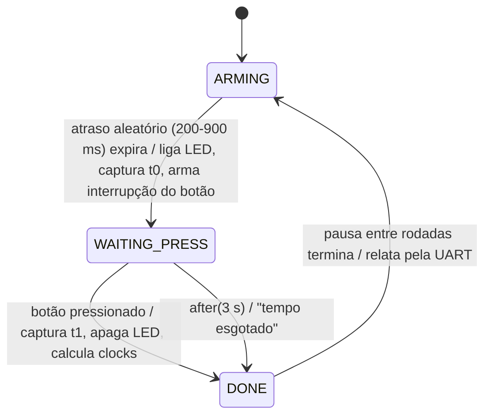
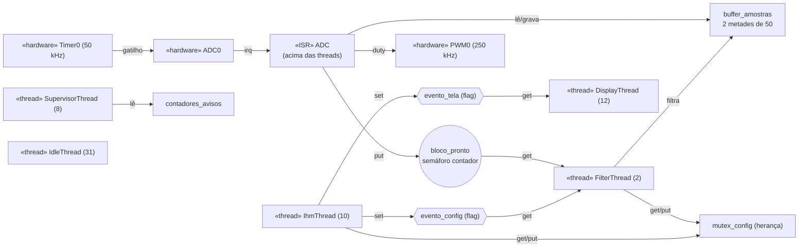

# Lista de questões sobre os Labs e o Projeto Final

Questões baseadas no que os labs ensinam, com **gabarito no fim**. Complementam o [Resumo_Labs.md](Resumo_Labs.md) (de onde saem os fatos e os números) e as listas de questões da [P1](P1/Lista_Questoes_P1.md) e do [Compilado P2](P2/Compilado_P2.md).

**Como usar:** responda sem olhar, só com a Tabela e as suas anotações; depois confira. Cada resposta indica onde revisar. As questões são **estimativas do que os labs permitem cobrar**, não garantia.

Legenda: ★ básica · ★★ média · ★★★ nível de prova.

| Bloco | Origem | Questões |
|---|---|---|
| **A** | Lab 1: ambiente e `volatile` | Q1 |
| **B** | Lab 2: SysTick, VTOR, registradores, interrupção de GPIO | Q2 a Q5 |
| **C** | Lab 3: assembly e AAPCS | Q6, Q7 |
| **D** | Lab 4a e 4b: periféricos e custo da abstração | Q8, Q9 |
| **E** | Lab 5a e 5b: ThreadX | Q10 a Q13 |
| **F** | Lab 6a: escalonamento | Q14 a Q16 |
| **G** | Projeto Final | Q17 a Q20 |

---

# Parte 1 – Questões

## Bloco A – Lab 1

**Q1 ★.** (a) Por que, para ver o valor de `__LINE__` ou `__DATE__` no depurador, é preciso atribuí-lo a uma variável? (b) Por que essa variável deve ser `volatile`? (c) Cite duas razões pelas quais **nem toda variável pode ser vista** no depurador.

## Bloco B – Lab 2

**Q2 ★★.** O SysTick do Cortex-M4 é de 24 bits e o clock é de 120 MHz. (a) Qual o **maior intervalo** que ele mede sem estourar? (b) Como medir um intervalo de **3 s** com resolução de **1 clock**, usando o SysTick? Descreva a solução e escreva a fórmula do número de clocks decorridos. (c) Qual a *race condition* possível ao ler o tempo e como evitá-la?

**Q3 ★★.** (a) Qual o papel do registrador **VTOR**? Em que endereço está e a qual bloco pertence? (b) Como saber, lendo o VTOR, se a tabela de vetores está na Flash ou na RAM (Flash `0x0000_0000`-`0x000F_FFFF`, SRAM `0x2000_0000`-`0x2003_FFFF`)? (c) O que faz a função `IntRegister()` da TivaWare e por que ela **não** pode ser usada se o requisito exige o vetor em Flash? (d) Como associar uma ISR a uma interrupção **sem** `IntRegister()`?

**Q4 ★★★.** Na primeira linha da `main` foram lidos **CONTROL = `0x00000004`** e **xPSR = `0x21000000`**. Decodifique os dois: modo, pilha ativa, estado de ponto flutuante, flags **N Z C V**, bit **T** e número da exceção. O que o fato de **C = 1** e **FPCA = 1** indica sobre o que aconteceu **antes** da `main`?

**Q5 ★★.** No jogo de tempo de reação: (a) desenhe o **diagrama de estados** de uma rodada (LED, botão, tempo limite de 3 s e pausa); (b) qual a **ISR do botão** faz, em ordem? (c) Como evitar o efeito de **bounce** do botão sem filtro de hardware?

## Bloco C – Lab 3

**Q6 ★★.** Para `uint16_t EightBitHistogram(uint16_t width, uint16_t height, uint8_t *p_image, uint16_t *p_histogram)`: (a) em que registradores chegam os **4 parâmetros** e em qual vai o **retorno**? (b) Quais instruções de load/store usar para o **pixel** e para o **histograma** e por quê? (c) Se a rotina usar um quinto registrador de trabalho **além de R0-R3 e R12**, o que a AAPCS exige?

**Q7 ★★★.** Planeje e escreva `EightBitHistogram` em assembly: calcula `image_size = width × height`; **retorna 0** sem tocar no histograma se `image_size ≥ 64K`; senão **zera** as 256 posições de 16 bits, conta cada pixel **lendo-o uma só vez** e retorna `image_size`. Mostre a **alocação de registradores** e comente.

## Bloco D – Labs 4a e 4b

**Q8 ★★.** No Lab 4a (joystick, ADC, PWM, UART): (a) por que o **timer** dispara o ADC **por hardware** em vez de uma ISR de software disparar? (b) Por que a **impressão pela UART** fica no laço principal e não na ISR do ADC? (c) O que a ISR do ADC faz, em ordem?

**Q9 ★★.** No Lab 4b, 1000 pulsos foram medidos em **2.432** ciclos (assembly), **2.804** (C puro) e **22.057** (C+TivaWare), a 120 MHz. (a) Calcule os **ciclos por pulso** e o **tempo** de cada técnica. (b) Quanto o assembly é mais rápido que a TivaWare e que o C puro? (c) Por que a TivaWare é tão mais lenta? (d) Por que o assembly foi **desenrolado ×8** e que cuidado a medida exige (overhead e estouro)?

## Bloco E – Labs 5a e 5b

**Q10 ★★.** No `demo_threadx.c` (Lab 5a), onde ficam na memória **a estrutura de controle** de uma thread, de uma fila e de um mutex? E a **pilha** de cada thread e as **mensagens** da fila? Cite os tamanhos das estruturas (`TX_THREAD`, `TX_QUEUE`, `TX_MUTEX`, `TX_SEMAPHORE`, `TX_EVENT_FLAGS_GROUP`) e diga **por que** são globais.

**Q11 ★★.** Na tabela de threads do demo, as **threads 3 e 4** usam a mesma função `thread_3_and_4_entry`. (a) Como diferenciá-las? (b) Por que as **threads 1 e 2** se revezam e as demais não? (c) O que significa o *preemption-threshold* igual à prioridade?

**Q12 ★★★.** No Lab 5b, o tick do ThreadX depende de quatro valores: clock do núcleo, `SYSTEM_CLOCK`, `SYSTICK_CYCLES` e `TX_TIMER_TICKS_PER_SECOND`. (a) Escreva a **relação** entre eles para um tick de **10 ms** a **120 MHz**. (b) Se o clock real fosse **60 MHz** e o código continuasse programado para 120 MHz, quanto duraria `tx_thread_sleep(100)`? (c) Se `TX_TIMER_TICKS_PER_SECOND` fosse 1000 e o SysTick continuasse em 10 ms por tick, quanto duraria um `sleep(100)` que o programador pensava ser 100 ms?

**Q13 ★★.** Descreva, em passos, o caminho do **reset até a primeira instrução de uma thread** (Lab 5b), citando `Reset_Handler`, `SystemInit`, `__main`, `tx_kernel_enter`, `tx_application_define` e o **PendSV**.

## Bloco F – Lab 6a

**Q14 ★★★.** Três tarefas periódicas, prazo = período: **T1** (C = 0,3 s, T = 1 s), **T2** (0,5 s, 1,5 s), **T3** (0,8 s, 4 s), prioridades por taxa (T1 > T2 > T3). (a) Calcule **U**. (b) O Teorema 1 garante a escalonabilidade? (c) Aplique o **Teorema 3** e conclua. (d) Qual o **tempo de resposta** de cada tarefa? Compare com o medido no cenário c (R1 = 0,30; R2 = 0,80; R3 = 2,70 s).

**Q15 ★★★.** T1 e T3 do item anterior compartilham um mutex; **T3 segura o mutex por 0,4 s** (metade do seu tempo de execução) e T2 **não** usa o mutex. (a) Explique por que, **sem herança**, T1 pode perder o prazo e qual o pior caso de R1. (b) Qual o limite de R1 **com herança**? (c) Qual o **custo** da herança sobre T2? (d) Por que o enunciado **proibiu `tx_thread_sleep`** para o período e o que usar no lugar?

**Q16 ★★.** No cenário b do Lab 6 ("sem preempção"), por que o *preemption-threshold* é **1 e não 0**? E por que no cenário a (*time-slice* de 50 ms) T1 e T2 perdem o prazo por poucos **microssegundos**?

## Bloco G – Projeto Final

**Q17 ★★★.** Desenhe o **diagrama de objetos UML** da arquitetura do Filtro Digital (Timer0, ADC0, PWM0, ISR do ADC, FilterThread, SupervisorThread, IhmThread, DisplayThread, IdleThread, semáforo `bloco_pronto`, event flags `evento_config` e `evento_tela`, `mutex_config`, `buffer_amostras`), indicando **prioridades** e **setas com a operação**.

**Q18 ★★.** O projeto amostra a **50 kHz** e processa em **blocos de 50 amostras**. (a) Qual o período de amostragem e a duração de um bloco? (b) Qual o valor de recarga do Timer0 a 120 MHz? (c) Se a ISR gasta ≈ 1 µs por amostra e a `FilterThread` 33 µs por bloco, qual a **utilização da CPU**? (d) A `FilterThread` com recálculo de coeficientes gasta 76 µs: qual o **tempo de resposta de pior caso**, considerando a interferência da ISR? Cabe no prazo?

**Q19 ★★★.** O caminho crítico do filtro **não usa mutex**, mas a ISR e a `FilterThread` acessam o mesmo `buffer_amostras`. (a) Como isso é possível sem *race condition*? (b) Para que serve o `mutex_config` e por que tem **herança de prioridade**? (c) Por que os contadores de aviso podem ser lidos sem mutex?

**Q20 ★★.** Justifique as **prioridades** do projeto (FilterThread 2, SupervisorThread 8, IhmThread 10, DisplayThread 12, IdleThread 31) com a regra do **Rate Monotonic**, e explique para que serve a `IdleThread` (aprendizado do Lab 6) e por que o projeto **não** usa *preemption-threshold*.

---

# Parte 2 – Gabarito

## Respostas – Bloco A

**Q1.** (a) **Macros do pré-processador desaparecem na compilação**: o depurador só enxerga variáveis (símbolos na memória ou em registradores). (b) Sem `volatile` o compilador, ao otimizar, vê a variável como **código morto** (nunca lida) e a **elimina**; com `volatile` ele a mantém na memória. (c) **Escopo e tempo de vida** (locais só existem enquanto o *frame* está ativo) e **otimização** (a variável vai para um registrador, é fundida ou eliminada: *optimized out*). Revise: [Resumo_Labs, Lab 1](Resumo_Labs.md), [Resumo P1 §11.8](P1/Resumo_P1.md#s11-8).

## Respostas – Bloco B

**Q2.** (a) `2²⁴ / 120 MHz = 16.777.216 / 120.000.000 ≈ 139,8 ms`. (b) Configurar o SysTick para uma **interrupção curta** (1 ms, `RVR = 119.999`), manter um **contador de software** `ms` incrementado na ISR e combinar com o **valor corrente** `VAL` (que decresce a cada clock): `clocks = ms × 120.000 + (RVR − VAL)`. O intervalo é a diferença entre dois instantes assim calculados. (c) A ISR pode incrementar `ms` **no meio** da leitura de `ms` e `VAL`, dando um instante errado: usa-se a **leitura dupla** (reler `ms` até ficar estável). Revise: [Resumo_Labs, Lab 2](Resumo_Labs.md), [Resumo P1 §13](P1/Resumo_P1.md#s13).

**Q3.** (a) O **VTOR** guarda o **endereço base da tabela de vetores**; o núcleo busca o handler em `VTOR + 4×N`. Está no **SCB/NVIC** (bloco do próprio núcleo, não da TI), em **`0xE000_ED08`**. (b) Se o valor está em `0x0000_0000`-`0x000F_FFFF` → **Flash**; em `0x2000_0000`-`0x2003_FFFF` → **RAM**. (c) Na primeira chamada, `IntRegister()` **copia a tabela de vetores para a RAM e reprograma o VTOR**, para poder gravar o ponteiro da ISR em tempo de execução; isso viola o requisito de manter o vetor em Flash. (d) Definir a função com **o mesmo nome** do símbolo `WEAK` da tabela do startup (`SysTick_Handler`, `GPIOJ_Handler`): o *linker* resolve a ligação e o VTOR permanece em `0x0`. Revise: [Resumo P1 §11.5](P1/Resumo_P1.md#s11-5), [Resumo_Labs, Lab 2](Resumo_Labs.md).

**Q4.** **CONTROL = `0x4` = `0b100`:** `nPRIV = 0` (**privilegiado**), `SPSEL = 0` (pilha **MSP**), `FPCA = 1` (**há contexto de ponto flutuante ativo**). **xPSR = `0x21000000`:** nibble 31-28 = `0010` → **N=0, Z=0, C=1, V=0**; nibble 27-24 = `0001` → Q=0, ICI/IT=00 e **T=1** (bit 24, Thumb obrigatório); IPSR = 0 → **Thread mode** (nenhuma exceção ativa). **C = 1 e FPCA = 1** mostram que **alguma instrução** (aritmética que gerou carry; instrução de ponto flutuante) **já rodou em `SystemInit`/`__main`, antes da `main`**: as flags **não são zeradas por hardware**. Revise: [Resumo P1 §8.4-8.6](P1/Resumo_P1.md#s8), [§17](P1/Resumo_P1.md#s17).

**Q5.** (a)

(b) A ISR: **captura t1** o mais cedo possível, **apaga o LED**, **calcula** `clocks = t1 − t0`, **desabilita a interrupção do botão** e sinaliza `DONE` para o `main` (que imprime). (c) A própria ISR **desabilita a interrupção do botão** logo na primeira borda válida (`GPIOIntDisable`) e só a rearma na rodada seguinte: os *bounces* seguintes não geram nova interrupção. Revise: [Resumo P1 §14](P1/Resumo_P1.md#s14), [§11.8](P1/Resumo_P1.md#s11-8).

## Respostas – Bloco C

**Q6.** (a) AAPCS: `width` em **R0**, `height` em **R1**, `p_image` em **R2**, `p_histogram` em **R3**; **retorno em R0** (16 bits). Argumentos menores que uma word chegam **estendidos para 32 bits**. (b) **Pixel (8 bits): `LDRB`**; **histograma (16 bits sem sinal): `LDRH`/`STRH`** (com índice `Rn, Rm, LSL #1` para o byte-offset). O formato de LD/ST vem da **largura do dado** no diagrama de memória. (c) Deve **salvar o registrador no início (`PUSH`) e restaurá-lo antes do retorno (`POP`)**: R4-R11 são **callee-saved**. Revise: [Resumo P1 §10](P1/Resumo_P1.md#s10), [§9.4](P1/Resumo_P1.md#s9-4).

**Q7.** **Planejamento.** Algoritmo: `size = w·h`; se `size ≥ 65536` retorna 0; zera 256 posições; para cada pixel, `hist[pixel]++`; retorna `size`. **Alocação:** R0 = pixel/endereço do bin (e depois zero), R1 = contagem (e contador do zeramento), R2 = ponteiro da imagem, R3 = histograma, R12 = contador de pixels, **R4 = `image_size`** (salvo na pilha, pois não cabe em R0-R3/R12 e é o retorno).

```
EightBitHistogram PROC
        PUSH    {R4}                    ; R4 é callee-saved: preservar (AAPCS)
        MUL     R4, R0, R1              ; R4 = image_size = width * height
        CMP     R4, #0x10000            ; >= 64K ?
        BHS     erro                    ; sim: retorna 0, histograma intacto
        MOV     R0, #0                  ; valor zero
        MOV     R1, #256                ; contador do zeramento
zera    SUBS    R1, R1, #1              ; índice 255..0
        STRH    R0, [R3, R1, LSL #1]    ; hist[i] = 0 (16 bits)
        BNE     zera
        MOVS    R12, R4                 ; R12 = pixels restantes (Z=1 se imagem vazia)
        BEQ     fim
laco    LDRB    R0, [R2], #1            ; R0 = pixel; ponteiro avança (pós-indexado)
        ADD     R0, R3, R0, LSL #1      ; R0 = &hist[pixel]
        LDRH    R1, [R0]                ; contagem atual
        ADD     R1, R1, #1
        STRH    R1, [R0]                ; hist[pixel]++
        SUBS    R12, R12, #1
        BNE     laco
fim     MOV     R0, R4                  ; retorno = image_size
        POP     {R4}
        BX      LR
erro    MOV     R0, #0                  ; erro: retorno 0
        POP     {R4}
        BX      LR
        ENDP
```
**Por que é eficiente:** cada pixel é lido **uma vez**, a imagem é percorrida como **vetor linear** (pós-indexado), o histograma é endereçado com **registrador deslocado**, e o retorno de **16 bits** não representa 65536 (por isso `≥ 64K` é erro). Medido no seu lab: **≈ 16 ciclos/pixel** (19.200 pixels, ≈ 308.830 ciclos). Revise: [Gabarito Lab 3 no Resumo_Labs](Resumo_Labs.md), [Resumo P1 §9.4-9.5](P1/Resumo_P1.md#s9-4).

## Respostas – Bloco D

**Q8.** (a) Com o **timer disparando o ADC**, a conversão começa no **instante exato** do timer, **sem passar pela CPU**: período **exato e sem jitter**. Se uma ISR de software iniciasse a conversão, o instante variaria com a **latência da interrupção**. (b) A UART é **lenta**; imprimir **dentro da ISR** atrasaria outras interrupções. A ISR deve fazer o **mínimo**, sinalizar (`g_nova = 1`), e o `main` imprime. (c) Ordem da ISR: `ADCIntClear` → `ADCSequenceDataGet` (x, y) → ler o botão → atualizar o PWM (`RGB_Set`) → `g_nova = 1`. Revise: [Resumo_Labs, Lab 4a](Resumo_Labs.md), [Resumo P1 §11.8](P1/Resumo_P1.md#s11-8).

**Q9.** (a) Por pulso: **2,432**, **2,804** e **22,057** ciclos. Tempo (÷ 120 MHz): **20,27 µs**, **23,37 µs** e **183,81 µs**. (b) TivaWare ÷ assembly ≈ **9,07×**; C puro ÷ assembly ≈ **1,15×**. (c) Cada pulso na TivaWare faz **duas chamadas de função** (`GPIOPinWrite`), com prólogo, desvio, cálculo de endereço e retorno; o **custo da chamada** domina. O C puro e o assembly fazem **uma escrita (`STR`)** por borda. A otimização do compilador aproxima o C do assembly. (d) **Desenrolar** (16 `STR` por iteração) **reduz o overhead do laço** (decremento e desvio por pulso). A medida deve **descontar o overhead** da leitura do SysTick (calibrado) e **detectar o estouro** do contador de 24 bits (≈ 139,8 ms a 120 MHz), e **não pode ter I/O serial** no trecho medido. Revise: [Resumo_Labs, Lab 4b](Resumo_Labs.md).

## Respostas – Bloco E

**Q10.** **Estruturas de controle:** todas em **`.bss`** (variáveis globais, nem `.data`, nem pilha, nem heap). Tamanhos (ARMv7-M, 32 bits): **`TX_THREAD` 180 B**, **`TX_QUEUE` 60 B**, **`TX_MUTEX` 52 B**, **`TX_SEMAPHORE` 32 B**, **`TX_EVENT_FLAGS_GROUP` 40 B** (byte pool 52 B, block pool 48 B). **Memória adicional** (pilhas de 1024 B, as 100 mensagens × 4 B = 400 B da fila, a área do block pool): alocada de um **byte pool de 9120 B**, que também fica em `.bss` (`memory_area`). São **globais** porque a estrutura precisa **existir enquanto o componente existir** (uma local sumiria no retorno da função): tx 14.35-14.36. Revise: [Compilado §1.5 e §3.3](P2/Compilado_P2.md#c1-mem), [Gabarito Q1 A7](P2/Gabarito_Prova2022_Q1.md#a7).

**Q11.** (a) Pelo parâmetro **`thread_input`** passado a `tx_thread_create` (3 ou 4): o mesmo código executa com entradas diferentes. (b) Têm a **mesma prioridade (16)** e **time-slice de 4 ticks (40 ms a 100 Hz)**: ao fim da fatia, o escalonador passa a CPU à outra de mesma prioridade. As demais têm prioridades diferentes ou **sem fatia**. (c) Uma thread em execução só é preemptada por outra de prioridade **menor que o limiar**; com **limiar = prioridade**, vale a regra normal (sem efeito extra). Revise: [Compilado §3.2](P2/Compilado_P2.md#c3), [Resumo_Escalonamento](P2/Resumo_Escalonamento.md#e8).

**Q12.** (a) `SYSTICK_CYCLES = SYSTEM_CLOCK / TX_TIMER_TICKS_PER_SECOND − 1 = 120.000.000/100 − 1 = 1.199.999` (período = `RVR + 1` = 1.200.000 ciclos = **10 ms** a 120 MHz). Os quatro valores precisam **concordar**: clock real = `SYSTEM_CLOCK`; recarga do SysTick = `SYSTEM_CLOCK/ticks_por_s − 1`; macro `TX_TIMER_TICKS_PER_SECOND` igual ao usado. (b) A 60 MHz, 1.200.000 ciclos duram **20 ms**: o tick passa a **20 ms** e `sleep(100)` dura **2 s** (o dobro). (c) O tick real continua **10 ms**; `sleep(100)` dura **1 s**, **10×** mais que os 100 ms pensados. **Nenhuma verificação acusa o erro**: todos os tempos ficam errados na mesma proporção. Revise: [Resumo_Labs, Lab 5b](Resumo_Labs.md), [Resumo P1 §13.4](P1/Resumo_P1.md#s13-4).

**Q13.** (1) **Reset:** o core lê **MSP** (palavra 0) e **PC** (palavra 1) da tabela de vetores em `0x0`. (2) **`Reset_Handler`** chama **`SystemInit`** (libera a FPU, clock) e salta para **`__main`**. (3) **`__main`** copia `.data` da Flash para a RAM, zera `.bss` e chama **`main`**. (4) `main`: programa o **clock em 120 MHz**, configura o LED e chama **`tx_kernel_enter()`** (não retorna). (5) O kernel executa `_tx_initialize_low_level` (desabilita interrupções, **programa o SysTick**, prioridades de SysTick e PendSV), `_tx_initialize_high_level` (estruturas e a **System Timer Thread**) e **`tx_application_define`** (cria as threads). (6) **`_tx_thread_schedule`** habilita as interrupções e dispara o **PendSV**; o `PendSV` restaura o contexto da thread pronta de maior prioridade e retorna da exceção a ela; a função de entrada começa. Dali em diante o SysTick gera o tick e o PendSV faz as trocas. Revise: [Compilado §3.2](P2/Compilado_P2.md#c3) (tx 14.64-14.67), [Resumo P1 §17](P1/Resumo_P1.md#s17).

## Respostas – Bloco F

**Q14.** (a) `U = 0,3/1 + 0,5/1,5 + 0,8/4 = 0,300 + 0,333 + 0,200 = 0,833`. (b) Limite do Teorema 1 (n = 3) = **0,780**: **0,833 > 0,780** → **não conclui**. (c) **Teorema 3:** i = 1: t = 1: `0,3` ✓. i = 2: t = 1: 0,8; t = 1,5: `(0,3·2 + 0,5)/1,5 = 0,733` → **min 0,733** ✓. i = 3: t = 1: 1,6; t = 2: 1,2; t = 3: `(0,3·3 + 0,5·2 + 0,8)/3 = 0,9`; **t = 4: `(0,3·4 + 0,5·3 + 0,8)/4 = 0,875`**; t = 1,5: 1,267 → **min 0,875 ≤ 1** ✓ → **escalonável**. (d) Pela análise de resposta: **R1 = 0,3 s**, **R2 = 0,8 s**, **R3 = 2,7 s** (R3: 0,8 → 1,6 → 2,4 → 2,7 → 2,7). **Bate com o medido** (0,30; 0,80; 2,70 s): o teste exato prevê o comportamento real. Revise: [Compilado G2](P2/Compilado_P2.md#g2), [Resumo_Escalonamento §3](P2/Resumo_Escalonamento.md#e3).

**Q15.** (a) T3 pega o mutex e é **preemptada por T2** (prioridade maior que T3 e que **não usa** o mutex); T1 chega, **bloqueia** no mutex e passa a esperar T3, que **não consegue** terminar a seção crítica enquanto T2 executa: **inversão de prioridade**. Pior caso: `R1 = C1 + (seção crítica de T3) + (um job de T2) = 0,3 + 0,4 + 0,5 = 1,2 s > 1 s` → **perde o prazo** (medido: 1,10 s, com 11 perdas em ≈ 128 s). (b) **Com herança**, T3 herda a prioridade de T1 e **T2 não a preempta**: `B1 = 0,4 s`, `R1 ≤ 0,3 + 0,4 = 0,7 s` ≤ 1 s ✓ (medido: 0,60 s). (c) **T2 é atrasado** (T3 passa a executar com prioridade alta na frente dele): R2 sobe de **0,85 s para 1,35 s**. (d) `tx_thread_sleep(período)` ao fim do job faz o **período real = C + sleep** (deriva); o professor mandou usar **timers ou mensagens**: aqui um **`TX_TIMER` periódico** libera um **semáforo** que a thread espera, e o período fica fixo. Revise: [Compilado §1.8 e G3](P2/Compilado_P2.md#c1-dead), [Resumo_Escalonamento §9](P2/Resumo_Escalonamento.md#e9).

**Q16.** O **threshold = 0** significaria "ninguém preempta, **nem a System Timer Thread** do ThreadX", que tem **prioridade 0** e trata os timeouts: o sistema **trava**. Por isso se usa o **threshold = 1** (a maior prioridade das tarefas da aplicação): nenhuma tarefa preempta outra, mas a timer thread continua podendo rodar. No cenário a, **T1 e T2 perdem por µs** porque a CPU é dividida em fatias iguais e a demanda de cada job (calibrada mais o custo dos ticks) fica **um pouco acima de um número exato de fatias**. Revise: [Resumo_Labs, Lab 6a](Resumo_Labs.md), [Compilado §3.2](P2/Compilado_P2.md#c3) (preempt threshold).

## Respostas – Bloco G

**Q17.** Elementos e relações (desenhe com os símbolos da disciplina: thread com barras laterais, semáforo contador, bandeira, cadeado, bloco de memória; ISR rosa; hardware cinza; setas da thread/ISR para o objeto com a operação):


Prioridades: **menor número = maior** (ISR acima de todas; FilterThread 2; SupervisorThread 8; IhmThread 10; DisplayThread 12; IdleThread 31). Revise: [Resumo_Labs, Projeto Final](Resumo_Labs.md), [Compilado §3.3 e G6](P2/Compilado_P2.md#c3).

**Q18.** (a) Período = `1/50 kHz =` **20 µs**; bloco = `50 × 20 µs =` **1 ms**. (b) `120 MHz / 50 kHz = 2.400` ciclos → recarga `2.400 − 1 =` **2.399**. (c) ISR: `1 µs / 20 µs =` **5 %**; filtro: `33 µs / 1 ms =` **3,3 %**; total ≈ **8,3 %** da CPU. (d) A ISR tem prioridade acima da thread: `R = 76 + ⌈R/20⌉·1`: R = 76 → 80 → 80, ou seja, **R ≈ 80 µs** (76 µs do filtro mais 4 execuções da ISR). **Cabe no prazo de 1 ms** (8 % do prazo). Revise: [Compilado §4.11 e G2](P2/Compilado_P2.md#c4-rma), [Resumo_Escalonamento §2](P2/Resumo_Escalonamento.md#e2).

**Q19.** (a) O `buffer_amostras` tem **duas metades de 50**: a ISR trabalha numa metade enquanto a `FilterThread` filtra **a outra**, e elas são **trocadas a cada milissegundo**. **Nunca acessam a mesma metade ao mesmo tempo**, então não há conflito (e nenhum mutex no caminho crítico, que tem prazo rígido). (b) O `mutex_config` protege a **configuração em uso** (tipo e cortes), que a `IhmThread` altera e a `FilterThread` lê quando chega `evento_config`. Tem **herança de prioridade** para que uma thread de prioridade média **não atrase** a `FilterThread` enquanto ela espera o mutex (inversão de prioridade); a posse dura **poucos µs**. (c) Cada contador tem **um único escritor** e é uma variável de **32 bits** (acesso atômico no Cortex-M4): não há *race condition* de escrita nem leitura "rasgada". Revise: [Compilado §1.3 e §1.8](P2/Compilado_P2.md#c1-mem), [Compilado G3](P2/Compilado_P2.md#g3).

**Q20.** **Rate Monotonic:** quanto **mais frequente** a tarefa, **maior a prioridade**: filtro (1 ms) > IHM (10 ms) > supervisor (100 ms); o **display** é aperiódico e **longo** (dezenas de ms), por isso fica **por último** e não atrasa as de cima. (No projeto, o supervisor tem prioridade 8, **maior** que a IHM 10, apesar de mais lento: é uma escolha de projeto; a ordem estrita por taxa seria IHM antes do supervisor.) A **`IdleThread` (31)** é um laço vazio que **evita o HardFault do escalonador ocioso** observado no Lab 6 (sem nenhuma thread pronta, o ThreadX tomou HardFault sob o depurador). O projeto **não usa preemption-threshold** (limiar = prioridade) para **não bloquear a timer thread** (prioridade 0), como no Lab 6. Revise: [Compilado §4.10-4.11](P2/Compilado_P2.md#c4), [Resumo_Labs, Projeto](Resumo_Labs.md).

---

## Para consolidar

- Refaça sem olhar: **Q4** (decodificar registradores), **Q7** (assembly do histograma), **Q12** (coerência do tick) e **Q14-Q15** (escalonamento e inversão de prioridade): são os que mais se parecem com questões de prova.
- Reveja o [Resumo_Labs.md](Resumo_Labs.md) antes de cada bloco e a [seção 1.8 do Compilado](P2/Compilado_P2.md#c1-dead) para deadlock e inversão de prioridade.
