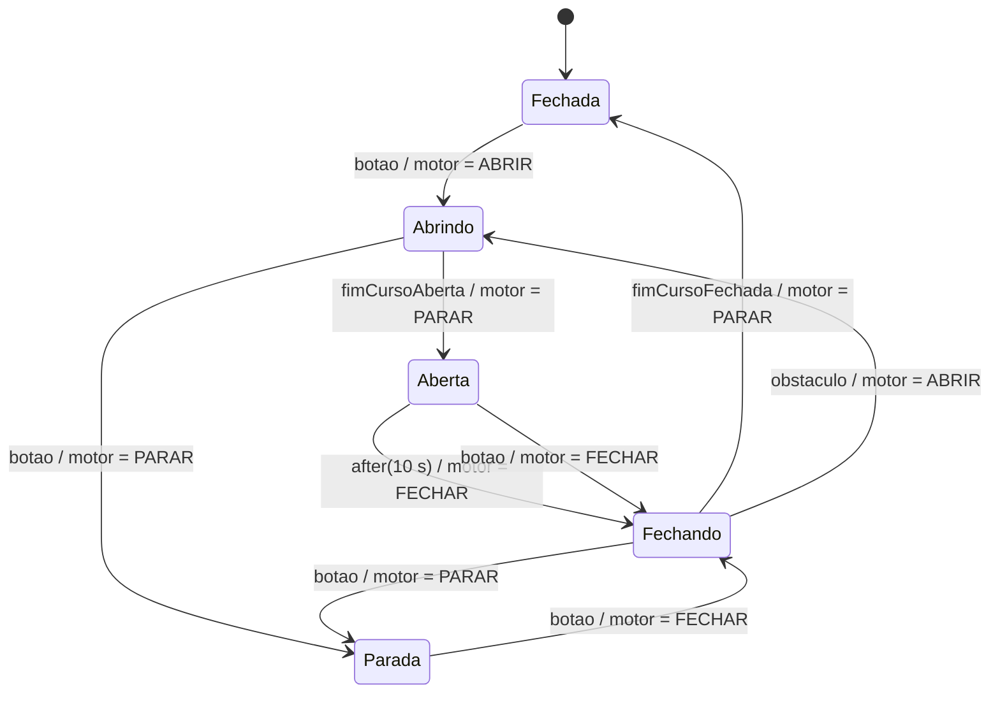
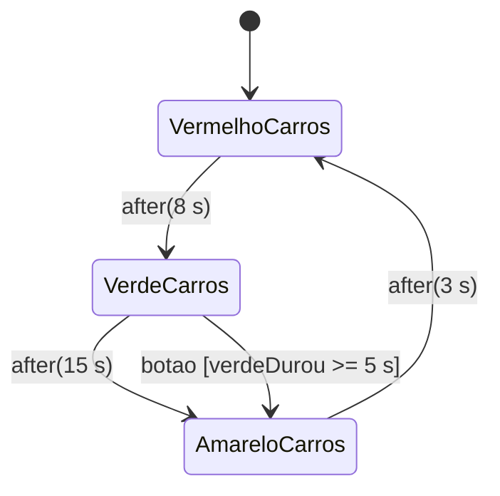

# Lista de questões para estudar a P1

Banco de questões com **gabarito no fim** (cada resposta aponta para o [Resumo_P1.md](Resumo_P1.md) para você revisar). As questões **não repetem** as listas do professor: para essas, use o [Gabarito_Exercicios.md](Gabarito_Exercicios.md) (17 questões de assembly, primos e MEF) e a [prova de 2022](Gabarito_Prova2022.md) (Q2 e Q3).

## Como usar

1. Escolha um bloco. Responda **no papel, sem olhar o Resumo** e **só com a Tabela** (`QRC0001_UAL.pdf`), como na prova: sem calculadora, em hexadecimal.
2. Só depois, confira no **gabarito** (Parte 2). Errou? Vá à seção do Resumo indicada.
3. Marque as que errou e **refaça no dia seguinte**.

Legenda: ★ = básica · ★★ = média · ★★★ = no nível de prova. 📋 = precisa da Tabela.

| Bloco | Assunto | Questões | Resumo |
|---|---|---|---|
| **A** | Conceitos: embarcados, arquitetura, RISC, ARM, Cortex-M | A1 a A12 | [§1-8](Resumo_P1.md#s1) |
| **B** | Flags, aritmética e deslocamentos (à mão) | B1 a B9 | [§8.4, §9](Resumo_P1.md#s8) |
| **C** | Escrever assembly | C1 a C17 | [§9, §10](Resumo_P1.md#s9) |
| **D** | Exceções e interrupções | D1 a D18 | [§11, §12](Resumo_P1.md#s11) |
| **E** | SysTick e timers | E1 a E8 | [§13](Resumo_P1.md#s13) |
| **F** | Máquinas de estados (UML) | F1 a F8 | [§14](Resumo_P1.md#s14) |
| **G** | Reset e o que acontece antes da `main` | G1 a G5 | [§17](Resumo_P1.md#s17) |
| **H** | Estilo de prova (questões longas) | H1 a H3 | [Gabarito 2022](Gabarito_Prova2022.md) |

**Onde está o peso:** na prova de 2022, a parte da P1 era **Interrupções (3 pts)** e **Assembly (3 pts)**. Dê mais tempo aos blocos **C, D, E e H**.

---

# Parte 1 – Questões

## Bloco A – Conceitos

**A1 ★.** Defina sistema embarcado e cite **4 características** típicas.

**A2 ★.** Diferencie **reliability**, **availability**, **safety** e **security**, uma frase para cada.

**A3 ★.** O modelo de arquitetura tem **9 camadas**. Quantas são de hardware e quantas de software? O que faz a **HAL** e o que faz a **camada de adaptação**? Em qual camada fica o **CMSIS-RTOS**?

**A4 ★.** Cite as características de uma arquitetura **RISC** e explique por que ela é **Load/Store**.

**A5 ★★.** Explique um pipeline de **5 estágios**. O que são **data hazard** e **control hazard** e como cada um é resolvido?

**A6 ★.** Compilando o mesmo programa, por que o código RISC costuma ser **maior** e mesmo assim **mais rápido** que o CISC?

**A7 ★★.** O que é **yield** e como ele explica a decisão dos fabricantes de usar **núcleo RISC com muita memória e periféricos**?

**A8 ★.** (a) Por que a Acorn **não** usou o Motorola 68000 no projeto do ARM? (b) O que significa a sigla ARM em 1985 e em 1990? (c) Qual é o **modelo de negócio** da ARM?

**A9 ★.** Liste **6 características** dos processadores Cortex-M. Qual a diferença entre o ARM7TDMI e o Cortex-M quanto ao conjunto de instruções?

**A10 ★★.** Um inteiro sem sinal de 64 bits `0x1122334455667788` está no endereço `0x2000_0000` (little-endian). (a) Quais valores ficam em cada **word**? (b) E em cada **byte**, de `0x2000_0000` a `0x2000_0007`? (c) Em qual registrador fica o byte mais significativo ao carregar em um par de registradores?

**A11 ★★.** Quais são os **modos** do processador e as **pilhas**? Qual pilha o **Handler mode** usa? O que o **IPSR** informa? Qual registrador escolhe a pilha das threads?

**A12 ★★.** Diferencie **PRIMASK**, **FAULTMASK** e **BASEPRI**. Se `BASEPRI = 0x40`, quais prioridades são bloqueadas (considere 4 bits implementados, alinhados à esquerda)?

---

## Bloco B – Flags, aritmética e deslocamentos 📋

Em todas, **N Z C V** são os flags após a instrução. Responda em **hexadecimal**.

**B1 ★★.** `R0 = 0x7FFFFFFF`, `R1 = 1`. `ADDS R2, R0, R1`. Dê R2 e N Z C V. O resultado é correto como número **com sinal**? E **sem sinal**?

**B2 ★★.** `R0 = 0xFFFFFFFF`, `R1 = 1`. `ADDS R2, R0, R1`. Dê R2 e N Z C V.

**B3 ★★.** `R0 = 5`, `R1 = 7`. `CMP R0, R1`. Dê os flags e diga quais condições são verdadeiras: `EQ NE HS LO HI LS GE LT GT LE MI PL`.

**B4 ★★★.** `R0 = 0x80000000`, `R1 = 1`. `CMP R0, R1`. Dê os flags. Diga se `HI` e `LT` são verdadeiras e **o que isso significa** para sem sinal × com sinal.

**B5 ★★.** `R0 = 0`, `R1 = 0x80000000`. `SUBS R2, R0, R1`. Dê R2 e os flags.

**B6 ★★.** `R1:R0 = 0x00000000_FFFFFFFF` e `R3:R2 = 0x00000000_00000001`. Escreva a soma de 64 bits em `R5:R4` com o **menor número de instruções** e dê o resultado.

**B7 ★★.** `R0 = 0x80000001`. Dê R1 e o flag **C** depois de cada: (a) `LSRS R1, R0, #1` (b) `ASRS R1, R0, #1` (c) `LSLS R1, R0, #1` (d) `RORS R1, R0, #1`.

**B8 ★.** `R0 = 0x00001234`. `TST R0, #0x80`. Qual o valor de **Z**? Para que serve o `TST`?

**B9 ★★.** Complete: após `CMP R0, R1`, quando usar `HS/LO/HI/LS` e quando usar `GE/LT/GT/LE`? E por que **C = 1** na subtração significa "sem empréstimo"?

---

## Bloco C – Escrever assembly 📋

Use a **AAPCS** quando for função (argumentos em R0-R3, retorno em R0, preservar R4-R11, `BX LR`). **Comente** as linhas. Quando disser "sem saltos", use `IT`.

**C1 ★★.** `R0 = máximo (sem sinal) de R1 e R2`, **sem saltos**.

**C2 ★★.** `R0 = |R1|` (valor absoluto, R1 com sinal), **sem saltos**.

**C3 ★.** (a) `R0 = 10 × R1` **sem MUL**. (b) `R0 = 7 × R1` com **uma** instrução.

**C4 ★.** Copie os **bits 11:8** de `R1` para `R0` (alinhados no bit 0).

**C5 ★.** Escreva o valor `0b101` nos **bits 6:4** de `R0`, sem mexer nos demais bits.

**C6 ★.** Zere os **bits 7:0** de `R0` com **uma** instrução.

**C7 ★.** Inverta a ordem dos **bytes** de `R0` (`0x11223344 → 0x44332211`) com **uma** instrução.

**C8 ★★.** `R0 = R1 mod 10` (sem sinal), com **3 instruções ou menos**.

**C9 ★★.** `R0 = 1` se `R1` for **múltiplo de 8**, senão `R0 = 0`, **sem saltos**.

**C10 ★★★.** `R0 = 1` se o caractere em `R1` for uma **letra minúscula** (`'a'` a `'z'`), senão 0, **sem saltos e com 4 instruções**.

**C11 ★★.** `uint32_t soma(uint32_t *v, uint32_t n)`: soma `n` words de `v`. Trate `n = 0`.

**C12 ★★.** `char *copia(char *dest, const char *src)`: copia a string (inclusive o `\0`) e **retorna `dest`**.

**C13 ★★.** `uint64_t mult(uint32_t a, uint32_t b)`: devolve o produto de 64 bits.

**C14 ★★★.** `uint32_t f(uint32_t x)` que retorna `quad(x) + x`, onde `quad` é uma sub-rotina assembly que devolve `x*x` (`BL quad`). Mostre o prólogo e o epílogo e **explique o que preservar**.

**C15 ★★★.** `SysTick_Handler` (ISR em assembly) que **incrementa** o contador de 32 bits em `0x2000_0100` e, **toda vez** que ele for múltiplo de 500, grava `1` na word em `0x2000_0104`.

**C16 ★★.** `void systick_config(void)` em assembly: SysTick a cada **1 ms** com clock de **80 MHz**, com interrupção e clock do processador.

**C17 ★★.** `x = a[i] + a[i+1]`, com `a` em `0x2000_0000` (words) e `i` em `R1`; `R0 = x`. Use endereçamento com **registrador deslocado**.

---

## Bloco D – Exceções e interrupções

**D1 ★.** O que é **exceção**? Quais as 3 causas? Qual a diferença para **interrupção**?

**D2 ★.** Por que usar interrupção em vez de **polling**? Quais as 4 etapas da sequência básica de uma interrupção?

**D3 ★★.** Diferencie interrupção **vetorada** e **não vetorada**. Qual é o caso do Cortex-M4?

**D4 ★★.** O que é **latência** de interrupção e o que a compõe? Se a pior latência é **2 µs** e a pior ISR dura **40 µs**, qual o **tempo de resposta** de pior caso?

**D5 ★★.** (a) Qual o número da **exceção** da `IRQ5`? (b) Em que **endereço** da tabela de vetores está o vetor da `IRQ10` (VTOR = 0)? (c) E o do `SysTick`? (d) E o do `Reset_Handler`?

**D6 ★★.** Quando uma interrupção é aceita com `SP = 0x2000_1000`: (a) quantos bytes são empilhados? (b) Liste **endereço → registrador**. (c) Qual o novo SP?

**D7 ★★.** O que é **EXC_RETURN**? Interprete `0xFFFFFFF1`, `0xFFFFFFF9` e `0xFFFFFFFD`.

**D8 ★★.** Quais são os **estados** de uma exceção? O que acontece se um novo pedido da mesma fonte chega **enquanto a ISR está ativa**?

**D9 ★★★.** Para a `IRQ37`: (a) qual registrador e bit **habilita** no NVIC (valor a escrever)? (b) qual registrador **desabilita**? (c) e o **IPR** (índice e byte) da prioridade? (d) Mesma pergunta de (a) para a `IRQ70`.

**D10 ★★.** Com **4 bits** de prioridade implementados (S7G2), qual valor aparece no registrador para a prioridade **5**? Qual a prioridade **mais alta** e a **mais baixa**? O que o **PRIGROUP** define?

**D11 ★★.** Três ISRs: **B** (prioridade 5) está executando. **A** (prioridade 2) chega e, durante A, **C** (prioridade 2) chega. Descreva a **ordem de execução** e diga onde ocorre **tail-chaining**.

**D12 ★★.** Defina **tail-chaining** e **late arrival**.

**D13 ★★★.** Escreva em **C**: (a) a **inicialização** completa de uma interrupção de botão (borda de descida) com prioridade 4; (b) a **ISR**, que apenas sinaliza `botao_pressionado` para o `main`.

**D14 ★★.** Por que o **pedido no periférico** precisa ser limpo pela ISR, mas o **pending do NVIC** é limpo sozinho?

**D15 ★★.** Por que uma **função C comum** serve de ISR em um Cortex-M? Quais registradores o hardware empilha e por quê?

**D16 ★★.** O que acontece se o **bit 0** de uma entrada da tabela de vetores for **0**?

**D17 ★★★ (estilo prova).** Descreva **detalhadamente**, em passos numerados, o atendimento da interrupção de uma **UART** que recebeu um byte, do sinal elétrico até a **primeira instrução da ISR**. Cite hardware, controlador, core, memória e software.

**D18 ★★.** Qual a diferença entre `__disable_irq()`, `NVIC_DisableIRQ(n)` e `BASEPRI`? Quando usar cada um?

---

## Bloco E – SysTick e timers

**E1 ★★.** Calcule o `RVR` para **5 ms** com clock de **120 MHz**. Cabe em 24 bits?

**E2 ★★.** Qual o **período máximo** do SysTick a 120 MHz? E a 100 MHz?

**E3 ★★.** Precisa de uma interrupção a cada **1 s** com clock de 100 MHz. Como fazer? Dê `RVR`, a ISR e o número de contagens.

**E4 ★★.** Com `RVR = 2`, qual a sequência do **CVR** e o período em ciclos? Escreva o que o SysTick faz quando o CVR chega a 0.

**E5 ★★.** Qual o valor do **CSR** para: (a) interrupção ligada, clock do processador, habilitado; (b) só contando, **sem interrupção**, clock do processador; (c) interrupção ligada com clock de **referência**? Quais os **endereços** dos 3 registradores?

**E6 ★★★.** Em **C**, configure o SysTick para 1 ms a 80 MHz **sem** `SysTick_Config`, e escreva o handler que pisca um LED a cada 500 ms.

**E7 ★★.** Quais os **erros comuns** na configuração do SysTick? O que o `COUNTFLAG` faz e quando é zerado?

**E8 ★.** Diferencie **timer** e **counter** e cite 4 usos de timers.

---

## Bloco F – Máquinas de estados (UML)

**F1 ★.** Explique a notação `evento [guarda] / ações` de uma transição. Quais campos são opcionais?

**F2 ★★.** Diferencie as ações `entry`, `exit` e `do`. O que é um **evento interno** (sem mudar de estado)?

**F3 ★★.** Diferencie **junction** e **choice**. Quando usar o `else`?

**F4 ★★.** Diferencie superestado **OR** e **AND**. E histórico **raso (H)** e **profundo (H\*)**.

**F5 ★★★.** Modele uma **porta de garagem**: um botão; ao apertar, a porta abre, e ao apertar de novo com ela abrindo, para. Quando aberta, fecha sozinha após 10 s ou com o botão. Se um **obstáculo** é detectado enquanto fecha, volta a abrir. Há fins de curso de aberta e de fechada. Desenhe o diagrama de estados.

**F6 ★★.** Quais as **3 formas** de codificar uma FSM em C? Implemente a de **matriz estado × evento** para 3 estados e 2 eventos.

**F7 ★.** Diferencie `after(T)` e `at(t)`. Dê um uso de cada.

**F8 ★★.** Como os **eventos externos** (botão, UART) chegam ao código da FSM em um sistema com RTOS?

---

## Bloco G – Reset e inicialização

**G1 ★★.** Descreva a sequência do **reset até a `main`**, citando `Reset_Handler`, `SystemInit` e `__main`.

**G2 ★.** O que são as **palavras 0 e 1** da tabela de vetores? Por que a **palavra 0 é o SP** e não um vetor?

**G3 ★★.** O que faz o `__main`? Por que é preciso **copiar o `.data`** e **zerar o `.bss`**?

**G4 ★.** O que faz a `SystemInit` e por que importa para o SysTick?

**G5 ★★.** Em que **estado** o processador está quando a `main` começa (modo, pilha, NVIC, clock)?

---

## Bloco H – Estilo de prova

**H1 ★★★.** Interrupção de um **botão** que acorda o sistema: descreva o atendimento (hardware, controlador, core, memória, software) e escreva a **ISR em C**. (Mesmo formato da Q2 de 2022.)

**H2 ★★★.** **Planeje** (algoritmo e alocação de registradores) e **escreva** em assembly, seguindo a AAPCS:
- `void systickConfig(void)`: SysTick a cada **5 ms** com clock de **80 MHz**, com interrupção;
- `void systickISR(void)`: incrementa, em 64 bits, o inteiro sem sinal em **`0x2000_0060`**, tratando o **carry**.

**H3 ★★★.** Faça **o diagrama de estados** e esboce o **código C** (por seleção de estado) de um **semáforo de pedestres**: vermelho dos carros (pedestre atravessa) por 8 s, verde por 15 s, amarelo por 3 s; um botão de pedestre antecipa o amarelo **se** o verde já durou pelo menos 5 s.

---

# Parte 2 – Gabarito

Cada resposta tem **"Revise:"** com a seção do Resumo. Onde há mais de uma solução válida, aviso.

## Respostas – Bloco A

**A1.** Sistema computacional **embutido** em um dispositivo maior; específico da aplicação; com restrições de **tempo real**; muito usado em **malhas de controle** (sensores → processamento → saídas). Características: baseado em **microcontrolador**; **custo**; **eficiência energética**; **heterogeneidade**; restrições **físicas, de recursos e de tempo de resposta**; interconectado (IoT); confiabilidade, disponibilidade, manutenibilidade, testabilidade, escalabilidade, segurança (safety e security). Revise: [§1](Resumo_P1.md#s1).

**A2.** **Reliability:** funcionar sob condições dadas por um período. **Availability:** estar funcionando em um instante ou intervalo específico. **Safety:** não causar dano a pessoas, ambiente ou bens. **Security:** proteger integridade e confidencialidade. Revise: [§1](Resumo_P1.md#s1).

**A3.** **2 de hardware** (hardwired, soft-wired) e **7 de software**. **HAL (3):** funções que acessam o hardware (*device drivers*) com API padronizada. **Adaptation (4):** traduz as interfaces irregulares de drivers diferentes para uma padronizada, muitas vezes em tempo de compilação. **CMSIS-RTOS** fica na **RTOS Adaptation Layer (7)**. Revise: [§3](Resumo_P1.md#s3).

**A4.** Poucas instruções **simples**; arquitetura **Load/Store**; **muitos registradores**; mesma sequência de execução para todas (pipeline); ~1 instrução por ciclo. É Load/Store para que **só** LD/ST acessem a memória e o resto opere em registradores; isso torna as instruções **regulares**, o que viabiliza o pipeline. Revise: [§4.3](Resumo_P1.md#s4).

**A5.** Estágios: **Fetch; Decode e leitura de operandos; ALU; acesso à memória; escrita em registrador**. Com o pipeline cheio, termina **uma instrução por clock**. **Data hazard:** uma instrução precisa do resultado da anterior, que só grava no estágio 5; resolve-se com **stall**, **forwarding/bypass** (usa o resultado do estágio 3) ou **reordenando**. **Control hazard:** um desvio muda o fluxo e o pipeline é **descarregado (flush)**. Revise: [§4.4](Resumo_P1.md#s4).

**A6.** Instruções simples: mais instruções e **mais bytes** para o mesmo programa. Mas são **regulares**, de tamanho fixo e ~1 ciclo, o que permite **pipeline** e clock alto; no CISC o microcódigo e a decodificação complexa deixam o tempo variável. Revise: [§4.5](Resumo_P1.md#s4).

**A7.** **Yield** = % de chips funcionais. Quanto maior o chip, **menor o yield**, então o custo **não** cresce linearmente com a área; existe uma faixa de menor custo por transistor. Com T milhões de transistores nessa faixa, os fabricantes preferem **núcleo RISC (pequeno) + muita memória e periféricos** em vez de um núcleo CISC grande. Revise: [§5](Resumo_P1.md#s5).

**A8.** (a) O 68000 tinha **resposta a interrupção lenta demais**. (b) **Acorn RISC Machine** (1985) e **Advanced RISC Machines** (1990, a empresa). (c) **Empresa de IP**: só projeta e **licencia** processadores. Revise: [§6.1](Resumo_P1.md#s6).

**A9.** Pipeline de **3 estágios** (exceto M7/M55); **Harvard** (exceto M0/M0+); **eficiência energética**; **Thumb-2** (16 e 32 bits); **NVIC** com interrupção vetorada de baixa latência; **tail-chaining** e **late arrival**; **bit-banding**; **MPU**; instruções **condicionais** (IT). O ARM7TDMI tinha **dois** conjuntos, ARM (32 bits) e Thumb (16 bits); o Cortex-M só tem **Thumb-2**: densidade do Thumb e desempenho próximo ao ARM. Revise: [§7](Resumo_P1.md#s7).

**A10.** (a) **word baixa** `0x55667788` em `0x2000_0000`; **word alta** `0x11223344` em `0x2000_0004`. (b) Bytes de `0x2000_0000` a `0x2000_0007`: `88 77 66 55 44 33 22 11`. (c) O mais significativo vai em **R1** (par `R1:R0`, R1 = parte alta). Revise: [§8.1](Resumo_P1.md#s8), [§9.8.1](Resumo_P1.md#s9-8b).

**A11.** Modos: **Thread privilegiado**, **Thread não privilegiado**, **Handler privilegiado**. Pilhas: **MSP** (SO e handlers) e **PSP** (threads). **Handler usa sempre MSP.** **IPSR[8:0]** = número da exceção ativa (**0 = Thread mode**). O registrador **CONTROL** (bit **SPSEL**) escolhe a pilha das threads; **nPRIV** define o privilégio. Revise: [§8.2](Resumo_P1.md#s8), [§8.5-8.6](Resumo_P1.md#s8).

**A12.** **PRIMASK = 1:** mascara as exceções de prioridade configurável (todas, exceto NMI e HardFault). **FAULTMASK = 1:** mascara também a **HardFault** (só a NMI passa). **BASEPRI = n:** bloqueia exceções com valor **maior ou igual** a n (valor maior = prioridade menor); 0 = sem efeito. Com `BASEPRI = 0x40` (nível 4), são bloqueadas as prioridades de **nível 4 a 15**; passam as **0 a 3**. Revise: [§8.6](Resumo_P1.md#s8), [§12.3](Resumo_P1.md#s12).

## Respostas – Bloco B

**B1.** `R2 = 0x80000000`, **N=1, Z=0, C=0, V=1**. Com sinal: **errado** (estouro, V=1; positivo + positivo deu "negativo"). Sem sinal: **correto** (2.147.483.648, C=0 não houve vai-um).

**B2.** `R2 = 0x00000000`, **N=0, Z=1, C=1, V=0**. Com sinal: −1 + 1 = 0 (correto, V=0). Sem sinal: 4.294.967.295 + 1 estoura 32 bits (C=1).

**B3.** 5 − 7 = `0xFFFFFFFE`: **N=1, Z=0, C=0** (há empréstimo), **V=0**. Verdadeiras: **NE, LO, LS, LT, LE, MI**. Falsas: EQ, HS, HI, GE, GT, PL.

**B4.** 0x80000000 − 1 = `0x7FFFFFFF`: **N=0, Z=0, C=1, V=1**. **HI é verdadeira** (C=1 e Z=0) e **LT é verdadeira** (N≠V). Significa: sem sinal 0x80000000 (2.147.483.648) é **maior** que 1, mas com sinal 0x80000000 (−2.147.483.648) é **menor** que 1. Por isso **escolher HS/LO/HI/LS ou GE/LT/GT/LE depende do tipo** do dado.

**B5.** `R2 = 0x80000000`, **N=1, Z=0, C=0** (0 < 0x80000000, há empréstimo), **V=1** (0 − (−2³¹) = +2³¹ não cabe com sinal).

**B6.** `ADDS R4, R0, R2` e `ADC R5, R1, R3`. R4 = 0xFFFFFFFF + 1 = `0x00000000` com **C=1**; R5 = 0 + 0 + C = `0x00000001`. Resultado: **`R5:R4 = 0x00000001_00000000`**. Revise: [§9.8](Resumo_P1.md#s9-8).

**B7.** (a) `0x40000000`, **C=1** (bit 0 saiu). (b) `0xC0000000`, **C=1** (preenche com o bit de sinal). (c) `0x00000002`, **C=1** (bit 31 saiu). (d) `0xC0000000`, **C=1** (o bit 0 vai para o bit 31 e para o C). Revise: [§9.2](Resumo_P1.md#s9-2), Tabela p.2.

**B8.** `0x1234 AND 0x80 = 0` (o byte baixo é 0x34, bit 7 = 0): **Z=1**. O `TST` faz AND e **só atualiza os flags** (não guarda o resultado): testa bits. Revise: [§9.3](Resumo_P1.md#s9-3).

**B9.** **Sem sinal:** `HS, LO, HI, LS` (usam C e Z). **Com sinal:** `GE, LT, GT, LE` (usam N, V e Z). No ARM, `SUBS`/`CMP` deixam **C = 1 quando NÃO há empréstimo** (Rn ≥ Rm sem sinal), por isso HS = CS. Revise: [§8.4](Resumo_P1.md#s8), [§9.6](Resumo_P1.md#s9-6).

## Respostas – Bloco C

(Há outras soluções válidas. O que vale é **correto**, **eficiente** e **comentado**.)

**C1.**
```
        CMP     R1, R2          ; compara R1 com R2 (sem sinal)
        ITE     HS              ; HS = R1 >= R2 (sem sinal)
        MOVHS   R0, R1          ; R0 = R1 se R1 >= R2
        MOVLO   R0, R2          ; senão R0 = R2
```

**C2.**
```
        CMP     R1, #0
        ITE     LT              ; LT = com sinal, R1 < 0
        RSBLT   R0, R1, #0      ; R0 = 0 - R1
        MOVGE   R0, R1          ; R0 = R1
```

**C3.** (a) `ADD R0, R1, R1, LSL #2` (R1 + 4·R1 = 5·R1) e `LSL R0, R0, #1` (×2): 10·R1. (b) `RSB R0, R1, R1, LSL #3` (8·R1 − R1 = 7·R1). Revise: [§9.2](Resumo_P1.md#s9-2).

**C4.** `UBFX R0, R1, #8, #4` (começa no bit 8, largura 4). Tabela p.3.

**C5.**
```
        MOV     R2, #5          ; 0b101
        BFI     R0, R2, #4, #3  ; insere 3 bits a partir do bit 4
```

**C6.** `BFC R0, #0, #8` (limpa 8 bits a partir do bit 0).

**C7.** `REV R0, R0`. Tabela p.3.

**C8.**
```
        MOV     R2, #10
        UDIV    R3, R1, R2      ; R3 = R1 / 10
        MLS     R0, R3, R2, R1  ; R0 = R1 - R3*10 = R1 mod 10
```

**C9.**
```
        TST     R1, #7          ; bits 2:0 = 0 <=> múltiplo de 8
        ITE     EQ
        MOVEQ   R0, #1
        MOVNE   R0, #0
```

**C10.**
```
        SUB     R3, R1, #'a'    ; R3 = c - 'a'
        CMP     R3, #25         ; 'z' - 'a' = 25 (sem sinal: valores < 'a' viram enormes)
        ITE     LS              ; LS = R3 <= 25 (sem sinal)
        MOVLS   R0, #1
        MOVHI   R0, #0
```
O truque da faixa sem sinal está em [§9.10](Resumo_P1.md#s9-10).

**C11.**
```
soma    PROC
        MOV     R2, #0          ; acumulador
        CBZ     R1, fim         ; n = 0: retorna 0
laco    LDR     R3, [R0], #4    ; R3 = *v++ (pós-indexado)
        ADD     R2, R2, R3
        SUBS    R1, R1, #1      ; n-- e atualiza Z
        BNE     laco
fim     MOV     R0, R2          ; retorno em R0
        BX      LR
        ENDP
```
(Só usa R0-R3, que podem ser destruídos pela AAPCS: não precisa de PUSH.)

**C12.**
```
copia   PROC
        MOV     R2, R0          ; R2 = ponteiro de escrita (R0 fica com dest para retornar)
laco    LDRB    R3, [R1], #1    ; R3 = *src++
        STRB    R3, [R2], #1    ; *dst++ = R3
        CMP     R3, #0          ; copiou o '\0'?
        BNE     laco
        BX      LR              ; R0 = dest
        ENDP
```
(`CBNZ` não serve: só salta **para frente**.)

**C13.**
```
mult    PROC
        UMULL   R2, R3, R0, R1  ; R3:R2 = R0 * R1 (64 bits)
        MOV     R0, R2          ; word baixa
        MOV     R1, R3          ; word alta; retorno 64 bits = R1:R0
        BX      LR
        ENDP
```
Tabela p.2 (UMULL). Retorno de 64 bits em **R1:R0**.

**C14.**
```
f       PROC
        PUSH    {R4, LR}        ; LR porque chamamos BL (será sobrescrito); R4 porque vamos usá-lo (é "callee-saved")
        MOV     R4, R0          ; guarda x em um registrador preservado pela AAPCS
        BL      quad            ; R0 = x*x
        ADD     R0, R0, R4      ; R0 = x*x + x
        POP     {R4, PC}        ; restaura R4 e retorna (LR vai direto ao PC)
        ENDP
```
**O que preservar:** **LR** (o `BL` o sobrescreve) e **R4** (R4-R11 pertencem ao chamador). **R0-R3 e R12 podem ser destruídos** pela `quad`, então x precisa ir para um registrador **R4-R11**. Dois registradores empilhados = 8 bytes: a pilha continua **alinhada em 8**. Revise: [§10](Resumo_P1.md#s10), [§9.7](Resumo_P1.md#s9-7).

**C15.**
```
SysTick_Handler PROC
        LDR     R0, =0x20000100
        LDR     R1, [R0]        ; contador
        ADD     R1, R1, #1
        STR     R1, [R0]
        MOV     R2, #500
        UDIV    R3, R1, R2
        MLS     R3, R3, R2, R1  ; R3 = contador mod 500
        CBNZ    R3, fim         ; não é múltiplo: sai
        MOV     R2, #1
        STR     R2, [R0, #4]    ; flag em 0x20000104
fim     BX      LR              ; LR = EXC_RETURN
        ENDP
```
Só usa R0-R3, já empilhados pelo hardware: **sem PUSH/POP**. Revise: [§11.8](Resumo_P1.md#s11-8).

**C16.** `N = 1 ms × 80 MHz = 80 000`, `RVR = 79 999 = 0x1387F`.
```
systick_config PROC
        LDR     R0, =0xE000E010 ; base do SysTick (CSR)
        LDR     R1, =79999
        STR     R1, [R0, #4]    ; RVR = 0xE000E014
        MOV     R1, #0
        STR     R1, [R0, #8]    ; CVR = 0xE000E018 (zera o contador)
        MOV     R1, #7          ; CLKSOURCE=1, TICKINT=1, ENABLE=1
        STR     R1, [R0]        ; CSR
        BX      LR
        ENDP
```
Revise: [§13.4](Resumo_P1.md#s13-4).

**C17.**
```
        LDR     R2, =0x20000000        ; base de a
        LDR     R3, [R2, R1, LSL #2]   ; R3 = a[i]   (endereço = base + i*4)
        ADD     R1, R1, #1             ; i+1
        LDR     R12, [R2, R1, LSL #2]  ; R12 = a[i+1]
        ADD     R0, R3, R12
```
Alternativa com menos instruções: `ADD R2, R2, R1, LSL #2` e depois `LDR R3, [R2]` e `LDR R12, [R2, #4]`. Revise: [§9.5](Resumo_P1.md#s9-5) (Tabela p.4).

## Respostas – Bloco D

**D1.** **Exceção** = evento que muda o fluxo de execução fora da sequência normal. Causas: **interrupção de hardware**, **falha (fault)** e **exceção gerada por software**. **Interrupção** é a exceção causada por um **periférico**. Revise: [§11.1](Resumo_P1.md#s11).

**D2.** No **polling** o processador consulta o periférico periodicamente (ineficiente); com interrupção, o periférico **avisa** quando precisa. Sequência: (1) o periférico pede; (2) o processador suspende a tarefa; (3) executa a ISR e, se preciso, **limpa o pedido**; (4) retoma a tarefa. Revise: [§11.1-11.2](Resumo_P1.md#s11).

**D3.** **Vetorada:** o controlador informa ao processador o **endereço do handler** (tabela de vetores), sem consultar a fonte. **Não vetorada:** uma única ISR consulta o controlador para descobrir a fonte (overhead). O **Cortex-M4 é vetorado** (tabela a partir de 0x0). Revise: [§11.3](Resumo_P1.md#s11).

**D4.** **Latência** = tempo do sinal de IRQ ao início do handler. Inclui: detecção, processamento no controlador, **término da instrução corrente**, períodos com interrupção mascarada, handlers de prioridade maior em execução. **Tempo de resposta (pior caso) = maior latência + pior tempo da ISR** = 2 µs + 40 µs = **42 µs**. Revise: [§11.3](Resumo_P1.md#s11).

**D5.** (a) **exceção = IRQ + 16**: 5 + 16 = **21**. (b) endereço = `4 × (16 + n)`: `4 × 26 = 104 = 0x68`. (c) SysTick é a exceção 15: `4 × 15 = 0x3C`. (d) Reset é a exceção 1: `0x4` (a palavra 0, em 0x0, é o SP inicial). Revise: [§11.4-11.5](Resumo_P1.md#s11-4).

**D6.** (a) **8 words = 32 bytes** (0x20). (b) e (c): novo SP = `0x2000_0FE0`.

| Endereço | Registrador |
|---|---|
| `0x2000_0FFC` | xPSR |
| `0x2000_0FF8` | PC |
| `0x2000_0FF4` | LR |
| `0x2000_0FF0` | R12 |
| `0x2000_0FEC` | R3 |
| `0x2000_0FE8` | R2 |
| `0x2000_0FE4` | R1 |
| `0x2000_0FE0` | **R0** (novo SP) |

Se o SP não estiver alinhado em 8 bytes, há uma word de preenchimento extra. Revise: [§11.7.1](Resumo_P1.md#s11-7b).

**D7.** **EXC_RETURN** é um valor mágico colocado em **LR** quando a exceção é aceita; ao carregá-lo no PC, o hardware reconhece um **retorno de exceção** e desempilha. `0xFFFFFFF1` = volta ao **Handler mode** com **MSP**; `0xFFFFFFF9` = volta ao **Thread mode** com **MSP**; `0xFFFFFFFD` = volta ao **Thread mode** com **PSP**. Revise: [§11.7](Resumo_P1.md#s11-7).

**D8.** **Inactive → Pending → Active → Inactive**. Se um novo pedido chega com a ISR **ativa**, o estado vira **Active and Pending**: a ISR roda de novo depois que a atual termina. Revise: [§11.6](Resumo_P1.md#s11).

**D9.** `IRQ37`: 37 / 32 = **registrador 1**, bit 37 mod 32 = **5**. (a) `ISER[1] = 1 << 5 = 0x20`. (b) `ICER[1] = 0x20`. (c) 8 bits por IRQ e 4 IRQs por registrador: **IPR[9]** (37 / 4), **byte 1** (37 mod 4). (d) `IRQ70`: **ISER[2]**, bit 6, valor `0x40`. Escrever 0 não tem efeito. Revise: [§12.2](Resumo_P1.md#s12).

**D10.** Prioridades alinhadas à esquerda: **5 → `0x50`**. A mais alta é **0** e a mais baixa é **15** (0xF0). O **PRIGROUP** (no AIRCR) divide os bits em **grupo** (decide a **preempção**) e **subgrupo** (desempata pedidos simultâneos). Revise: [§12.3](Resumo_P1.md#s12).

**D11.** B (5) executa. **A (2) chega → preempta B** (prioridade maior). **C (2) chega durante A → fica pendente** (mesma prioridade não preempta). Quando A termina, C está pendente e é **mais prioritário que B**: o processador **não desempilha para B**, atende C direto: isso é o **tail-chaining**. C termina → **desempilha e volta a B**. Ordem: B, A, **C**, B. Revise: [§11.7](Resumo_P1.md#s11-7).

**D12.** **Tail-chaining:** quando uma exceção é atendida logo após outra, evita o `POP` seguido de `PUSH` (não desempilha e empilha de novo). **Late arrival:** uma interrupção de **prioridade maior** que chega **durante o empilhamento** de uma de prioridade menor é atendida **primeiro**. Revise: [§11.7](Resumo_P1.md#s11-7).

**D13.**
```c
volatile uint32_t botao_pressionado;       /* volatile: a ISR escreve, o main lê */

void botao_init(void)
{
    gpio_config_entrada(PINO_BOTAO);              /* pino como entrada */
    gpio_config_borda(PINO_BOTAO, DESCIDA);       /* borda de descida */
    gpio_habilita_interrupcao(PINO_BOTAO);        /* habilita no periférico */
    NVIC_SetPriority(IRQ_BOTAO, 4);               /* prioridade 4 */
    NVIC_EnableIRQ(IRQ_BOTAO);                    /* habilita a linha no NVIC (ISER) */
    __enable_irq();                               /* PRIMASK = 0 */
}

void BotaoISR(void)                               /* nome = símbolo do vetor no startup */
{
    gpio_limpa_interrupcao(PINO_BOTAO);           /* 1º: baixa o pedido no periférico */
    botao_pressionado = 1;                        /* 2º: sinaliza e sai */
}
```
Revise: [§11.8](Resumo_P1.md#s11-8).

**D14.** O pedido no periférico é um **flag do próprio periférico**, que o hardware do core **não conhece**: ele só se apaga quando o **software** lê/escreve o registrador do periférico; se não for limpo, a ISR é chamada de novo ao retornar. O **pending do NVIC** apenas "lembra" o pedido até o atendimento e é **limpo automaticamente quando o handler inicia**. Revise: [§11.3](Resumo_P1.md#s11), [§11.8](Resumo_P1.md#s11-8).

**D15.** O hardware empilha **R0-R3, R12, LR, PC e xPSR**: exatamente os registradores que a **AAPCS** permite a uma função destruir (R0-R3, R12) mais os de controle de fluxo. Se a função C preserva **R4-R11** (como a AAPCS manda) e retorna com `BX LR` (LR = EXC_RETURN), ela **já é** uma ISR válida: não precisa de atributo especial. Revise: [§11.7.1](Resumo_P1.md#s11-7b).

**D16.** O **bit 0 = 0** indica estado **ARM**, que o Cortex-M **não tem**: ocorre uma **exceção (UsageFault/HardFault)**. O bit 0 do vetor **deve ser sempre 1** (Thumb). Revise: [§11.5](Resumo_P1.md#s11-5), [§8.5](Resumo_P1.md#s8).

**D17.** Modelo (cada item numerado na prova):
1. **Hardware (UART):** chega o byte; o periférico **seta o flag** de recepção e ativa o **pedido de interrupção** (se habilitado no periférico).
2. **Controlador (NVIC):** vê o pedido; verifica se a **linha está habilitada** (ISER) e **não mascarada** e se tem **prioridade maior** que a exceção em curso; marca como **pendente** e o envia ao core.
3. **Core:** verifica **PRIMASK/FAULTMASK/BASEPRI** e se a prioridade permite preemptar a atividade atual; espera o **término da instrução corrente**.
4. **Core + memória:** **empilha 8 registradores** (xPSR, PC, LR, R12, R3, R2, R1, R0) na pilha ativa (SRAM).
5. **Core:** carrega **EXC_RETURN** em LR e marca a exceção como **Active** (o pending do NVIC é limpo).
6. **Core + memória:** lê o **vetor** na tabela (Flash, VTOR + 4×(16+n)) e o carrega no **PC**; a ISR começa a executar.

Pré-condições feitas pelo software na inicialização: configurar a UART, **habilitar a interrupção no periférico**, `NVIC_SetPriority` e `NVIC_EnableIRQ`. Revise: [§11.7](Resumo_P1.md#s11-7) e [§11.7.1](Resumo_P1.md#s11-7b).

**D18.** `__disable_irq()` seta **PRIMASK**: bloqueia **todas** as exceções configuráveis (usar em trechos críticos curtos). `NVIC_DisableIRQ(n)` mascara **uma só linha** (o periférico pode continuar pedindo; o pending fica guardado). **BASEPRI** bloqueia as de prioridade **igual ou menor** que um nível, deixando passar as mais importantes. Revise: [§12.4](Resumo_P1.md#s12), [§8.6](Resumo_P1.md#s8).

## Respostas – Bloco E

**E1.** `N = 5 ms × 120 MHz = 600 000`; **`RVR = 599 999 = 0x927BF`**. Cabe (< 16 777 216 = 0x1000000).

**E2.** `2²⁴ / f`: a **120 MHz** ≈ **139,8 ms**; a **100 MHz** ≈ **167,8 ms**.

**E3.** 1 s a 100 MHz = 100 000 000 ciclos: **não cabe** (> 16,7 M). Use **10 ms**: `RVR = 999 999 = 0xF423F` (cabe) e **conte 100 interrupções** na ISR com uma variável `static`/global; na centésima, sinalize e zere o contador. Revise: [§13.4](Resumo_P1.md#s13-4).

**E4.** `CVR`: **2, 1, 0, 2, 1, 0…**; **período = RVR + 1 = 3 ciclos** (ele chega a 0 e **recarrega no clock seguinte**). Ao chegar em 0: seta **COUNTFLAG** e, se `TICKINT = 1`, gera a exceção **15** (`SysTick_Handler`).

**E5.** (a) `0b111 = 7`. (b) `0b101 = 5` (ENABLE=1, CLKSOURCE=1, TICKINT=0; consulta-se o COUNTFLAG). (c) `0b011 = 3` (ENABLE=1, TICKINT=1, CLKSOURCE=0 = referência). Endereços: **CSR 0xE000E010, RVR 0xE000E014, CVR 0xE000E018** (CALIB 0xE000E01C). Revise: [§13.3-13.4](Resumo_P1.md#s13).

**E6.**
```c
#define LOAD_1MS  (80000UL - 1)                 /* 1 ms a 80 MHz */
volatile uint32_t ms;

void systick_config(void)
{
    SysTick->LOAD = LOAD_1MS;                   /* RVR = N - 1 */
    SysTick->VAL  = 0;                          /* zera o contador */
    SysTick->CTRL = SysTick_CTRL_CLKSOURCE_Msk  /* clock do processador */
                  | SysTick_CTRL_TICKINT_Msk    /* interrupção */
                  | SysTick_CTRL_ENABLE_Msk;    /* = 7 */
}

void SysTick_Handler(void)                      /* sem limpar flag: o NVIC e o COUNTFLAG cuidam */
{
    if (++ms >= 500) {
        ms = 0;
        led_toggle();                           /* a cada 500 ms */
    }
}
```
(Ou `SysTick_Config(80000)`, que faz o mesmo.) Revise: [§13.5](Resumo_P1.md#s13-5).

**E7.** Erros: `RVR = N` em vez de `N − 1`; esquecer **CLKSOURCE = 1** (usa a referência, de outra frequência) ou **TICKINT = 1** (não interrompe); escrever `RVR = 0` (**desabilita**); nome errado do handler; **ler o CSR sem querer, que zera o COUNTFLAG**. O **COUNTFLAG** (bit 16) indica que o contador chegou a 0 desde a última leitura e **é zerado ao ler o CSR**. Revise: [§13.4](Resumo_P1.md#s13-4).

**E8.** **Timer** conta pulsos de **clock** (mede tempo); **counter** conta pulsos de um **sinal de entrada** (conta eventos). Usos: medir tempo, **RTC**, **PWM**, interrupção periódica (clock do SO), disparar conversão A/D, **watchdog**. Revise: [§13.2](Resumo_P1.md#s13).

## Respostas – Bloco F

**F1.** O texto na seta: `evento [guarda] / ações`. **Evento** (gatilho), **guarda** (expressão booleana: só dispara se for verdadeira) e **ações** (executadas **instantaneamente**, na ordem, ao disparar). **Os três são opcionais.** Semântica *run-to-completion*: ocorre o evento → avalia a guarda → executa as ações → muda de estado. Revise: [§14.3](Resumo_P1.md#s14).

**F2.** `entry`: ações ao **entrar** no estado; `exit`: ao **sair**; `do`: atividade que **dura** enquanto o estado está ativo. **Evento interno** (`evento / ações` dentro do estado): executa as ações **sem sair** do estado (**sem** exit nem entry). Revise: [§14.4](Resumo_P1.md#s14).

**F3.** **Junction:** junção **estática**, as guardas são avaliadas conforme o fluxo já definido (junta ou divide transições). **Choice:** **decisão dinâmica**, as guardas são avaliadas **quando se chega nela**, com valores atuais. `else` é a saída tomada quando **nenhuma** guarda das outras saídas é verdadeira. Revise: [§14.5](Resumo_P1.md#s14).

**F4.** **OR:** só **um** subestado ativo por vez. **AND:** dividido em **regiões** (linhas tracejadas), cada uma é uma FSM concorrente: **um estado ativo por região**, com fork/join. **Histórico raso (H):** volta ao **último subestado do nível**; **profundo (H\*):** reconstitui **todo o caminho** de subestados aninhados. Revise: [§14.7-14.8](Resumo_P1.md#s14).

**F5.**

Estados nomeados por **particípio/substantivo**, **estado inicial**, evento de tempo `after(10 s)` e ações separadas por `;`. Variações: guardas, `entry / motor = ...`, e o estado `Parada` pode lembrar o último sentido (histórico). Revise: [§14](Resumo_P1.md#s14).

**F6.** (1) **Seleção por estado** (`switch(estado)` e depois o evento); (2) **seleção por evento** (`switch(evento)` e depois o estado); (3) **matriz estado × evento** de **ponteiros de função**.
```c
typedef enum { S_A, S_B, S_C } States;
typedef enum { E_1, E_2 } Events;

States fAB(States s) { /* ações da transição */ return S_B; }
States fBC(States s) { return S_C; }
States fCA(States s) { return S_A; }
States nada(States s) { return s; }            /* evento ignorado: fica no estado */

States (*mee[3][2])(States) = {
    /* E_1   E_2  */
    {  fAB,  nada },   /* S_A */
    {  nada, fBC  },   /* S_B */
    {  fCA,  nada },   /* S_C */
};

estado = mee[estado][evento](estado);          /* uma linha trata tudo */
```
Revise: [§14.9](Resumo_P1.md#s14).

**F7.** `after(T)` = tempo **relativo** desde a última **entrada no estado** (timeout, ex.: `after(40 min)`). `at(t)` = instante **absoluto** (ex.: `at(06:00)`). Revise: [§14.6](Resumo_P1.md#s14).

**F8.** Os eventos são **detectados por hardware e ISR**, e a ISR os **informa ao código por um mecanismo do RTOS** (mensagem, evento, fila). A thread da FSM bloqueia em um `receive`/`get` e, ao acordar, executa o `switch` da FSM. Revise: [§14.9](Resumo_P1.md#s14).

## Respostas – Bloco G

**G1.** **Reset → o core lê, da tabela de vetores (VTOR = 0): a palavra 0 → MSP; a palavra 1 → PC (`Reset_Handler`) → `Reset_Handler` chama `SystemInit` (configura o clock) e desvia para `__main` → `__main` copia o `.data` da Flash para a RAM, zera o `.bss`, configura pilha e heap e inicializa a biblioteca C → chama `main()`.** Revise: [§17.1](Resumo_P1.md#s17).

**G2.** **Palavra 0 = valor inicial do SP** (MSP); **palavra 1 = endereço do `Reset_Handler`**. O SP vem primeiro porque o `Reset_Handler` e as funções C que ele chama **já precisam de pilha**. Revise: [§17.2](Resumo_P1.md#s17).

**G3.** O `__main` prepara o ambiente C. As globais **com valor inicial** (`int x = 5;`) ficam gravadas na **Flash** e precisam ser **copiadas para a RAM** para poderem mudar. As globais **sem valor inicial** (`.bss`) precisam valer **0**, mas a RAM liga com lixo: é preciso **zerá-la**. Revise: [§17.2](Resumo_P1.md#s17).

**G4.** Configura o **clock do sistema** (oscilador, PLL, divisores; ex.: 120 MHz no TM4C129) e, se existir, a FPU. O clock define timers, UART e o **SysTick**: o `RVR = T × f − 1` só vale com o clock **já configurado**. Revise: [§17.1](Resumo_P1.md#s17).

**G5.** **Thread mode privilegiado**, usando **MSP**; interrupções **não habilitadas no NVIC** (PRIMASK = 0, mas nada pede); clock configurado; **globais inicializadas** e `.bss` zerada; periféricos ainda desligados. Revise: [§17.4](Resumo_P1.md#s17).

## Respostas – Bloco H

**H1.** Estrutura (no formato da Q2 de 2022): **2a**, descrição passo a passo do atendimento (hardware do botão, GPIO, NVIC, core, memória, ISR), como em **D17** trocando a UART por um **GPIO com borda**; **2b**, a ISR:
```c
void BotaoISR(void)
{
    gpio_botao_limpa_interrupcao();      /* limpa o pedido no GPIO */
    flag_acordou = 1;                    /* ou tx_event_flags_set(...) */
}
```
Pontos que rendem nota: nome do vetor, `void(void)`, limpar o flag, ISR **curta**, `volatile`. Revise: [Gabarito 2022 §Q2](Gabarito_Prova2022.md#q2a), [§11.8](Resumo_P1.md#s11-8).

**H2.** **3a Planejamento.**
- `systickConfig`: `N = 5 ms × 80 MHz = 400 000`; `RVR = 399 999 = 0x61A7F`; escrever RVR, zerar CVR, `CSR = 7`; retornar.
- `systickISR`: carregar o endereço, ler os 64 bits (`LDRD`), somar 1 com `ADDS` na word baixa e `ADC` com 0 na alta (o carry sobe), gravar de volta (`STRD`).

**3b Alocação de registradores.**

| Registrador | Função 1 | Função 2 |
|---|---|---|
| R0 | endereço (CSR / contador) | endereço do contador |
| R1 | valor a gravar | word baixa |
| R2 | – | word alta |

**3c Código.**
```
systickConfig PROC
        LDR     R0, =0xE000E010        ; base do SysTick
        LDR     R1, =399999            ; RVR = 5 ms * 80 MHz - 1
        STR     R1, [R0, #4]           ; SYST_RVR
        MOV     R1, #0
        STR     R1, [R0, #8]           ; SYST_CVR = 0
        MOV     R1, #7                 ; CLKSOURCE | TICKINT | ENABLE
        STR     R1, [R0]               ; SYST_CSR
        BX      LR
        ENDP

systickISR PROC                        ; (no startup o nome precisa ser SysTick_Handler)
        LDR     R0, =0x20000060
        LDRD    R1, R2, [R0]           ; R2:R1 = contador de 64 bits
        ADDS    R1, R1, #1             ; word baixa + 1, atualiza C
        ADC     R2, R2, #0             ; word alta + carry
        STRD    R1, R2, [R0]
        BX      LR
        ENDP
```
Só usa R0-R2: não há PUSH/POP (a AAPCS e o hardware já cobrem). Revise: [Gabarito 2022 §Q3](Gabarito_Prova2022.md#q3), [§9.8.1](Resumo_P1.md#s9-8b), [§13.4](Resumo_P1.md#s13-4).

**H3.** Estados: **VermelhoCarros** (pedestre atravessa; `after(8 s)` → `VerdeCarros`), **VerdeCarros** (`after(15 s)` → `AmareloCarros`; `botao [tempoNoEstado >= 5 s]` → `AmareloCarros`), **AmareloCarros** (`after(3 s)` → `VermelhoCarros`).

Código por seleção de estado (o timer e o botão geram eventos para a FSM):
```c
typedef enum { VERMELHO, VERDE, AMARELO } Estado;
typedef enum { EV_TEMPO, EV_BOTAO } Evento;

void fsm(Evento ev)
{
    static Estado s = VERMELHO;
    static uint32_t t_verde = 0;                      /* tempo em VERDE (s) */
    switch (s) {
    case VERMELHO:                                    /* after(8 s): EV_TEMPO a cada 8 s */
        if (ev == EV_TEMPO) { s = VERDE;  t_verde = 0; ligaVerde(); }
        break;
    case VERDE:
        if (ev == EV_TEMPO || (ev == EV_BOTAO && t_verde >= 5)) {   /* 2º caso: guarda [verdeDurou >= 5 s] */
            s = AMARELO;  ligaAmarelo();
        }
        break;
    case AMARELO:
        if (ev == EV_TEMPO) { s = VERMELHO; ligaVermelho(); }
        break;
    }
}
```
(O `t_verde` deve ser incrementado a cada segundo pelo tick; e o timer de cada estado reprogramado na entrada.) Revise: [§14.3-14.6, §14.9](Resumo_P1.md#s14).

---

## Para consolidar

- **Refaça** as do professor: [Gabarito_Exercicios.md](Gabarito_Exercicios.md) (Ex. 3, 4, 5, 8, 11 a 17) e a **Q3 de 2022** sem olhar.
- **Treine à mão** os flags (bloco B) até acertar em menos de 1 minuto cada.
- Antes de codificar qualquer função, escreva o **planejamento e a tabela de registradores** (o professor dá pontos separados para isso).
- **Dicas finais:** sem sinal × com sinal (HS/LO × GE/LT); preservar R4-R11; limpar o pedido da interrupção; bit 0 = 1 no vetor; `RVR = N − 1`.
