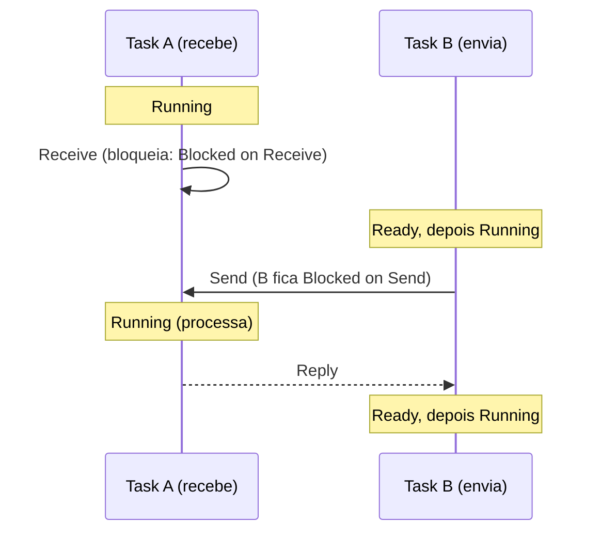
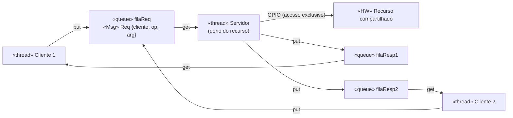
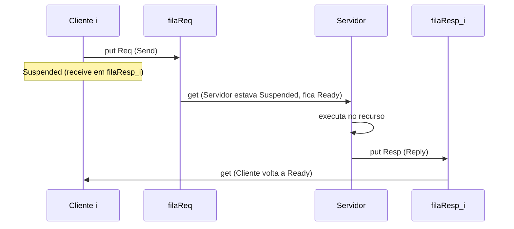

# Compilado da P2 – Sistemas Embarcados (ELEW32, Prof. Douglas Renaux)

Concorrência, exclusão mútua, RTOS/ThreadX e **escalonamento**, com os slides referenciados, e um **guia final** de como resolver o que alunos anteriores disseram que cai na prova.

Detalhes e demonstrações mais longas estão em [Resumo_P2.md](Resumo_P2.md) (concorrência, exclusão mútua, ThreadX), [Gabarito_Prova2022_Q1.md](Gabarito_Prova2022_Q1.md) (questão de ThreadX da prova de 2022) e [Resumo_Escalonamento.md](Resumo_Escalonamento.md) (material extra de escalonamento). Este compilado é a **versão única, na ordem dos slides**.

## Índice

- [0. Como usar e referências](#c0)
- [1. Concorrência](#c1) (inclui [1.1 Memória: quem enxerga o quê](#c1-mem) e [1.8 Deadlock e inversão de prioridade](#c1-dead))
- [2. Exclusão mútua](#c2)
- [3. RTOS e ThreadX](#c3)
- [4. Escalonamento](#c4)
- [5. Revisão rápida](#c5)
- [6. Guia: como resolver o que "vai cair"](#c6)
  - [G1 Escalonar um conjunto de tarefas](#g1) · [G2 Testes de escalonabilidade](#g2) · [G3 Inversão de prioridade](#g3) · [G4 Diagrama de tempo](#g4) · [G5 Arquitetura cliente-servidor](#g5) · [G6 Aplicação ThreadX](#g6)
- [7. Autoteste](#c7)

---

<a id="c0"></a>
## 0. Como usar e referências

### Os 4 conjuntos de slides

| Código | Arquivo (`P2/Slides`) | Tema | Slides |
|---|---|---|---|
| **conc** | `13_concurrency.pdf` | Concorrência, threads, troca de contexto | conc 13.2 a 13.16 |
| **excl** | `13_mutual_exclusion.pdf` | Recursos compartilhados, exclusão mútua, mensagens | excl 13.17 a 13.51 |
| **tx** | `14_t threadx_rtos.pdf` | RTOS e ThreadX | tx 14.2 a 14.67 |
| **sch** | `15_scheduling_v_oct_2023.pdf` | **Escalonamento** (tempo real, RM, EDF, PIP, PCP, bloqueio) | sch 15.1 a 15.52 |

A referência **(sch 15.N)** usa o número do **rodapé** ("Page 15.N"). Nota: no PDF a numeração pula de 15.45 para 15.48 e o slide da definição de RMA não tem rodapé (é o 15.20).

### Dois cuidados que valem nota

| Cuidado | Detalhe |
|---|---|
| **Numeração de prioridade** | No deck de escalonamento, **número maior = prioridade maior** (anotado no slide, sch 15.18). No **ThreadX**, **0 = maior prioridade** (tx 14.29). Ao passar de um para outro, **inverta**. |
| **Convenção do que vale** | O deck `sch` é de **outubro de 2023** (versão do arquivo) e traz **formalmente** os teoremas de Liu & Layland e Sha et al. A prova provavelmente usa **a notação dele**, não a de outros livros. |

### O que alunos anteriores disseram que caiu (Comentarios.md)

Relatos de **13/06/2026**, em grupo de alunos. São **de memória** ("acho que", "se não me engano") e de **outro semestre**: servem de pista, não de garantia.

| O que o aluno lembra | O que isso é | Onde estudar | Guia |
|---|---|---|---|
| "uma de **escalonamento de tarefas**; dava alguns algoritmos e precisava escalonar" | desenhar o escalonamento (RM/HPF, EDF, LLF, round robin...) | [4.6 a 4.10](#c4) | [G1](#g1) |
| "**cálculos** que mostram se um conjunto de tarefas é **escalonável**" | Teoremas 1, 2 e 3 (e 4/18 com bloqueio) | [4.11](#c4-rma) a [4.13](#c4-bloq) | [G2](#g2) |
| "questão envolvendo **inversão de prioridade**" | PIP, PCP, definição do professor | [4.12](#c4-recursos) | [G3](#g3) |
| "caiu **diagrama de tempo**" | Gantt do professor; diagramas de comunicação | [4.2](#c4-gantt), [2.6](#c2-msg) | [G4](#g4) |
| "pediu um **diagrama de uma arquitetura cliente-servidor**" | modelo cliente-servidor por mensagens | [2.6](#c2-msg), [3.3](#c3-comp) | [G5](#g5) |
| (prova de 2022) aplicação **ThreadX** com UML, `tx_application_define`, thread | questão 1 de 2022 | [3](#c3) | [G6](#g6) |

---

<a id="c1"></a>
## 1. Concorrência (conc 13.2-13.16)

([Resumo P2 §1-2](Resumo_P2.md#s1))

**Por que (conc 13.3-13.6).** Um sistema embarcado tem atividades com ritmos diferentes. Um único programa sequencial para tudo fica complexo. Divide-se em **tarefas** (uma por atividade) que executam **concorrentemente** e **cooperam**. Cada uma roda em um **processador virtual**; o **RTOS** gerencia o compartilhamento do processador, da memória e dos periféricos.

<a id="c1-mem"></a>
### 1.1 Memória: o que é cada região e quem a enxerga (conc 13.7-13.10)

Esta é a base para entender **por que** existe exclusão mútua: a pergunta é sempre "**esta região é compartilhada entre as threads?**".

**As regiões de um programa em C (conc 13.7).** O slide divide o armazenamento de um programa sequencial em três grupos: **Flash** (CODE: `.text` e `.const`), **RAM** (DATA: `.data` e `.bss`; **HEAP**; **STACK**) e **CPU** (Registers).

| Região | Onde | O que guarda | Quando recebe valor | Quem enxerga (threads) | É recurso compartilhado? |
|---|---|---|---|---|---|
| **`.text`** | Flash | o **código** (instruções) de **todas** as funções e de **todas** as threads | na gravação do programa | **todas** | compartilhada, mas **somente leitura**: não há conflito |
| **`.const`** | Flash | constantes (`const`, strings literais, tabelas fixas) | na gravação do programa | **todas** | compartilhada, **somente leitura**: **segura** |
| **`.data`** | RAM | variáveis **globais e `static`** **com valor inicial** (`int x = 5;`) | o valor inicial é **copiado da Flash para a RAM** antes da `main` ([P1 §17](../P1/Resumo_P1.md#s17)) | **todas** | **SIM**, leitura e escrita: **precisa de proteção** |
| **`.bss`** | RAM | variáveis **globais e `static`** **sem valor inicial** (valem 0) | **zerada** antes da `main` | **todas** | **SIM**, idem |
| **Heap** | RAM | memória **alocada dinamicamente** (`malloc`/`new`; no ThreadX, o **byte pool**) | em tempo de execução | **todas** (quem tiver o ponteiro) | **SIM**, e o **próprio alocador** precisa ser *thread-safe* |
| **Stack (pilha)** | RAM | variáveis **locais**, **parâmetros**, **endereços de retorno** e registradores salvos | a cada chamada de função | **só a thread dona** | **NÃO** (exclusiva), **uma pilha por thread** |
| **Registradores** | CPU | R0-R12, SP, LR, PC, xPSR | a cada instrução | **só a thread em execução**; ao trocar, o RTOS **salva uma cópia** de cada thread | **NÃO** (cada thread tem a **sua cópia**, `Regs 1..n`) |

**A legenda de cores do slide (conc 13.9):** **azul = compartilhado**; **vermelho = uso exclusivo**. Em azul: **código, constantes, `.data`, `.bss` e heap**. Em vermelho: **pilha e cópia dos registradores** de cada thread.

> "Embora esse compartilhamento permita acesso eficiente a dados compartilhados, **ele não oferece meios de proteção entre as threads**" (conc 13.9, tradução livre). Quem protege o dado compartilhado é o **programador**, com **mutex, semáforo ou mensagens** ([seção 2](#c2)).

**Por que a pilha é exclusiva.** Cada thread tem seu **próprio fluxo de chamadas** (suas funções empilhadas, seus retornos). Se duas threads usassem a mesma pilha, o `PUSH`/`POP` de uma destruiria o da outra. Por isso, na criação de cada thread, o ThreadX recebe uma **área de pilha só dela** (`stack_start` e `stack_size` em **bytes**, tx 14.28).

**Por que os registradores são "exclusivos".** Só existe **um** conjunto físico de registradores na CPU. Mas, a cada **troca de contexto** (conc 13.11-13.12), o RTOS **salva todos na pilha da thread que sai** e **restaura os da que entra**. Assim cada thread tem, logicamente, **os seus** registradores. A thread só percebe que foi interrompida porque o tempo passou, não porque algum valor mudou.

### 1.2 Thread × processo e a memória (conc 13.8-13.10)

| | **Processo** | **Thread** |
|---|---|---|
| Precisa de **MMU**? | **sim** | **não** |
| **Espaço de endereços** | **exclusivo** por tarefa (cada uma "vê" a sua memória) | **um só**: todas as threads enxergam a **mesma** memória |
| **O que é exclusivo** | tudo: código, `.data`, `.bss`, heap, pilha | só **pilha** e **registradores** |
| **O que é compartilhado** | só o que for **combinado explicitamente** pelo SO (mensagens, memória compartilhada) | **código, `.data`, `.bss`, heap**, periféricos |
| **Proteção** | uma tarefa **não consegue** corromper a memória da outra | **nenhuma**: uma thread pode sobrescrever o dado (ou a pilha) de outra |
| **Custo** | maior (troca de contextos de memória, mais RAM) | **menor**: "para simplificar e **reduzir o uso de recursos computacionais**" (conc 13.8) |
| Típico | processadores de aplicação (Cortex-A, desktop) | **microcontroladores** (**Cortex-M**, sem MMU) |

- **Processo** que contém várias threads = **multithreaded**; com uma só = **single-threaded** (conc 13.10).
- **Tarefa é um conceito lógico**: pode ser implementada por **um processo** ou por **uma thread**. **Em MCUs, cada tarefa é uma thread** (conc 13.8). É o nosso caso (TM4C129 = Cortex-M4F).
- 🧩 O Cortex-M tem, opcionalmente, uma **MPU** (Memory Protection Unit, [P1 §7](../P1/Resumo_P1.md#s7)). Ela permite **restringir o acesso** a regiões (marcar como somente leitura, proibir execução), mas **não cria espaços de endereços separados** como uma MMU. Por isso o Cortex-M continua sendo "threads em um só espaço", com uma proteção extra opcional.

**Consequência para a prova:** no ThreadX (threads, sem MMU) **tudo o que está em `.data`, `.bss` e heap é compartilhado por todas as threads** (e também pelas ISRs). Esse é o **recurso compartilhado** de que a exclusão mútua trata.

### 1.3 Esta variável é um recurso compartilhado? (regra prática) 🧩

**Pergunta-chave:** *mais de uma thread (ou thread e ISR) pode ler e escrever nela?* Se **sim**, e **pelo menos uma escreve**, é recurso compartilhado e **precisa de proteção**.

```c
const int TABELA[4] = {1, 2, 3, 4};   /* .const (Flash): compartilhada, SÓ LEITURA  -> segura          */
int       cont = 5;                   /* .data  (RAM):   compartilhada, leitura/escrita -> PROTEGER   */
int       total;                      /* .bss   (RAM):   compartilhada, leitura/escrita -> PROTEGER   */
TX_QUEUE  filaLeds;                   /* .bss: estrutura de controle global; só via serviços do ThreadX */

void tarefa(ULONG entrada)
{
    int        local = 0;             /* STACK desta thread: EXCLUSIVA -> segura                        */
    static int quantas = 0;           /* .bss (!): "static" local vive em RAM global -> COMPARTILHADA   */
    char      *p = malloc(16);        /* o ponteiro p está na pilha; os 16 bytes estão no HEAP          */

    local++;                          /* seguro: só esta thread enxerga                                 */
    cont++;                           /* RACE CONDITION se outra thread também escrever (LDR/ADD/STR)   */
    quantas++;                        /* idem: static local é compartilhada entre todas as chamadas     */
}
```

| Item | Vive em | Compartilhado? | Como lidar |
|---|---|---|---|
| Variável **global** (`.data`/`.bss`) | RAM global | **sim** | mutex, semáforo, fila ou seção crítica |
| Variável **`static`** (mesmo dentro de uma função) | RAM global | **sim** | idem. **Cuidado:** parece local, mas **não é** |
| Variável **local** (automática) e **parâmetro** | **pilha da thread** | **não** | nada, **desde que o endereço não seja passado a outra thread** |
| Endereço de uma **local** passado a outra thread | pilha de quem passou | passa a ser | **erro grave**: a pilha pode mudar ou sair de escopo; **envie uma cópia** (fila) |
| **Heap** (`malloc`/byte pool) | RAM global | **sim**, se mais de uma thread usa o ponteiro | o **alocador** é *thread-safe* no ThreadX (tx 14.33); **proteja o conteúdo** |
| **Constante** (`const`, literal) | Flash | sim, mas **só leitura** | nada |
| **Registrador de periférico** (GPIO, UART, SysTick...) | endereços de E/S na memória | **sim**: é um **recurso** | **uma thread dona** do periférico ou mutex |
| Variável **compartilhada com uma ISR** | RAM global | **sim** (a ISR interrompe a thread) | `volatile` + proteção (desabilitar interrupção por instantes, ou a ISR **sinaliza** por evento/fila) |
| **Estruturas do ThreadX** (`TX_QUEUE`, `TX_MUTEX`...) | RAM global (`.bss`) | acessadas **só pelos serviços** | os serviços já são **atômicos**; não mexa nos campos |
| **Buffer interno de uma fila** | RAM global (área que você reserva) | **interno** da fila | só `send`/`receive` |

**Periféricos também são recursos compartilhados (conc 13.14-13.15, excl 13.20).** O slide fala em "regiões de memória **ou periféricos**": como os registradores de E/S são mapeados na memória, uma thread configurando a UART e outra escrevendo nela **conflitam** do mesmo modo que dois `contador++`. Por isso, na nossa resolução da Q1 de 2022, **cada periférico (LEDs, resistência) pertence a uma só thread**.

### 1.4 Função **reentrante** × dados compartilhados 🧩

**Reentrante** = pode ser executada **ao mesmo tempo por várias threads** (ou interrompida e chamada de novo) **sem erro**. Como o **código (`.text`) é compartilhado**, **todas** as threads podem estar executando a **mesma função**, cada uma com a **sua pilha**.

- **Reentrante:** usa só **variáveis locais e parâmetros** (pilha), nenhum estado global.
- **Não reentrante:** usa **variável global ou `static`** que guarda estado entre chamadas (ou um periférico sem proteção).
- No Lab 6, a rotina `blink_led` precisava ser **reentrante** (RF2) justamente porque T1, T2 e T3 a chamam: sem estado global modificável.

### 1.5 O que o RTOS faz com a memória (resumo)

| Memória | Quem a reserva | Onde |
|---|---|---|
| **Pilha de cada thread** | **você**, no `tx_thread_create` (`stack_start`, `stack_size` em bytes) | array global (`ULONG pilhaX[256]` em `.bss`) ou byte pool |
| **Estrutura de controle** (`TX_THREAD`, `TX_QUEUE`...) | **você** | **global** (`.bss`), nunca local (tx 14.35-14.36, 14.39) |
| **Área de dados da fila** | **você**, em `tx_queue_create` | array global |
| **Memória dinâmica** | `tx_byte_allocate` / `tx_block_allocate` | **byte pool** (tamanho variável, pode fragmentar) ou **block pool** (blocos fixos) (tx 14.33) |
| **Salvar o contexto** | o RTOS, na troca de contexto | na **pilha da thread** que sai (conc 13.11-13.12) |

**Mensagens evitam compartilhar.** Na fila do ThreadX a mensagem é **copiada** do remetente para a fila e da fila para o receptor (tx 14.60): cada thread fica com a **sua cópia**, em memória **exclusiva** (pilha). Por isso mandar **valores** por fila **não cria recurso compartilhado**; mandar um **ponteiro** passa a ser compartilhamento do dado apontado.

**Detalhes que caem em prova ou em depuração** 🧩:
- **Pilha pequena demais:** a pilha de uma thread não tem proteção (conc 13.9). Se estourar, **corrompe a memória vizinha** (outra pilha ou uma variável global), com sintomas estranhos. Dimensione a pilha para as **locais mais fundas** e a **profundidade de chamadas**.
- **Exceções usam a pilha em uso:** ao aceitar uma interrupção, o hardware empilha **8 registradores** ([P1 §11.7](../P1/Resumo_P1.md#s11-7)) na pilha **ativa**. Deixe **folga** na pilha de cada thread para esse quadro.
- **ISR × thread:** o **Handler mode usa a MSP**; as threads do RTOS usam a **PSP** ([P1 §8.2](../P1/Resumo_P1.md#s8)). As duas pilhas são **separadas**.
- **Ao fazer `return` da função de entrada**, a thread **termina** (*Completed*) e **a pilha dela deixa de ser usada** (tx 14.28).

### 1.6 Resumo para decorar

| Pergunta | Resposta |
|---|---|
| O que as threads **compartilham**? | **código, `.const`, `.data`, `.bss`, heap** (e os periféricos) |
| O que é **exclusivo** de cada thread? | **pilha** e **cópia dos registradores** |
| Por que é "recurso compartilhado"? | porque várias threads **leem e escrevem** o mesmo endereço, e **nada protege** (conc 13.9) |
| Thread × processo? | processo = **MMU**, espaço **exclusivo**; thread = **sem MMU**, memória **compartilhada** (conc 13.10) |
| Local × global × `static`? | local = **pilha** (exclusiva); global e `static` = **RAM global** (compartilhada) |
| Constante em Flash? | compartilhada, **só leitura**: **segura** |
| Heap? | **compartilhado**; o alocador do ThreadX é *thread-safe* |
| Como proteger? | **mutex**, **semáforo**, **desabilitar interrupções**, **mensagens** ([seção 2](#c2)) |
| O que a MPU faz? | restringe regiões; **não** cria espaços separados (🧩) |

**Autoteste da seção:**
1. *Duas threads fazem `contador++` em uma global. Por que pode dar errado?* `LDR/ADD/STR` pode ser interrompido; uma atualização se perde (excl 13.24).
2. *Uma variável `static int n` dentro de uma função é compartilhada?* **Sim**: vive em `.data`/`.bss`.
3. *Uma variável local `int x` é compartilhada?* **Não**: vive na pilha da thread, exceto se seu endereço for passado a outra thread.
4. *Por que uma thread tem pilha própria e as demais regiões são comuns?* A pilha guarda o **fluxo de chamadas** de cada thread; código e dados globais são **a aplicação** que todas as threads compartilham (conc 13.8-13.9).
5. *Um processo e uma thread diferem em quê, quanto à memória?* Processo tem **espaço de endereços exclusivo** (precisa de MMU); thread **compartilha** tudo, exceto pilha e registradores (conc 13.10).
6. *Mandar um `int` por fila cria compartilhamento? E um ponteiro?* Um `int` é **copiado**: não; um **ponteiro** compartilha o dado apontado: **sim**.

### 1.7 Troca de contexto, preempção e prioridade (conc 13.11-13.16)

**Troca de contexto (conc 13.11-13.12).** (1) A executa; (2) **registradores salvos na pilha de A**; (3) o RTOS escolhe B pela **política de escalonamento**; (4) estado de B **restaurado da pilha de B**. No Cortex-M com ThreadX é a exceção **PendSV** (tx 14.63).

**Preemptivo × cooperativo (conc 13.13).** Preemptivo: o RTOS retoma o controle a qualquer momento (tarefa de maior prioridade fica pronta). Cooperativo: só quando a tarefa libera.

**Prioridade (conc 13.13).** O escalonador preemptivo por prioridade interrompe a tarefa atual quando uma de **maior prioridade** fica pronta; depois a preemptada retoma de onde parou.

**Cuidados (conc 13.14-13.16).** Tarefas independentes só precisam de escalonamento. Se **compartilham recursos**, é preciso **acesso exclusivo** e evitar **deadlock** e **inversão de prioridade**. **Quatro problemas** do ambiente multitarefa: **comunicação**, **sincronização**, **exclusão mútua** e **escalonamento**.

<a id="c1-dead"></a>
### 1.8 Deadlock e inversão de prioridade, explicados

Os slides apenas **citam** os dois riscos (conc 13.14), mas eles caem em prova (o deck de escalonamento trata de ambos: sch 15.32-15.37). A explicação abaixo parte de **por que acontecem**. As soluções completas (PIP e PCP) estão em [4.12](#c4-recursos) e o passo a passo de desenho em [G3](#g3).

**Os dois nascem do mesmo ponto:** uma tarefa **espera por um recurso** (mutex, semáforo) que **outra tarefa segura**. O que muda é **quem está atrapalhando quem**.

#### Deadlock (impasse): todas esperam para sempre

**Ideia.** Duas ou mais tarefas ficam **bloqueadas**, cada uma esperando um recurso que **só outra dessas tarefas poderia liberar**. Como **nenhuma** avança, **nenhuma** libera, e o impasse não se desfaz sozinho. (Analogia: dois carros frente a frente em uma rua estreita, cada um esperando o outro dar ré.)

**Exemplo com dois mutexes (S1 e S2):**

```c
/* Tarefa A (prioridade menor)          Tarefa B (prioridade maior) */
tx_mutex_get(&S1, TX_WAIT_FOREVER);     tx_mutex_get(&S2, TX_WAIT_FOREVER);
tx_mutex_get(&S2, TX_WAIT_FOREVER);     tx_mutex_get(&S1, TX_WAIT_FOREVER);
/* seção crítica */                     /* seção crítica */
tx_mutex_put(&S2); tx_mutex_put(&S1);   tx_mutex_put(&S1); tx_mutex_put(&S2);
```

Sequência que trava (`#` executando, `@` dentro de uma seção crítica, `p` pronta mas sem CPU, `b` **bloqueada**; um caractere por unidade de tempo):

```
t:  0123456789
A:  #@pp@bbbbb       A pega S1 (t=1); é preemptada por B; volta e tenta S2 em t=5 → bloqueia
B:    #@bbbbbb       B chega em t=2, pega S2 (t=3), tenta S1 em t=4 → bloqueia
                     A espera S2 (que B segura). B espera S1 (que A segura). = DEADLOCK
```

(Esta é a mesma situação da figura do slide sch 15.32: τa pega S1, τb pega S2, e cada uma pede o recurso da outra.)

**As 4 condições** (todas precisam valer ao mesmo tempo; se **uma** deixar de valer, não há deadlock):

| Condição | No exemplo |
|---|---|
| **Exclusão mútua** | só uma tarefa por vez segura cada mutex |
| **Posse e espera** | A segura S1 **e pede** S2 |
| **Sem preempção do recurso** | ninguém tira S1 de A à força |
| **Espera circular** | A espera B, e B espera A |

**Como evitar**
- **Mesma ordem** de aquisição em todas as tarefas (todas pegam S1 e depois S2): quebra a espera circular. É a solução mais barata.
- **Timeout** no `tx_mutex_get` (em vez de `TX_WAIT_FOREVER`); se estourar, **solta o que já tem** e tenta de novo.
- Pegar **todos os recursos de uma vez** (ou nenhum) e **evitar aninhar** mutexes.
- **PCP** (e ICPP): evitam deadlock **por construção** (sch 15.36). O PIP **não** evita (o exemplo acima trava com herança também).

**Sintoma:** as tarefas envolvidas ficam *Suspended* para sempre, **não consomem CPU** e **nada no código acusa erro**: o sistema "para" naquela parte.

#### Inversão de prioridade: a de alta prioridade espera quem não deveria

**Primeiro, o que é normal.** Se uma tarefa **H** (alta prioridade) precisa de um recurso que a tarefa **L** (baixa) está usando, H **espera** L terminar a seção crítica. Isso se chama **bloqueio** e é **inevitável** com exclusão mútua, e **curto** se a seção crítica for curta.

**O problema (inversão).** Durante essa espera, uma tarefa **M** de prioridade **média** (que **nem usa o recurso**) fica pronta e, por ter prioridade maior que L, **preempta L**. Agora L **não consegue terminar a seção crítica**, então **H continua esperando, só que agora por M**. Uma tarefa de prioridade **média** está atrasando uma de prioridade **alta**: as prioridades se **inverteram**. É a definição do professor (sch 15.34):

> *Priority inversion* é um cenário em que uma tarefa de **prioridade menor, que NÃO usa o recurso compartilhado**, está **atrasando** a execução de uma tarefa de prioridade maior.

**Exemplo** (L prioridade 1, M prioridade 2, H prioridade 3; **número maior = prioridade maior**, como no deck `sch`). L: executa 1, pega S, executa 3 dentro de S, solta, executa 1. M (chega em t=2): executa 4, sem usar S. H (chega em t=3): executa 1, pega S, executa 1 dentro de S, solta, executa 1.

```
SEM PROTOCOLO               t: 012345678901
                            L: #@ppppp@@pp#
                            M:   #p###
                            H:    #bbbbb@#     H bloqueia de t=4 a t=8 e termina em t=11 (R = 8)
                                               M executa em 4, 5 e 6 enquanto H espera = INVERSÃO
```

Passo a passo: L pega S (t=1); M chega (t=2) e preempta L; H chega (t=3), executa e **tenta S em t=4: bloqueia**; quem executa então? **M** (prioridade 2 > L), em t=4, 5, 6. Só em t=7 L volta, termina a seção crítica em t=8 e H prossegue. **H esperou 5 unidades; 3 delas foram "culpa" de M.**

**Por que é perigoso:** o bloqueio **não tem limite**: se houver **várias** tarefas médias, H espera **todas**. Em tempo real, H **perde o prazo** sem que a tarefa que a atrasa tenha qualquer relação com o recurso. (Caso real: em 1997 o robô **Mars Pathfinder** reiniciava repetidamente por inversão de prioridade; foi corrigido ligando a **herança de prioridade** no mutex.)

**Como resolver: herança de prioridade (PIP, sch 15.35).** Enquanto H espera S, **a dona L herda a prioridade de H**. Assim M **não preempta** L, e L termina a seção crítica logo:

```
COM HERANÇA (PIP)           t: 012345678901
                            L: #@pp@@ppppp#    L executa em t=4,5 com a prioridade 3 herdada de H
                            M:   #ppppp###     M passa a esperar
                            H:    #bb@#        H bloqueia só em 4 e 5 e termina em t=8 (R = 5)
```

O bloqueio de H cai de 5 para **2** unidades (só o que faltava da seção crítica de L). **Custo:** as tarefas que não usam o recurso (M) são **atrasadas** (M termina em 11, e não em 7). O **PCP** (sch 15.36) vai além: limita o bloqueio a **uma vez** e **evita deadlock**.

**No ThreadX (tx 14.32, 14.54-14.55):** `tx_mutex_create(&m, "m", TX_INHERIT)` liga a herança (PIP); `TX_NO_INHERIT` não. O **semáforo não tem dono**, então **não pode herdar** prioridade: **use mutex para exclusão mútua**. No seu **Lab 6** os cenários **d** (sem herança: T1 perde o prazo, R1 = 1,10 s) e **e** (com herança: R1 = 0,60 s) mostram exatamente isso ([Resumo_Labs](../Resumo_Labs.md)).

#### Comparação

| | **Deadlock** | **Inversão de prioridade** |
|---|---|---|
| O que acontece | tarefas **bloqueadas para sempre** | tarefa de alta prioridade **atrasada** por uma de prioridade menor |
| Termina sozinho? | **não** | **sim**, quando a tarefa de menor prioridade termina (mas pode ser tarde demais) |
| Quantos recursos? | **dois ou mais** (espera circular) | **um** já basta |
| Quem atrapalha | as próprias tarefas bloqueadas, umas às outras | uma tarefa **que nem usa o recurso** (M) |
| Consequência | o sistema (parte dele) **para** | **perda de prazo** (sistema segue funcionando) |
| Solução | **ordem** de aquisição, timeout, PCP/ICPP | **herança de prioridade** (PIP) ou PCP |
| ThreadX | evitar por projeto (sem proteção nativa) | `TX_INHERIT` |

**Perguntas de revisão**
1. *Uma tarefa de alta prioridade esperando uma de baixa dona do mutex é inversão de prioridade?* **Não**, é **bloqueio** normal. Só é **inversão** quando uma tarefa **que não usa o recurso** a atrasa (sch 15.34).
2. *A herança de prioridade resolve o deadlock do exemplo dos dois mutexes?* **Não**: as duas ficam bloqueadas, e herdar prioridade não libera nenhum mutex.
3. *Por que o semáforo não serve para evitar inversão?* Não tem **dono**; sem saber quem o segura, não há a quem passar a prioridade.
4. *Qual a regra mais simples para evitar deadlock?* **Todas as tarefas pegam os mutexes na mesma ordem.**

---

<a id="c2"></a>
## 2. Exclusão mútua (excl 13.17-13.51)

([Resumo P2 §3-5](Resumo_P2.md#s3))

### 2.1 Conceitos (excl 13.20-13.23)

- **Recurso compartilhado:** dado, dispositivo ou região de memória usada por várias tarefas.
- **Exclusão mútua:** só **uma** tarefa por vez usa o recurso; a outra **espera**.
- **Seção crítica (SC):** trecho de código que acessa o recurso.

### 2.2 Condição de corrida (excl 13.24)

Incrementar um contador compartilhado são 3 instruções: `LDR`, `ADD`, `STR`. Se a troca de contexto ocorrer entre elas, **uma atualização se perde** (contador 5, duas tarefas incrementam, resultado 6 em vez de 7). **Race condition**: o resultado depende do **tempo relativo** entre as tarefas.

### 2.3 Requisitos e formalização (excl 13.25-13.27)

1. Nenhuma outra tarefa na SC ao mesmo tempo.
2. Não atrasar quem quer entrar se **ninguém** usa o recurso.
3. SC de tempo **finito**.
4. **Nenhuma suposição** sobre velocidade relativa.
5. Evitar **deadlock, livelock, starvation** e **não impor ordem** ("revezar").

Lamport: tarefa = sequência de seções não críticas e críticas; nenhum par de SCs concorrentes; sem deadlock; **toda tarefa que tenta entrar eventualmente entra** (justiça; a mais forte é a fila FCFS).

### 2.4 Glossário (excl 13.28), decorar

| Termo | Significado |
|---|---|
| **Operação atômica** | sequência indivisível |
| **Deadlock** | tarefas **bloqueadas** esperando umas pelas outras |
| **Livelock** | tarefas **executando**, sem trabalho útil |
| **Starvation** | uma tarefa pronta é **sempre adiada** |
| **Race condition** | resultado depende do tempo relativo |

### 2.5 Soluções (excl 13.29-13.44)

| Solução | Observação |
|---|---|
| **Desabilitar interrupções** (excl 13.31) | só 1 CPU; atrasa tudo; tarefa que trava, trava o sistema; muitos RTOS proíbem |
| **Instruções atômicas** (excl 13.32-13.36) | test-and-set, `SWAP`; no Cortex-M **`LDREX`/`STREX`**: `STREX Rd` = **0 sucesso, 1 falha**; o monitor de acesso exclusivo remove a marca em `CLREX`, em qualquer `STREX` ou em **exceção** |
| **Semáforo / mutex** (excl 13.39) | NCS → `get` → CS → `put`; no ThreadX `tx_mutex_get/put` |
| **Software puro** (excl 13.40-13.43) | 4 tentativas que **falham** e **Peterson** que funciona |
| **Monitor** (excl 13.44) | todas as rotinas do recurso num módulo, protegido por semáforo |
| **Mensagens** (excl 13.45-13.51) | servem às 3 arquiteturas (inclusive distribuída) |

**As 4 tentativas que falham (excl 13.40-13.42):**

| Tentativa | Falha |
|---|---|
| 1ª `turn` | **alternância forçada**; quem não precisa mais entrar trava o outro |
| 2ª `flag`, testa antes de levantar | **sem exclusão mútua**: os dois veem `false` e entram |
| 3ª levantar a flag antes de testar | **deadlock**: os dois esperam para sempre |
| 4ª recuar (*back-off*) | possível **livelock** |

**Peterson (excl 13.43):**

```c
flag[0] = true; turn = 1; while (flag[1] && turn == 1) ; /* SC */ flag[0] = false;   /* P0 */
flag[1] = true; turn = 0; while (flag[0] && turn == 0) ; /* SC */ flag[1] = false;   /* P1 */
```

`flag` = interesse; `turn` = desempate (quem escreveu por último cede). Só para **2 tarefas** 🧩.

<a id="c2-msg"></a>
### 2.6 Comunicação por mensagens (excl 13.45-13.51)

| Tipo | Funcionamento | Estados (slide) |
|---|---|---|
| **Assíncrona** (excl 13.46) | remetente **não espera**; a mensagem vai para uma fila (`put`); o receptor pega quando quiser | receptor *Blocked on Receive* se a fila está vazia |
| **Síncrona** (excl 13.47) | só troca quando **as duas querem** (encontro); dados vão **direto** | quem chega primeiro: *Blocked on Receive* ou *Blocked on Send* |
| **Send-Receive-Reply** (excl 13.48) | `Send` e `Receive` **bloqueantes**; o remetente fica **bloqueado até o `Reply`** | A: Running → *Receive* → **Blocked on Receive**; B envia (*Send*) → **Blocked on Send**; A responde (*Reply*) → B volta a *Ready* |
| **Sequencialização** (excl 13.49) | várias tarefas remetentes enviam para a **caixa de entrada** de **uma** tarefa receptora, que processa **uma mensagem por vez** | serializa os acessos sem mutex |
| **Cliente-servidor** (excl 13.50) | evolução do **monitor**: o **servidor** (tarefa receptora) **encapsula o recurso compartilhado**; os clientes **enviam mensagem**; o servidor **responde** com o resultado | desenho: remetentes (elipses) → fila → tarefa receptora com o recurso dentro |

Primitivos de sincronização (excl 13.51, Stallings): semáforo contador, binário, **mutex** (quem trava, destrava), variável de condição, monitor, **event flags** (um bit por evento; AND/OR), mailbox/mensagens, spinlock.

---

<a id="c3"></a>
## 3. RTOS e ThreadX (tx 14.2-14.67)

([Resumo P2 §6-9](Resumo_P2.md#s6) e [Gabarito Q1, Parte A](Gabarito_Prova2022_Q1.md#a1))

### 3.1 RTOS (tx 14.2-14.8)

Camada entre hardware e aplicação, dá a cada thread a **ilusão** de processador e pilha próprios e oferece **temporização, comunicação, sincronização e gerenciamento** de threads (tx 14.2). Em segundos parece paralelo; em milissegundos o RTOS **alterna** a CPU (tx 14.3-14.4). Estados (tx 14.5): **Ready, Running, Waiting**. CMSIS-RTOS é a API padrão (tx 14.6-14.7). O slide **tx 14.8** mostra um diagrama UML de aplicação (joystick) com os símbolos do RTOS.

### 3.2 ThreadX (tx 14.15-14.28)

- Express Logic (1997), Microsoft (2019), Azure RTOS (tx 14.16). Serviços: threads, filas, semáforos, mutexes, event flags, timers, pools (tx 14.17). Troca de contexto ~0,4 µs a 200 MHz (tx 14.19).
- Tipos (tx 14.20): `UINT`, `ULONG` (32 bits), `CHAR`, `VOID`... em `tx_api.h`, `tx_port.h`, `tx_user.h`.
- **Aplicação mínima (tx 14.23):** `#include "tx_api.h"`; `main` chama **`tx_kernel_enter()`**; **`tx_application_define()`** cria os recursos; linkar com `tx.lib`.
- **Estados da thread (tx 14.28):** **Ready**, **Executing**, **Suspended**, **Completed** (retornou da função de entrada), **Terminated**.

```c
UINT tx_thread_create(TX_THREAD *thread_ptr, CHAR *name_ptr, VOID (*entry_function)(ULONG),
                      ULONG entry_input, VOID *stack_start, ULONG stack_size,
                      UINT priority, UINT preempt_threshold, ULONG time_slice, UINT auto_start);
```

**Prioridade (tx 14.29):** **0 = maior**; mesma prioridade = **FIFO**; **round-robin cooperativo** (`tx_thread_relinquish`); **time-slicing**; **herança de prioridade** nos mutexes; 🧩 *preempt threshold* = limiar abaixo do qual só threads de prioridade **melhor** (número menor) preemptam.

**Execução (tx 14.63):** threads em Thread mode; o ThreadX em Handler mode; usa **SVC** (síncrona) e **PendSV** (troca de contexto).

**Inicialização (tx 14.64-14.67):** reset → startup (`.data`, `.bss`) → `main` → `tx_kernel_enter` → **`tx_application_define`** → laço do escalonador.

<a id="c3-comp"></a>
### 3.3 Componentes (tx 14.31, 14.41-14.62)

**Símbolos UML (tx 14.31, 14.41):** thread = retângulo com **barras laterais** e `«thread»`; **memory block** `«memory block»`; **semáforo contador** (círculo vermelho); **mutex** (cadeado); **fila** (retângulo com divisórias); **event flag** (bandeira); **timer** (relógio). Mais `«HW»`, `«ISR»`, `«IRQ»`, `«GPIO»`, setas `put/get/set/wake/call/irq` (tx 14.8, 14.52, 14.62).

| Componente | Estrutura | Create |
|---|---|---|
| Thread | `TX_THREAD` | `tx_thread_create` |
| Fila | `TX_QUEUE` | `tx_queue_create` |
| Event flags | `TX_EVENT_FLAGS_GROUP` | `tx_event_flags_create` |
| Timer | `TX_TIMER` | `tx_timer_create` |
| Semáforo | `TX_SEMAPHORE` | `tx_semaphore_create` |
| Mutex | `TX_MUTEX` | `tx_mutex_create` |
| Block / byte pool | `TX_BLOCK_POOL` / `TX_BYTE_POOL` | `tx_block_pool_create` / `tx_byte_pool_create` |

**Uso dos serviços (tx 14.34-14.44).** Estruturas de controle **alocadas por você, globais** (não locais, não ponteiro solto, tx 14.35-14.36); ciclo: alocar → `create` → usar → `delete` (tx 14.40); **verificar o retorno** (`TX_SUCCESS` = 0, tx 14.43). Espera: `TX_NO_WAIT`, `TX_WAIT_FOREVER` ou **ticks**.

**Semáforo × mutex (tx 14.32, 14.54-14.55).** Semáforo: **sem dono**, sincronização. Mutex: **dono**, exclusão mútua, só a thread dona faz `put`, **`TX_INHERIT`** habilita **herança de prioridade**; não pode ser usado por ISR/timer.

**Timer (tx 14.50-14.53).** One-shot (`reschedule_ticks = 0`) ou periódico; `auto_activate`; a **função de expiração** roda na thread **System Timer** e **não pode bloquear**; `tx_timer_activate/deactivate/change`. Fluxo: SysTick → ISR incrementa `_tx_timer_system_clock` e acorda a System Timer → ela chama a função (tx 14.52).

**Event flags (tx 14.56-14.58).** Grupo de **32 flags**. `set(flags, TX_OR|TX_AND)`, `get(flags, TX_OR|TX_OR_CLEAR|TX_AND|TX_AND_CLEAR, &atuais, espera)`. Exemplo do slide: `0x01` e `0x10` → grupo `0x11`; a thread que esperava `get(0x11, TX_AND_CLEAR)` acorda e limpa.

**Filas (tx 14.59-14.62).** `tx_queue_create(q, nome, message_size /*palavras 1-16*/, area, queue_size /*bytes*/)`. **Capacidade = queue_size ÷ (message_size × 4)** (20 bytes, 1 palavra → 5, tx 14.61). `send` copia e bloqueia **se cheia**; `receive` copia e bloqueia **se vazia**; **duas cópias** por mensagem (tx 14.60).

**Memória (tx 14.33).** **Byte pool** (tamanho variável, pode fragmentar) × **block pool** (blocos fixos, sem fragmentação, tempo previsível).

### 3.4 ISR e thread

A ISR é **curta** (limpa o pedido no periférico e **sinaliza**); o trabalho fica em uma **thread** (padrão ISR → thread). Ver também o conceito de **IST** em [4.5](#c4-isr) (sch 15.11, 15.51).

---

<a id="c4"></a>
## 4. Escalonamento (sch 15.1-15.52)

O deck tem duas seções, anunciadas no sumário (sch 15.1): **Seção 1, tarefas independentes, preemptivas e periódicas** (sch 15.19) e **Seção 2, tarefas que compartilham recursos** (sch 15.30). Os tópicos do sumário: Real-Time Systems, **Gantt Notation**, **Static Scheduling**, **Dynamic Scheduling**, **Scheduling with Blocking**. Referências do professor (sch 15.2): dissertação de mestrado de João Luiz Luguesi (2006) e **Sha, Rajkumar, Lehoczky, *Priority Inheritance Protocols*, IEEE Trans. Computers, 1990**.

### 4.1 Sistemas de tempo real (sch 15.3-15.4)

Sistema cuja **correção depende não só do resultado lógico**, mas do **instante físico** em que ele é produzido. Interage com um ambiente e deve reagir a estímulos **dentro de limites de tempo ditados pelo ambiente** (plantas químicas, ferrovias, automóveis, equipamentos médicos).

Classificação pelo **valor de um resultado atrasado** (sch 15.4, figuras valor × tempo):

| Tipo | Resultado atrasado | Curva |
|---|---|---|
| **Hard** | consequências **graves** (acidente) | cai a zero (ou pior) no prazo |
| **Firm** | **sem valor** | cai a zero no prazo |
| **Soft** | **valor decrescente** | decai gradualmente |

<a id="c4-gantt"></a>
### 4.2 Notação Gantt e definições (sch 15.6-15.7)

**Diagrama de Gantt do professor (sch 15.6):** cada **tarefa** (τ) é uma linha; o eixo horizontal é o **relógio** (ticks). Elementos:

| Elemento | Símbolo |
|---|---|
| **Ativação do job** | seta ▼ no instante de liberação |
| **Ativação imediata após o tick** | seta com defasagem (o RTOS só percebe no tick) |
| **Prioridade corrente** | número dentro do bloco de execução |
| **Deadline** (prazo) | **traço vermelho** |
| **Fim do job** | **bolinha** ● |
| **Jitter por escalonamento** | espaço entre a ativação e o início |
| **job** | **cada execução de uma tarefa** |

**Cores/legenda (sch 15.6):**

| Cor | Estado |
|---|---|
| **amarelo** | executando |
| **laranja** | executando em **seção crítica de S1** |
| **verde (escuro)** | executando em **seção crítica de S2** |
| **cinza** | **suspensa por preempção** |
| **laranja claro** | **bloqueada porque S1 está em uso** |
| **verde claro** | **bloqueada porque S2 está em uso** |
| **ciano (azul claro)** | **suspensa por tarefa de prioridade menor** (efeito da herança de prioridade) |
| **rosa** | **suspensa por tempo ou jitter** |

(Leitura da legenda e das figuras sch 15.33-15.37: laranja e verde são os blocos "dentro da seção crítica".)

**Definições (sch 15.7):**

| Símbolo | Nome |
|---|---|
| **T** | **período** |
| **D** | **prazo relativo** (*relative deadline*) |
| **C** | **tempo total de computação** |
| **C_{i,s}** | tempo de τ_i **executando usando o recurso S** |
| **R_i** | **tempo de resposta** nesta ativação (da ativação ao fim do job) |
| **I** | **interferência** (tempo suspensa por preempção de tarefas de maior prioridade) |
| **B** | **tempo bloqueada** (por recurso em uso por tarefa de menor prioridade) |

Na figura, R_i inclui a interferência I, o bloqueio B e o tempo de execução C. É preciso **R_i ≤ D**.

### 4.3 Classificação das tarefas (sch 15.8, 15.43-15.44)

| Tipo | Característica | Como entra na análise (sch 15.44) |
|---|---|---|
| **Periódica** | ativada a cada **período T** | usar o **período** |
| **Esporádica** | chega em instantes imprevistos, com **intervalo mínimo T_min** entre jobs | usar o **tempo mínimo entre jobs** |
| **Aperiódica** | sem limite de chegada | usar um **servidor aperiódico** |

**Sempre o pior caso (sch 15.43):** metáfora da freada. Parar um carro a 100 km/h exige 85 m, 112 m ou 69,5 m conforme a condição; o projeto usa **o pior caso**. "Mesmo em sistemas de tempo real."

### 4.4 Preemptivo × não preemptivo (sch 15.9)

Figura com 3 tarefas (τ_a de maior prioridade): τ_c começa em 13, τ_b chega em 16, τ_a em 19.
- **Preemptivo:** cada chegada de prioridade maior **tira a CPU** (τ_c é suspensa em 16 e só termina em 24; τ_b é suspensa em 19).
- **Não preemptivo:** τ_c **vai até o fim** (18); τ_b e τ_a **esperam** (ciano: "suspensa por tarefa de menor prioridade") e entram depois.

<a id="c4-isr"></a>
### 4.5 Estruturas de programa, ISR e IST (sch 15.10-15.12, 15.51)

**Três estruturas (sch 15.10, 15.12):** *Simple Loop* (segmentos em sequência), *Loop and ISRs* (laço principal + ISRs) e **RTOS** (segmentos como tarefas com ISRs).

**Planejando uma ISR (sch 15.10):** tempo de execução **o menor possível**. Deve: **salvar dados voláteis** (portas de E/S, canais de comunicação, dados analógicos), **interagir com o periférico** para informar que o pedido foi atendido, **encaminhar dados** para processamento de menor prioridade, **sinalizar** a ocorrência de eventos. Deve **evitar:** funções longas de biblioteca e chamadas ao RTOS que **poderiam ser adiadas**.

**IST, Interrupt Service Thread (sch 15.11, 15.51):** para reduzir ainda mais o tempo da ISR, **adia-se o serviço** para uma **thread de alta prioridade**.

| | ISR | IST |
|---|---|---|
| Modo | **Handler** mode (prioridade mais alta) | **Thread** mode |
| Faz | o **mínimo**: salva dado volátil e informa a ocorrência | o **processamento** do dado recebido |
| Prioridade | do NVIC | **nível adequado** de prioridade de tarefa |
| Análise de escalonabilidade | considerada **como tarefa** | **escalonável** e **considerada** na análise |

Benefícios da IST (sch 15.11): ISR mínima; outras ISRs/exceções **não são atrasadas**; a IST roda numa prioridade que **garante o tempo de resposta**; a IST pode **suspender** e acessa **mais serviços do RTOS** que uma ISR.

### 4.6 Round Robin (sch 15.13)

Tarefas prontas ficam numa fila; cada uma executa no máximo **um quantum T_q** e vai para o **fim da fila**. Figura: τ1 e τ2 liberadas em 50 ms, τ3 em 100 ms; as tarefas alternam em fatias de T_q. **Sem garantia de prazo.** No ThreadX: threads de **mesma prioridade** com **time-slice** (tx 14.29).

### 4.7 Executivo cíclico, escalonamento estático (sch 15.14)

**Tabela pré-calculada** repetida a cada **major cycle** (hiperperíodo, mínimo múltiplo comum dos períodos), dividido em **minor cycles** (quadros). A figura mostra 3 tarefas num major cycle de 12 ms, com a tarefa menos frequente (τ3) **fatiada** em 4 pedaços (1) a (4) ao longo do ciclo. **Determinístico**, sem preempção dinâmica; **rígido** (mudar uma tarefa refaz a tabela).

### 4.8 EDF, Earliest Deadline First, escalonamento dinâmico (sch 15.15)

**Prioridade dinâmica**: executa a tarefa com o **prazo absoluto mais próximo**. A figura mostra 3 jobs com prazos (traços vermelhos): τ2 (prazo 23) **preempta** τ3 (prazo 26) em 16; τ1 (liberada em 18, prazo 25) só executa em 21, depois de τ2, e **antes** de τ3 retomar. Para D = T o **teste exato é `U ≤ 1`** 🧩 (Liu & Layland; o slide de homework 15.25 pergunta se o conjunto é escalonável por EDF).

### 4.9 LLF, Least Laxity First (sch 15.16)

**Prioridade dinâmica**: executa a tarefa com **menor folga** (*laxity* L_i). A figura mostra a **resposta estimada** (o instante em que o job terminaria) e a **laxity L_i** = distância entre essa resposta estimada e o **prazo**. Em fórmula: `L = (prazo absoluto − instante atual) − tempo de execução restante`.

### 4.10 Prioridade fixa: HPF, RMA e DMA (sch 15.17-15.20)

**Highest Priority First (sch 15.17):** executa a tarefa **pronta de maior prioridade**. Como alocar prioridades:
- pela **"importância"** da tarefa;
- **RMA** (*Rate Monotonic Analysis*), prioridades **estáticas**;
- **DMA** (*Deadline Monotonic Analysis*): o slide escreve "Dynamic Priorities"; na literatura o DM também é de prioridade **fixa** (prazo menor = prioridade maior). 🧩 Trate como "prioridade pelo prazo".

**RMA (sch 15.20):** procedimento de alocação de **prioridades estáticas** que dá **maior prioridade às tarefas de maior taxa, isto é, menor período**. **Só vale para tarefas periódicas.**

**Exemplo HPF (sch 15.18)**, notação "**números maiores = prioridade maior**":

| Tarefa | T | C | P |
|---|---|---|---|
| τ1 | 3 | 1 | 3 |
| τ2 | 5 | 1 | 2 |
| τ3 | 11 | 5 | 1 |

O conjunto **não é escalonável** com HPF de prioridades estáticas por RMA: τ3 **perde o prazo** (o job liberado em 12 termina em 24, prazo 23; no slide a falha aparece marcada).

<a id="c4-rma"></a>
### 4.11 Escalonabilidade com RMA: Teoremas 1, 2 e 3 (sch 15.19-15.29)

Hipóteses da Seção 1 (sch 15.19): tarefas **independentes, preemptáveis e periódicas**, um processador.

**Teorema 1, Liu & Layland (sch 15.21):** para *n* tarefas independentes, preemptáveis e periódicas, com prioridades por RMA, uma **condição suficiente** é:

```
U = Σ (C_i / T_i)  ≤  n · (2^(1/n) − 1)
```

**Observação do slide:** é **suficiente, não necessária**: quem **falha** no teste **ainda pode ser escalonável**.

Gráfico U(n) × n (sch 15.22): decresce de 1,00 (n=1) para **0,693** (ln 2) quando n → ∞. Valores: n=1: 1,000; 2: 0,828; **3: 0,780**; 4: 0,757; 5: 0,743; 10: 0,718; 20: 0,705; ∞: 0,693. O gráfico tem 3 regiões: acima de 1,0 (**N**: não escalonável), entre a curva e 1,0 (**H**, inconclusivo) e abaixo da curva (**P**, escalonável). (A leitura das letras é minha.)

**Teorema 2, Liu & Layland (sch 15.23):** com prioridades por RMA, se **cada tarefa termina sua primeira execução antes do prazo quando todas são liberadas simultaneamente**, o sistema é **escalonável**. Usa-se uma **solução gráfica**: desenhar o Gantt a partir do instante crítico e conferir o primeiro prazo de cada tarefa.

**Exemplo (sch 15.24)**, o conjunto de sch 15.18: **Teo 1:** `1/3 + 1/5 + 5/11 = 0,9878` (> 0,780: **não conclui**). **Teo 2:** o Gantt mostra que τ3 **perde o primeiro prazo**.

**Teorema 3, caracterização exata do RMA (sch 15.26)** (🧩 atribuído a Lehoczky, Sha e Ding, 1989): um conjunto de *n* tarefas periódicas independentes, escalonadas por RM, **sempre cumpre seus prazos, para qualquer fase**, **se e somente se**:

```
∀ i, 1 ≤ i ≤ n :    min          Σ_{j=1}^{i}  C_j · (1 / (l·T_k)) · ⌈ l·T_k / T_j ⌉   ≤  1
                (k,l) ∈ R_i

R_i = { (k,l) | 1 ≤ k ≤ i , l = 1, …, ⌊ T_i / T_k ⌋ }
```

(tarefas numeradas por **período crescente**, τ1 = menor período.)

**Como aplicar (sch 15.28-15.29):** para cada tarefa *i*, liste os pares (k,l) de R_i; para cada um calcule a soma; pegue o **mínimo**. Se o mínimo é **≤ 1 para todas as tarefas**, o sistema é escalonável.

**Exemplo do slide** (os tempos incluem a troca de contexto):

| Tarefa | C (ms) | T (ms) | U |
|---|---|---|---|
| τ1 | 38 | 100 | 0,380 |
| τ2 | 40 | 150 | 0,267 |
| τ3 | 100 | 350 | 0,286 |
| Total | | | 0,933 |

| i | Pares (k,l) | Resultados | Mínimo |
|---|---|---|---|
| 1 | (1,1) | 0,38 | **0,38** ✓ |
| 2 | (1,1), (2,1) | 0,78 ; 0,7733 | **0,7733** ✓ |
| 3 | (1,1), (1,2), (1,3), (2,1), (2,2), (3,1) | 1,78 ; 1,28 ; 0,98 ; 1,44 ; 0,98 ; 1,06 | **0,98** ✓ |

Conclusão do slide: **escalonável**. ⚠ **Erro de conta no slide (sch 15.29):** na linha (2,2) o slide escreve **0,96**, mas o valor correto é **0,98**, igual ao de (1,3), porque os dois têm **l·T_k = 300 ms**. O mínimo correto é **0,98** (não muda a conclusão). Pontos (k,l) com o **mesmo l·T_k** dão **o mesmo resultado**.

🧩 **Interpretação:** `t = l·T_k` são os instantes de liberação das tarefas de maior prioridade ("pontos de escalonamento"); a soma é a **fração de [0, t] que as tarefas 1..i exigem**. Se para **algum** t a demanda cabe (≤ 1), a tarefa *i* cumpre o primeiro prazo. Por isso basta **um** ponto com resultado ≤ 1: não precisa calcular todos.

<a id="c4-recursos"></a>
### 4.12 Recursos compartilhados: deadlock, inversão, PIP e PCP (sch 15.30-15.37)

**Seção 2 (sch 15.30-15.31):** tarefas que **compartilham recursos** (semáforos/mutex); tema: **inversão de prioridade**.

**Deadlock (sch 15.32).** Figura: τa (prio 1) pega **S1** em 13; τb (prio 2) chega em 15, pega **S2** e tenta **S1** (bloqueada); τa tenta **S2** (bloqueada). **Deadlock** a partir de 20.

**Inversão de prioridade (sch 15.33-15.34).** Definição do professor:

> **Priority inversion** is a scenario where a **lower priority task, NOT using a shared resource, is holding the execution of a higher priority task.**

Figura (sch 15.33): 4 tarefas (prioridades τ1=4 … τ4=1) e dois recursos. τ4 (menor prioridade) segura **S1**; τ1 (maior) chega e **bloqueia em S1** (laranja claro); enquanto isso τ2 e τ3, de prioridade **média e que não usam S1**, executam e **atrasam τ4**, que por isso demora a soltar S1. τ1 espera por tarefas que **não têm relação com o recurso**.

**PIP, Priority Inheritance Protocol (sch 15.35).** A tarefa que **segura** o recurso **herda a prioridade** da tarefa de maior prioridade que está bloqueada nele. Na figura, durante 17 a 20, τ4 executa em S1 com a prioridade 4 de τ1 (rótulo "4"), e τ2 e τ3 ficam **ciano** (suspensas por tarefa de menor prioridade). Ao soltar, τ4 volta a prioridade 1. O bloqueio de τ1 passa a ser **limitado**.

**PCP, Priority Ceiling Protocol (sch 15.36).** Regras do slide:

1. Cada semáforo recebe um **teto de prioridade estático** (*priority ceiling*): a **maior prioridade** entre as tarefas que o acessam.
2. O **teto do sistema** é **dinâmico** e igual ao **maior teto** entre os semáforos **atualmente travados**.
3. Uma tarefa só pode **adquirir** um semáforo (entrar na seção crítica) se sua prioridade for **estritamente maior (>)** que o teto do sistema **OU** se for a tarefa que **definiu** o teto atual do sistema.
4. Se a condição 3 é **falsa**, a tarefa **bloqueia** e a tarefa que segura o semáforo **herda a sua prioridade**.

Objetivo (citação de Sha et al. no slide): **evitar a formação de deadlocks e de bloqueio em cadeia** (*chained blocking*). Exemplo (sch 15.37): linha "**system ceiling**" no topo (valores 0, 4, 4, 4, 0, 4, 0 ao longo do tempo) indicando o teto vigente.

| | **PIP** | **PCP** |
|---|---|---|
| Quando há bloqueio | **só se o recurso está ocupado** | também com o recurso **livre**, se a prioridade não supera o teto do sistema |
| Herança | sim | sim |
| Deadlock | **não evita** (sch 15.32) | **evita** |
| Bloqueio em cadeia | pode ocorrer | **evita** |
| Precisa dos tetos? | não | **sim** (estáticos) |

<a id="c4-bloq"></a>
### 4.13 Escalonabilidade com bloqueio (sch 15.38-15.42)

Perguntas do slide 15.38: como avaliar a escalonabilidade quando as tarefas sofrem **bloqueio**? como tratar **tarefas não periódicas**?

**B_i** = **tempo que a tarefa i fica bloqueada por uma tarefa de menor prioridade** (pior caso). Nos exemplos o B_i **é dado**.

**Teorema 4 (sch 15.39), RM + PCP, condição suficiente:**

```
C1/T1 + … + Cn/Tn  +  max( B1/T1 , … , B_{n-1}/T_{n-1} )   ≤   n · (2^(1/n) − 1)
```

**Caracterização exata do RMA com bloqueio (sch 15.40), "Theorem 18" de Sha et al.:** com PCP, as tarefas são escalonáveis (qualquer fase) **se e somente se**, ∀ i, 1 ≤ i ≤ n:

```
 min        [   Σ_{j=1}^{i-1}  U_j · (T_j / (l·T_k)) · ⌈ l·T_k / T_j ⌉   +   C_i / (l·T_k)   +   B_i / (l·T_k)   ]   ≤  1
(k,l)∈R_i
```

com R_i = { (k,l) | 1 ≤ k ≤ i, l = 1, …, ⌊T_i/T_k⌋ } (o mesmo do Teorema 3) e B_i = pior bloqueio de τ_i. **O que muda em relação ao Teorema 3: soma-se `B_i / (l·T_k)` ao termo da própria tarefa i.** (Para a última tarefa, de menor prioridade, B = 0.)

**Exemplo (sch 15.41-15.42)**, mesmas tarefas do Teorema 3 mais o bloqueio:

| Tarefa | C (ms) | T (ms) | B (ms) | U |
|---|---|---|---|---|
| τ1 | 38 | 100 | 20 | 0,38 |
| τ2 | 40 | 150 | 30 | 0,267 |
| τ3 | 100 | 350 | 0 | 0,286 |

- **i = 1:** (1,1): `(38 + 20)/100 = 0,58` ≤ 1 ✓.
- **i = 2:** (1,1): `0,38 + 40/100 + 30/100 = 1,08`; (2,1): `0,38·(100/150)·⌈150/100⌉ + 40/150 + 30/150 = 0,9733` → **mínimo 0,9733** ✓.
- **i = 3** (B = 0): os mesmos valores do Teorema 3: 1,78; 1,28; 0,98; 1,44; **0,98** (o slide mostra 0,98 aqui); 1,06 → **mínimo 0,98** ✓.

Conclusão: **escalonável**.

<a id="c4-nper"></a>
### 4.14 Tarefas não periódicas, servidores e interrupções (sch 15.43-15.51)

**Servidores aperiódicos (sch 15.45).** Um **servidor aperiódico** é uma **tarefa periódica** com um **orçamento de tempo (C_i)** e um **período (T_i)**, que **executa as tarefas aperiódicas**. Se o orçamento acaba, só volta a executar **no próximo período**.

| Prioridade estática | Prioridade dinâmica |
|---|---|
| **Polling Server** (maior atraso para atender) | **Total Bandwidth Server** |
| **Deferrable Server** (não se comporta como tarefa periódica) | **Constant Bandwidth Server** |
| **Sporadic Server** | |

**Sporadic Server (sch 15.48):** orçamento C_i, período T_i, **prioridade estática**. Estados: **Active** (executando ou preemptado por tarefa de maior prioridade) e **Idle** (sem demanda ou sem orçamento). **Próxima reposição do orçamento:** quando ativo **+ T_i**; **valor da reposição:** calculado ao ficar idle, repondo **o que foi usado**. Exemplo (sch 15.49, Buttazzo, fig. 5.17): τ1 (C=1, T=5), τ2 (C=4, T=15), servidor C_s=5, T_s=10 de prioridade **média**; os pedidos aperiódicos J1 e J2 (C=2 cada) consomem o orçamento, que é **reposto depois** (setas "+2" e a curva de C_s na figura).

**Interrupções na análise (sch 15.50).** Uma interrupção entra na análise **como tarefa** (periódica, esporádica ou aperiódica): **C_i** = tempo da ISR **incluindo salvar e restaurar contexto**; **T_i** = período ou **mínimo intervalo entre chegadas**. ISR em Handler mode (a prioridade mais alta), **mínimo possível**; **IST** em Thread mode faz o resto (sch 15.51).

<a id="c4-hw"></a>
### 4.15 Exercícios do professor (sch 15.25 e 15.52), com resposta

**Homework 15.25.** *"Would the task set of the previous slide be schedulable by a dynamic priority scheduling algorithm? What would be the timeline for EDF? LLF?"* O conjunto é T = (3, 5, 11), C = (1, 1, 5), U = 0,9878.

**Resposta:** **sim**: U ≤ 1 ⇒ o EDF é escalonável (D = T). Conferido por simulação em todo o hiperperíodo (165): **nenhum prazo perdido** nem em EDF nem em LLF. Linhas do tempo (tempo relativo; `#` = executando; desempate: menor índice de tarefa; todas liberadas em 0):

```
RM  (perde):  t: 012345678901234567890123
              τ1: #..#..#..#..#..#..#..#..
              τ2: .#...#....#.....#...#...
              τ3: ..#.#..##..#.##..#.#..##     <- τ3 termina em 12, prazo 11: PERDE

EDF:          t: 012345678901234567890123
              τ1: #..#..#...#.#..#..#..#..
              τ2: .#...#.....#....#.....#.
              τ3: ..#.#..###...##..#.##..#     <- τ3 termina em 11 (prazo 11): cumpre

LLF:          t: 012345678901234567890123
              τ1: #..#..#...#.#..#..#..#..
              τ2: .#.....#...#....#.....#.
              τ3: ..#.##..##...##..#.##..#
```

Veja em [G1](#g1) como construir.

**Homework 15.52** (configurar o ThreadX):

1. **Round Robin com 4 threads independentes (T0..T3):** criar as 4 com a **mesma prioridade** e **time-slice** diferente de `TX_NO_TIME_SLICE` (tx 14.29: *time-slicing*); alternativa **cooperativa**: cada thread chama `tx_thread_relinquish()`.
2. **RMA:** atribuir **prioridades pelo período**: **menor período = menor número = maior prioridade** (0 é a maior no ThreadX; inverta a convenção do deck `sch`), sem time-slice, com **preempção** (preempt_threshold igual à prioridade).
3. **T2 e T3 compartilham `mutex0`:** o ThreadX protege contra **inversão de prioridade** se o mutex for criado com **`TX_INHERIT`**: implementa **herança de prioridade (PIP)** (tx 14.29, 14.32). **Não** implementa **PCP** (não há teto de prioridade por recurso) 🧩, portanto **não evita deadlock nem bloqueio em cadeia**.

---

<a id="c5"></a>
## 5. Revisão rápida

### 5.1 Algoritmos de escalonamento (sch 15.13-15.18)

| Algoritmo | Quem executa | Prioridade | Garante prazo? | Slide |
|---|---|---|---|---|
| **Round Robin** | o primeiro da fila, por no máximo **T_q** | – | **não** | 15.13 |
| **Executivo cíclico** | o que a **tabela** manda (major/minor cycle) | estático | sim, se a tabela foi verificada | 15.14 |
| **EDF** | **menor prazo absoluto** | **dinâmica** | sim se U ≤ 1 (D = T) | 15.15 |
| **LLF** | **menor folga** (laxity) | **dinâmica** | sim, ótimo 🧩 | 15.16 |
| **HPF / RMA** | **maior prioridade** pronta; prioridade = **menor período** | **fixa** | testes dos Teoremas 1 a 3 | 15.17-15.18 |
| **DMA** | prioridade pelo **prazo** menor | (slide diz dinâmica; normalmente fixa) | – | 15.17 |

### 5.2 Fórmulas

| O quê | Fórmula | Slide |
|---|---|---|
| Utilização | `U = Σ C_i/T_i`; **U > 1 → impossível** | 15.21 |
| **Teorema 1** (RM, suficiente) | `U ≤ n(2^(1/n) − 1)` (n=3: 0,780; ∞: 0,693) | 15.21-15.22 |
| **Teorema 2** | todas terminam o **1º job** antes do prazo com **liberação simultânea** → escalonável | 15.23 |
| **Teorema 3** (RM, exato) | `∀i: min_{(k,l)∈R_i} Σ_{j=1}^{i} C_j · ⌈l·T_k/T_j⌉ / (l·T_k) ≤ 1`, `R_i={(k,l)\|1≤k≤i, l=1..⌊T_i/T_k⌋}` | 15.26 |
| **Teorema 4** (RM+PCP, suficiente) | `Σ C_i/T_i + max(B_1/T_1..B_{n-1}/T_{n-1}) ≤ n(2^(1/n) − 1)` | 15.39 |
| **Com bloqueio** (exato) | `∀i: min [Σ_{j<i} U_j·(T_j/(l T_k))·⌈l T_k/T_j⌉ + C_i/(l T_k) + B_i/(l T_k)] ≤ 1` | 15.40 |
| EDF | `U ≤ 1` (D = T) 🧩 | 15.25 |
| Laxity | `L = prazo − agora − trabalho restante` | 15.16 |
| Resposta | `R_i ≤ D_i` (R inclui C + I + B) | 15.7 |
| Capacidade de fila | `queue_size ÷ (message_size × 4)` | tx 14.61 |

### 5.3 PIP × PCP × sem protocolo (sch 15.32-15.37)

| | Sem protocolo | **PIP** | **PCP** |
|---|---|---|---|
| Inversão de prioridade | **sim, ilimitada** | limitada | limitada |
| Deadlock | possível | **possível** | **evitado** |
| Bloqueio em cadeia | possível | possível | **evitado** |
| Precisa de teto por recurso | – | não | **sim** |
| ThreadX | `TX_NO_INHERIT` | **`TX_INHERIT`** | não nativo |

### 5.4 Convenções que confundem

| Tema | Slides de escalonamento | ThreadX |
|---|---|---|
| Maior prioridade | **número maior** (sch 15.18) | **0** (tx 14.29) |
| Estados | executando, suspensa (preempção), bloqueada (recurso) | Executing, **Suspended**, Ready |
| Seção crítica | laranja (S1) e verde (S2) | `tx_mutex_get` ... `tx_mutex_put` |

---

<a id="c6"></a>
## 6. Guia: como resolver o que "vai cair"

Cada guia é um **procedimento**, com um exemplo **conferido** (os desenhos de tempo foram gerados por simulação; o do conjunto do slide sch 15.18 confere com o slide). Faça o exemplo **sem olhar a resposta** e compare.

<a id="g1"></a>
### G1. Escalonar um conjunto de tarefas (quando a prova "dá os algoritmos")

**Slides:** sch 15.6-15.7 (notação), 15.9 (preempção), 15.13 (RR), 15.14 (cíclico), 15.15 (EDF), 15.16 (LLF), 15.17-15.18 (HPF/RMA).

**Passo a passo**

1. **Leia o enunciado e anote:** algoritmo pedido, **T, C, D** de cada tarefa (D = T se não disser), **prioridades** (e a convenção: no deck `sch`, número maior = mais prioritário), **instantes de liberação** (sem aviso, **todos em 0**) e o **horizonte** (até o primeiro prazo perdido ou 1 hiperperíodo).
2. **Tabela de dados** e **U = Σ C/T**. Se U > 1, já dá para dizer que alguém perde prazo.
3. **Desenhe a régua do tempo** e **uma linha por tarefa** (notação do professor, sch 15.6): marque **liberações ▼** (em 0, T, 2T…) e **prazos** (traço vermelho; prazo absoluto = liberação + D).
4. **Varra o tempo.** A cada **evento** (liberação, fim de job, fim de quantum) escolha quem executa pela regra:

| Algoritmo | Regra a cada evento |
|---|---|
| **HPF / RM** | maior **prioridade** entre as prontas (RM: menor **período**) |
| **EDF** | menor **prazo absoluto** entre as prontas |
| **LLF** | menor **laxity** = (prazo absoluto − agora) − (restante) |
| **Round Robin** | cabeça da fila, **T_q** por vez; ao fim do quantum vai para o **fim da fila** |
| **Não preemptivo** | quem começou **vai até o fim** |
| **Cíclico** | o que a **tabela** do quadro manda |

5. **Marque o fim de cada job com ●** e escreva a **prioridade** dentro do bloco, como no slide.
6. **Calcule R_i = fim − liberação** de cada job e compare com D.
7. **Conclua** ("τ3 perde o prazo em t = 11" ou "nenhum prazo perdido").

**Regras que evitam erro:**
- **Preemptivo só decide em eventos.** No RM não há troca "no meio" sem liberação ou término.
- **Empate:** diga a regra que usou (ex.: "continua quem já está executando" ou "menor índice"). No EDF/LLF muda o desenho, não o veredito.
- **Mesmo instante:** a tarefa que **chega** entra na fila **antes** da que foi preemptada (no RR).
- **Job anterior inacabado quando o seguinte é liberado = prazo perdido** (para D = T).

**Exemplo (o do slide sch 15.18)**: T = (3, 5, 11), C = (1, 1, 5), prioridades P = (3, 2, 1) (número maior = mais prioritário), todas liberadas em 0 (tempo relativo; o slide usa 12 como origem).

*RM/HPF, passo a passo:* t=0 τ1 (prio 3); t=1 τ2; t=2 τ3 começa; **t=3 τ1 libera** e preempta τ3; t=4 τ3; **t=5 τ2 libera** (prio 2 > 1) e preempta; t=6 τ1; t=7-8 τ3; **t=9 τ1** preempta; t=10 τ2; **t=11 τ3** faz sua 5ª unidade e **termina em 12, com prazo 11: perde**.

```
t:  012345678901234567890123           ▼ liberações: τ1 a cada 3, τ2 a cada 5, τ3 a cada 11
τ1: #..#..#..#..#..#..#..#..           prio 3
τ2: .#...#....#.....#...#...           prio 2
τ3: ..#.#..##..#.##..#.#..##           prio 1   <- o job de τ3 acaba em 12 (prazo 11): PERDE
```

*EDF:* a diferença está em **t = 9**: o job de τ1 liberado em 9 tem prazo 12 e τ3 tem prazo 11, então **τ3 continua** (no RM seria preemptada). τ3 acaba em **10**, cumpre.

```
EDF  τ1: #..#..#...#.#..#..#..#..
     τ2: .#...#.....#....#.....#.
     τ3: ..#.#..###...##..#.##..#         <- τ3 acaba em 10: cumpre
```

Conferido por simulação em todo o **hiperperíodo (165)**: o EDF **não perde nenhum prazo** (U = 0,9878 ≤ 1). O LLF também não perde (desenho em [4.15](#c4-hw)).

**Round Robin (exemplo para treinar):** τ1 (C=7) e τ2 (C=4) liberadas em 0, τ3 (C=3) liberada em 5, **T_q = 2**. A fila começa [τ1, τ2]. Resultado (cada letra = 1 unidade):

```
t:  01234567890123
    11221122331131     -> τ2 termina em 8, τ3 em 13, τ1 em 14
```

(τ3 chega em 5, durante o quantum de τ1; entra na fila **antes** de τ1, que foi preemptada no fim do quantum.)

**Executivo cíclico (como montar)** 🧩: (1) **hiperperíodo** = mmc dos períodos; (2) **quadro f** (minor cycle) que **divide** o hiperperíodo, com f ≥ maior C, e `2f − mdc(f, T_i) ≤ D_i` para toda tarefa; (3) distribua os jobs nos quadros respeitando as **liberações**. Exemplo: T = (4, 6, 12), C = (1, 2, 3) → hiperperíodo 12, **f = 4**: quadro 1 = {τ1, τ2}, quadro 2 = {τ1, τ3}, quadro 3 = {τ1, τ2}. Compare com a figura sch 15.14.

---

<a id="g2"></a>
### G2. Testes de escalonabilidade ("cálculos que mostram se o conjunto é escalonável")

**Slides:** sch 15.21-15.29 (sem bloqueio), 15.38-15.42 (com bloqueio).

**Fluxo de decisão (RM):**

```
U = Σ C_i/T_i
  ├─ U > 1 ................................ NÃO é escalonável (nenhum algoritmo)
  ├─ U ≤ n(2^(1/n) − 1) ................... SIM (Teorema 1, suficiente)
  └─ senão (inconclusivo)
        ├─ Teorema 2: desenhar o 1º job de cada tarefa (liberação simultânea) ... passa? SIM : NÃO
        └─ Teorema 3 (exato): para cada i, min ≤ 1 ? SIM : NÃO
   (com bloqueio: Teorema 4 suficiente, ou "com bloqueio" exato)
   (EDF: só U ≤ 1)
```

**Teorema 3, passo a passo**

1. **Ordene por período crescente** e numere τ1..τn (τ1 = menor T = maior prioridade).
2. Para cada **i = 1..n**, liste os **pontos** `t = l·T_k` com k ≤ i e l = 1, …, ⌊T_i/T_k⌋ (são os múltiplos dos períodos das tarefas de prioridade maior ou igual que **não passam de T_i**). O **último ponto é t = T_i**.
3. Para cada ponto calcule a **soma**: `S(t) = [ Σ_{j=1}^{i} C_j · ⌈ t / T_j ⌉ ] / t`. O `⌈t/T_j⌉` é quantos jobs de τ_j foram liberados até t.
4. Pegue o **mínimo** de S(t) sobre os pontos. **Se ≤ 1, τ_i passa.**
5. O conjunto é escalonável **se todas** as tarefas passam.

**Atalho que economiza tempo de prova:** como a condição é "**o mínimo** ≤ 1", **basta encontrar um ponto** com S ≤ 1: pare de calcular os outros daquela tarefa. Comece por **t = T_i**. Pontos com **o mesmo t** (ex.: (1,3) e (2,2) quando 3·T1 = 2·T2) dão o **mesmo valor**.

**Exemplo A: o conjunto do slide 15.18 (T = 3, 5, 11; C = 1, 1, 5): NÃO escalonável**

- **U** = 1/3 + 1/5 + 5/11 = **0,9878**; limite (n=3) = 0,780: **inconclusivo**.
- **i = 1:** t = 3: (1·1)/3 = **0,333** ✓.
- **i = 2:** t = 3: (1·1 + 1·1)/3 = 0,667; t = 5: (1·2 + 1·1)/5 = **0,6** ✓.
- **i = 3:** pontos t = 3, 6, 9 (k=1), 5, 10 (k=2), 11 (k=3):

| (k,l) | t | Σ C_j⌈t/T_j⌉ | S(t) |
|---|---|---|---|
| (1,1) | 3 | 1·1 + 1·1 + 5·1 = 7 | 2,333 |
| (1,2) | 6 | 1·2 + 1·2 + 5·1 = 9 | 1,500 |
| (1,3) | 9 | 1·3 + 1·2 + 5·1 = 10 | 1,111 |
| (2,1) | 5 | 1·2 + 1·1 + 5·1 = 8 | 1,600 |
| (2,2) | 10 | 1·4 + 1·2 + 5·1 = 11 | 1,100 |
| (3,1) | 11 | 1·4 + 1·3 + 5·1 = 12 | **1,091** |

**Mínimo = 1,091 > 1 → τ3 não passa → conjunto NÃO escalonável por RM** (o mesmo que o Gantt do slide mostra: o primeiro job de τ3 termina em 12 > 11). Isso é o **Teorema 2** visual.

**Exemplo B: o do slide 15.28 (C = 38, 40, 100; T = 100, 150, 350): escalonável**

Segue o quadro da [seção 4.11](#c4-rma): mínimos 0,38 ; **0,7733** ; **0,98**. ⚠ O slide 15.29 escreve 0,96 em (2,2); o correto é **0,98**. O que o professor cobra é o **método**; se a sua conta der 0,98 onde o slide diz 0,96, **você** está certo.

**Exemplo C (treino, não está nos slides): T = (5, 8, 20), C = (1, 3, 5)**

- U = 0,2 + 0,375 + 0,25 = **0,825** > 0,780 (n=3): **inconclusivo** no Teorema 1.
- i=1: 1/5 = 0,2 ✓. i=2: t=5: (1+3)/5 = 0,8; t=8: (2+3)/8 = **0,625** ✓.
- i=3: t = 5, 10, 15, 20 (k=1), 8, 16 (k=2), 20 (k=3). Em **t = 20**: `(1·⌈20/5⌉ + 3·⌈20/8⌉ + 5·⌈20/20⌉)/20 = (4 + 9 + 5)/20 = 0,9` ✓ (já basta). O mínimo é 0,9 ≤ 1.
- **Escalonável.**

**Com bloqueio (treino): mesmas tarefas com B = (2, 1, 0)**

Fórmula do slide 15.40: `min [ Σ_{j<i} U_j·(T_j/(l T_k))·⌈l T_k/T_j⌉ + C_i/(l T_k) + B_i/(l T_k) ]`.
- **i = 1** (sem tarefas acima): t = 5: `(C1 + B1)/5 = (1+2)/5 = 0,6` ✓.
- **i = 2:** t = 5: `U1·(5/5)·⌈5/5⌉ + 3/5 + 1/5 = 0,2 + 0,6 + 0,2 = 1,0` (≤ 1 ✓ no limite); t = 8: `0,2·(5/8)·⌈8/5⌉ + 3/8 + 1/8 = 0,25 + 0,375 + 0,125 = 0,75` ✓. Mínimo **0,75**.
- **i = 3** (B = 0): o mesmo do Exemplo C, **0,9** ✓.
- **Escalonável com o bloqueio.** (O Teorema 4, suficiente, daria `0,825 + max(2/5, 1/8) = 1,225` > 0,780: **inconclusivo**; por isso se usa o exato.)

**Erros comuns:** esquecer o **teto** `⌈ ⌉` (use o arredondamento para **cima**); contar tarefas de **menor** prioridade na soma; não ordenar por período; usar o Teorema 1 como se fosse **necessário** (falhar nele **não** prova que não é escalonável); esquecer que os **C incluem a troca de contexto** quando o enunciado diz.

---

<a id="g3"></a>
### G3. Inversão de prioridade (PIP, PCP e deadlock)

**Slides:** sch 15.31-15.37 (definição, deadlock, PIP, PCP), 15.6 (cores do Gantt), tx 14.32 e 14.54-14.55 (mutex, herança).

**Definição do professor (sch 15.34):** inversão de prioridade é quando uma tarefa de **prioridade menor, que NÃO usa o recurso compartilhado**, está **atrasando** uma tarefa de prioridade maior. (A tarefa de alta só espera pela de baixa **dona do recurso** ("bloqueio") e isso é aceitável; o problema é a **média** que ocupa a CPU nesse intervalo.)

**Passo a passo (qualquer questão)**

1. **Tabela:** tarefa, **prioridade** (número maior = maior, nos slides), **liberação**, e **onde cada uma pede e solta cada recurso** (S1, S2…).
2. **Sem protocolo:** desenhe o Gantt. Marque o instante em que a de **alta prioridade bloqueia** (laranja claro) e veja **quem executa** nesse intervalo. Se é uma tarefa **que não usa o recurso**, é a **inversão**.
3. **PIP:** quando H bloqueia em S, o **dono herda a prioridade de H**; **escreva a prioridade herdada** dentro do bloco; as tarefas médias ficam **ciano** (suspensas por tarefa de menor prioridade). Ao soltar S, o dono volta à prioridade original e H assume.
4. **PCP:** (a) calcule o **teto de cada semáforo** (maior prioridade entre quem o usa); (b) mantenha a linha **"system ceiling"** (maior teto entre os semáforos **travados**); (c) a cada pedido, aplique as **4 regras** (sch 15.36): só pega se prioridade **> teto do sistema** (ou se for ela quem definiu o teto); senão **bloqueia** e o dono **herda**.
5. **Conclua:** tempo de **bloqueio B**, **resposta R** de cada tarefa, se houve **deadlock**.

**Exemplo A: inversão e PIP** (1 recurso S; número maior = maior prioridade)

| Tarefa | Prioridade | Liberação | Corpo (unidades de tempo) |
|---|---|---|---|
| L | 1 | 0 | executa 1; **pega S**; executa 3 dentro de S; solta S; executa 1 |
| M | 2 | 2 | executa 4 (**não usa S**) |
| H | 3 | 3 | executa 1; **pega S**; executa 1 dentro de S; solta S; executa 1 |

Legenda: `#` executando · `@` executando **dentro de S** · `p` pronta (preemptada/aguardando CPU) · `b` **bloqueada** no recurso · espaço = não liberada/terminada.

```
SEM PROTOCOLO               t: 012345678901
                            L: #@ppppp@@pp#
                            M:   #p###
                            H:    #bbbbb@#        H bloqueia de t=4 a 8; termina em 11 (R = 8)
                                                  M roda em 4,5,6 enquanto H espera = INVERSÃO

COM HERANÇA (PIP)           t: 012345678901
                            L: #@pp@@ppppp#       L herda prioridade 3 em t=4,5
                            M:   #ppppp###        M só roda depois
                            H:    #bb@#           H bloqueia só em 4,5; termina em 8 (R = 5)
```

Leitura: sem protocolo H espera **5** unidades, e 3 delas (M executando) são **inversão**. Com PIP, o bloqueio de H é de **2** (o resto da seção crítica de L) e **M passa a esperar** (termina em 11 em vez de 7). O PIP **limita** o bloqueio de H, mas **atrasa as tarefas não relacionadas**.

**Exemplo B: deadlock e PCP** (2 recursos S1 e S2)

| Tarefa | Prioridade | Liberação | Corpo |
|---|---|---|---|
| a | 1 | 0 | executa 1; pega **S1**; executa 2; pega **S2**; executa 1; solta S2; solta S1; executa 1 |
| b | 2 | 2 | executa 1; pega **S2**; executa 1; pega **S1**; executa 1; solta S1; solta S2; executa 1 |

```
SEM PROTOCOLO ou PIP        t: 0123456789
                            a: #@pp@bbbbb        a pede S2 em t=5 (b tem) → bloqueia
                            b:   #@bbbbbb        b pede S1 em t=4 (a tem) → bloqueia   = DEADLOCK

COM PCP (tetos S1 = S2 = 2)  t: 0123456789
   system ceiling:              0222222000
                            a: #@p@@ppp#         b NÃO consegue S2 em t=3 (teto do sistema = 2 e a prioridade de b é 2, não > 2)
                            b:   #bb@@#          a herda prioridade 2, termina as duas seções críticas; b entra depois
```

PCP: em t=3, **S2 está livre**, mas o teto do sistema (2, definido por S1 que `a` segura) **não é superado** pela prioridade de `b` (2 não é > 2) e `b` não é quem definiu o teto: **b bloqueia**; `a` **herda a prioridade 2** e conclui suas seções (sem deadlock); `b` termina em 8 e `a` em 9.

**O que o PCP evita e o que custa:** evita **deadlock** e **bloqueio em cadeia**; `b` fica bloqueada **mesmo com o recurso livre**.

**ThreadX (tx 14.32; homework sch 15.52).** `tx_mutex_create(&m, "m", TX_INHERIT)` = **PIP**; `TX_NO_INHERIT` = nenhum protocolo. **Não há PCP** 🧩. Não use **semáforo** para exclusão mútua (sem dono, sem herança).

**Perguntas que costumam aparecer:** "Há inversão de prioridade nesta figura? Quem a causa?" (procure a tarefa **que não usa o recurso** executando enquanto H está bloqueada); "Desenhe com herança"; "Desenhe com PCP"; "O sistema entra em deadlock?"; "Qual o tempo de bloqueio de H?"

---

<a id="g4"></a>
### G4. Diagrama de tempo

"Diagrama de tempo" pode ser **três coisas diferentes**. Releia o enunciado para saber qual.

#### (a) Gantt de escalonamento (sch 15.6)

É o do [G1](#g1)/[G3](#g3). **Checklist de nota:**

- **Eixo do tempo** com **ticks numerados** e uma **linha por tarefa**, com o nome e a **prioridade**.
- **Liberações** (▼) e **prazos** (traço vermelho) de cada job.
- **Estado** de cada instante: **executando**, **preemptada**, **bloqueada** (e em qual recurso), **dentro da seção crítica**.
- **Fim do job** (●) e, se pedido, **R_i** com seta.
- **Legenda** das cores/símbolos (copie a do slide 15.6 ou defina a sua).
- Mostre **claramente quem perde o prazo**.

#### (b) Diagrama de uma aplicação ThreadX no tempo

Uma linha por **thread** e uma para a **ISR**; estados **Executing / Ready / Suspended** (tx 14.28), com setas para os **eventos** (set de event flag, send de fila, expiração de timer). Modelo para a almofada de 2022:

```
t →          botão                         40 min depois        timer 1 s     timer 1 s
ISR      :   ██ (set EV_BOTAO)
Modo     :   ░░ Suspended  ██ Executing (get→TX_SUCCESS, send filas)  ░░ Suspended .....  ██ (get timeout → PISCA)
Leds     :   ░░ Suspended ........  ██ (receive: ACENDE)  ░░ Suspended ...........  ██ (PISCA)     ██ (TICK)   ██ (TICK)
Temp     :   ░░ Suspended ........  ██ (receive: 30)
Timer    :                                                      ativo (periódico 1 s) → função de expiração envia LEDS_TICK
```

Mostre **quem acorda quem** e a **prioridade** (preempção). Há um passo a passo completo em [Gabarito Q1, A13](Gabarito_Prova2022_Q1.md#a13).

#### (c) Diagramas de comunicação entre tarefas (excl 13.46-13.48)

Estados do slide: **Running, Ready, Blocked on Receive, Blocked on Send**, e as setas **Send, Receive, Reply**. Send-Receive-Reply (excl 13.48):



**Assíncrona (excl 13.46):** o remetente **não bloqueia**; só o **receptor** bloqueia (*Blocked on Receive*) quando a fila está vazia. **Síncrona (excl 13.47):** quem chega primeiro **bloqueia** (*Receive* ou *Send*) até o **encontro**.

---

<a id="g5"></a>
### G5. Arquitetura cliente-servidor

**Slides:** excl 13.49-13.50 (modelo), excl 13.46-13.48 (comunicação), tx 14.31/14.41 e tx 14.8 (símbolos UML), tx 14.59-14.62 (filas).

**Ideia (excl 13.50):** o **servidor** é uma **tarefa que encapsula o recurso compartilhado**. Os **clientes** nunca tocam o recurso: **enviam mensagens** ao servidor, que processa **uma por vez** (sequencialização, excl 13.49) e **responde com o resultado**. Resolve a **exclusão mútua sem mutex** e serve também para arquitetura **distribuída**.

**Passo a passo do desenho**

1. **Quem é o recurso compartilhado?** (periférico, LCD, UART, uma lista...) → ele fica **dentro do servidor**.
2. **Quem são os clientes?** → uma **thread** (retângulo com barras laterais, `«thread»`) cada.
3. **Fila de requisições** (`filaReq`, símbolo de fila): **muitos clientes → um servidor** (excl 13.49). A mensagem leva **operação, parâmetros e quem pediu** (`«Msg» Req {cliente, op, arg}`).
4. **Resposta:** como o slide excl 13.48 mostra o cliente **bloqueado até o Reply**, cada cliente tem sua **fila de resposta** (`filaResp_i`); o cliente envia o pedido e **bloqueia** no `receive` da sua fila de resposta. Alternativa mais simples (se não há dado de volta): **semáforo** ou **event flag** do cliente.
5. **Setas** com `put` / `get` (tx 14.62): o cliente faz `put` em `filaReq` e `get` em `filaResp_i`; o servidor faz `get` em `filaReq` e `put` em `filaResp_i`.
6. **Hardware** do recurso com `«HW»` ligado só ao servidor.

**Diagrama (estrutura; desenhe os símbolos da disciplina, tx 14.31/14.41, no lugar das caixas):**



**Sequência de um pedido** (Send-Receive-Reply, excl 13.48):



Símbolos: **thread** com barras laterais e `«thread»`; **fila** com divisórias; setas rotuladas `put` e `get` (tx 14.8, 14.62). Escreva em cada fila a **mensagem** que ela carrega.

**Código (esqueleto ThreadX):**

```c
typedef struct { ULONG cliente; ULONG op; ULONG arg; } Req;      /* 3 palavras */
typedef struct { ULONG status;  ULONG valor; }          Resp;     /* 2 palavras */

TX_QUEUE filaReq, filaResp[N_CLIENTES];                           /* globais */

void ServidorMain(ULONG entrada)
{
    Req r;  Resp p;
    while (1) {
        tx_queue_receive(&filaReq, &r, TX_WAIT_FOREVER);          /* espera um pedido */
        p = executa_no_recurso(r.op, r.arg);                      /* só o servidor toca o recurso */
        tx_queue_send(&filaResp[r.cliente], &p, TX_WAIT_FOREVER); /* Reply */
    }
}

void ClienteMain(ULONG id)
{
    Req r = { id, OP_LER, 0 };  Resp p;
    while (1) {
        tx_queue_send(&filaReq, &r, TX_WAIT_FOREVER);             /* Send */
        tx_queue_receive(&filaResp[id], &p, TX_WAIT_FOREVER);     /* Blocked on Reply (excl 13.48) */
        usa(p.valor);
    }
}
```

**O que justificar na prova:**
- **Por que não precisa de mutex:** só o servidor acessa o recurso; as mensagens **serializam** os acessos (excl 13.49).
- **Por que uma fila de resposta por cliente:** para que cada cliente **receba a sua** resposta (e não a de outro).
- **Síncrono × assíncrono:** com `receive` bloqueante o cliente **espera** o resultado (síncrono com resposta, excl 13.48); se não precisa de resposta, remove-se `filaResp` e o cliente **não bloqueia** (assíncrono, excl 13.46).
- **Prioridade do servidor:** o servidor trabalha **em nome** de clientes; dê-lhe prioridade **adequada** ao pior cliente (relação com a inversão de prioridade, [G3](#g3)) 🧩.

---

<a id="g6"></a>
### G6. Aplicação ThreadX (UML + `tx_application_define` + thread)

É o formato da **questão 1 da prova de 2022** (almofada aquecida). Resolução completa e teoria no [Gabarito_Prova2022_Q1.md](Gabarito_Prova2022_Q1.md) (diagrama em [Q1_diagrama_UML.svg](Q1_diagrama_UML.svg)). Procedimento em 9 passos: [A12 do gabarito](Gabarito_Prova2022_Q1.md#a12).

---

<a id="c7"></a>
## 7. Autoteste

1. **Defina sistema de tempo real e as 3 classes.** Correção depende do **instante** do resultado; **hard** (atraso grave), **firm** (atraso sem valor), **soft** (valor decrescente) (sch 15.3-15.4).
2. **O que cada símbolo do Gantt do professor significa?** ▼ liberação, traço vermelho prazo, ● fim do job, número = prioridade corrente, cores: amarelo executando, cinza preempção, laranja/verde seção crítica S1/S2, laranja claro/verde claro bloqueada, ciano suspensa por menor prioridade (sch 15.6).
3. **O que são C, T, D, R, I, B?** [4.2](#c4-gantt).
4. **U = 0,95 com 3 tarefas: o Teorema 1 garante?** Não (0,780 < 0,95); é **inconclusivo**: use Teorema 2 ou 3.
5. **U = 1,02: escalonável?** **Não**, por nenhum algoritmo.
6. **O Teorema 1 é necessário?** **Não**, só suficiente (sch 15.21).
7. **Quando o EDF escalona (D = T)?** Se **U ≤ 1**.
8. **O que o RMA faz?** Prioridade **estática**; **menor período = maior prioridade**; só **periódicas** (sch 15.20).
9. **Como aplicar o Teorema 3?** Para cada i, para os pontos `l·T_k ≤ T_i`, calcule `Σ C_j ⌈l T_k / T_j⌉ / (l T_k)` e tome o **mínimo**; ≤ 1 para todos → escalonável (G2).
10. **O que muda no Teorema com bloqueio?** Soma-se `B_i / (l·T_k)` ao termo da tarefa i (sch 15.40).
11. **Defina inversão de prioridade (professor).** Tarefa de prioridade **menor, que não usa o recurso compartilhado**, atrasando uma de prioridade maior (sch 15.34).
12. **PIP × PCP: o que cada um evita?** PIP **limita a inversão**; **PCP** também **evita deadlock** e **bloqueio em cadeia** (sch 15.35-15.36).
13. **Regra de entrada do PCP?** Prioridade **> teto do sistema** (ou ser quem o definiu); senão **bloqueia** e o dono **herda** (sch 15.36).
14. **O ThreadX tem PIP? PCP?** **PIP** com `TX_INHERIT`; **PCP não** (sch 15.52).
15. **Por que a ISR deve ser mínima e quando usar uma IST?** Para não atrasar outras interrupções e **poder ser analisada**; a IST (thread de alta prioridade) faz o processamento e **pode suspender** (sch 15.10-15.11, 15.51).
16. **Como tratar tarefas esporádicas e aperiódicas na análise?** Esporádica: **intervalo mínimo** entre jobs; aperiódica: **servidor aperiódico** (sch 15.44-15.45).
17. **Por que o cliente-servidor dispensa mutex?** Só o servidor toca o recurso; as mensagens **sequencializam** (excl 13.49-13.50).
18. **Round Robin garante prazo?** Não; só reparte a CPU em fatias de **T_q** (sch 15.13).
19. **Como o ThreadX implementa Round Robin e RMA?** RR: mesma prioridade + **time-slice**; RMA: prioridade pelo período (0 = maior), preemptivo (sch 15.52, tx 14.29).
20. **Tarefa de prioridade 1 no deck `sch` e prioridade 1 no ThreadX: é a mesma?** **Não**: no `sch` maior número = maior prioridade; no ThreadX 0 é a maior.

---

## Fontes e limites deste compilado

- **Slides:** `P2/Slides` (4 PDFs); figuras lidas e conferidas.
- **Comentários de alunos:** [Comentarios.md](Comentarios.md) (de memória, de outro semestre).
- 🧩 **Marca o que não está nos slides:** a leitura das letras N/H/P do gráfico 15.22, a atribuição do Teorema 3 a Lehoczky, Sha e Ding, a fórmula da laxity, o teste `U ≤ 1` do EDF, o método do executivo cíclico, a prioridade fixa do DM, e a inexistência de PCP no ThreadX.
- Os **desenhos de tempo** (G1, G3, homework 15.25) foram gerados por simulação passo a passo e **conferem com o slide sch 15.18** (RM perde o prazo de τ3); o EDF e o LLF foram verificados em todo o hiperperíodo.
- **Erro no slide sch 15.29:** a linha (2,2) mostra 0,96; o correto é 0,98.
- Para o aprofundamento (RTA, ICPP, SRP, notas sobre ThreadX), veja [Resumo_Escalonamento.md](Resumo_Escalonamento.md).
