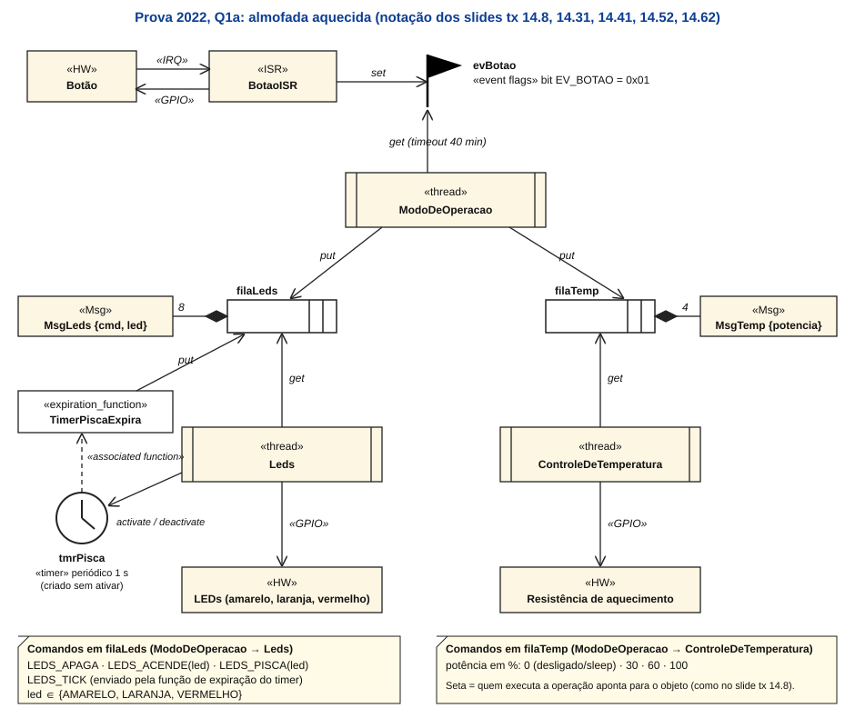

# Gabarito – Prova 2022, Questão 1 (ThreadX / RTOS, 4 pts), refeito com os slides da P2

Enunciado: [Prova2022.md](../P1/Prova%20Antiga/Prova2022.md), Questão 1 (almofada aquecida, 1 ISR, 3 threads, 2 filas, 1 evento, 1 timer).
Versão anterior (sem os slides novos): [Gabarito_Prova2022.md](../P1/Gabarito_Prova2022.md). **Esta substitui aquela**, porque agora a notação UML e as chamadas vêm dos slides.

## Como ler as referências

- **(tx 14.N)** = slide de ThreadX, `14_t threadx_rtos.pdf`, número do rodapé *Page 14.N*. **(excl 13.N)** e **(conc 13.N)** = slides de exclusão mútua e concorrência.
- **[Resumo P2 §x]** = seção do [Resumo_P2.md](Resumo_P2.md) que explica o assunto (revise lá).
- 🧩 = detalhe que **não está nos slides** (complemento do padrão ThreadX).
- Não é gabarito oficial: é uma resolução construída com o material. Onde há mais de uma solução válida, aviso.

### Mapa de pontos e onde revisar

| Item | Pts | O que pede | Slides | Resumo P2 |
|---|---|---|---|---|
| 1a | 1,0 | Diagrama UML com a notação da disciplina | tx 14.8, 14.31, 14.41, 14.52, 14.62 | [§6.4](Resumo_P2.md#s6) |
| 1b | 1,5 | `tx_application_define()` | tx 14.23, 14.28, 14.34-14.36, 14.39-14.40, 14.43, 14.50-14.53, 14.56-14.58, 14.61, 14.64-14.67 | [§7.3](Resumo_P2.md#s7), [§7.7](Resumo_P2.md#s7), [§8](Resumo_P2.md#s8) |
| 1c | 1,5 | Função principal da thread `Leds` (fila + timer) | tx 14.28, 14.50-14.53, 14.59-14.62 | [§8.6](Resumo_P2.md#s8), [§8.8](Resumo_P2.md#s8) |
| (2b) | | ISR do botão (aparece na Q2, mas usa o mesmo evento) | tx 14.56-14.58 | [§9.2](Resumo_P2.md#s9) |
| tx_api.h | | Protótipos e constantes que o professor fornece na prova | | [seção "Usando o tx_api.h"](#txapi) |
| Teoria | | Tudo o que a questão exige saber | | [Parte A](#a1) (A1 a A14) |

---

# Parte A – O que você precisa saber para resolver esta questão

Esta parte é a **teoria completa** que a Q1 usa. Leia na ordem se estiver aprendendo do zero; depois resolva a [Parte B](#parteb) sem olhar.

| Seção | Assunto | Usada em |
|---|---|---|
| [A1](#a1) | Concorrência, thread, troca de contexto, prioridade | todas |
| [A2](#a2) | Estados de uma thread e quem executa | 1b, 1c |
| [A3](#a3) | Comunicação e sincronização: qual objeto usar | 1a |
| [A4](#a4) | Event flags | ISR, `ModoMain` |
| [A5](#a5) | Filas de mensagens | 1b, 1c |
| [A6](#a6) | Timers e o tempo no ThreadX | 1b, 1c |
| [A7](#a7) | Criar threads e guardar estruturas de controle | 1b |
| [A8](#a8) | Quem pode chamar o quê (thread, ISR, timer) | 1c, ISR |
| [A9](#a9) | Exclusão mútua, mutex e semáforo (não usados aqui, mas podem cair) | teoria |
| [A10](#a10) | Inicialização do ThreadX | 1b |
| [A11](#a11) | Notação UML da disciplina | 1a |
| [A12](#a12) | Método para resolver este tipo de questão | todas |
| [A13](#a13) | Teste de mesa: o sistema funcionando no tempo | entender |
| [A14](#a14) | Autoteste com respostas | revisão |

---

<a id="a1"></a>
## A1. Concorrência, thread, troca de contexto, prioridade

**Por quê.** Um sistema embarcado faz várias coisas com ritmos diferentes (ler botão, piscar LED, controlar aquecimento). Escrever tudo num único laço fica complexo. A solução é dividir em **tarefas**, uma por atividade, que executam **concorrentemente** e **cooperam** (conc 13.3-13.4; [Resumo P2 §1](Resumo_P2.md#s1)).

**Thread.** Segmento de programa que executa concorrentemente aos outros. Cada thread tem **seu próprio PC, registradores e pilha**; **compartilha** código, `.data`, `.bss` e heap com as demais (conc 13.8-13.10). Num Cortex-M (sem MMU) cada tarefa é uma thread. O compartilhamento é eficiente, mas **não há proteção**: uma thread pode corromper dado de outra.

**RTOS.** Camada entre o hardware e a aplicação. Dá a cada thread a **ilusão** de ter um processador próprio (processador virtual) e oferece **temporização, comunicação e sincronização entre threads, e gerenciamento de threads** (tx 14.2; [Resumo P2 §6.1](Resumo_P2.md#s6)). Em escala de segundos parece tudo **paralelo**; em milissegundos vê-se o RTOS **alternando** a CPU (tx 14.3-14.4).

**Troca de contexto** (conc 13.11-13.12): (1) a thread A executa; (2) **os registradores são salvos na pilha de A**; (3) o RTOS escolhe a thread B pela **política de escalonamento**; (4) o estado de B é **restaurado da pilha de B** e ela continua de onde parou. No Cortex-M com ThreadX isto é feito pela exceção **PendSV**, e as chamadas síncronas ao kernel usam **SVC** (tx 14.63). O **tick** do RTOS vem do **SysTick** (tx 14.52). O custo típico é ~0,4 µs a 200 MHz (tx 14.19).

**Preemptivo × cooperativo.** Num RTOS **preemptivo** o kernel retoma o controle a qualquer momento (por exemplo, quando uma thread de **maior prioridade** fica pronta). Num cooperativo a troca só ocorre quando a thread **libera** o processador (conc 13.13).

**Prioridade.** Quando uma thread de prioridade maior que a que executa fica pronta, o escalonador **preempta** a atual; quando a mais prioritária termina ou bloqueia, a preemptada **retoma** de onde parou. **No ThreadX, 0 é a maior prioridade** (tx 14.29).

**Os quatro problemas do ambiente multitarefa** (conc 13.16): **comunicação**, **sincronização**, **compartilhamento de recursos/exclusão mútua** e **escalonamento**. A Q1 trabalha com os dois primeiros: filas comunicam, event flags e timer sincronizam.

---

<a id="a2"></a>
## A2. Estados de uma thread e quem executa

Estados genéricos (tx 14.5): **Ready** (quer a CPU), **Running** (usa a CPU), **Waiting** (bloqueada por tempo, sincronização ou comunicação).

Nomes no ThreadX (tx 14.28; [Resumo P2 §7.4](Resumo_P2.md#s7)):

| Estado | Como chega | Como sai |
|---|---|---|
| **Ready** | `tx_thread_create` com `TX_AUTO_START`; acabou a espera; `tx_thread_resume` | o escalonador a escolhe → Executing |
| **Executing** | escolhida pelo escalonador (só **uma** por vez, num processador) | preemptada → Ready; bloqueia → Suspended; retorna → Completed |
| **Suspended** | `TX_DONT_START` na criação; ficou esperando (`tx_queue_receive` com fila vazia, `tx_event_flags_get` sem o evento, `tx_thread_sleep`...) | o evento ou o tempo ocorre → Ready |
| **Completed** | a função de entrada **retornou** | não volta (por isso o laço infinito) |
| **Terminated** | `tx_thread_terminate` | 🧩 `tx_thread_reset` |

**Regra de quem executa** (tx 14.29): executa a thread **Ready de maior prioridade**. Entre **mesma prioridade** a ordem é **FIFO**. Há dois jeitos de alternar entre mesma prioridade: **round-robin cooperativo** (`tx_thread_relinquish`) ou **time-slicing** (fatia em ticks dada na criação; `TX_NO_TIME_SLICE` = sem fatia).

🧩 **Preempt threshold:** valor de prioridade abaixo do qual outras threads **não** podem preemptar esta thread; se for igual à prioridade, não há efeito. Na Q1 usamos `5, 5` e `6, 6`.

**Aplicado à Q1:** quase sempre as três threads estão **Suspended** (esperando evento ou mensagem) e a CPU fica ociosa. Quando o botão é apertado, `ModoDeOperacao` (prioridade 5) vai a Ready, preempta o que estiver rodando e executa; ao enviar mensagens, `Leds` e `ControleDeTemperatura` (prioridade 6) viram Ready e rodam depois que `ModoDeOperacao` voltar a esperar.

---

<a id="a3"></a>
## A3. Comunicação e sincronização: qual objeto usar

| Objeto | Para quê | Carrega dados? | Tem dono? | Quando usar |
|---|---|---|---|---|
| **Event flags** | avisar que algo ocorreu (um bit por evento, 32 por grupo) | não | não | **ISR → thread**, "aconteceu X" |
| **Fila** | enviar **dados/comandos** de uma thread a outra | sim (1 a 16 palavras) | não | mandar **ordens** entre threads |
| **Semáforo** | sincronizar / contar ocorrências | não | **não** | sinalizar vários eventos contados |
| **Mutex** | **exclusão mútua** (proteger recurso) | não | **sim** | acesso exclusivo a dado/periférico |
| **Timer** | agir depois de um tempo | não | – | temporização sem ocupar thread |

(tx 14.31, 14.41-14.42; [Resumo P2 §8.1, §9.1, §10.2](Resumo_P2.md#s8))

**Por que cada escolha na Q1:**
- **ISR → `ModoDeOperacao`: event flags.** O botão só avisa "foi apertado" e o enunciado exige usar evento. Não há dado a transportar.
- **`ModoDeOperacao` → `Leds` e → `ControleDeTemperatura`: filas.** Há **dados** (o comando e o LED, ou a potência). Duas filas separadas porque cada destinatário tem seu tipo de mensagem e seu ritmo, e assim a thread que recebe não precisa filtrar.
- **Piscar o LED: timer.** Evita uma thread dedicada só a contar 1 s.

**Comunicação por mensagem** (excl 13.45-13.51): é **assíncrona** (quem envia segue sem esperar quem recebe, enquanto a fila não estiver cheia) e com **endereçamento indireto** (o remetente conhece a **fila**, não o receptor). Na fila do ThreadX são **duas cópias** por mensagem: remetente → fila e fila → receptor (tx 14.60).

**Vantagem de usar fila para atuar no hardware:** só **uma** thread (`Leds`) mexe nos LEDs e só uma (`ControleDeTemperatura`) mexe na resistência. Como nenhum recurso é compartilhado entre threads, **não precisa de mutex**: as mensagens já impõem a ordem ([A9](#a9)).

---

<a id="a4"></a>
## A4. Event flags

(tx 14.56-14.58; [Resumo P2 §8.7](Resumo_P2.md#s8))

Um **grupo** é uma palavra de **32 bits** (`TX_EVENT_FLAGS_GROUP`); cada bit é uma flag (1 = levantada, 0 = abaixada). Nasce com 0.

```c
UINT tx_event_flags_create(TX_EVENT_FLAGS_GROUP *group_ptr, CHAR *name_ptr);
UINT tx_event_flags_set(TX_EVENT_FLAGS_GROUP *group_ptr, ULONG flags_to_set, UINT set_option);
UINT tx_event_flags_get(TX_EVENT_FLAGS_GROUP *group_ptr, ULONG requested_flags,
                        UINT get_option, ULONG *actual_flags_ptr, ULONG wait_option);
```

| Opção | Em `set` | Em `get` |
|---|---|---|
| `TX_OR` | **liga** os bits da máscara (mantém os outros) | acorda se **qualquer** flag pedida está em 1 |
| `TX_OR_CLEAR` | – | qualquer, e **limpa** as flags pedidas |
| `TX_AND` | faz **AND** da máscara com o grupo (**apaga** os bits fora da máscara) | acorda só se **todas** as flags pedidas estão em 1 |
| `TX_AND_CLEAR` | – | todas, e **limpa** |

- Se o teste já está satisfeito, o `get` retorna **na hora**. Senão a thread vai a **Suspended** até o teste passar ou o tempo (`wait_option`) acabar.
- `wait_option`: `TX_NO_WAIT` (0), `TX_WAIT_FOREVER` (0xFFFFFFFF) ou **ticks** (timeout) (tx 14.43).
- `actual_flags_ptr` é **saída**: valor do grupo quando a thread acordou.
- Exemplo do slide (tx 14.58): grupo 0x0; A faz `set(0x1, TX_OR)` → 0x1; B faz `set(0x10, TX_OR)` → 0x11; C esperava `get(0x11, TX_AND_CLEAR, TX_WAIT_FOREVER)` → acorda e o grupo volta a 0x0.
- **Não conta ocorrências:** dois `set` antes do `get` valem como um. Se precisar contar, use semáforo ou fila.
- **Esquecer `_CLEAR`** deixa o bit em 1 e o próximo `get` retorna imediatamente.

---

<a id="a5"></a>
## A5. Filas de mensagens

(tx 14.59-14.62; [Resumo P2 §8.8](Resumo_P2.md#s8))

```c
UINT tx_queue_create(TX_QUEUE *queue_ptr, CHAR *name_ptr, UINT message_size,
                     VOID *queue_start, ULONG queue_size);
UINT tx_queue_send   (TX_QUEUE *queue_ptr, VOID *source_ptr,      ULONG wait_option);
UINT tx_queue_receive(TX_QUEUE *queue_ptr, VOID *destination_ptr, ULONG wait_option);
```

- **`message_size`**: tamanho da mensagem em **palavras de 32 bits**, de **1 a 16**.
- **`queue_start`**: ponteiro para a **área de armazenamento** (memória que você reserva).
- **`queue_size`**: tamanho da área em **bytes**.
- **Capacidade = `queue_size` ÷ (`message_size` × 4)**. Exemplo do slide (tx 14.61): área de 20 bytes, mensagem de 1 palavra → 20 ÷ 4 = **5 mensagens**. Na Q1: `64 ÷ (2×4) = 8` e `16 ÷ (1×4) = 4`.
- **`send`**: **copia** a mensagem de `source_ptr` para a fila; **bloqueia só se a fila estiver cheia** (conforme `wait_option`).
- **`receive`**: **copia** a mensagem da **cabeça** da fila para `destination_ptr`; **bloqueia se a fila estiver vazia**.
- Ordem **FIFO**. A mensagem é **copiada**, então a variável `m` pode ser reutilizada logo após o `send`; não envie ponteiro para variável local que sairá de escopo.
- Três modos de espera: **não bloqueante** (`TX_NO_WAIT`), **bloqueante** (`TX_WAIT_FOREVER`) ou **com timeout** (ticks) (tx 14.59).
- 🧩 Retornos típicos: `TX_QUEUE_FULL` (send sem espera numa fila cheia), `TX_QUEUE_EMPTY` (receive sem espera numa fila vazia). Outros serviços: `tx_queue_front_send` (envia **na frente**), `tx_queue_flush`.
- Estrutura interna (tx 14.62): `TX_QUEUE` aponta para a `«storage area»`; o `Sender` faz `put` e o `Receiver` faz `get`.

---

<a id="a6"></a>
## A6. Timers e o tempo no ThreadX

(tx 14.50-14.53; [Resumo P2 §8.6](Resumo_P2.md#s8))

**Tick.** Unidade de tempo do RTOS. Vem do **SysTick** ([Resumo P1 §13](../P1/Resumo_P1.md#s13)); quantos ticks por segundo é `TX_TIMER_TICKS_PER_SECOND`, definido em `tx_user.h` (tx 14.24-14.25). **Converta tempo em ticks:** `ticks = segundos × TX_TIMER_TICKS_PER_SECOND`. Por exemplo, 40 min = `40 × 60 × TX_TIMER_TICKS_PER_SECOND` ticks.

```c
UINT tx_timer_create(TX_TIMER *timer_ptr, CHAR *name_ptr,
                     VOID (*expiration_function)(ULONG), ULONG expiration_input,
                     ULONG initial_ticks, ULONG reschedule_ticks, UINT auto_activate);
UINT tx_timer_activate(TX_TIMER *);     UINT tx_timer_deactivate(TX_TIMER *);
UINT tx_timer_change(TX_TIMER *, ULONG initial_ticks, ULONG reschedule_ticks);
```

- **`initial_ticks`**: ticks até a **primeira** expiração.
- **`reschedule_ticks`**: `0` → **one-shot** (dispara uma vez e se desativa sozinho); `> 0` → **periódico** (recarrega com esse valor a cada expiração).
- **`auto_activate`**: `TX_AUTO_ACTIVATE` (já começa a contar) ou `TX_NO_ACTIVATE` (você liga com `tx_timer_activate`).
- Um timer periódico só para com **`tx_timer_deactivate`**. Só um timer **inativo** pode ser reprogramado com `tx_timer_change`.
- **A função de expiração** roda no contexto da thread interna **System Timer** (não na sua thread nem na ISR). Pode enviar mensagem, setar evento, fazer `put` de semáforo, **mas não pode bloquear** (tx 14.52). Por isso usa `TX_NO_WAIT` e só sinaliza.

**Fluxo interno** (tx 14.52): `«HW» SysTick` gera `irq` → `«ISR» SysTick` **incrementa** `_tx_timer_system_clock` e **acorda** (`wake`) a thread `SystemTimer` → ela **chama** (`call`) a função de expiração do timer.

**Três jeitos de "esperar tempo" no ThreadX:**

| Jeito | Quando usar | Exemplo na Q1 |
|---|---|---|
| `tx_thread_sleep(ticks)` | a thread só quer dormir | (não usado) |
| **Timeout** no `get`/`receive` (`wait_option`) | esperar um evento **no máximo** X ticks | 40 min sem botão (`ModoMain`) |
| **Timer** com função de expiração | gerar eventos periódicos sem ocupar uma thread | piscar o LED (1 s) |

---

<a id="a7"></a>
## A7. Criar threads e guardar estruturas de controle

(tx 14.23, 14.28-14.29, 14.34-14.40; [Resumo P2 §7.4-7.5, §8.2-8.3](Resumo_P2.md#s7))

```c
UINT tx_thread_create(TX_THREAD *thread_ptr, CHAR *name_ptr,
                      VOID (*entry_function)(ULONG), ULONG entry_input,
                      VOID *stack_start, ULONG stack_size,
                      UINT priority, UINT preempt_threshold,
                      ULONG time_slice, UINT auto_start);
```

| Parâmetro | Significado | Q1 |
|---|---|---|
| `thread_ptr` | estrutura de controle, **global** | `&thModo` |
| `name_ptr` | nome ASCII | `"ModoDeOperacao"` |
| `entry_function` | `void f(ULONG)`; é o `main` da thread | `ModoMain` |
| `entry_input` | valor passado a `f` | `0` |
| `stack_start` / `stack_size` | pilha e seu tamanho em **BYTES** | `pilhaModo`, `sizeof(pilhaModo)` |
| `priority` | **0 = maior** | 5 |
| `preempt_threshold` | limiar de preempção (igual à prioridade = sem efeito) | 5 |
| `time_slice` | ticks por fatia ou `TX_NO_TIME_SLICE` | sem fatia |
| `auto_start` | `TX_AUTO_START` (já Ready) ou `TX_DONT_START` (Suspended) | `TX_AUTO_START` |

**A função de entrada é um laço infinito.** Se retornar, a thread vai a *Completed* e nunca mais executa (tx 14.23, 14.28).

**Estruturas de controle.** Os serviços recebem **ponteiros** para estruturas **que você aloca** (`TX_THREAD`, `TX_QUEUE`, `TX_TIMER`, `TX_EVENT_FLAGS_GROUP`...). Elas precisam **existir enquanto o componente existir** (tx 14.34-14.36):

| Onde | Vive | Serve para |
|---|---|---|
| **Global / estática** (`.bss`, `.data`) | do power-on ao power-off | **o caso normal** (tx 14.39) |
| **Local** (pilha) | só até a função retornar | **ERRADO** para componentes do ThreadX |
| Heap (`malloc`/`new`) | até `free` | só se executar **antes** de `tx_kernel_enter()` |
| **Byte pool** do ThreadX | de `allocate` a `release` | se a alocação ocorre **depois** de `tx_kernel_enter()` ou é dinâmica |

**Os dois erros clássicos do slide** (tx 14.35): (1) ponteiro **não inicializado** passado ao `create`; (2) variável **local**, que some quando a função retorna.

**Ciclo de uso de um componente** (tx 14.40): (1) alocar a estrutura (global); (2) **inicializar com `create`**; (3) usar as funções principais (ex.: `set`/`get`); (4) funções secundárias; (5) `delete` (raro).

**Verifique os retornos** (tx 14.43-14.44): `TX_SUCCESS` = 0. Muitos parâmetros são **entradas** (ponteiros para estruturas já criadas) e outros **saídas** (áreas já alocadas para receber resultado, como `&atuais` no `get`). Cada serviço tem na documentação **Allowed From** e **Preemption Possible**.

**Pilha em bytes, mensagem em palavras, fila em bytes:** é a confusão de unidades mais comum ([Resumo P2 §9.5](Resumo_P2.md#s9)).

---

<a id="a8"></a>
## A8. Quem pode chamar o quê (thread, ISR, timer)

([Resumo P2 §9.2](Resumo_P2.md#s9), tx 14.43-14.44, 14.52)

| Contexto | Pode bloquear (`TX_WAIT_FOREVER`/timeout)? | Observação |
|---|---|---|
| **Thread** | **sim** | é onde fica o trabalho pesado |
| **ISR** | **não** | curta: **limpa o pedido no periférico** e **sinaliza** (`event set`, `semaphore put`, `queue send` com `TX_NO_WAIT`) 🧩 |
| **Função de expiração do timer** | **não** | roda na thread System Timer (tx 14.52) |
| **`tx_application_define`** (inicialização) | não | só **cria** componentes |

- **Mutex só pode ter como dono uma thread**: não é permitido a ISR nem a timer (retorno `TX_CALLER_ERROR`) ([Resumo P2 §8.5](Resumo_P2.md#s8-5)).
- A ISR deve **limpar a flag de interrupção do periférico** antes de retornar ([Resumo P1 §11.7](../P1/Resumo_P1.md#s11-7)); o pending do NVIC é limpo automaticamente, mas o do periférico não.
- Ideia central do padrão: **ISR curta + thread trabalha**. A ISR do botão só faz `event_flags_set`; quem decide o que fazer é `ModoDeOperacao` (no slide tx 14.8, a ISR do joystick faz `put` numa fila lida pela thread `PacMan`).
- Várias chamadas do ThreadX **podem causar preempção**: ao enviar uma mensagem para uma thread de prioridade maior, a troca de contexto pode ocorrer **dentro** do `send` (tx 14.43-14.44).

---

<a id="a9"></a>
## A9. Exclusão mútua, mutex e semáforo

A Q1 **não** precisa de mutex, mas a prova pode perguntar. ([Resumo P2 §3-4, §8.5](Resumo_P2.md#s3), excl 13.17-13.51)

**Problema.** Dois fluxos acessam o mesmo recurso (variável, periférico). Um `x++` em C vira `LDR / ADD / STR`; se a troca de contexto ocorrer entre o `LDR` e o `STR`, uma atualização **se perde** (*race condition*, excl 13.24). O trecho que acessa o recurso é a **seção crítica**.

**Requisitos de uma solução** (excl 13.25-13.27): **exclusão mútua** (no máximo um dentro), **progresso** (se ninguém está dentro, quem quiser entra), **espera limitada** (ninguém espera para sempre, sem *starvation*), sem suposição sobre velocidade ou número de CPUs.

**Glossário** (excl 13.28): *deadlock* (esperam uns pelos outros para sempre), *livelock* (mudam de estado mas não progridem), *starvation* (uma tarefa nunca é atendida).

**Soluções** (excl 13.29-13.44): desabilitar interrupções (só 1 CPU, atrasa tudo); instruções atômicas (`LDREX`/`STREX` no Cortex-M); software puro (Peterson, só 2 tarefas); **semáforo/mutex do RTOS**; **monitor**; **mensagens** (as três arquiteturas, inclusive distribuída).

| | Semáforo | Mutex |
|---|---|---|
| Uso | **sincronizar** | **exclusão mútua** |
| Dono | **nenhum** | **uma thread** por vez |
| Quem devolve (`put`) | qualquer thread ou ISR | **só o dono** |
| Herança de prioridade | não | **opcional** (`TX_INHERIT`) |
| `get` com valor 0 | suspende (FIFO) | suspende (FIFO) |

```c
TX_MUTEX m;
tx_mutex_create(&m, "m", TX_INHERIT);          /* ou TX_NO_INHERIT */
tx_mutex_get(&m, TX_WAIT_FOREVER);
/* seção crítica curta */
tx_mutex_put(&m);                              /* quem pega, devolve */
```

🧩 **Inversão de prioridade:** thread de baixa prioridade (L) segura o mutex que a de alta (H) quer; uma de média (M) preempta L; H espera M sem relação com ele. A **herança de prioridade** faz L subir à prioridade de H até soltar o mutex. **Deadlock com dois mutexes:** A pega M1 e pede M2, B pega M2 e pede M1. Prevenção: sempre pegar na **mesma ordem**, usar timeout.

**Por que a Q1 não precisa:** cada recurso de hardware (LEDs, resistência) é acessado por **uma única thread**, e as outras só mandam mensagens pela fila. Esse é o padrão "thread dona do recurso + mensagens" (excl 13.45-13.51).

---

<a id="a10"></a>
## A10. Inicialização do ThreadX

(tx 14.23, 14.64-14.67; [Resumo P2 §7.3, §7.7](Resumo_P2.md#s7); fluxo de reset em [Resumo P1 §17](../P1/Resumo_P1.md#s17))

1. **Reset**: vetor de reset da tabela de exceções.
2. **Startup**: inicializa `.data`/`.bss`, FPU.
3. **`main()`**: inicializações que **não** envolvem o ThreadX (clock, periféricos) e **`tx_kernel_enter()`**, que **não retorna**.
4. `tx_kernel_enter` chama **`tx_application_define(first_unused_memory)`**: **cria** threads, filas, eventos, timers, mutexes, semáforos, pools. (Nada executa ainda: as threads só começam depois.)
5. O ThreadX entra no **laço do escalonador** e executa as funções de entrada das threads por prioridade.

Aplicação mínima (tx 14.23): (1) `#include "tx_api.h"`; (2) `main` chama `tx_kernel_enter()`; (3) `tx_application_define` cria os recursos; (4) compilar e linkar com `tx.lib`.

`first_unused_memory` é o início da RAM livre. Dá para usá-la para pilhas (como no slide), mas aqui usamos arrays globais.

Se mudar `TX_TIMER_TICKS_PER_SECOND` num `.h` **gerado** pelo SSP, a mudança **não tem efeito**: use a aba Properties e gere de novo (tx 14.24-14.25).

---

<a id="a11"></a>
## A11. Notação UML da disciplina

Os símbolos e as setas estão na seção [1a](#q1a), com o slide de cada um. Resumo para decorar:

| Componente | Símbolo | Slide |
|---|---|---|
| Thread | retângulo com **duas barras laterais**, `«thread»` + nome | tx 14.31, 14.41 |
| Fila | retângulo comprido com **divisórias à direita** | tx 14.31 |
| Event flag | **bandeira** | tx 14.31 |
| Timer | **relógio** | tx 14.31 |
| Mutex | **cadeado** `«mutex»` | tx 14.31 |
| Semáforo contador | círculo vermelho `«counting semaphore»` | tx 14.31 |
| Memória (byte/block pool) | `«memory block»` | tx 14.31 |
| Hardware / ISR | `«HW»`, `«ISR»`, setas `«IRQ»` e `«GPIO»` | tx 14.8 |
| Operações | setas rotuladas `put`, `get`, `set`, `wake`, `call`, `irq`, `increment` | tx 14.8, 14.52, 14.62 |

Para o comportamento (quando a FSM muda de estado) use o **diagrama de estados** da P1, com `evento [guarda] / ações`, `after(t)` para tempo, `entry`/`exit` ([Resumo P1 §14](../P1/Resumo_P1.md#s14)).

---

<a id="a12"></a>
## A12. Método para resolver este tipo de questão

([Resumo P2 §10.4](Resumo_P2.md#s10))

1. **Liste as atividades** do enunciado → uma **thread** por atividade (nome, prioridade).
2. **Quem gera eventos?** (botão, tempo, dado chegando) → **ISR** + event flags/semáforo/fila.
3. **Quais dados passam entre threads?** → **filas** (defina as **mensagens e comandos**).
4. **Onde entra o tempo?** → timer, timeout no `get`/`receive`, ou `tx_thread_sleep`. Converta em **ticks**.
5. **Quem mexe em cada periférico?** → **uma** thread por recurso. Se duas precisarem, use mutex.
6. **Desenhe** com os símbolos da disciplina (A11).
7. **Escreva `tx_application_define`**: global → `create` de cada objeto → threads.
8. **Escreva as threads**: laço infinito, bloqueando em `receive`/`get`; tratar cada comando.
9. **Revise as unidades**: pilha em bytes, mensagem em palavras, fila em bytes, prioridade 0 = maior.

---

<a id="a13"></a>
## A13. Teste de mesa: o sistema funcionando no tempo

Cenário (todas as threads começam esperando; `evBotao` = 0).

| Quando | O que acontece | Quem executa |
|---|---|---|
| Boot | `tx_application_define` cria tudo; `Modo` fica no `get` do evento (espera para sempre), `Leds` e `Temp` no `receive` das filas | – |
| botão 1 | ISR limpa o GPIO e faz `set(EV_BOTAO)`; `Modo` fica Ready e preempta (prioridade 5); `get` retorna `TX_SUCCESS` e limpa o bit; estado `NIVEL30`; envia `ACENDE amarelo` e `30`; volta a esperar **com timeout de 40 min** | ISR → `Modo` |
| logo depois | `Leds` e `Temp` ficam Ready e rodam: amarelo aceso, resistência a 30% | `Leds`, `Temp` |
| botão 2 (alguns segundos depois) | mesmo caminho; **o timeout de 40 min recomeça do zero**; estado `NIVEL60`, laranja, 60% | – |
| botão 3 | `NIVEL100`, vermelho, 100% | – |
| botão 4 | volta a `DESLIGADO`: `APAGA` e `0`; `Modo` espera **para sempre** | – |
| botão de novo | `NIVEL30`; agora conta 40 min sem botão | – |
| passam 40 min sem botão | o `get` **acorda por timeout** (`status != TX_SUCCESS`); `ultimo = NIVEL30`, estado `SLEEP`; envia `PISCA amarelo` e `0` | `Modo` |
| `Leds` recebe `PISCA` | apaga tudo, acende o amarelo e **ativa o timer** | `Leds` |
| a cada 1 s | timer expira → `TimerPiscaExpira` (thread System Timer) envia `LEDS_TICK` → `Leds` acorda e **alterna** o LED (1 s aceso, 1 s apagado = **0,5 Hz**) | System Timer, `Leds` |
| botão em SLEEP | `Modo` vai a `DESLIGADO` e envia `APAGA`: `Leds` **desativa o timer** e apaga | `Modo`, `Leds` |

---

<a id="a14"></a>
## A14. Autoteste (responda antes de ler a resposta)

1. **Por que a ISR do botão não executa a lógica da FSM?** Porque a ISR deve ser **curta**; só limpa o pedido e **sinaliza**. A lógica fica numa thread, que pode bloquear e ser escalonada (A8).
2. **O que acontece se a função de entrada de uma thread retornar?** A thread vai a *Completed* e nunca mais executa (A2, A7).
3. **Fila com área de 48 bytes e mensagem de 3 palavras: qual a capacidade?** `48 ÷ (3×4) = 4` mensagens (A5).
4. **Qual a diferença entre `TX_OR` e `TX_AND` no `get` de event flags?** `OR` acorda com **qualquer** flag pedida; `AND` só com **todas** (A4).
5. **Por que a função de expiração do timer não pode usar `TX_WAIT_FOREVER`?** Ela roda na thread System Timer; bloquear essa thread paralisaria o serviço de timers (A6, tx 14.52).
6. **Como medir 40 min sem usar um segundo timer?** Timeout no `tx_event_flags_get` (A6).
7. **Qual thread tem a maior prioridade: a de nível 5 ou a de nível 6?** A de **5** (0 é a maior) (A2).
8. **Duas threads precisam mexer no mesmo periférico. O que usar?** **Mutex** (ou deixar uma só thread dona do periférico e comunicar por fila) (A9).
9. **Por que a estrutura `TX_QUEUE` não pode ser variável local?** Ela precisa existir enquanto a fila existir; a local some quando a função retorna (A7).
10. **Dois botões apertados antes de `Modo` executar viram quantos eventos?** **Um** (event flags não contam) (A4).
11. **Quantas cópias a mensagem sofre numa fila do ThreadX?** **Duas**: remetente → fila e fila → receptor (A3, tx 14.60).
12. **Quem acorda a thread System Timer, e quando?** A `«ISR» SysTick`, a cada tick (A6, tx 14.52).

---

<a id="parteb"></a>
# Parte B – Resolução da Questão 1

## B0. Decisões de projeto (antes de desenhar e codificar)

O enunciado exige **1 ISR, 3 threads, 2 filas, 1 evento e 1 timer**. Passo a passo do raciocínio ([Resumo P2 §10.4](Resumo_P2.md#s10), checklist de "projete a aplicação"):

1. **Uma thread por atividade** (tx 14.8, 14.28): `ModoDeOperacao` (decide o estado), `Leds` (aciona LEDs) e `ControleDeTemperatura` (aciona a resistência).
2. **Quem gera o evento?** O botão. Ele chama uma **ISR** que só **sinaliza**; o enunciado manda usar **event flags** para isso (tx 14.56-14.58; [§9.2](Resumo_P2.md#s9)).
3. **Que dados passam entre threads?** Comandos. Vão por **filas** (tx 14.59-14.62), uma para cada destinatário, como o enunciado pede.
4. **Tempo.** Dois tempos aparecem no enunciado:
   - **piscar a 0,5 Hz** (1 s aceso, 1 s apagado): é o **timer** do ThreadX, usado na thread `Leds` (item 1c). Timer **periódico** de 1 s (tx 14.50-14.51).
   - **40 minutos sem botão**: como o único timer já está ocupado com o piscar, uso o **timeout do `tx_event_flags_get`** (a espera "BLOCKING com TIMEOUT", tx 14.43 e 14.56). Cada botão pressionado reinicia a espera, que é exatamente "contados desde a última vez que o botão foi pressionado".
   - Alternativa válida: timer de 40 min em `ModoDeOperacao` e o piscar dentro de `Leds` com `tx_queue_receive` com timeout de 1 s. Escolha uma e **diga qual** na prova.
5. **Prioridades** (tx 14.29): **0 é a maior**. `ModoDeOperacao` = 5 (reage logo ao botão) e as de saída = 6.

| Elemento | Nome | Papel |
|---|---|---|
| `«HW»` + `«ISR»` | `Botão` / `BotaoISR` | Limpa o pedido no GPIO e faz `tx_event_flags_set` |
| Evento | `evBotao` | Grupo de flags; bit `EV_BOTAO` = "botão pressionado" |
| Thread 1 | `ModoDeOperacao` | FSM; espera o evento (timeout 40 min); envia comandos às filas |
| Thread 2 | `Leds` | Recebe de `filaLeds`; liga, desliga e pisca os LEDs |
| Thread 3 | `ControleDeTemperatura` | Recebe de `filaTemp`; define a potência |
| Fila 1 | `filaLeds` | `ModoDeOperacao` → `Leds`; também recebe `LEDS_TICK` do timer |
| Fila 2 | `filaTemp` | `ModoDeOperacao` → `ControleDeTemperatura` |
| Timer | `tmrPisca` | Periódico de 1 s; a função de expiração manda `LEDS_TICK` a `filaLeds` |

**Comandos das filas** (o enunciado pede para defini-los no diagrama):
- `filaLeds` (mensagem `MsgLeds {cmd, led}`): `LEDS_APAGA`, `LEDS_ACENDE(led)`, `LEDS_PISCA(led)`, `LEDS_TICK`.
- `filaTemp` (mensagem `MsgTemp {potencia}`): potência em %: `0`, `30`, `60`, `100`.

---

<a id="q1a"></a>
## 1a – Diagrama UML (1 pt)



(Arquivo: [Q1_diagrama_UML.svg](Q1_diagrama_UML.svg). Abra no navegador se a pré-visualização do editor não mostrar tudo.)

### Como cada símbolo foi tirado dos slides

| O que desenhei | Convenção | Slide |
|---|---|---|
| **Thread**: retângulo com **duas barras verticais** nas laterais, `«thread»` + nome | símbolo "Thread" do quadro de componentes | tx 14.31, 14.41; usado em tx 14.8, 14.52, 14.62 |
| **Fila**: retângulo comprido com **divisórias à direita** | símbolo "Queue" | tx 14.31, 14.41 |
| **Mensagem**: classe `«Msg»` ligada à fila por **composição** (losango preenchido) com **multiplicidade** (capacidade da fila) | como `«JoystickMovement» Msg` ligada à fila com multiplicidade 2 | tx 14.8 |
| **Event flag**: **bandeira** preta | símbolo "Event Flag" | tx 14.31, 14.41; usado em tx 14.8 |
| **Timer**: **relógio** | símbolo "Timer" | tx 14.31, 14.41 |
| **Hardware**: caixa `«HW»` (botão, LEDs, resistência) | como `«HW» Joystick` e `«HW» SysTick` | tx 14.8, 14.52 |
| **ISR**: caixa `«ISR»`; seta `«IRQ»` do HW para ela e `«GPIO»` dela de volta ao HW | como `«ISR» Joystick:irq` com `«GPIO»` e `«IRQ»` | tx 14.8 |
| **Setas rotuladas** com a operação: `put`, `get`, `set` | `put` (ISR → fila), `get` (thread ← fila), `set` (thread → bandeira) | tx 14.8, 14.62 |
| **Função de expiração do timer**: caixa `«expiration_function»` ligada ao timer por `«associated function»`, e ela faz `put` na fila | como em "Timer internals" | tx 14.52 |
| **Comandos das filas** numa **nota** (retângulo com canto dobrado) | nota ligada por linha tracejada | tx 14.52 |

**Convenção da seta:** quem **executa** a operação (`put`, `get`, `set`) aponta **para o objeto** (fila, bandeira). É como está em tx 14.8 e 14.62: a seta `put` vai de `Sender` para `:Queue`, e a seta `get` vai de `Receiver` para `:Queue`, **mesmo que o dado flua no sentido contrário**.

**Checagem do que a correção espera ver:** botão, ISR, evento, **3 threads**, **2 filas separadas**, timer, LEDs, resistência, **direção dos fluxos** e **os comandos de cada fila**.

### Diagrama de estados de `ModoDeOperacao` (complemento)

Notação `evento [guarda] / ações` da P1 ([Resumo P1 §14](../P1/Resumo_P1.md#s14)).

```mermaid
stateDiagram-v2
    [*] --> Desligado
    Desligado --> Nivel30 : botao / ACENDE amarelo; temp=30
    Nivel30 --> Nivel60 : botao / ACENDE laranja; temp=60
    Nivel60 --> Nivel100 : botao / ACENDE vermelho; temp=100
    Nivel100 --> Desligado : botao / APAGA; temp=0
    Nivel30 --> Sleep : after 40 min / PISCA amarelo; temp=0
    Nivel60 --> Sleep : after 40 min / PISCA laranja; temp=0
    Nivel100 --> Sleep : after 40 min / PISCA vermelho; temp=0
    Sleep --> Desligado : botao / APAGA; temp=0
```



`after 40 min` = tempo sem botão. `Desligado` e `Sleep` esperam o botão **sem limite de tempo**.

**Se errou o diagrama, revise:** [Resumo P2 §6.4](Resumo_P2.md#s6) (símbolos), [§8.1](Resumo_P2.md#s8) (componentes), tx 14.8 (exemplo completo).

---

<a id="q1b"></a>
## 1b – `tx_application_define()` (1,5 pt)

### Como pensar

`tx_application_define` roda **dentro de `tx_kernel_enter()`**, que é chamada pela `main` (tx 14.23, 14.64-14.67; [Resumo P2 §7.7](Resumo_P2.md#s7)). Ela só **cria** os componentes: threads, filas, eventos, timers (tx 14.23 passo 3). Para cada um:

1. **Estrutura de controle** (`TX_THREAD`, `TX_QUEUE`...) alocada por você, **global/estática**, nunca local nem ponteiro solto (tx 14.35-14.36; erro clássico em [Resumo P2 §8.2](Resumo_P2.md#s8)).
2. **Nome ASCII**, **opções** (enums/`#define`), **áreas de memória** já alocadas (tx 14.34, 14.39-14.40).
3. **Verificar o retorno** (`TX_SUCCESS` = 0) (tx 14.43-14.44). Na resposta abaixo mostro a checagem uma vez; as demais seguem o mesmo padrão.

### Resposta

```c
#include "tx_api.h"                                   /* tx 14.23, passo 1 */

#define EV_BOTAO   0x01UL                             /* bit 0 do grupo de flags */
#define TICKS_1S   (TX_TIMER_TICKS_PER_SECOND)        /* tx_user.h (tx 14.24-14.25) */

/* mensagens das filas (tamanho em PALAVRAS de 32 bits: tx 14.59, 14.61) */
typedef enum { LEDS_APAGA, LEDS_ACENDE, LEDS_PISCA, LEDS_TICK } CmdLeds;
typedef struct { ULONG cmd; ULONG led; } MsgLeds;     /* 2 palavras */
typedef struct { ULONG potencia; }        MsgTemp;    /* 1 palavra: 0, 30, 60 ou 100 (%) */

/* estruturas de controle: GLOBAIS (tx 14.35-14.36, 14.39) */
TX_EVENT_FLAGS_GROUP evBotao;
TX_QUEUE   filaLeds, filaTemp;
TX_THREAD  thModo, thLeds, thTemp;
TX_TIMER   tmrPisca;

/* áreas de memória (globais) */
ULONG areaFilaLeds[16];                               /* 64 bytes = 8 msgs de 2 palavras */
ULONG areaFilaTemp[4];                                /* 16 bytes = 4 msgs de 1 palavra  */
ULONG pilhaModo[256], pilhaLeds[256], pilhaTemp[256]; /* 1024 bytes cada */

void ModoMain(ULONG entrada);
void LedsMain(ULONG entrada);
void TempMain(ULONG entrada);
void TimerPiscaExpira(ULONG entrada);

void tx_application_define(void *first_unused_memory)
{
    UINT err;

    err = tx_event_flags_create(&evBotao, "evBotao");
    if (err != TX_SUCCESS) { /* tratar erro (tx 14.43); nas demais chamadas é igual */ }

    /* filas: message_size em PALAVRAS, queue_size em BYTES (tx 14.61) */
    tx_queue_create(&filaLeds, "filaLeds", 2, areaFilaLeds, sizeof(areaFilaLeds));
    tx_queue_create(&filaTemp, "filaTemp", 1, areaFilaTemp, sizeof(areaFilaTemp));

    /* timer periódico de 1 s, criado desativado (tx 14.50-14.53) */
    tx_timer_create(&tmrPisca, "tmrPisca", TimerPiscaExpira, 0,
                    TICKS_1S, TICKS_1S, TX_NO_ACTIVATE);

    /* threads (assinatura em tx 14.28; prioridade 0 = maior) */
    tx_thread_create(&thModo, "ModoDeOperacao", ModoMain, 0,
                     pilhaModo, sizeof(pilhaModo), 5, 5, TX_NO_TIME_SLICE, TX_AUTO_START);
    tx_thread_create(&thLeds, "Leds", LedsMain, 0,
                     pilhaLeds, sizeof(pilhaLeds), 6, 6, TX_NO_TIME_SLICE, TX_AUTO_START);
    tx_thread_create(&thTemp, "ControleDeTemperatura", TempMain, 0,
                     pilhaTemp, sizeof(pilhaTemp), 6, 6, TX_NO_TIME_SLICE, TX_AUTO_START);
}
```

### O que rende nota

| Item | Por quê | Slide / Resumo |
|---|---|---|
| `void tx_application_define(void *first_unused_memory)` | assinatura exigida pelo kernel | tx 14.23 |
| Estruturas de controle **globais** | local ou ponteiro solto é erro (os dois "X" vermelhos) | tx 14.35-14.36; [§8.2](Resumo_P2.md#s8) |
| Fila: `message_size` em **palavras** e `queue_size` em **bytes** | capacidade = bytes ÷ (palavras × 4): `64 ÷ (2×4) = 8` e `16 ÷ (1×4) = 4` | tx 14.61; [§8.8](Resumo_P2.md#s8) |
| Timer **periódico** (`reschedule_ticks > 0`) e **`TX_NO_ACTIVATE`** | só pisca no sleep | tx 14.50-14.53; [§8.6](Resumo_P2.md#s8) |
| `tx_thread_create` com **10 parâmetros na ordem certa** | pilha em **bytes**, prioridade **0 = maior** | tx 14.28-14.29; [§7.4-7.5](Resumo_P2.md#s7) |
| Mostrar a checagem de `TX_SUCCESS` ao menos uma vez | a disciplina pede | tx 14.43-14.44; [§8.4](Resumo_P2.md#s8) |

A `main` com `tx_kernel_enter()` não foi pedida; se quiser mostrá-la, são 2 linhas (tx 14.23, passo 2).

---

<a id="q1c"></a>
## 1c – Função principal da thread `Leds` (1,5 pt)

### Como pensar

1. **Assinatura** compatível com `tx_thread_create`: `void LedsMain(ULONG entrada)` (tx 14.28, 14.23).
2. **Laço infinito** (tx 14.23).
3. **Bloqueia** em `tx_queue_receive(..., TX_WAIT_FOREVER)`; assim a thread fica *Suspended* sem gastar CPU (tx 14.60; [Resumo P2 §7.4](Resumo_P2.md#s7)).
4. **Um `switch` por comando.** O piscar usa o **timer** (`tx_timer_activate`/`deactivate`).
5. **Todo acesso aos LEDs fica só nesta thread.** A função de expiração do timer **não** mexe nos LEDs: ela só manda `LEDS_TICK` pela fila. Motivo: ela roda no contexto da thread **System Timer** e **não pode bloquear** (tx 14.52-14.53; [Resumo P2 §8.6](Resumo_P2.md#s8)).

### Resposta

```c
/* função de expiração: roda no contexto da thread System Timer (tx 14.52).
   Só sinaliza e nunca bloqueia: TX_NO_WAIT. */
void TimerPiscaExpira(ULONG entrada)
{
    MsgLeds m = { LEDS_TICK, 0 };
    tx_queue_send(&filaLeds, &m, TX_NO_WAIT);
}

static void apagaTodos(void)
{
    led(OFF, AMARELO);
    led(OFF, LARANJA);
    led(OFF, VERMELHO);
}

void LedsMain(ULONG entrada)                        /* ULONG: compatível com tx_thread_create */
{
    MsgLeds m;
    UINT    status;
    LedId   piscando = AMARELO;
    int     aceso = 0;

    while (1) {
        status = tx_queue_receive(&filaLeds, &m, TX_WAIT_FOREVER);   /* suspensa até chegar msg */
        if (status != TX_SUCCESS) continue;                          /* tx 14.43 */

        switch (m.cmd) {
        case LEDS_APAGA:
            tx_timer_deactivate(&tmrPisca);
            apagaTodos();
            break;
        case LEDS_ACENDE:
            tx_timer_deactivate(&tmrPisca);
            apagaTodos();
            led(ON, (LedId)m.led);
            break;
        case LEDS_PISCA:
            apagaTodos();
            piscando = (LedId)m.led;
            aceso = 1;                               /* começa 1 s aceso */
            led(ON, piscando);
            tx_timer_activate(&tmrPisca);            /* 1ª expiração em 1 s */
            break;
        case LEDS_TICK:
            aceso = !aceso;
            led(aceso ? ON : OFF, piscando);
            break;
        }
    }
}
```

### O que rende nota e erros comuns

| Item | Por quê | Slide / Resumo |
|---|---|---|
| Parâmetro `ULONG` e retorno `void` | `tx_thread_create` espera `VOID (*)(ULONG)` | tx 14.28 |
| `while (1)` + `tx_queue_receive(..., TX_WAIT_FOREVER)` | receive **bloqueia se a fila está vazia**, e a mensagem é **copiada** para `m` | tx 14.59-14.60 |
| Tratar **cada** comando | `APAGA`, `ACENDE`, `PISCA` e `TICK` | enunciado |
| Timer: `activate`/`deactivate` e função de expiração enviando à fila | periódico só desativa com `tx_timer_deactivate` | tx 14.50-14.53 |
| 0,5 Hz | **1 s aceso + 1 s apagado** = timer de 1 s **alternando** | enunciado |

**Erros que custam pontos:**
- `tx_queue_send` com `TX_WAIT_FOREVER` dentro da função de expiração do timer (bloquearia a System Timer).
- Mexer nos LEDs **dentro** da função de expiração (concorrência com `Leds`).
- Esquecer o laço infinito: se a função **retorna**, a thread vai a *Completed* (tx 14.28).
- Piscar a 1 Hz (apagar/acender a cada 0,5 s) em vez de 0,5 Hz.

---

## Complemento: o que não foi pedido, mas fecha o sistema

Escrito no estilo dos exemplos dos slides: chamada direta do serviço, `status` testado contra `TX_SUCCESS`, sem funções auxiliares de tratamento de erro.

### `BotaoISR` (item 2b da prova, usa o mesmo evento)

```c
void BotaoISR(void)                                  /* void(void): nome do vetor no startup */
{
    gpio_botao_limpa_interrupcao();                   /* 1º: baixa o pedido no periférico */
    tx_event_flags_set(&evBotao, EV_BOTAO, TX_OR);    /* 2º: sinaliza; ISR curta */
}
```
Detalhes: [Gabarito_Prova2022 §2b](../P1/Gabarito_Prova2022.md#q2b) e [Resumo P2 §9.2](Resumo_P2.md#s9). Chamar `tx_event_flags_set` de ISR é permitido 🧩 (os slides só listam "initialization and threads" para o `create`).

### `ModoMain` e `TempMain`

```c
enum { DESLIGADO, NIVEL30, NIVEL60, NIVEL100, SLEEP };
#define TEMPO_40MIN  (40UL * 60UL * TX_TIMER_TICKS_PER_SECOND)   /* 40 min em ticks */

void ModoMain(ULONG entrada)
{
    MsgLeds m;
    MsgTemp t;
    ULONG   atuais;
    UINT    status;
    int     estado = DESLIGADO, ultimo = DESLIGADO;
    ULONG   espera = TX_WAIT_FOREVER;

    while (1) {
        /* suspensa até o botão (ISR) ou até estourar o tempo (tx 14.56-14.58) */
        status = tx_event_flags_get(&evBotao, EV_BOTAO, TX_OR_CLEAR, &atuais, espera);

        if (status == TX_SUCCESS) {                      /* botão pressionado */
            if (estado == NIVEL100 || estado == SLEEP) estado = DESLIGADO;
            else                                       estado++;
        } else {                                         /* timeout: 40 min sem botão */
            ultimo = estado;
            estado = SLEEP;
        }

        switch (estado) {
        case DESLIGADO: m.cmd = LEDS_APAGA;  m.led = 0;        t.potencia = 0;   break;
        case NIVEL30:   m.cmd = LEDS_ACENDE; m.led = AMARELO;  t.potencia = 30;  break;
        case NIVEL60:   m.cmd = LEDS_ACENDE; m.led = LARANJA;  t.potencia = 60;  break;
        case NIVEL100:  m.cmd = LEDS_ACENDE; m.led = VERMELHO; t.potencia = 100; break;
        case SLEEP:     m.cmd = LEDS_PISCA;
                        m.led = (ultimo == NIVEL30) ? AMARELO :
                                (ultimo == NIVEL60) ? LARANJA : VERMELHO;
                        t.potencia = 0;                                          break;
        }
        tx_queue_send(&filaLeds, &m, TX_WAIT_FOREVER);   /* tx 14.61 */
        tx_queue_send(&filaTemp, &t, TX_WAIT_FOREVER);

        /* só os níveis ligados têm limite de 40 min; DESLIGADO e SLEEP esperam o botão */
        espera = (estado == DESLIGADO || estado == SLEEP) ? TX_WAIT_FOREVER : TEMPO_40MIN;
    }
}

void TempMain(ULONG entrada)
{
    MsgTemp t;
    UINT    status;

    while (1) {
        status = tx_queue_receive(&filaTemp, &t, TX_WAIT_FOREVER);   /* tx 14.61 */
        if (status != TX_SUCCESS) break;                              /* igual ao slide */
        resistencia_define_potencia(t.potencia);                      /* função de hardware */
    }
}
```

Notas:
- Na primeira volta a thread espera para sempre (estado `DESLIGADO`), então a partida **não** envia comando: os LEDs e a resistência já nascem apagados ("situação inicial", passo 2 do enunciado).
- `TX_OR_CLEAR` (tx 14.56-14.58): espera **qualquer** das flags pedidas e **limpa** ao acordar, para o próximo botão gerar um novo evento.
- Qualquer retorno diferente de `TX_SUCCESS` no `get` é tratado como timeout. O código exato desse retorno (`TX_NO_EVENTS`) não está nos slides 🧩; confira no `tx_api.h` se quiser testá-lo explicitamente.
- Event flags **não contam**: dois toques antes de `ModoMain` rodar viram um só. Aceitável aqui. Para contar toques use **semáforo** ([Resumo P2 §8.5](Resumo_P2.md#s8-5)) ou **fila** ([§9.1](Resumo_P2.md#s9)).
- 40 min = 240 000 ticks se `TX_TIMER_TICKS_PER_SECOND` = 100: cabe em `ULONG` (limite de espera 0xFFFFFFFE, tx 14.43).

---

<a id="txapi"></a>
## Usando o `tx_api.h` na prova

O professor fornece o `tx_api.h`. **Não tenho o arquivo** (não está na pasta nem no disco), então não cito linhas dele. Abaixo está **o que procurar nele** para cada trecho da resposta, pelo nome do símbolo (use Ctrl+F). Os valores numéricos são do ThreadX padrão 🧩: confira no arquivo que você receber, porque a versão pode variar.

| Preciso de... | Procure no `tx_api.h` | Usado em |
|---|---|---|
| Ordem e tipo dos 10 parâmetros de criar thread | protótipo `_tx_thread_create` (e o `#define tx_thread_create`) | 1b |
| Constantes de criação de thread | `TX_AUTO_START` / `TX_DONT_START`, `TX_NO_TIME_SLICE` | 1b |
| Parâmetros de criar fila | `_tx_queue_create`: `message_size`, `queue_start`, `queue_size` | 1b |
| Parâmetros de criar timer | `_tx_timer_create`: `initial_ticks`, `reschedule_ticks`, `auto_activate`; constantes `TX_AUTO_ACTIVATE` / `TX_NO_ACTIVATE` | 1b |
| Criar grupo de event flags | `_tx_event_flags_create` | 1b |
| Opções de espera | `TX_NO_WAIT` (0), `TX_WAIT_FOREVER` (0xFFFFFFFF) | 1c, `ModoMain` |
| Opções do event flags | `TX_OR` (0), `TX_OR_CLEAR` (1), `TX_AND` (2), `TX_AND_CLEAR` (3) | ISR, `ModoMain` |
| Códigos de retorno | `TX_SUCCESS` (0), `TX_NO_EVENTS` (timeout do `get` de flags), `TX_QUEUE_EMPTY`, `TX_QUEUE_FULL` | checar retorno |
| Tipos | `ULONG`, `UINT`, `CHAR`, `VOID` e as estruturas `TX_THREAD`, `TX_QUEUE`, `TX_TIMER`, `TX_EVENT_FLAGS_GROUP` | declarações globais |
| Função de expiração do timer | o ponteiro `VOID (*expiration_function)(ULONG)` no protótipo do timer | 1c |
| `tx_queue_send` / `tx_queue_receive` / `tx_timer_activate` / `tx_timer_deactivate` | protótipos `_tx_queue_send` etc. | 1c |

Como usar o header sem se perder:
- No arquivo, o nome que você chama é um `#define` (`tx_queue_create`) apontando para a função com sublinhado (`_tx_queue_create`). **Procure pelo nome com sublinhado** para achar o protótipo. 🧩 Em algumas configurações o `#define` esconde um parâmetro extra (tamanho da estrutura de controle): a lista de parâmetros que **você** escreve é a dos slides (tx 14.28, 14.61).
- **O header dá a ordem e os tipos, mas não as unidades.** Isto ele **não** diz, e você precisa saber dos slides: `message_size` em **palavras** e `queue_size` em **bytes** (tx 14.61), `stack_size` em **bytes** (tx 14.28), prioridade **0 = maior** (tx 14.29), `reschedule_ticks > 0` = **periódico** (tx 14.50-14.53), estrutura de controle **global** (tx 14.35-14.36).
- Para estes comandos o header **não** substitui o conhecimento: qual primitiva escolher, quem pode bloquear (função de expiração e ISR não podem), e o diagrama UML.

## Se errou, onde estudar

| Erro | Estude |
|---|---|
| Não lembrei os símbolos UML | tx 14.31/14.41 e tx 14.8: [Resumo P2 §6.4](Resumo_P2.md#s6) |
| Esqueci como se cria cada componente | tx 14.28, 14.51, 14.57, 14.61: [Resumo P2 §7.4, §8.6-8.8](Resumo_P2.md#s8) |
| Estrutura de controle local / ponteiro solto | tx 14.35-14.36: [Resumo P2 §8.2](Resumo_P2.md#s8) |
| Tamanho da fila (palavras × bytes) | tx 14.61: [Resumo P2 §8.8](Resumo_P2.md#s8) |
| Prioridade invertida (0 = maior) | tx 14.29: [Resumo P2 §7.5](Resumo_P2.md#s7) |
| Função de expiração bloqueando | tx 14.52-14.53: [Resumo P2 §8.6](Resumo_P2.md#s8) |
| Não sei qual primitiva escolher | [Resumo P2 §9.1](Resumo_P2.md#s9) e [§10.2](Resumo_P2.md#s10) |
| A thread "retornou" e parou | tx 14.28 (estado Completed): [Resumo P2 §7.4](Resumo_P2.md#s7) |
| Fluxo `main` → `tx_kernel_enter` → `tx_application_define` | tx 14.64-14.67: [Resumo P2 §7.7](Resumo_P2.md#s7) |
