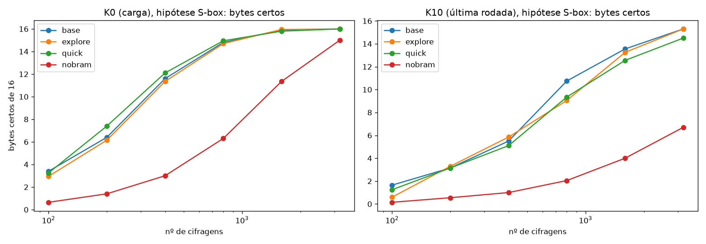

# Relatório final: simulação de ataque por energia e contramedidas em FPGA (projeto SMA)

Gerado automaticamente em 22/10/2026 08:48. Todos os números vêm de simulação; **nenhuma medição física foi feita**.

## 1. Ambiente

| Item | Versão |
|---|---|
| Python | 3.13.15 (NumPy 2.5.3) |
| GHDL | GHDL 6.0.0 (6.0.0.r0.ge589c698c.dirty) [Dunoon edition] |
| Vivado | vivado v2025.2 (64-bit) |
| Dispositivo alvo | XC7Z020 (Zynq-7000), clock de teste de 10 ns |

## 2. Testes automáticos

```
----------------------------------------------------------------------
Ran 17 tests in 0.710s
OK
```

Cobertura: AES contra o FIPS-197 e inversão do escalonamento de chave; controles negativos (traços embaralhados, ruído enorme, outra chave, ciclo errado, TVLA nulo); funções de análise sobre vazamento sintético; leitura do CSV do Vivado; e **estados do VHDL no GHDL iguais aos do modelo Python** (200 cifragens, todos os ciclos).

## 3. Baseline sintético (alvo A em Python e alvo B em VHDL)

Alvo: AES-128 iterativo, uma rodada por ciclo, sem proteção. Modelo: distância de Hamming do registrador de estado de 128 bits + ruído gaussiano (σ base = 10.0). TTD90 = menor N da grade com ≥ 90% de sucesso da chave inteira (40 repetições; grade [50, 100, 200, 400, 800, 1600, 3200, 6400]).

| Experimento | TTD90 |
|---|---|
| E1 base (última rodada, σ=10.0) | 3200 |
| E2 σ=0.0 | 800 |
| E2 σ=5.0 | 1600 |
| E2 σ=10.0 | 3200 |
| E2 σ=20.0 | acima da grade |
| E3 modelo errado (HW no lugar de HD) | acima da grade |
| E4 carga inicial (K0) | 6400 |
| E5 quantização 8 bits | 3200 |
| E5 quantização 4 bits | 3200 |
| E5 quantização 2 bits | 6400 |
| E6 TVLA, máx \|t\| (limite 4,5) | 92.7 |
| Alvo B (VHDL/GHDL), σ=10.0 | 3200 |

Ressalva: com poucas repetições a taxa em N intermediário varia ±0,1 (uma checagem com 300 repetições deu ≈ 0,66 em N=1.600, contra 0,85 com 40). O σ é escolhido por nós.

## 4. Alvo no Vivado: implementação, simulação temporizada e potência estimada

Fluxo: VHDL → síntese e implementação (XC7Z020) → netlist Verilog com atrasos (SDF) → simulação temporizada no xsim → um SAIF por janela de 10 ns alinhada às bordas de clock → `read_saif` + `report_power` (XML, corrente Vccint com resolução de µA). Janelas por cifragem: 0 = limpeza, 1 = carga (ciclo 0), 2 a 11 = rodadas 1 a 10.

**Custo por compilação (relatórios do Vivado):**

| compilação | LUTs | FFs | BRAM (tiles) | WNS (ns) @10 ns | potência total (W) | dinâmica (W) |
|---|---|---|---|---|---|---|
| base | 748 | 278 | 4.5 | 1.926 | 0.154 | 0.051 |
| explore | 748 | 278 | 4.5 | 1.926 | 0.154 | 0.051 |
| nobram | 1251 | 422 | 0.0 | 3.288 | 0.149 | 0.045 |
| quick | 753 | 278 | 4.5 | 1.207 | 0.155 | 0.051 |

A potência dessa tabela é a estimativa sem atividade de simulação (vetorless), só serve como custo relativo.

**Primeiro lote (499 cifragens, compilação base): ataque CPA sobre a corrente dinâmica Vccint.**

| hipótese | janela | ρ médio do palpite certo | bytes certos com N = 100 / 200 / 300 / 499 |
|---|---|---|---|
| reg_load | 1 | +0.091 | 1 / 3 / 2 / 1 |
| sbox_load | 1 | +0.175 | 2 / 7 / 8 / 12 |
| reg_last | 11 | +0.023 | 1 / 1 / 1 / 1 |
| sbox_last | 11 | +0.166 | 0 / 1 / 3 / 5 |

Hipóteses: `reg_*` = distância de Hamming do registrador; `sbox_*` = transição da saída combinacional da S-box (`sbox_load`: SB(0)=0x63 → SB(pt⊕k); `sbox_last`: SB(s9) → SB(ct)). **Achados:** (1) o vazamento do registrador na última rodada não aparece nesse modelo de potência; (2) a lógica combinacional da S-box vaza; (3) a corrente do trilho da BRAM (Vccbram) é constante, isto é, o modelo do Vivado não faz a BRAM depender dos dados.

## 5. Rodada noturna (N = 5000 cifragens por variante)

Estado das variantes: base OK; explore OK; aggressive FALHA_IMPL; quick OK; nobram OK

- Conferência funcional (base): 4999 cifragens; estados iguais ao modelo Python em todos os ciclos: True
- Conferência funcional (explore): 4999 cifragens; estados iguais ao modelo Python em todos os ciclos: True
- Conferência funcional (nobram): 4999 cifragens; estados iguais ao modelo Python em todos os ciclos: True
- Conferência funcional (quick): 4999 cifragens; estados iguais ao modelo Python em todos os ciclos: True


Cifragens por variante: 5000. Janelas: [1, 11]. Métrica de potência: corrente dinâmica Vccint (A).

### Força do vazamento e ataque, por variante e hipótese

| variante | hipótese | janela | ρ médio do palpite certo | ρ mínimo | bytes certos (todas as cifragens) | N estimado (ρ médio) | N estimado (ρ mín.) | TTD90 (grade) |
|---|---|---|---|---|---|---|---|---|
| base | reg_load | 1 | +0.088 | +0.039 | 7/16 | 3569 | 17831 | None |
| base | sbox_load | 1 | +0.184 | +0.099 | 16/16 | 805 | 2782 | 1600 |
| base | reg_last | 11 | +0.047 | -0.016 | 1/16 | 12570 | 27661921999673 | None |
| base | sbox_last | 11 | +0.174 | +0.114 | 15/16 | 898 | 2129 | None |
| explore | reg_load | 1 | +0.088 | +0.039 | 7/16 | 3569 | 17831 | None |
| explore | sbox_load | 1 | +0.184 | +0.099 | 16/16 | 805 | 2782 | 1600 |
| explore | reg_last | 11 | +0.047 | -0.016 | 1/16 | 12570 | 27661921999673 | None |
| explore | sbox_last | 11 | +0.174 | +0.114 | 15/16 | 898 | 2129 | None |
| quick | reg_load | 1 | +0.089 | +0.046 | 10/16 | 3455 | 13089 | None |
| quick | sbox_load | 1 | +0.188 | +0.106 | 16/16 | 771 | 2439 | 3200 |
| quick | reg_last | 11 | +0.049 | -0.018 | 2/16 | 11394 | 27661921999673 | None |
| quick | sbox_last | 11 | +0.166 | +0.091 | 15/16 | 984 | 3337 | None |
| nobram | reg_load | 1 | +0.210 | +0.130 | 16/16 | 613 | 1632 | None |
| nobram | sbox_load | 1 | +0.105 | +0.080 | 16/16 | 2508 | 4275 | None |
| nobram | reg_last | 11 | +0.200 | +0.121 | 16/16 | 677 | 1861 | 1600 |
| nobram | sbox_last | 11 | +0.074 | +0.035 | 10/16 | 5031 | 22138 | None |

### Variação da corrente entre cifragens (mesma janela)

| variante | janela | média (mA) | desvio (µA) | valores distintos |
|---|---|---|---|---|
| base | 1 | 51.576 | 1246.1 | 3066 |
| base | 11 | 50.935 | 1193.1 | 3011 |
| explore | 1 | 51.576 | 1246.1 | 3066 |
| explore | 11 | 50.935 | 1193.1 | 3011 |
| quick | 1 | 52.231 | 1215.1 | 3059 |
| quick | 11 | 47.725 | 1111.7 | 2903 |
| nobram | 1 | 60.754 | 2130.8 | 3694 |
| nobram | 11 | 72.939 | 2054.5 | 3730 |

### Correlação entre variantes nas mesmas cifragens

| par | correlação |
|---|---|
| base x explore (janela 1) | +1.000 |
| base x quick (janela 1) | +0.921 |
| base x nobram (janela 1) | +0.551 |
| explore x quick (janela 1) | +0.921 |
| explore x nobram (janela 1) | +0.551 |
| nobram x quick (janela 1) | +0.547 |
| base x explore (janela 11) | +1.000 |
| base x quick (janela 11) | +0.888 |
| base x nobram (janela 11) | +0.432 |
| explore x quick (janela 11) | +0.888 |
| explore x nobram (janela 11) | +0.432 |
| nobram x quick (janela 11) | +0.430 |

### Curvas (taxa de sucesso da chave inteira por N e bytes certos médios)

- **base / reg_load**: N=100: 0.00 (0.9/16), N=200: 0.00 (1.3/16), N=400: 0.00 (1.3/16), N=800: 0.00 (2.0/16), N=1600: 0.00 (3.4/16), N=3200: 0.00 (4.7/16)
- **base / sbox_load**: N=100: 0.00 (3.4/16), N=200: 0.00 (6.4/16), N=400: 0.00 (11.6/16), N=800: 0.30 (14.8/16), N=1600: 0.90 (15.9/16), N=3200: 1.00 (16.0/16)
- **base / reg_last**: N=100: 0.00 (1.1/16), N=200: 0.00 (1.0/16), N=400: 0.00 (1.2/16), N=800: 0.00 (1.1/16), N=1600: 0.00 (1.1/16), N=3200: 0.00 (1.3/16)
- **base / sbox_last**: N=100: 0.00 (1.6/16), N=200: 0.00 (3.1/16), N=400: 0.00 (5.5/16), N=800: 0.00 (10.8/16), N=1600: 0.10 (13.6/16), N=3200: 0.35 (15.3/16)
- **explore / reg_load**: N=100: 0.00 (1.0/16), N=200: 0.00 (1.2/16), N=400: 0.00 (1.6/16), N=800: 0.00 (2.2/16), N=1600: 0.00 (2.5/16), N=3200: 0.00 (4.6/16)
- **explore / sbox_load**: N=100: 0.00 (3.0/16), N=200: 0.00 (6.2/16), N=400: 0.00 (11.3/16), N=800: 0.20 (14.7/16), N=1600: 0.95 (15.9/16), N=3200: 1.00 (16.0/16)
- **explore / reg_last**: N=100: 0.00 (1.1/16), N=200: 0.00 (1.1/16), N=400: 0.00 (1.1/16), N=800: 0.00 (1.2/16), N=1600: 0.00 (1.2/16), N=3200: 0.00 (1.5/16)
- **explore / sbox_last**: N=100: 0.00 (0.6/16), N=200: 0.00 (3.3/16), N=400: 0.00 (5.8/16), N=800: 0.00 (9.1/16), N=1600: 0.00 (13.2/16), N=3200: 0.35 (15.3/16)
- **quick / reg_load**: N=100: 0.00 (0.9/16), N=200: 0.00 (1.4/16), N=400: 0.00 (1.4/16), N=800: 0.00 (2.0/16), N=1600: 0.00 (3.1/16), N=3200: 0.00 (5.0/16)
- **quick / sbox_load**: N=100: 0.00 (3.2/16), N=200: 0.00 (7.4/16), N=400: 0.00 (12.1/16), N=800: 0.30 (14.9/16), N=1600: 0.80 (15.8/16), N=3200: 1.00 (16.0/16)
- **quick / reg_last**: N=100: 0.00 (1.2/16), N=200: 0.00 (1.1/16), N=400: 0.00 (1.2/16), N=800: 0.00 (1.2/16), N=1600: 0.00 (1.6/16), N=3200: 0.00 (1.9/16)
- **quick / sbox_last**: N=100: 0.00 (1.2/16), N=200: 0.00 (3.1/16), N=400: 0.00 (5.1/16), N=800: 0.00 (9.3/16), N=1600: 0.00 (12.6/16), N=3200: 0.20 (14.5/16)
- **nobram / reg_load**: N=100: 0.00 (2.1/16), N=200: 0.00 (4.4/16), N=400: 0.00 (8.8/16), N=800: 0.00 (12.7/16), N=1600: 0.20 (14.6/16), N=3200: 0.65 (15.7/16)
- **nobram / sbox_load**: N=100: 0.00 (0.7/16), N=200: 0.00 (1.4/16), N=400: 0.00 (3.0/16), N=800: 0.00 (6.3/16), N=1600: 0.00 (11.3/16), N=3200: 0.30 (15.0/16)
- **nobram / reg_last**: N=100: 0.00 (3.4/16), N=200: 0.00 (8.1/16), N=400: 0.05 (13.1/16), N=800: 0.65 (15.7/16), N=1600: 1.00 (16.0/16), N=3200: 1.00 (16.0/16)
- **nobram / sbox_last**: N=100: 0.00 (0.1/16), N=200: 0.00 (0.6/16), N=400: 0.00 (1.0/16), N=800: 0.00 (2.0/16), N=1600: 0.00 (4.0/16), N=3200: 0.00 (6.7/16)

Leitura: ρ é a correlação do palpite certo; 'N estimado' usa N ≈ 3 + 8·(z/ln((1+ρ)/(1−ρ)))² com z = 3,719 e vale só como ordem de grandeza (hipótese gaussiana).
Todos os resultados vêm da estimativa de potência do Vivado (SAIF da simulação temporizada), não de medição física.




## 6. O que se pode afirmar e o que não

- **Funcional (verificado):** alvo AES em Python, em VHDL (GHDL) e no netlist temporizado do Vivado produzem os mesmos estados em todos os ciclos; ataque CPA recupera a chave nos três contextos quando há hipótese compatível com a fonte de vazamento.
- **O modelo simples do baseline (só o registrador) não representa a estimativa do Vivado.** No modelo da AMD, o vazamento relevante está na lógica combinacional da S-box. Contramedidas e variantes devem ser avaliadas com hipóteses sobre essa lógica.
- **Limites:** potência é estimativa do Vivado (SAIF da simulação temporizada), não medição; ruído de medição e rede de alimentação não são modelados; uma única família de FPGA e um único alvo; as hipóteses `sbox_*` foram formuladas depois de ver o primeiro lote; resultados de N pequeno variam entre repetições.
- **Não validado:** efeito da reconfiguração parcial real (modelada como troca de conjuntos de traços), desempenho em placa, ataques com alinhamento (DTW, janela deslizante) contra clock aleatório.

Análise detalhada dos resultados da rodada noturna: [ANALISE_RESULTADOS.md](ANALISE_RESULTADOS.md).

## 7. Como reproduzir

```bash
cd PI/simulacao/baseline
python -m unittest discover -s tests -v          # testes
python run_experiments.py                         # baseline sintético
python vhdl_flow.py --n 20000 --sigma 10          # alvo VHDL no GHDL
cd ../vivado
bash overnight/run_overnight.sh 5000 1,11         # compilações, simulação temporizada, potência e análise
python ../baseline/build_report.py 5000           # este relatório
```

Arquivos principais: `PI/simulacao/baseline/` (modelo, ataque, métricas, testes), `PI/simulacao/vhdl/` (alvo B), `PI/simulacao/vivado/` (scripts Tcl, testbench Verilog, rodada noturna), e os planos em `PI/*.md`.
